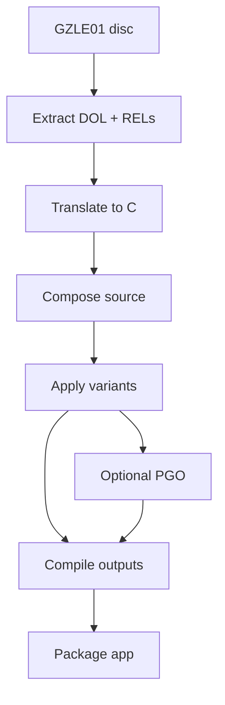
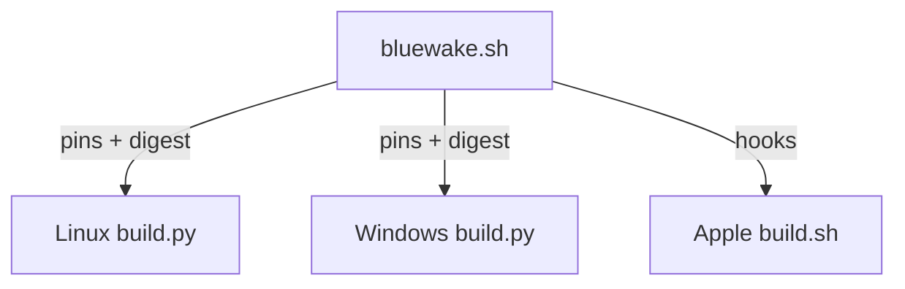
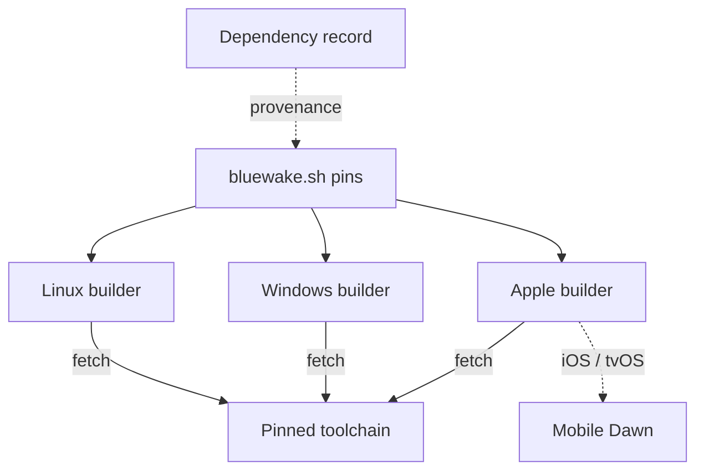
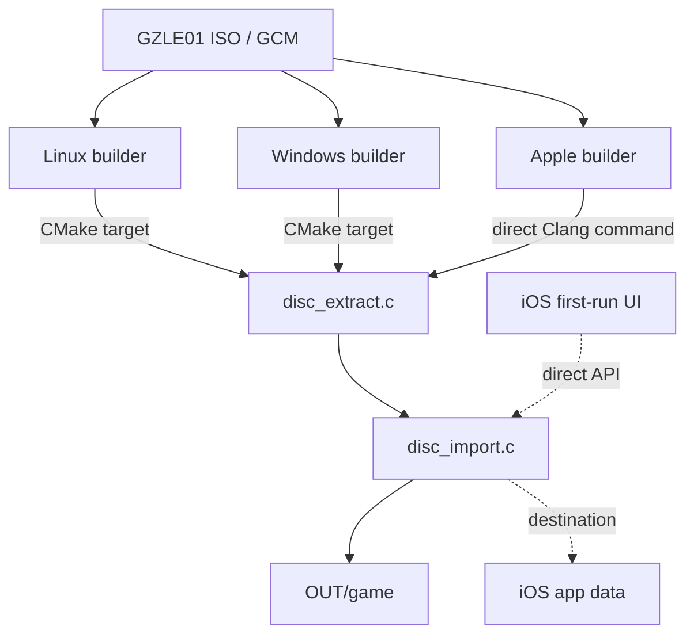
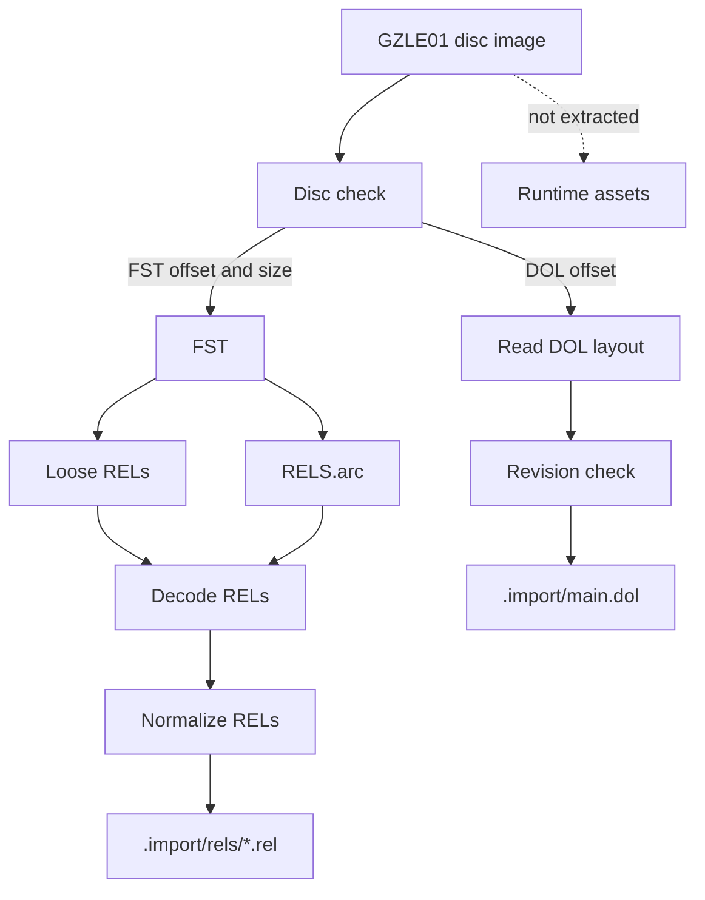
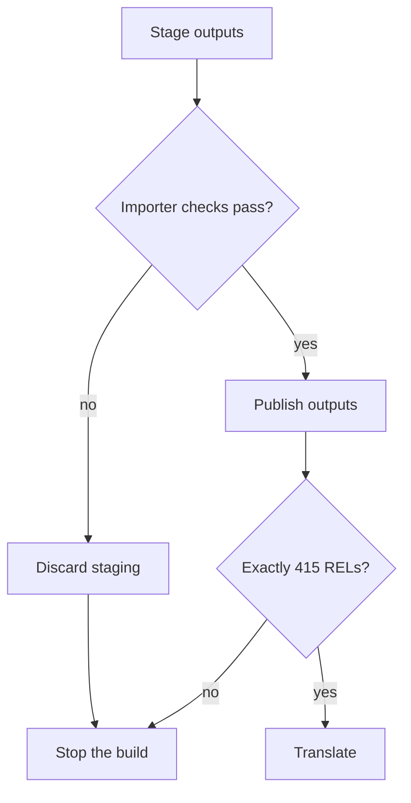
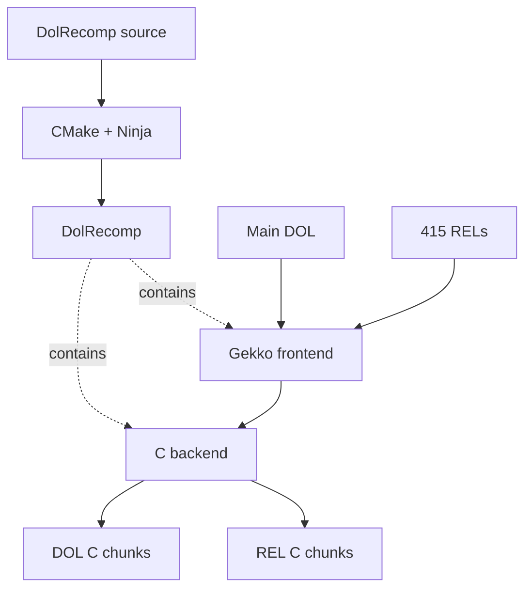
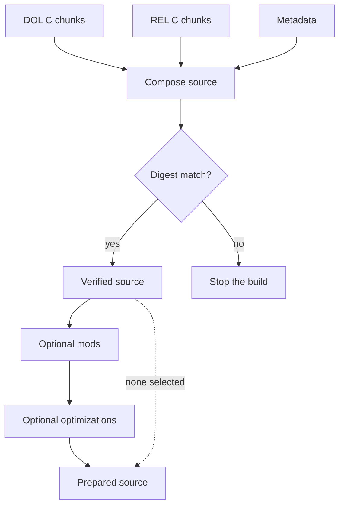
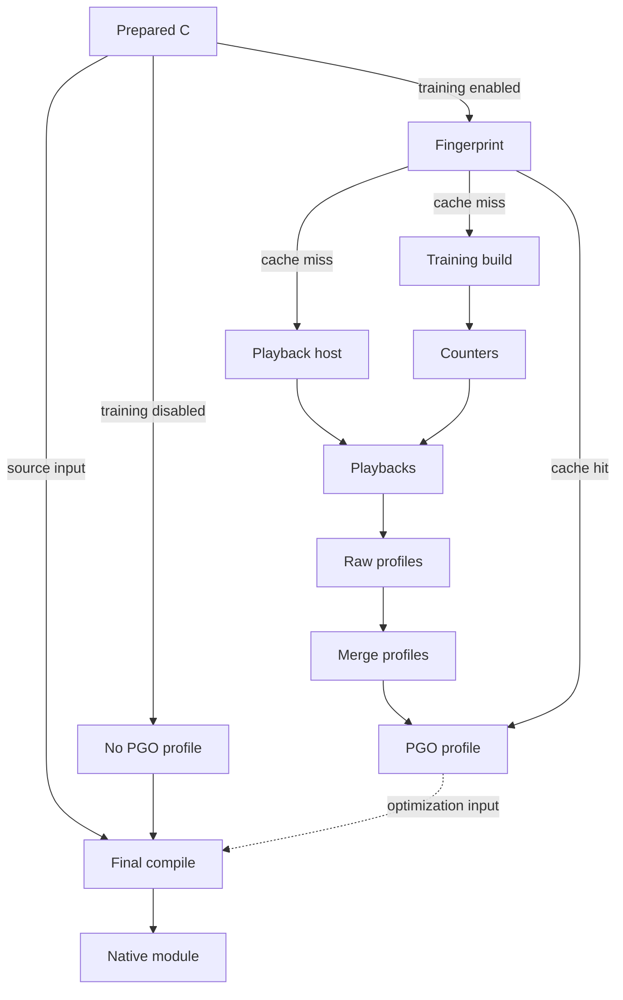
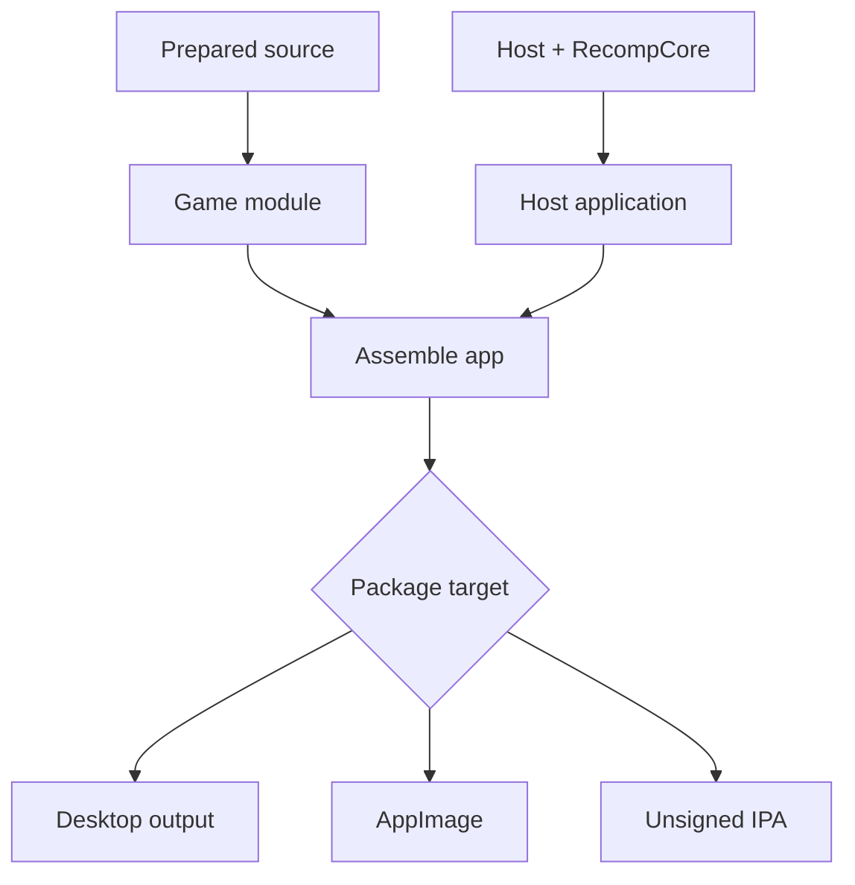

# BlueWake build process

## Contents

- [End-to-end overview](#end-to-end-overview)
- [Build toolchain overview](#build-toolchain-overview)
  - [Concepts](#concepts)
  - [Artifact-to-game examples](#artifact-to-game-examples)
- [1. Coordinate](#1-coordinate)
  - [`bluewake.sh` game profile](#bluewakesh-game-profile)
  - [Linux builder](#linux-builder)
  - [Windows builder](#windows-builder)
  - [Apple builder](#apple-builder)
- [2. Fetch](#2-fetch)
  - [Dependency declarations](#dependency-declarations)
  - [RecompCore and DolRecomp checkout](#recompcore-and-dolrecomp-checkout)
  - [Apple Dawn package](#apple-dawn-package)
- [3. Extract](#3-extract)
  - [Input and platform paths](#input-and-platform-paths)
  - [Shared extraction](#shared-extraction)
- [4. Translate](#4-translate)
  - [Translation pipeline](#translation-pipeline)
- [5. Compose and prepare](#5-compose-and-prepare)
  - [Generate the composite source](#generate-the-composite-source)
  - [Apply mods and optimizations](#apply-mods-and-optimizations)
- [6. Train](#6-train)
  - [Training pipeline](#training-pipeline)
- [7. Compile and package](#7-compile-and-package)
  - [Linux](#linux-x86-64)
  - [Windows](#windows-x86-64)
  - [macOS](#macos-apple-silicon)
  - [iPhone and iPad](#iphone-and-ipad-iosipados-arm64)
  - [Apple TV](#apple-tv-tvos-arm64-experimental)
  - [Android](#android-in-progress)

Architecture path: [Overview](Overview.md) → **Build process**

This chapter expands the build-time half of the
[architecture overview](Overview.md). It follows the player's disc through
validation, translation, preparation, native compilation, and packaging.

## End-to-end overview

The direct path skips profile-guided training. Both paths produce a platform
host and a separate native module containing the translated game code.

## Build toolchain overview

### Concepts

- [RecompCore](https://github.com/chrissotraidis/RecompCore) — the lower-level static-recompilation foundation inherited from the Wind Waker Recomp lineage. BlueWake fetches a tested RecompCore revision into `ROOT/ref/recompcore` and uses its GXRuntime, Aurora renderer, DSP support, CPU/runtime interfaces, and DolRecomp submodule. BlueWake adds the `GZLE01` build profile, composite preparation, mods, platform applications, packaging, and game-specific host integration; runtime changes are developed in RecompCore and then adopted by updating BlueWake's pin.

- [Build profile](../../scripts/builder/profiles/bluewake.sh) — game-specific configuration and hooks, not performance data. `bluewake.sh` defines the supported game, dependency pins, expected generated-source digest, output names, and Apple build hooks.

- [DOL](https://wiibrew.org/wiki/DOL) — the GameCube's main executable format. BlueWake extracts `main.dol` alongside 415 loadable REL modules before translating either kind of code.

- [File-system table (FST)](https://www.gc-forever.com/yagcd/chap13.html#sec13.4) — the GameCube disc directory: fixed-size file and directory entries followed by their names. The disc header gives BlueWake its offset and size; the importer walks it to locate loose RELs and `RELS.arc` without unpacking the whole disc.

- [REL](https://wiibrew.org/wiki/REL) — a relocatable GameCube executable module, similar in purpose to a dynamic library. Wind Waker loads and unloads these modules as their code and data are needed; BlueWake extracts all 415 RELs, translates each one, and combines them with the DOL translation while retaining their module metadata.

- [RARC](https://wiki.cloudmodding.com/zgcn/ARC) — a Nintendo archive container identified by the `RARC` signature. Wind Waker stores many of its REL modules inside `RELS.arc`; BlueWake reads its file table and extracts only `.rel` members.

- [Yaz0](https://www.gc-forever.com/yagcd/chap16.html#sec16.2) — a Nintendo compression format identified by the `Yaz0` signature. `RELS.arc`, loose RELs, and archive members may use it, so BlueWake decodes each applicable layer before passing uniform module bytes to DolRecomp.

- [DolRecomp](https://github.com/elliotttate/DolRecomp) — the ahead-of-time translator. It converts PowerPC instructions from the DOL and RELs into C while preserving guest CPU and address semantics; it does not reconstruct Nintendo's original source.

- [Composite generation](../../scripts/generate_composite.py) — combines the separately translated main DOL and all 415 RELs into one deterministic source tree, with a shared dispatcher and ABI tables for building one native game module. “Composite” here means composing translated program units, not combining rendered images; BlueWake verifies the generated tree against the profile's expected digest before modifying or compiling it.

- [Profile-guided optimization (PGO)](../../scripts/linux/build.py) (`compile_module`) — PGO uses recorded execution counts to help the final compiler optimize frequently executed translated paths. The resulting `.profdata` is a compiler input, separate from the build profile above.

- [Training](../../scripts/linux/build.py) (`train`) — deterministic headless game playbacks used to produce PGO counters, not machine learning. Builders merge the raw counters with `llvm-profdata` and keep game-derived profiles in the private build directory.

`OUT` below is the exact output directory passed to the selected builder with
`--out`; build artifacts are expressed relative to it. `ROOT` is the repository
checkout and prefixes shared dependency caches that intentionally live outside
`OUT`.

| Stage | Main code or tool | What it does | Result | Artifact |
| --- | --- | --- | --- | --- |
| Coordinate | [Platform builders](#1-coordinate) and [`bluewake.sh`](../../scripts/builder/profiles/bluewake.sh) | Selects the target, inputs, options, and ordered build stages. | Ordered build with pinned inputs and provenance | Build logs under `OUT/logs/` |
| Fetch | Git and [`bluewake.sh`](../../scripts/builder/profiles/bluewake.sh) | Retrieves and verifies the exact runtime and translator revisions. | Exact RecompCore and DolRecomp source | Checkout under `ROOT/ref/recompcore/` |
| Extract | [Platform builders](#3-extract) | Confirms the supported disc and separates the code inputs needed for translation. | Validated DOL and RELs; the original disc remains an external runtime input | `OUT/game/main.dol` and `OUT/game/rels/` |
| Translate | [Pinned DolRecomp](https://github.com/elliotttate/DolRecomp/commit/b8b534591cba8ca7cd43943a655ee6e2591cf5de) | Converts the game's PowerPC machine code into compilable C. | Generated C for PowerPC code | Generated tree under `OUT/translated/` |
| Compose and prepare | [`generate_composite.py`](../../scripts/generate_composite.py) and [mod scripts](../../scripts/mods) | Joins translated units and applies selected, guarded source variants. | Verified composite source and selected variants | `OUT/composite-src/` and its digest files |
| Train | [Platform PGO paths](#6-train) and `llvm-profdata` | Records representative execution frequencies for compiler optimization. | Optional local optimization profile | `OUT/pgo-local/composite.profdata` or `OUT/composite.profdata` |
| Compile and package | [CMake targets and platform packagers](#7-compile-and-package) | Produces native binaries and arranges them for the target platform. | Native module and platform application | [Platform artifact paths](#7-compile-and-package) |

### Artifact-to-game examples

Build artifacts are not guest objects that gameplay modifies directly. This
table instead shows which player-visible behavior each artifact enables once
it is consumed by a later build stage or loaded at runtime. The cited PR is a
concrete BlueWake contribution that created, validated, or exercised that
artifact; it need not be the artifact's historical origin.

| Artifact | Player-visible use | How it reaches the game | Example project contribution |
| --- | --- | --- | --- |
| Build logs and provenance | A developer can reproduce and diagnose the exact build that a player tested. | Builders record selected inputs, stages, tool output, and native artifacts under `OUT`. | [PR #254](https://github.com/chrissotraidis/bluewake/pull/254) makes the Linux build environment reproducible and shared with CI. |
| Pinned RecompCore and DolRecomp checkout | Every translated action and compatibility service uses the selected translator/runtime behavior. | DolRecomp generates the game code; RecompCore supplies guest CPU, services, graphics, DSP, and host interfaces. | [PR #353](https://github.com/chrissotraidis/bluewake/pull/353) advances the runtime pin so a resized Vulkan window keeps drawing. |
| Extracted `main.dol` and RELs | The title flow, Link's actions, scenes, actors, and other original routines remain available for translation. | Extraction supplies the executable and 415 relocatable modules without changing the player's disc. | [PR #37](https://github.com/chrissotraidis/bluewake/pull/37) consolidated the shared extraction and build pipeline used by the current module. |
| DolRecomp-generated C | Original PowerPC routines execute as compiled native functions. | The compiler turns mechanically translated DOL and REL functions into the game module. | [PR #37](https://github.com/chrissotraidis/bluewake/pull/37) integrated the translated module and its cross-platform host contract. |
| Composite source and metadata | Calls, returns, callbacks, and scene-module transitions resolve across DOL and REL code. | Composite generation joins translated units with dispatch, data-image, alias, and ABI metadata. | [PR #211](https://github.com/chrissotraidis/bluewake/pull/211) exercises this boundary by preserving the correct translated return path around a DVD callback. |
| PGO profile | Frequently exercised training routes can be optimized without changing guest-visible behavior. | Clang consumes merged execution counts while compiling the final translated module. | [PR #243](https://github.com/chrissotraidis/bluewake/pull/243) preserves the existing profile when a host-only change rebuilds the app. |
| Native game module and platform host | Starting BlueWake loads translated gameplay and connects it to windows, input, audio, files, and graphics. | The host dynamically loads the module and coordinates its shared guest state. | [PR #254](https://github.com/chrissotraidis/bluewake/pull/254) validates this Linux build in the same container used by CI. |
| Packaged Linux AppImage | A Linux or SteamOS player launches the assembled host, module, and support files as one application. | AppImage packaging arranges the already-built runtime without including private game data in CI. | [PR #217](https://github.com/chrissotraidis/bluewake/pull/217) adds SteamOS-compatible AppImage packaging validation. |

## 1. Coordinate

### `bluewake.sh` game profile

[`scripts/builder/profiles/bluewake.sh`](../../scripts/builder/profiles/bluewake.sh)
is sourced configuration and shell functions, not a standalone builder.

| Stage | What it does | Result | Artifact/output | Code reference |
| --- | --- | --- | --- | --- |
| Describe the game | Defines the game ID, bundle ID, module name, default output, and PGO inputs. | One shared game and application identity | `PROFILE_*` variables | [Profile variables](../../scripts/builder/profiles/bluewake.sh#L20-L35) |
| Pin dependencies | Selects exact RecompCore and DolRecomp revisions and verifies the Dawn archive by checksum. | Reproducible dependency inputs | `RECOMPCORE_SHA`, `DOLRECOMP_SHA`, `DAWN_SHA256` | [Dependency pins](../../scripts/builder/profiles/bluewake.sh#L37-L44) |
| Guard generation | Records the accepted digest for the unmodified generated composite. | Builders reject unexpected translator or disc output. | `COMPOSITE_DIGEST` | [Digest and verification](../../scripts/builder/profiles/bluewake.sh#L45-L190) |
| Define Apple hooks | Implements dependency, extraction, translation, generation, mod, compile, and app functions. | The generic Apple pipeline can build BlueWake without game-specific logic. | `profile_*` shell functions | [Profile hooks](../../scripts/builder/profiles/bluewake.sh#L49-L317) |

Linux and Windows parse the shared pin and digest values directly. The Apple
builder sources the file and invokes its hook functions.

### Linux builder

[`scripts/linux/build.py`](../../scripts/linux/build.py) owns the Linux x86-64
pipeline.

| Stage | What it does | Result | Artifact/output | Code reference |
| --- | --- | --- | --- | --- |
| Check environment | Verifies Clang, LLD, `llvm-profdata`, CMake, Ninja, Git, and Python. `--ci-container` builds the shared image and reinvokes the builder inside it. | Native or containerized Linux toolchain ready | Stage logs under `OUT/logs/` | [`run_in_ci_container`](../../scripts/linux/build.py), [`check_tools`](../../scripts/linux/build.py) |
| Prepare inputs | Fetches pinned dependencies, validates the disc, and extracts `main.dol` plus 415 RELs. | Verified source inputs | `ROOT/ref/recompcore/` and `OUT/game/` | [`dependencies`](../../scripts/linux/build.py), [`disc` and `extract`](../../scripts/linux/build.py) |
| Generate source | Builds DolRecomp, translates DOL/REL code, verifies the composite digest, and applies selected mods and guarded preparations. | Compilable prepared composite | `OUT/translated/` and `OUT/composite-src/` | [`build_dolrecomp` through `generate`](../../scripts/linux/build.py), [`build_mods` and preparation](../../scripts/linux/build.py) |
| Train | Builds an instrumented module, runs headless playbacks, and merges profiles unless training is skipped or reused. | Local optimization profile | `OUT/pgo-local/composite.profdata` | [`train`](../../scripts/linux/build.py) |
| Compile and assemble | Compiles the game module and host, then copies game inputs, DSP data, and provenance into the app folder. | Runnable Linux folder | `OUT/BlueWake/bluewake` and `OUT/BlueWake/gGZLE01_recomp.so` | [`compile_module`](../../scripts/linux/build.py), [`build_app` and `package`](../../scripts/linux/build.py) |
| Package AppImage | With `--appimage`, packages and audits the assembled outputs. | Portable Linux package | `OUT/BlueWake-x86_64.AppImage` | [`package_appimage`](../../scripts/linux/build.py) |

### Windows builder

[`scripts/windows/build.py`](../../scripts/windows/build.py) provides the
Windows x86-64 pipeline.

| Stage | What it does | Result | Artifact/output | Code reference |
| --- | --- | --- | --- | --- |
| Check environment | Verifies Visual Studio's LLVM/Clang, the Windows SDK, CMake, Ninja, and Git. | Windows toolchain ready | Stage logs under `OUT/logs/` | [`check_tools` and Visual Studio environment](../../scripts/windows/build.py) |
| Prepare inputs | Converts supported Dolphin formats through pinned `nodtool`, validates the disc, and extracts the DOL and 415 RELs. | Verified source inputs | Converted ISO when needed and `OUT/game/` | [`dependencies` and `disc`](../../scripts/windows/build.py), [`extract`](../../scripts/windows/build.py) |
| Generate source | Builds DolRecomp, translates the DOL/REL code, verifies the composite, and applies requested mod variants. | Compilable prepared composite | `OUT/translated/` and `OUT/composite-src/` | [`build_dolrecomp` through `generate`](../../scripts/windows/build.py), [`build_mods` and preparation](../../scripts/windows/build.py) |
| Train | Builds an instrumented module, runs headless playbacks, and merges or reuses the local profile. | Local optimization profile | `OUT/pgo-local/composite.profdata` | [`train`](../../scripts/windows/build.py) |
| Compile | Compiles the translated module and Windows host with the selected profile. | Native Windows binaries | `OUT/composite/gGZLE01_recomp.dll` and `OUT/app/BlueWake.exe` | [`compile_module`](../../scripts/windows/build.py), [`build_app`](../../scripts/windows/build.py) |
| Assemble | Copies Dawn, SDL, DSP, game inputs, runtime DLLs, and provenance into one folder. | Directly runnable Windows build | `OUT/BlueWake/` | [`package`](../../scripts/windows/build.py) |

### Apple builder

[`scripts/builder/build.sh`](../../scripts/builder/build.sh) is the generic
pipeline for macOS, iOS/iPadOS, and tvOS.

| Stage | What it does | Result | Artifact/output | Code reference |
| --- | --- | --- | --- | --- |
| Select target | Parses signing, PGO, optimization, packaging, and device options; selects `macosx`, `iphoneos`, or `appletvos`. | Configured Apple build | Selected Xcode SDK and `OUT/logs/` | [Argument and SDK selection](../../scripts/builder/build.sh) |
| Load profile | Sources `bluewake.sh`, checks Xcode/CMake/Ninja, and calls its dependency, extraction, translation, generation, and mod hooks. | Verified prepared composite | `ROOT/ref/recompcore/`, `OUT/game/`, and `OUT/composite-src/` | [Profile loading](../../scripts/builder/build.sh), [pipeline hooks](../../scripts/builder/build.sh) (steps 1/9 to 6/9) |
| Train | Optionally invokes the profile's local training hook and merges the recorded profile. | Local optimization profile | `OUT/composite.profdata` | [Training dispatch](../../scripts/builder/build.sh) (the local optimization training step), [`profile_train`](../../scripts/builder/profiles/bluewake.sh) |
| Compile module | Calls the profile compile hook for the selected SDK and architecture. | Native translated module | `OUT/composite-{ios,macos,tvos}/gGZLE01_recomp.dylib` | [Compile stage](../../scripts/builder/build.sh) (step 7/9), [`profile_compile`](../../scripts/builder/profiles/bluewake.sh) |
| Build and sign app | Builds or imports the app, embeds the module, records module optimizations, and signs the module and bundle. | Installable target app | `OUT/app/BlueWake.app`, `OUT/app-tvos/BlueWake.app`, or `OUT/app-macos/host/BlueWake.app` | [Build, embed, and sign](../../scripts/builder/build.sh) (step 8/9) |
| Package | Creates macOS `BlueWake.app` or an optional unsigned IPA. IPA staging removes signing material and rejects private game/save/key files. | Distributable package | `OUT/packaged/BlueWake.app`; use `--ipa OUT/BlueWake.ipa` for an IPA under `OUT` | [Packaging and privacy checks](../../scripts/builder/build.sh) (step 9/9) |
| Install | When requested, transfers and launches the supported device build. | Running device installation | Installed app and device launch | [Device installation](../../scripts/builder/build.sh) (`--install`) |

All three builders validate their tools, reuse safe intermediates, and record
provenance. Platform options change compilation and packaging, not the
supported game revision.

## 2. Fetch

Each platform has a separate implementation that produces the same pinned
RecompCore and DolRecomp checkout. Apple's dependency hook also fetches the
verified mobile Dawn archive for iOS and tvOS. The hook performs that fetch
after the checkout, but this is execution order rather than a dependency:
Dawn does not consume the RecompCore checkout. macOS performs no additional
Dawn fetch here because desktop Aurora resolves its macOS package later.

### Dependency declarations

The build profile is the source builders execute or parse. The lock file is a
repository-wide provenance and audit record; it does not drive these fetches.

| Stage | What it does | Result | Artifact/output | Code reference |
| --- | --- | --- | --- | --- |
| Declare executable pins | Records the RecompCore URL and revision, DolRecomp revision, and Dawn URL/checksum used by the builders. | One dependency selection across platforms | `RECOMPCORE_*`, `DOLRECOMP_SHA`, `DAWN_*` | [Build-profile pins](../../scripts/builder/profiles/bluewake.sh) |
| Record dependency provenance | Documents dependency origins, licenses, roles, exact revisions, local paths, and patch history for audits. | Reviewable dependency inventory | `config/dependencies.lock.json` | [Dependency lock](../../config/dependencies.lock.json) |

### RecompCore and DolRecomp checkout

Linux, Windows, and Apple implement the same guarded checkout sequence.

| Stage | What it does | Result | Artifact/output | Code reference |
| --- | --- | --- | --- | --- |
| Initialize | Creates `ROOT/ref/recompcore` as a Git checkout only when the path is absent or empty; refuses to replace unrelated files. | Safe checkout location | `ROOT/ref/recompcore/.git/` | [Linux](../../scripts/linux/build.py) (`dependencies`), [Windows](../../scripts/windows/build.py) (`dependencies`), [Apple](../../scripts/builder/profiles/bluewake.sh) (`profile_dependencies`) |
| Fetch RecompCore | Fetches only the pinned SHA without recursively fetching submodules, then checks out `FETCH_HEAD` detached. | Exact runtime source | `ROOT/ref/recompcore/` at `RECOMPCORE_SHA` | [Linux](../../scripts/linux/build.py) (`dependencies`), [Windows](../../scripts/windows/build.py) (`dependencies`), [Apple](../../scripts/builder/profiles/bluewake.sh) (`profile_dependencies`) |
| Fetch DolRecomp | Synchronizes the parent's DolRecomp submodule and initializes its pinned revision with a shallow update. | Exact translator source | `ROOT/ref/recompcore/DolRecomp/` at `DOLRECOMP_SHA` | [Linux](../../scripts/linux/build.py) (`dependencies`), [Windows](../../scripts/windows/build.py) (`dependencies`), [Apple](../../scripts/builder/profiles/bluewake.sh) (`profile_dependencies`) |
| Verify | Checks both HEAD revisions and rejects tracked local modifications before building. | Clean, attributable dependency tree | Successful dependency-stage log | [Linux](../../scripts/linux/build.py) (`dependencies`), [Windows](../../scripts/windows/build.py) (`dependencies`), [Apple](../../scripts/builder/profiles/bluewake.sh) (`profile_dependencies`) |

### Apple Dawn package

macOS lets desktop Aurora resolve its own pinned Dawn package. iOS and tvOS
prepare the mobile archive during the dependency hook.

| Stage | What it does | Result | Artifact/output | Code reference |
| --- | --- | --- | --- | --- |
| Download and verify | Reuses the cached iOS arm64 archive only when its SHA-256 matches; otherwise downloads it and verifies the new file. | Trusted renderer package | `ROOT/build/deps/dawn-ios-arm64.tar.gz` | [Archive fetch](../../scripts/builder/profiles/bluewake.sh) (`profile_dependencies`) |
| Extract | Expands the verified archive when its CMake package is absent. | Dawn headers, libraries, and CMake configuration | `ROOT/build/deps/dawn-ios/` | [iOS extraction](../../scripts/builder/profiles/bluewake.sh) (`profile_dependencies`) |
| Prepare tvOS | Copies the iOS archive, retags its Mach-O platform as tvOS, rebuilds its index, and records the source checksum. | Development tvOS Dawn archive | `ROOT/build/deps/dawn-tvos/` | [tvOS preparation](../../scripts/builder/profiles/bluewake.sh) (`profile_dependencies`) |

## 3. Extract

| Boundary | Shared | Platform-specific |
| --- | --- | --- |
| Input adapter | The extraction tool ultimately receives an uncompressed GZLE01 ISO or GCM. | Builders own paths and preflight checks; Windows may first normalize a supported compressed Dolphin image. |
| Build-time CLI | Every build pipeline compiles the same [`disc_extract.c`](../../scripts/ios/disc_extract.c) wrapper with the same extraction core. | Linux and Windows create the tool through CMake; the Apple profile invokes Clang directly. |
| Extraction core | [`disc_import.c`](../../apple/ios/src/disc_import.c) validates the disc and revision, extracts the DOL and RELs, normalizes them, and publishes the prepared tree. | The iOS first-run UI links this core directly instead of using the command-line wrapper. |
| Caller-owned result | The prepared layout is always `main.dol` plus `rels/*.rel`. | Builders place it under `OUT/game/` and enforce 415 RELs; iOS places it in the app's data container and reports progress through its UI. |

### Input and platform paths

| Stage | What it does | Result | Artifact/output | Code reference |
| --- | --- | --- | --- | --- |
| Linux preflight | Accepts `.iso` or `.gcm`, reads the GameCube header, and rejects the wrong magic, game ID, or revision before extraction. | Confirmed `GZLE01` revision-0 candidate | Original disc path retained as the runtime disc | [`disc`](../../scripts/linux/build.py) |
| Windows preflight | Accepts `.iso` or `.gcm` directly. As an optional convenience, it converts supported compressed Dolphin formats through pinned `nodtool`; it then rejects the wrong magic, game ID, or revision. | Confirmed uncompressed `GZLE01` revision-0 candidate | Original disc path or cached `OUT/disc/GZLE01.iso` | [`disc`](../../scripts/windows/build.py), [`nodtool`](../../scripts/windows/build.py) |
| Apple wrapper | Compiles `disc_extract.c` with the shared importer, runs it on the uncompressed ISO, and checks for exactly 415 REL files. | Native extractor and verified extracted set | `OUT/tools/disc_extract` and `OUT/game/` | [`profile_extract`](../../scripts/builder/profiles/bluewake.sh) |

### Shared extraction

The importer is a selective parser, not a full disc unpacker. It reads offsets
from the GameCube header, extracts only the executable code needed by
DolRecomp, and leaves textures, audio, and other runtime assets on the original
disc image. Wind Waker stores modules both as loose files and inside
`RELS.arc`, so the importer handles the disc file-system table, RARC archives,
and optional Yaz0 compression before producing one uniform REL directory.

**Extraction paths**

Code: [`bluewake_disc_check`](../../apple/ios/src/disc_import.c),
[`bluewake_disc_prepare`](../../apple/ios/src/disc_import.c),
[`unpack_rels_arc`](../../apple/ios/src/disc_import.c), and
[`write_rel`](../../apple/ios/src/disc_import.c).

**Safe publication and builder gate**

Code: [staging, publication, and cleanup](../../apple/ios/src/disc_import.c) (`bluewake_disc_prepare`);
exact-count gates in [Linux](../../scripts/linux/build.py) (`extract`),
[Windows](../../scripts/windows/build.py) (`extract`), and
[Apple](../../scripts/builder/profiles/bluewake.sh) (`profile_extract`).

| Stage | What it does | Result | Artifact/output | Code reference |
| --- | --- | --- | --- | --- |
| Check disc identity | Opens the image, verifies the GameCube magic, and requires game ID `GZLE01`. | Supported game image | Validation result or specific error | [`bluewake_disc_check`](../../apple/ios/src/disc_import.c) |
| Read the executable | Uses the disc header to locate the DOL, reads its section table, and computes the complete executable size. | In-memory main executable | DOL byte buffer | [DOL extraction](../../apple/ios/src/disc_import.c) (`fail`) |
| Verify revision | Computes the DOL SHA-1 and compares it with the supported USA revision-0 value. | Exact supported executable, not only a matching disc ID | Verified DOL digest | [Revision check](../../apple/ios/src/disc_import.c) (`sha1_hex`) |
| Extract modules | Walks the disc file-system table, decompresses loose Yaz0 RELs, locates `RELS.arc`, and unpacks its RARC/Yaz0 members. | Complete translated-code input set | Staged `main.dol` and `rels/*.rel` | [File-system extraction](../../apple/ios/src/disc_import.c) (`fail`), [`unpack_rels_arc`](../../apple/ios/src/disc_import.c) |
| Normalize modules | Sets each extracted REL's alignment field to four, matching the canonical inputs from which BlueWake's composite source is generated. The disc image is not modified. | Consistent REL headers across both disc storage paths | Normalized staged `rels/*.rel` | [`write_rel`](../../apple/ios/src/disc_import.c) |
| Publish outputs | Replaces the previous prepared files only after extraction succeeds; failures remove the temporary files. | Finished prepared game tree | `OUT/game/main.dol` and `OUT/game/rels/` | [Output swap and cleanup](../../apple/ios/src/disc_import.c) (`remove_flat_dir`) |
| Verify module count | Each builder requires exactly 415 extracted RELs before translation begins. | Consistent input set on every platform | Successful extraction-stage log | [Linux](../../scripts/linux/build.py) (`extract`), [Windows](../../scripts/windows/build.py) (`extract`), [Apple](../../scripts/builder/profiles/bluewake.sh) (`profile_extract`) |

These paths are private build intermediates under the caller-selected `OUT`.
Linux and Windows also copy them into `OUT/BlueWake/game/` for the runnable
folder. The AppImage packager does not embed the DOL, RELs, or disc image.

The extracted DOL and RELs are game-derived private inputs. They remain in the
local build tree; the original disc continues to provide runtime assets. See
the platform commands in [`docs/BUILD_YOUR_OWN.md`](../BUILD_YOUR_OWN.md).

## 4. Translate

### Translation pipeline

Each builder compiles the
[pinned DolRecomp revision](https://github.com/elliotttate/DolRecomp)
for its host, then invokes it with `--gamecube --backend c --cpu gekko`.
“GameCube” selects the DOL/REL input rules and Gekko PowerPC model; “C backend”
selects portable C as the translator's output instead of native LLVM objects.

The frontend validates and decodes the executable units into DolRecomp's
internal representation (DolIR). The backend emits split C sources, dispatch
tables, and module metadata that preserve guest operations and addresses. This
is compile-oriented generated code, not reconstructed Nintendo source and not
a component that runs by itself.

The platform compiler does not run in this stage. Section 7 later feeds the
prepared C through Clang to produce an x86-64 or arm64 native game module; the
module uses RecompCore at runtime for architectural state and host services.

References: DolRecomp's pinned [backend overview](https://github.com/elliotttate/DolRecomp/blob/b8b534591cba8ca7cd43943a655ee6e2591cf5de/src/backend/README.md),
[CLI mode selection](https://github.com/elliotttate/DolRecomp/blob/b8b534591cba8ca7cd43943a655ee6e2591cf5de/src/app/cli.c#L14-L33),
and [portable C emitter](https://github.com/elliotttate/DolRecomp/blob/b8b534591cba8ca7cd43943a655ee6e2591cf5de/src/backend/emitter.c).
The table below links the corresponding BlueWake invocation on each platform.

| Stage | What it does | Result | Artifact/output | Code reference |
| --- | --- | --- | --- | --- |
| Build DolRecomp | Configures and compiles the pinned translator with the platform toolchain. | Native translator for the build host | `OUT/dolrecomp/dolrecomp` or `OUT/dolrecomp/dolrecomp.exe` | [Linux](../../scripts/linux/build.py) (`build_dolrecomp`), [Windows](../../scripts/windows/build.py) (`build_dolrecomp`), [Apple](../../scripts/builder/profiles/bluewake.sh) (`profile_translate`) |
| Translate the DOL | Runs the GameCube C backend for Gekko and partitions `main.dol` into 4,096-instruction chunks. | C functions for the main executable | `OUT/translated/dol/generated/` | [Linux](../../scripts/linux/build.py) (`translate`), [Windows](../../scripts/windows/build.py) (`translate`), [Apple](../../scripts/builder/profiles/bluewake.sh) (`profile_translate`) |
| Translate the RELs | Translates all extracted modules with the shared REL address base `0xC0400000`. | C functions and metadata for 415 RELs | `OUT/translated/rels/generated/rels/` | [Linux](../../scripts/linux/build.py) (`translate`), [Windows](../../scripts/windows/build.py) (`translate`), [Apple](../../scripts/builder/profiles/bluewake.sh) (`profile_translate`) |
| Publish the translation | Generates into a temporary tree and replaces the previous output only after both translator runs succeed. | Complete translation from one input set | `OUT/translated/` | [Linux](../../scripts/linux/build.py) (`translate`), [Windows](../../scripts/windows/build.py) (`translate`), [Apple](../../scripts/builder/profiles/bluewake.sh) (`profile_translate`) |

## 5. Compose and prepare

Stage 5 is where BlueWake-specific build logic turns DolRecomp's generic
output into BlueWake's compile-ready game-module source. Compositing,
cross-DOL/REL dispatch, metadata generation, and base-digest verification are
required correctness steps. Mods, native replacements, and performance
transformations are selectable additions. The BlueWake host remains a separate
component, although Stage 6 may build it early to run PGO training playbacks.

### Generate the composite source

| Stage | What it does | Result | Artifact/output | Code reference |
| --- | --- | --- | --- | --- |
| Combine translations | Joins DOL chunks and REL translations with shared dispatch, ABI tables, and module metadata. | One source tree that can address code across DOL and REL boundaries | `OUT/composite-src.new/` | [`generate_composite.py`](../../scripts/generate_composite.py), [Linux invocation](../../scripts/linux/build.py) (`generate`), [Windows invocation](../../scripts/windows/build.py) (`generate`), [Apple invocation](../../scripts/builder/profiles/bluewake.sh) (`profile_generate`) |
| Verify the base | Computes the deterministic tree digest and compares it with `COMPOSITE_DIGEST` from the game profile. | Known translation from the supported disc and translator | `OUT/composite-src.digest` | [Linux verification](../../scripts/linux/build.py) (`generate`), [Windows verification](../../scripts/windows/build.py) (`generate`), [Apple verification](../../scripts/builder/profiles/bluewake.sh) (`profile_generate`) |
| Track inputs | Fingerprints generators, mod selection, and the optimization recipe so stale prepared trees are not reused. | Cache identity for the complete preparation recipe | `OUT/composite-inputs.digest` | [Linux inputs](../../scripts/linux/build.py) (`generate`), [Windows inputs](../../scripts/windows/build.py) (`generate`), [Apple inputs](../../scripts/builder/profiles/bluewake.sh) (`profile_generate`) |
| Publish the composite | Reuses an identical tree or moves the verified temporary tree into place. | Stable base for modifications and compilation | `OUT/composite-src/` | [Linux publication](../../scripts/linux/build.py) (`generate`), [Windows publication](../../scripts/windows/build.py) (`generate`), [Apple publication](../../scripts/builder/profiles/bluewake.sh) (`profile_generate`) |

### Apply mods and optimizations

| Stage | What it does | Result | Artifact/output | Code reference |
| --- | --- | --- | --- | --- |
| Build mod inputs | Applies the widescreen patches and Better Wind Waker option sites, then translates their changed DOL or REL inputs. | Translated source for each requested variant | `OUT/mods/*/translated/` | [`build_mod_variants.py`](../../scripts/mods/build_mod_variants.py), [Linux entry](../../scripts/linux/build.py) (`build_mods`), [Windows implementation](../../scripts/windows/build.py) (`build_mods`), [Apple hook](../../scripts/builder/profiles/bluewake.sh) (`profile_mods`) |
| Add variants | Merges the selected alternatives into the base composite so the runtime can select them without separate modules. | Base, widescreen, Better Wind Waker, and combined variants | Variant source inside `OUT/composite-src/` | [Linux mod stage](../../scripts/linux/build.py) (`build_mods`), [Windows mod stage](../../scripts/windows/build.py) (`build_mods`), [Apple mod hook](../../scripts/builder/profiles/bluewake.sh) (`profile_mods`) |
| Prepare optimizations | Applies the selected native replacements and source transformations through a shared recipe. | Compile-ready optimized source | Updated `OUT/composite-src/` | [`module_optimizations.py`](../../scripts/builder/module_optimizations.py), [Linux preparation](../../scripts/linux/build.py) (`prepare_blocks`), [Windows preparation](../../scripts/windows/build.py) (`prepare_blocks`), [Apple dispatch](../../scripts/builder/build.sh) (step 6/9) |
| Guard changes | Selected transformations check the source shape or digest they expect. Unselected transformations leave the verified base implementation in place; a failed selected transformation can stop the build. | Optional changes cannot silently target unknown generated code | Preparation logs and `OUT/composite-final.digest` | [`module_optimizations.py`](../../scripts/builder/module_optimizations.py), [Linux preparation](../../scripts/linux/build.py) (`prepare_blocks`), [Windows preparation](../../scripts/windows/build.py) (`prepare_blocks`), [Apple dispatch](../../scripts/builder/build.sh) (step 6/9) |

[`audit_composite_provenance.py`](../../scripts/audit_composite_provenance.py)
is a separate diagnostic for comparing two prepared trees; it is not the
build-time guard that applies these transformations.

## 6. Train

Stage 5 ends with prepared C source under `OUT/composite-src/`, not a compiled
game module. When training is enabled and the fingerprint check finds no
reusable profile, **Stage 6 compiles that Stage 5 source immediately after the
fingerprint check and before any playback runs**. This first compilation
produces a temporary native game module with execution counters and also needs
a native host to run it. Linux and Windows build or reuse their normal host;
Apple builds a dedicated instrumented training host. A verified profile-cache
hit skips both training builds. Stage 7 then compiles the prepared source
again, optionally using the profile to optimize frequently executed code
without changing game behavior; no machine-learning model is trained.

### Training pipeline

Training is optional profile-guided optimization (PGO), not machine learning.
Linux and Windows implement the flow in their builders; Apple invokes the
shared [`train_local_pgo.py`](../../scripts/builder/train_local_pgo.py).

| Stage | What it does | Result | Artifact/output | Code reference |
| --- | --- | --- | --- | --- |
| Fingerprint inputs | Hashes prepared source, compiler settings, and playback code; reuses a profile only when the receipt matches. | Safe cache decision | `OUT/pgo-local/training.json` | [Linux](../../scripts/linux/build.py) (`training_fingerprint`), [Windows](../../scripts/windows/build.py) (`training_fingerprint`), [shared Apple trainer](../../scripts/builder/train_local_pgo.py) |
| Build the playback host | On a cache miss, provides a native executable that can load the instrumented module. Linux and Windows build or reuse the normal host target; Apple builds a dedicated instrumented host. | Runnable host for deterministic training | Platform app build or `OUT/pgo-local/host/` | [Linux](../../scripts/linux/build.py) (`train`), [Windows](../../scripts/windows/build.py) (`train`), [Apple](../../scripts/builder/train_local_pgo.py) |
| Compile Stage 5 source for training | On a cache miss, Stage 6 compiles the prepared composite with LLVM profile-generation flags before running any playback. | Temporary native module that records executed translated functions | Instrumented build under `OUT/pgo-local/` | [Linux](../../scripts/linux/build.py) (`train`), [Windows](../../scripts/windows/build.py) (`train`), [Apple hook](../../scripts/builder/profiles/bluewake.sh) (`profile_train`) |
| Run playbacks | Boots the instrumented module headlessly and exercises the opening plus configured tours and mod combinations. | Raw execution counters from representative game paths | `*.profraw` under `OUT/pgo-local/` | [Linux playbacks](../../scripts/linux/build.py) (`train`), [Windows playbacks](../../scripts/windows/build.py) (`train`), [training script](../../scripts/builder/train_local_pgo.py) |
| Validate and merge | Rejects incomplete runs, merges counters with `llvm-profdata`, and confirms translated functions were recorded. | Compiler-readable local PGO profile | `OUT/pgo-local/composite.profdata` | [Linux merge](../../scripts/linux/build.py) (`train`), [Windows merge](../../scripts/windows/build.py) (`train`) |
| Feed final compile | Hashes or copies the profile into the compiler inputs so a changed profile forces recompilation; optional tiering identifies unvisited chunks. | Hot translated paths optimized from observed execution | `OUT/profiles/composite-*.profdata` or `OUT/composite.profdata` | [Linux compile profile](../../scripts/linux/build.py) (`compile_module`), [Apple merge](../../scripts/builder/profiles/bluewake.sh) (`profile_compile`) |

Profiles contain measurements derived from the player's game build. They stay
inside the private `OUT` tree and are not release artifacts.

## 7. Compile and package

CMake and Ninja compile the game module separately from the platform host.
Assembly joins them only after both native outputs succeed; packaging and
signing then diverge by target.

### Linux (x86-64)

| Stage | What it does | Result | Artifact/output | Code reference |
| --- | --- | --- | --- | --- |
| Compile module | Uses Clang and LLD with the selected CPU, PGO, tiering, and optimization flags. | Native translated game library | `OUT/composite/gGZLE01_recomp.so` | [`compile_module`](../../scripts/linux/build.py), [`cmake/composite`](../../cmake/composite) |
| Build host | Compiles the Linux entry, RecompCore runtime, Aurora/Dawn renderer, SDL input/audio, and settings UI. | Native Linux executable | `OUT/app/bluewake` | [`configure_app`](../../scripts/linux/build.py), [`build_app`](../../scripts/linux/build.py), [`linux/CMakeLists.txt`](../../linux/CMakeLists.txt) |
| Assemble folder | Copies the host, module, DSP data, game inputs, provenance, and optional portable marker into one runnable tree. | Personal runnable Linux build | `OUT/BlueWake/` | [`package`](../../scripts/linux/build.py) |
| Package AppImage | With `--appimage`, packages the assembled folder, creates update metadata, and enforces the declared glibc ceiling. | Portable Linux package | `OUT/BlueWake-x86_64.AppImage` and `.zsync` | [`package_appimage`](../../scripts/linux/build.py), [`make_appimage.sh`](../../scripts/linux/make_appimage.sh), [`check_appimage_abi.py`](../../scripts/linux/check_appimage_abi.py) |

`--ci-container` runs the same builder inside
[`scripts/linux/Dockerfile`](../../scripts/linux/Dockerfile); it changes the
toolchain environment, not these build stages or outputs.

### Windows (x86-64)

| Stage | What it does | Result | Artifact/output | Code reference |
| --- | --- | --- | --- | --- |
| Compile module | Uses Visual Studio LLVM/Clang and LLD with the selected CPU, PGO, tiering, and optimization flags. | Native translated game library | `OUT/composite/gGZLE01_recomp.dll` | [`compile_module`](../../scripts/windows/build.py), [`cmake/composite`](../../cmake/composite) |
| Build host | Compiles the Windows entry, runtime, renderer, input/audio, settings, resources, and crash handling. | Native Windows executable and runtime DLLs | `OUT/app/BlueWake.exe` | [`configure_app`](../../scripts/windows/build.py), [`build_app`](../../scripts/windows/build.py), [`windows/CMakeLists.txt`](../../windows/CMakeLists.txt) |
| Assemble folder | Copies binaries, Visual C++ runtime files, DSP data, game inputs, provenance, and optional portable marker. | Personal runnable Windows build | `OUT/BlueWake/` | [`package`](../../scripts/windows/build.py) |
| Package release | Collects the application and required runtime files for distribution workflows. | Windows release folder | Packager-selected destination | [`package_release.py`](../../scripts/windows/package_release.py) |

### macOS (Apple silicon)

| Stage | What it does | Result | Artifact/output | Code reference |
| --- | --- | --- | --- | --- |
| Compile module | Uses Apple Clang, the macOS SDK, arm64 CPU flags, and any selected PGO profile. | Native translated game library | `OUT/composite-macos/gGZLE01_recomp.dylib` | [`profile_compile`](../../scripts/builder/profiles/bluewake.sh) |
| Build host | Builds the shared host and desktop Aurora renderer as an application bundle. | Unsigned host app | `OUT/app-macos/host/BlueWake.app` | [`profile_build_app`](../../scripts/builder/profiles/bluewake.sh) |
| Package and sign | Copies the module, runtime, game inputs, and provenance into a movable bundle, then signs it. | Personal runnable macOS app | `OUT/packaged/BlueWake.app` | [`profile_package_mac`](../../scripts/builder/profiles/bluewake.sh), [`package_macos.py`](../../scripts/builder/package_macos.py) |

### iPhone and iPad (iOS/iPadOS, arm64)

| Stage | What it does | Result | Artifact/output | Code reference |
| --- | --- | --- | --- | --- |
| Compile module | Cross-compiles the translated source with Apple Clang for arm64 and the iPhoneOS SDK. | Native translated game library | `OUT/composite-ios/gGZLE01_recomp.dylib` | [`profile_compile`](../../scripts/builder/profiles/bluewake.sh) |
| Build app | Compiles the UIKit entry, touch/controller services, runtime, and mobile renderer. | iOS application bundle | `OUT/app/BlueWake.app` | [`profile_build_app`](../../scripts/builder/profiles/bluewake.sh), [`apple/ios/CMakeLists.txt`](../../apple/ios/CMakeLists.txt) |
| Embed and sign | Places the module in `Frameworks`, records optimization features, and applies development or ad-hoc signatures. | Installable personal app | `OUT/app/BlueWake.app/Frameworks/gGZLE01_recomp.dylib` | [Embed and sign](../../scripts/builder/build.sh) (step 8/9) |
| Package personal IPA | With `--ipa`, requires the translated module, strips signing material, and audits out the disc image, DOL/REL inputs, saves, and keys. | Unsigned, sideloadable personal package containing translated game code but no raw game inputs | Caller-selected path, commonly `OUT/BlueWake.ipa` | [IPA packaging and privacy audit](../../scripts/builder/build.sh) (step 9/9) |
| Package app-only IPA | With `--app-only --ipa`, builds the host package without a translated game module and verifies that the module is absent. | Unsigned host-only package to which a player can add their own module | Caller-selected path | [App-only validation](../../scripts/builder/build.sh) (step 9/9) |

PadMint can add the player's translated module to an app-only build. Neither
IPA mode contains the raw disc image, extracted DOL/REL files, saves, keys, or
signing material.

### Apple TV (tvOS, arm64; experimental)

| Stage | What it does | Result | Artifact/output | Code reference |
| --- | --- | --- | --- | --- |
| Select tvOS | The device wrapper selects the tvOS platform, device, signing options, and controller-first application path. | Configured Apple TV build | Build arguments and `OUT/logs/` | [`build_device.sh`](../../scripts/tvos/build_device.sh), [platform selection](../../scripts/builder/build.sh) |
| Compile module and app | Uses Apple Clang, the tvOS SDK, retagged Dawn archive, and tvOS application target. | Native module and controller-first app | `OUT/composite-tvos/gGZLE01_recomp.dylib` and `OUT/app-tvos/BlueWake.app` | [`profile_compile`](../../scripts/builder/profiles/bluewake.sh), [`profile_build_app`](../../scripts/builder/profiles/bluewake.sh) |
| Embed and sign | Adds the module to the bundle and signs both outputs. | Installable experimental tvOS app | `OUT/app-tvos/BlueWake.app/Frameworks/gGZLE01_recomp.dylib` | [Embed and sign](../../scripts/builder/build.sh) (step 8/9) |
| Install and launch | When requested, installs the app, transfers the disc into its data container, and launches it through `devicectl`. | Running device installation | App data `Library/Caches/BlueWake/GZLE01.iso` | [Device deployment](../../scripts/builder/build.sh) (`--install`) |

The Dawn archive bridge remains experimental; see the
[tvOS build guide](../TVOS_BUILD.md).

### Android (in progress)

Android arm64 support is under development in
[PR #93](https://github.com/chrissotraidis/bluewake/pull/93). It is not yet a
current build path, so its proposed artifacts are not included above.

The build paths are also test entry points. Direct Python contracts protect
source generation and packaging rules; Linux and Windows CI fetch the pinned
public runtime, compile explicit source-only targets, run their CTest graphs,
and reject unexpected personal modules. Disc-free package fixtures then check
container and ABI behavior without claiming that a playable build was tested.
See [test families](Testing.md#test-families),
[platform entry points](Testing.md#platform-entry-points), and
[continuous integration](Testing.md#continuous-integration).

Continue to the runtime [high-level view](Runtime.md#high-level-view).
