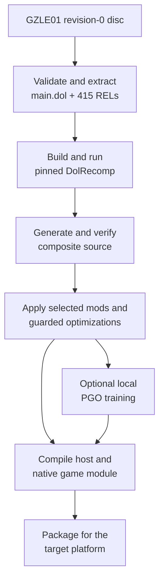
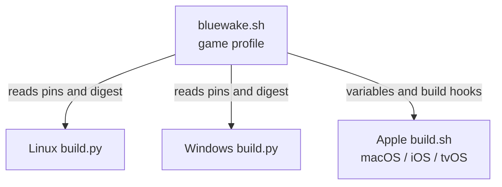
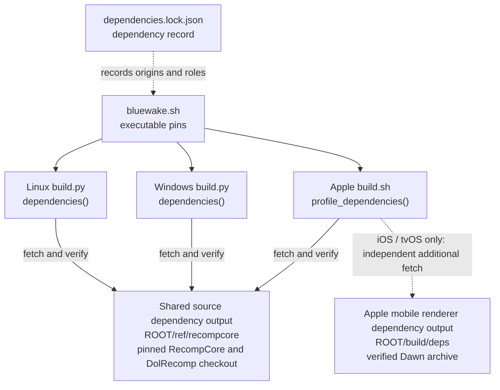
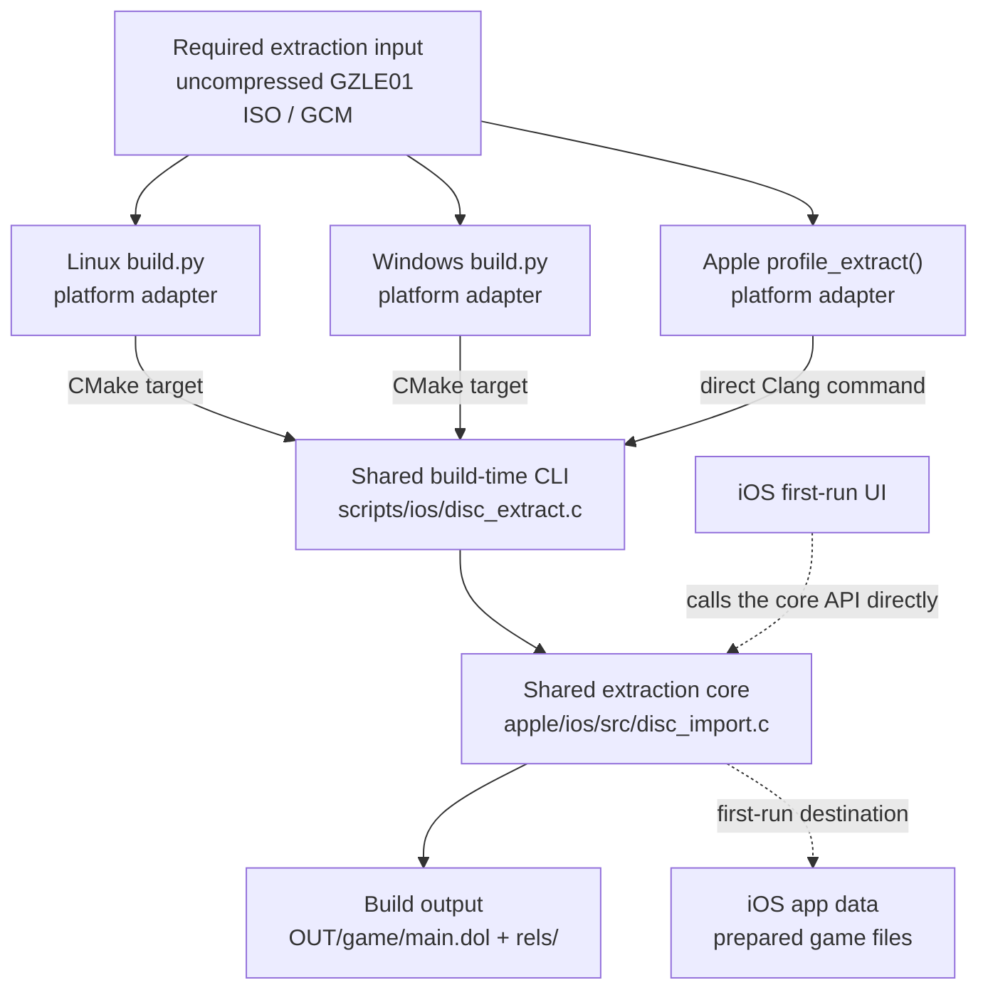
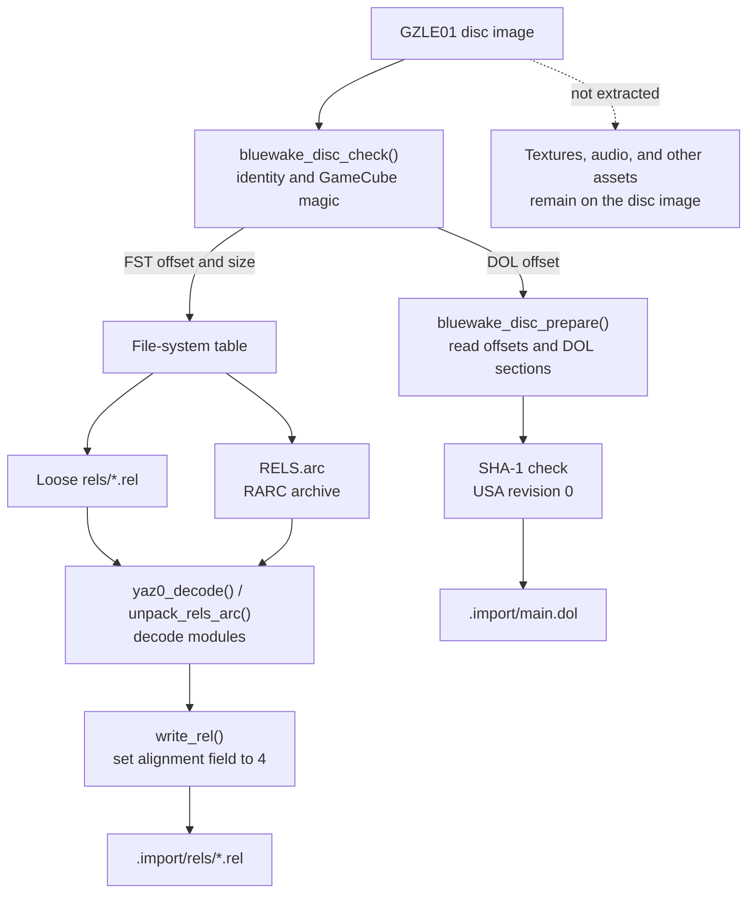
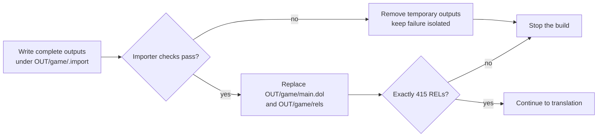

# BlueWake build process

## Contents

- [End-to-end overview](#end-to-end-overview)
- [Build toolchain overview](#build-toolchain-overview)
  - [Concepts](#concepts)
- [1. Coordinate](#1-coordinate)
  - [`bluewake.sh` game profile](#bluewakesh-game-profile)
  - [Linux builder](#linux-builder)
  - [Windows builder](#windows-builder)
  - [Apple builder](#apple-builder)
- [2. Fetch](#2-fetch)
  - [Dependency declarations](#dependency-declarations)
  - [RecompCore and DolRecomp checkout](#recompcore-and-dolrecomp-checkout)
  - [Apple Dawn package](#apple-dawn-package)
- [3. Extract](#3-extract)
  - [Input and platform paths](#input-and-platform-paths)
  - [Shared extraction](#shared-extraction)
- [4. Translate](#4-translate)
- [5. Compose and prepare](#5-compose-and-prepare)
  - [Generate the composite source](#generate-the-composite-source)
  - [Apply mods and optimizations](#apply-mods-and-optimizations)
- [6. Train](#6-train)
- [7. Compile and package](#7-compile-and-package)
  - [Linux](#linux-x86-64)
  - [Windows](#windows-x86-64)
  - [macOS](#macos-apple-silicon)
  - [iPhone and iPad](#iphone-and-ipad-iosipados-arm64)
  - [Apple TV](#apple-tv-tvos-arm64-experimental)
  - [Android](#android-in-progress)

This chapter expands the build-time half of the
[architecture overview](Overview.md). It follows the player's disc through
validation, translation, preparation, native compilation, and packaging.

## End-to-end overview

The direct path skips profile-guided training. Both paths produce a platform
host and a separate native module containing the translated game code.

## Build toolchain overview

### Concepts

- [RecompCore](https://github.com/chrissotraidis/RecompCore) — the lower-level static-recompilation foundation inherited from the Wind Waker Recomp lineage. BlueWake fetches a tested RecompCore revision into `ROOT/ref/recompcore` and uses its GXRuntime, Aurora renderer, DSP support, CPU/runtime interfaces, and DolRecomp submodule. BlueWake adds the `GZLE01` build profile, composite preparation, mods, platform applications, packaging, and game-specific host integration; runtime changes are developed in RecompCore and then adopted by updating BlueWake's pin.

- [Build profile](../../scripts/builder/profiles/bluewake.sh) — game-specific configuration and hooks, not performance data. `bluewake.sh` defines the supported game, dependency pins, expected generated-source digest, output names, and Apple build hooks.

- [DOL](https://wiibrew.org/wiki/DOL) — the GameCube's main executable format. BlueWake extracts `main.dol` alongside 415 loadable REL modules before translating either kind of code.

- [File-system table (FST)](https://www.gc-forever.com/yagcd/chap13.html#sec13.4) — the GameCube disc directory: fixed-size file and directory entries followed by their names. The disc header gives BlueWake its offset and size; the importer walks it to locate loose RELs and `RELS.arc` without unpacking the whole disc.

- [REL](https://wiibrew.org/wiki/REL) — a relocatable GameCube executable module, similar in purpose to a dynamic library. Wind Waker loads and unloads these modules as their code and data are needed; BlueWake extracts all 415 RELs, translates each one, and combines them with the DOL translation while retaining their module metadata.

- [RARC](https://wiki.cloudmodding.com/zgcn/ARC) — a Nintendo archive container identified by the `RARC` signature. Wind Waker stores many of its REL modules inside `RELS.arc`; BlueWake reads its file table and extracts only `.rel` members.

- [Yaz0](https://www.gc-forever.com/yagcd/chap16.html#sec16.2) — a Nintendo compression format identified by the `Yaz0` signature. `RELS.arc`, loose RELs, and archive members may use it, so BlueWake decodes each applicable layer before passing uniform module bytes to DolRecomp.

- [DolRecomp](https://github.com/elliotttate/DolRecomp) — the ahead-of-time translator. It converts PowerPC instructions from the DOL and RELs into C while preserving guest CPU and address semantics; it does not reconstruct Nintendo's original source.

- [Composite generation](../../scripts/generate_composite.py) — combines the separately translated main DOL and all 415 RELs into one deterministic source tree, with a shared dispatcher and ABI tables for building one native game module. “Composite” here means composing translated program units, not combining rendered images; BlueWake verifies the generated tree against the profile's expected digest before modifying or compiling it.

- [Profile-guided optimization (PGO)](../../scripts/linux/build.py#L771-L906) — PGO uses recorded execution counts to help the final compiler optimize frequently executed translated paths. The resulting `.profdata` is a compiler input, separate from the build profile above.

- [Training](../../scripts/linux/build.py#L979-L1105) — deterministic headless game playbacks used to produce PGO counters, not machine learning. Builders merge the raw counters with `llvm-profdata` and keep game-derived profiles in the private build directory.

`OUT` below is the exact output directory passed to the selected builder with
`--out`; build artifacts are expressed relative to it. `ROOT` is the repository
checkout and prefixes shared dependency caches that intentionally live outside
`OUT`.

| Stage | Main code or tool | What it does | Result | Artifact |
| --- | --- | --- | --- | --- |
| Coordinate | [Platform builders](#1-coordinate) and [`bluewake.sh`](../../scripts/builder/profiles/bluewake.sh) | Selects the target, inputs, options, and ordered build stages. | Ordered build with pinned inputs and provenance | Build logs under `OUT/logs/` |
| Fetch | Git and [`bluewake.sh`](../../scripts/builder/profiles/bluewake.sh) | Retrieves and verifies the exact runtime and translator revisions. | Exact RecompCore and DolRecomp source | Checkout under `ROOT/ref/recompcore/` |
| Extract | [Platform builders](#3-extract) | Confirms the supported disc and separates the code inputs needed for translation. | Validated DOL, RELs, and runtime disc | `OUT/game/main.dol` and `OUT/game/rels/` |
| Translate | [Pinned DolRecomp](https://github.com/elliotttate/DolRecomp/commit/b8b534591cba8ca7cd43943a655ee6e2591cf5de) | Converts the game's PowerPC machine code into compilable C. | Generated C for PowerPC code | Generated tree under `OUT/translated/` |
| Compose and prepare | [`generate_composite.py`](../../scripts/generate_composite.py) and [mod scripts](../../scripts/mods) | Joins translated units and applies selected, guarded source variants. | Verified composite source and selected variants | `OUT/composite-src/` and its digest files |
| Train | [Platform PGO paths](#6-train) and `llvm-profdata` | Records representative execution frequencies for compiler optimization. | Optional local optimization profile | `OUT/pgo-local/composite.profdata` or `OUT/composite.profdata` |
| Compile and package | [CMake targets and platform packagers](#7-compile-and-package) | Produces native binaries and arranges them for the target platform. | Native module and platform application | [Platform artifact paths](#7-compile-and-package) |

## 1. Coordinate

### `bluewake.sh` game profile

[`scripts/builder/profiles/bluewake.sh`](../../scripts/builder/profiles/bluewake.sh)
is sourced configuration and shell functions, not a standalone builder.

| Stage | What it does | Result | Artifact/output | Code reference |
| --- | --- | --- | --- | --- |
| Describe the game | Defines the game ID, bundle ID, module name, default output, and PGO inputs. | One shared game and application identity | `PROFILE_*` variables | [Profile variables](../../scripts/builder/profiles/bluewake.sh#L20-L35) |
| Pin dependencies | Selects exact RecompCore and DolRecomp revisions and verifies the Dawn archive by checksum. | Reproducible dependency inputs | `RECOMPCORE_SHA`, `DOLRECOMP_SHA`, `DAWN_SHA256` | [Dependency pins](../../scripts/builder/profiles/bluewake.sh#L37-L44) |
| Guard generation | Records the accepted digest for the unmodified generated composite. | Builders reject unexpected translator or disc output. | `COMPOSITE_DIGEST` | [Digest and verification](../../scripts/builder/profiles/bluewake.sh#L45-L190) |
| Define Apple hooks | Implements dependency, extraction, translation, generation, mod, compile, and app functions. | The generic Apple pipeline can build BlueWake without game-specific logic. | `profile_*` shell functions | [Profile hooks](../../scripts/builder/profiles/bluewake.sh#L49-L319) |

Linux and Windows parse the shared pin and digest values directly. The Apple
builder sources the file and invokes its hook functions.

### Linux builder

[`scripts/linux/build.py`](../../scripts/linux/build.py) owns the Linux x86-64
pipeline.

| Stage | What it does | Result | Artifact/output | Code reference |
| --- | --- | --- | --- | --- |
| Check environment | Verifies Clang, LLD, `llvm-profdata`, CMake, Ninja, Git, and Python. `--ci-container` builds the shared image and reinvokes the builder inside it. | Native or containerized Linux toolchain ready | Stage logs under `OUT/logs/` | [`run_in_ci_container`](../../scripts/linux/build.py#L236-L284), [`check_tools`](../../scripts/linux/build.py#L348-L438) |
| Prepare inputs | Fetches pinned dependencies, validates the disc, and extracts `main.dol` plus 415 RELs. | Verified source inputs | `ROOT/ref/recompcore/` and `OUT/game/` | [`dependencies`](../../scripts/linux/build.py#L439-L475), [`disc` and `extract`](../../scripts/linux/build.py#L476-L541) |
| Generate source | Builds DolRecomp, translates DOL/REL code, verifies the composite digest, and applies selected mods and guarded preparations. | Compilable prepared composite | `OUT/translated/` and `OUT/composite-src/` | [`build_dolrecomp` through `generate`](../../scripts/linux/build.py#L496-L632), [`build_mods` and preparation](../../scripts/linux/build.py#L633-L770) |
| Train | Builds an instrumented module, runs headless playbacks, and merges profiles unless training is skipped or reused. | Local optimization profile | `OUT/pgo-local/composite.profdata` | [`train`](../../scripts/linux/build.py#L979-L1105) |
| Compile and assemble | Compiles the game module and host, then copies game inputs, DSP data, and provenance into the app folder. | Runnable Linux folder | `OUT/BlueWake/bluewake` and `OUT/BlueWake/gGZLE01_recomp.so` | [`compile_module`](../../scripts/linux/build.py#L771-L906), [`build_app` and `package`](../../scripts/linux/build.py#L1115-L1178) |
| Package AppImage | With `--appimage`, packages and audits the assembled outputs. | Portable Linux package | `OUT/BlueWake-x86_64.AppImage` | [`package_appimage`](../../scripts/linux/build.py#L1179-L1205) |

### Windows builder

[`scripts/windows/build.py`](../../scripts/windows/build.py) provides the
Windows x86-64 pipeline.

| Stage | What it does | Result | Artifact/output | Code reference |
| --- | --- | --- | --- | --- |
| Check environment | Verifies Visual Studio's LLVM/Clang, the Windows SDK, CMake, Ninja, and Git. | Windows toolchain ready | Stage logs under `OUT/logs/` | [`check_tools` and Visual Studio environment](../../scripts/windows/build.py#L271-L374) |
| Prepare inputs | Converts supported Dolphin formats through pinned `nodtool`, validates the disc, and extracts the DOL and 415 RELs. | Verified source inputs | Converted ISO when needed and `OUT/game/` | [`dependencies` and `disc`](../../scripts/windows/build.py#L375-L471), [`extract`](../../scripts/windows/build.py#L547-L561) |
| Generate source | Builds DolRecomp, translates the DOL/REL code, verifies the composite, and applies requested mod variants. | Compilable prepared composite | `OUT/translated/` and `OUT/composite-src/` | [`build_dolrecomp` through `generate`](../../scripts/windows/build.py#L472-L676), [`build_mods` and preparation](../../scripts/windows/build.py#L677-L871) |
| Train | Builds an instrumented module, runs headless playbacks, and merges or reuses the local profile. | Local optimization profile | `OUT/pgo-local/composite.profdata` | [`train`](../../scripts/windows/build.py#L1046-L1173) |
| Compile | Compiles the translated module and Windows host with the selected profile. | Native Windows binaries | `OUT/composite/gGZLE01_recomp.dll` and `OUT/app/BlueWake.exe` | [`compile_module`](../../scripts/windows/build.py#L872-L1006), [`build_app`](../../scripts/windows/build.py#L1216-L1224) |
| Assemble | Copies Dawn, SDL, DSP, game inputs, runtime DLLs, and provenance into one folder. | Directly runnable Windows build | `OUT/BlueWake/` | [`package`](../../scripts/windows/build.py#L1225-L1294) |

### Apple builder

[`scripts/builder/build.sh`](../../scripts/builder/build.sh) is the generic
pipeline for macOS, iOS/iPadOS, and tvOS.

| Stage | What it does | Result | Artifact/output | Code reference |
| --- | --- | --- | --- | --- |
| Select target | Parses signing, PGO, optimization, packaging, and device options; selects `macosx`, `iphoneos`, or `appletvos`. | Configured Apple build | Selected Xcode SDK and `OUT/logs/` | [Argument and SDK selection](../../scripts/builder/build.sh#L68-L207) |
| Load profile | Sources `bluewake.sh`, checks Xcode/CMake/Ninja, and calls its dependency, extraction, translation, generation, and mod hooks. | Verified prepared composite | `ROOT/ref/recompcore/`, `OUT/game/`, and `OUT/composite-src/` | [Profile loading](../../scripts/builder/build.sh#L150-L173), [pipeline hooks](../../scripts/builder/build.sh#L225-L271) |
| Train | Optionally invokes the profile's local training hook and merges the recorded profile. | Local optimization profile | `OUT/composite.profdata` | [Training dispatch](../../scripts/builder/build.sh#L272-L283), [`profile_train`](../../scripts/builder/profiles/bluewake.sh#L204-L215) |
| Compile module | Calls the profile compile hook for the selected SDK and architecture. | Native translated module | `OUT/composite-{ios,macos,tvos}/gGZLE01_recomp.dylib` | [Compile stage](../../scripts/builder/build.sh#L284-L290), [`profile_compile`](../../scripts/builder/profiles/bluewake.sh#L216-L258) |
| Build and sign app | Builds or imports the app, embeds the module, records module optimizations, and signs the module and bundle. | Installable target app | `OUT/app/BlueWake.app`, `OUT/app-tvos/BlueWake.app`, or `OUT/app-macos/host/BlueWake.app` | [Build, embed, and sign](../../scripts/builder/build.sh#L291-L340) |
| Package | Creates macOS `BlueWake.app` or an optional unsigned IPA. IPA staging removes signing material and rejects private game/save/key files. | Distributable package | `OUT/packaged/BlueWake.app`; use `--ipa OUT/BlueWake.ipa` for an IPA under `OUT` | [Packaging and privacy checks](../../scripts/builder/build.sh#L341-L390) |
| Install | When requested, transfers and launches the supported device build. | Running device installation | Installed app and device launch | [Device installation](../../scripts/builder/build.sh#L391-L410) |

All three builders validate their tools, reuse safe intermediates, and record
provenance. Platform options change compilation and packaging, not the
supported game revision.

## 2. Fetch

Each platform has a separate implementation that produces the same pinned
RecompCore and DolRecomp checkout. Apple's dependency hook also fetches the
verified mobile Dawn archive for iOS and tvOS. The hook performs that fetch
after the checkout, but this is execution order rather than a dependency:
Dawn does not consume the RecompCore checkout. macOS performs no additional
Dawn fetch here because desktop Aurora resolves its macOS package later.

### Dependency declarations

The build profile is the source builders execute or parse. The lock file is a
repository-wide provenance and audit record; it does not drive these fetches.

| Stage | What it does | Result | Artifact/output | Code reference |
| --- | --- | --- | --- | --- |
| Declare executable pins | Records the RecompCore URL and revision, DolRecomp revision, and Dawn URL/checksum used by the builders. | One dependency selection across platforms | `RECOMPCORE_*`, `DOLRECOMP_SHA`, `DAWN_*` | [Build-profile pins](../../scripts/builder/profiles/bluewake.sh#L37-L44) |
| Record dependency provenance | Documents dependency origins, licenses, roles, exact revisions, local paths, and patch history for audits. | Reviewable dependency inventory | `config/dependencies.lock.json` | [Dependency lock](../../config/dependencies.lock.json) |

### RecompCore and DolRecomp checkout

Linux, Windows, and Apple implement the same guarded checkout sequence.

| Stage | What it does | Result | Artifact/output | Code reference |
| --- | --- | --- | --- | --- |
| Initialize | Creates `ROOT/ref/recompcore` as a Git checkout only when the path is absent or empty; refuses to replace unrelated files. | Safe checkout location | `ROOT/ref/recompcore/.git/` | [Linux](../../scripts/linux/build.py#L439-L448), [Windows](../../scripts/windows/build.py#L375-L390), [Apple](../../scripts/builder/profiles/bluewake.sh#L56-L66) |
| Fetch RecompCore | Fetches only the pinned SHA without recursively fetching submodules, then checks out `FETCH_HEAD` detached. | Exact runtime source | `ROOT/ref/recompcore/` at `RECOMPCORE_SHA` | [Linux](../../scripts/linux/build.py#L449-L460), [Windows](../../scripts/windows/build.py#L390-L400), [Apple](../../scripts/builder/profiles/bluewake.sh#L67-L81) |
| Fetch DolRecomp | Synchronizes the parent's DolRecomp submodule and initializes its pinned revision with a shallow update. | Exact translator source | `ROOT/ref/recompcore/DolRecomp/` at `DOLRECOMP_SHA` | [Linux](../../scripts/linux/build.py#L461-L469), [Windows](../../scripts/windows/build.py#L401-L415), [Apple](../../scripts/builder/profiles/bluewake.sh#L82-L86) |
| Verify | Checks both HEAD revisions and rejects tracked local modifications before building. | Clean, attributable dependency tree | Successful dependency-stage log | [Linux](../../scripts/linux/build.py#L459-L473), [Windows](../../scripts/windows/build.py#L399-L419), [Apple](../../scripts/builder/profiles/bluewake.sh#L81-L91) |

### Apple Dawn package

macOS lets desktop Aurora resolve its own pinned Dawn package. iOS and tvOS
prepare the mobile archive during the dependency hook.

| Stage | What it does | Result | Artifact/output | Code reference |
| --- | --- | --- | --- | --- |
| Download and verify | Reuses the cached iOS arm64 archive only when its SHA-256 matches; otherwise downloads it and verifies the new file. | Trusted renderer package | `ROOT/build/deps/dawn-ios-arm64.tar.gz` | [Archive fetch](../../scripts/builder/profiles/bluewake.sh#L93-L101) |
| Extract | Expands the verified archive when its CMake package is absent. | Dawn headers, libraries, and CMake configuration | `ROOT/build/deps/dawn-ios/` | [iOS extraction](../../scripts/builder/profiles/bluewake.sh#L102-L106) |
| Prepare tvOS | Copies the iOS archive, retags its Mach-O platform as tvOS, rebuilds its index, and records the source checksum. | Development tvOS Dawn archive | `ROOT/build/deps/dawn-tvos/` | [tvOS preparation](../../scripts/builder/profiles/bluewake.sh#L107-L119) |

## 3. Extract

| Boundary | Shared | Platform-specific |
| --- | --- | --- |
| Input adapter | The extraction tool ultimately receives an uncompressed GZLE01 ISO or GCM. | Builders own paths and preflight checks; Windows may first normalize a supported compressed Dolphin image. |
| Build-time CLI | Every build pipeline compiles the same [`disc_extract.c`](../../scripts/ios/disc_extract.c) wrapper with the same extraction core. | Linux and Windows create the tool through CMake; the Apple profile invokes Clang directly. |
| Extraction core | [`disc_import.c`](../../apple/ios/src/disc_import.c) validates the disc and revision, extracts the DOL and RELs, normalizes them, and publishes the prepared tree. | The iOS first-run UI links this core directly instead of using the command-line wrapper. |
| Caller-owned result | The prepared layout is always `main.dol` plus `rels/*.rel`. | Builders place it under `OUT/game/` and enforce 415 RELs; iOS places it in the app's data container and reports progress through its UI. |

### Input and platform paths

| Stage | What it does | Result | Artifact/output | Code reference |
| --- | --- | --- | --- | --- |
| Linux preflight | Accepts `.iso` or `.gcm`, reads the GameCube header, and rejects the wrong magic, game ID, or revision before extraction. | Confirmed `GZLE01` revision-0 candidate | Original disc path retained as the runtime disc | [`disc`](../../scripts/linux/build.py#L476-L493) |
| Windows preflight | Accepts `.iso` or `.gcm` directly. As an optional convenience, it converts supported compressed Dolphin formats through pinned `nodtool`; it then rejects the wrong magic, game ID, or revision. | Confirmed uncompressed `GZLE01` revision-0 candidate | Original disc path or cached `OUT/disc/GZLE01.iso` | [`disc`](../../scripts/windows/build.py#L422-L455), [`nodtool`](../../scripts/windows/build.py#L457-L469) |
| Apple wrapper | Compiles `disc_extract.c` with the shared importer, runs it on the uncompressed ISO, and checks for exactly 415 REL files. | Native extractor and verified extracted set | `OUT/tools/disc_extract` and `OUT/game/` | [`profile_extract`](../../scripts/builder/profiles/bluewake.sh#L122-L130) |

### Shared extraction

The importer is a selective parser, not a full disc unpacker. It reads offsets
from the GameCube header, extracts only the executable code needed by
DolRecomp, and leaves textures, audio, and other runtime assets on the original
disc image. Wind Waker stores modules both as loose files and inside
`RELS.arc`, so the importer handles the disc file-system table, RARC archives,
and optional Yaz0 compression before producing one uniform REL directory.

**Extraction paths**

Code: [`bluewake_disc_check`](../../apple/ios/src/disc_import.c#L245-L265),
[`bluewake_disc_prepare`](../../apple/ios/src/disc_import.c#L318-L506),
[`unpack_rels_arc`](../../apple/ios/src/disc_import.c#L267-L316), and
[`write_rel`](../../apple/ios/src/disc_import.c#L206-L221).

**Safe publication and builder gate**

Code: [staging, publication, and cleanup](../../apple/ios/src/disc_import.c#L318-L506);
exact-count gates in [Linux](../../scripts/linux/build.py#L519-L525),
[Windows](../../scripts/windows/build.py#L547-L559), and
[Apple](../../scripts/builder/profiles/bluewake.sh#L122-L130).

| Stage | What it does | Result | Artifact/output | Code reference |
| --- | --- | --- | --- | --- |
| Check disc identity | Opens the image, verifies the GameCube magic, and requires game ID `GZLE01`. | Supported game image | Validation result or specific error | [`bluewake_disc_check`](../../apple/ios/src/disc_import.c#L245-L265) |
| Read the executable | Uses the disc header to locate the DOL, reads its section table, and computes the complete executable size. | In-memory main executable | DOL byte buffer | [DOL extraction](../../apple/ios/src/disc_import.c#L343-L367) |
| Verify revision | Computes the DOL SHA-1 and compares it with the supported USA revision-0 value. | Exact supported executable, not only a matching disc ID | Verified DOL digest | [Revision check](../../apple/ios/src/disc_import.c#L368-L379) |
| Extract modules | Walks the disc file-system table, decompresses loose Yaz0 RELs, locates `RELS.arc`, and unpacks its RARC/Yaz0 members. | Complete translated-code input set | Staged `main.dol` and `rels/*.rel` | [File-system extraction](../../apple/ios/src/disc_import.c#L395-L479), [`unpack_rels_arc`](../../apple/ios/src/disc_import.c#L267-L316) |
| Normalize modules | Sets each extracted REL's alignment field to four, matching the canonical inputs from which BlueWake's composite source is generated. The disc image is not modified. | Consistent REL headers across both disc storage paths | Normalized staged `rels/*.rel` | [`write_rel`](../../apple/ios/src/disc_import.c#L206-L221) |
| Publish outputs | Replaces the previous prepared files only after extraction succeeds; failures remove the temporary files. | Finished prepared game tree | `OUT/game/main.dol` and `OUT/game/rels/` | [Output swap and cleanup](../../apple/ios/src/disc_import.c#L481-L506) |
| Verify module count | Each builder requires exactly 415 extracted RELs before translation begins. | Consistent input set on every platform | Successful extraction-stage log | [Linux](../../scripts/linux/build.py#L519-L525), [Windows](../../scripts/windows/build.py#L547-L559), [Apple](../../scripts/builder/profiles/bluewake.sh#L122-L130) |

These paths are private build intermediates under the caller-selected `OUT`.
Linux and Windows also copy them into `OUT/BlueWake/game/` for the runnable
folder. The AppImage packager does not embed the DOL, RELs, or disc image.

The extracted DOL and RELs are game-derived private inputs. They remain in the
local build tree; the original disc continues to provide runtime assets. See
the platform commands in [`docs/BUILD_YOUR_OWN.md`](../BUILD_YOUR_OWN.md).

## 4. Translate

The builder compiles pinned DolRecomp, then runs its GameCube C backend over
the DOL and each REL. The result preserves PowerPC operations and guest
addresses; it is not reconstructed Nintendo source code.

The builder checks out the
[pinned DolRecomp revision](https://github.com/elliotttate/DolRecomp/commit/b8b534591cba8ca7cd43943a655ee6e2591cf5de)
under `ROOT/ref/recompcore/DolRecomp`. Each platform builder records its invocation
in the build log.

## 5. Compose and prepare

### Generate the composite source

[`scripts/generate_composite.py`](../../scripts/generate_composite.py) combines
the DOL and REL translations with shared dispatch and module metadata. The
result can address code across the original executable and REL boundaries.

[`scripts/audit_composite_provenance.py`](../../scripts/audit_composite_provenance.py)
and the profile digest verify the generated base. Unexpected input stops the
normal build instead of silently producing a different module.

### Apply mods and optimizations

[`scripts/mods/build_mod_variants.py`](../../scripts/mods/build_mod_variants.py)
adds selected widescreen and Better Wind Waker variants. The builder applies
selected guarded preparations through
[`scripts/builder/module_optimizations.py`](../../scripts/builder/module_optimizations.py).

Preparations verify the source shape or digest they expect. If a guard fails,
the original translated implementation remains in place.

## 6. Train

When enabled, the [Linux builder](../../scripts/linux/build.py) and
[Windows builder](../../scripts/windows/build.py) run their platform training
flows directly; the Apple builder uses
[`train_local_pgo.py`](../../scripts/builder/train_local_pgo.py). Each builds
an instrumented module, runs headless playbacks, and merges the results with
`llvm-profdata` for the final compile.

Fingerprints prevent reuse with incompatible inputs. Training output stays in
the private build directory and is not a public artifact.

## 7. Compile and package

CMake and Ninja compile the prepared composite into a native game module. A
separate build produces the shared host, runtime, renderer, audio, input,
storage, and platform entry code.

Packaging arranges those outputs and support files for the target. Platform
SDKs, signing, and final artifact formats diverge here.

### Linux (x86-64)

[`scripts/linux/build.py`](../../scripts/linux/build.py) uses Clang, LLD,
CMake, and Ninja. [`linux/CMakeLists.txt`](../../linux/CMakeLists.txt) builds
the host; [`scripts/linux/make_appimage.sh`](../../scripts/linux/make_appimage.sh)
optionally creates the AppImage.

| Artifact | Location relative to `OUT` |
| --- | --- |
| Host | `BlueWake/bluewake` |
| Game module | `BlueWake/gGZLE01_recomp.so` |
| App folder | `BlueWake/` |
| Optional AppImage | `BlueWake-x86_64.AppImage` |

`--ci-container` uses the shared
[`scripts/linux/Dockerfile`](../../scripts/linux/Dockerfile) environment.

### Windows (x86-64)

[`scripts/windows/build.py`](../../scripts/windows/build.py) uses Visual Studio
LLVM/Clang, CMake, and Ninja. [`windows/CMakeLists.txt`](../../windows/CMakeLists.txt)
adds the Windows entry, settings, crash handling, resources, and compatibility
layer.

| Artifact | Location relative to `OUT` |
| --- | --- |
| Host | `BlueWake/BlueWake.exe` |
| Game module | `BlueWake/gGZLE01_recomp.dll` |
| App folder | `BlueWake/` |

[`scripts/windows/package_release.py`](../../scripts/windows/package_release.py)
assembles the distributable folder and runtime DLLs.

### macOS (Apple silicon)

[`scripts/builder/build.sh`](../../scripts/builder/build.sh) with `--platform
macos` uses Apple Clang and the macOS SDK.
[`scripts/builder/package_macos.py`](../../scripts/builder/package_macos.py)
creates and signs the app bundle.

| Artifact | Location relative to `OUT` |
| --- | --- |
| App | `packaged/BlueWake.app` |
| Game module | `packaged/BlueWake.app/Contents/Frameworks/gGZLE01_recomp.dylib` |
| Personal game inputs | `packaged/BlueWake.app/Contents/Resources/Game/` |

### iPhone and iPad (iOS/iPadOS, arm64)

The default [`scripts/builder/build.sh`](../../scripts/builder/build.sh) target
uses Apple Clang and the iPhoneOS SDK.
[`apple/ios/CMakeLists.txt`](../../apple/ios/CMakeLists.txt) adds UIKit, touch,
controller, and mobile services.

| Artifact | Location relative to `OUT` | Role |
| --- | --- | --- |
| App | `app/BlueWake.app` | Signed or ad-hoc app bundle |
| Game module | `app/BlueWake.app/Frameworks/gGZLE01_recomp.dylib` | Translated game module |
| Optional IPA | `BlueWake.ipa` when requested with `--ipa OUT/BlueWake.ipa` | Unsigned package for sideloading |

The IPA path excludes disc and extracted game data. PadMint can add the
player's module to an app-only build.

### Apple TV (tvOS, arm64; experimental)

[`scripts/tvos/build_device.sh`](../../scripts/tvos/build_device.sh) selects
the tvOS branch of the Apple builder. It creates a controller-first app and
can install, transfer the disc, and launch through `devicectl`.

| Artifact | Location relative to `OUT` |
| --- | --- |
| App | `app-tvos/BlueWake.app` |
| Game module | `app-tvos/BlueWake.app/Frameworks/gGZLE01_recomp.dylib` |

The current Dawn archive bridge remains experimental. See the
[tvOS build guide](../status/TVOS_BUILD.md).

### Android (in progress)

Android arm64 support is under development in
[PR #93](https://github.com/chrissotraidis/bluewake/pull/93). It is not yet a
current build path, so its proposed artifacts are not included above.
