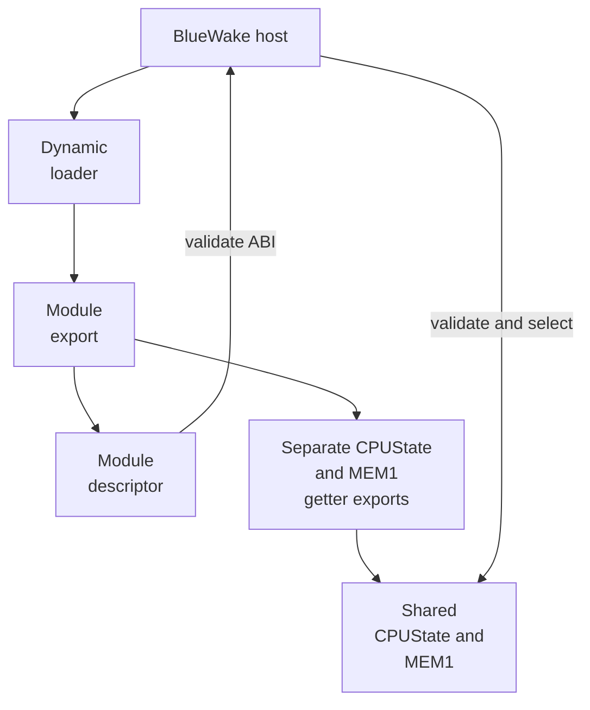
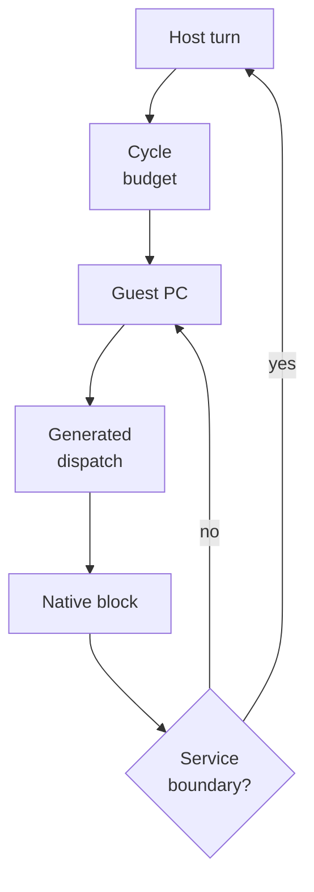

# Native game module

## Contents

- [Responsibility](#responsibility)
- [Module contents](#module-contents)
  - [Artifact-to-game examples](#artifact-to-game-examples)
- [Module loading and ABI](#module-loading-and-abi)
- [Translated-code dispatch](#translated-code-dispatch)
  - [Native routine selection](#native-routine-selection)

Architecture path: [Overview](Overview.md) → [Runtime](Runtime.md) → **Native game module**

## Responsibility

The native game module contains the ahead-of-time translated Wind Waker code.
It is compiled separately from the BlueWake host and loaded into the same
process. It preserves guest addresses and machine state rather than exposing a
new high-level game API.

## Module contents

| Content | Runtime purpose | Source |
| --- | --- | --- |
| Translated DOL functions | Implement the original main executable as native functions. | DolRecomp output composed in [Build Stage 5](Build.md#5-compose-and-prepare) |
| Translated REL functions | Implement the game's relocatable code modules while preserving linked guest addresses. | REL-grouped composite source |
| Dispatch tables | Map a guest program counter or function pointer to the corresponding native function. | [`generate_composite.py`](../../scripts/generate_composite.py#L562-L707) |
| DOL and REL metadata | Describe code ranges, data images, BSS, aliases, and the initial entry point. | [`generate_composite.py`](../../scripts/generate_composite.py#L799) |
| Module descriptor | Publishes the ABI contract, callbacks, and metadata. | `staticrecomp_get_module` export |
| Shared-storage getters | Optionally expose the module-owned `CPUState` and MEM1 allocations required by the declared CPU ABI. | `bluewake_composite_guest_cpu` and `bluewake_composite_guest_mem1` exports |

### Artifact-to-game examples

| Module artifact | In-game action | Runtime contact | Example project contribution |
| --- | --- | --- | --- |
| Translated DOL functions | Always-loaded systems run the title flow, main loop, OS support, and shared game logic. | Dispatch maps a DOL guest `pc` to its native translated function. | [PR #37](https://github.com/chrissotraidis/bluewake/pull/37) consolidated the native module, dispatch chassis, and host integration. |
| Translated REL functions | Entering a scene or using a system implemented by a relocatable module executes its original code. | Dispatch resolves the REL's linked guest code range while guest data remains at linked addresses. | [PR #37](https://github.com/chrissotraidis/bluewake/pull/37) added the combined DOL/REL composite and shared REL storage. |
| Dispatch tables | A call, return, callback, or interrupt resumes at the guest address selected by game state. | Generated range tables select the matching native function without rewriting the guest `pc`. | [PR #211](https://github.com/chrissotraidis/bluewake/pull/211) fixes a DVD callback that could corrupt the paused function's return path. |
| DOL and REL metadata | Boot loads initialized data; scene modules see relocated data and zeroed BSS. | The host consumes code ranges, data images, BSS descriptions, aliases, and the entry point. | [PR #37](https://github.com/chrissotraidis/bluewake/pull/37) contributed the generated metadata and module-owned guest storage contract. |
| Module descriptor and shared-storage getters | Launch binds the host to the exact module ABI before the title sequence begins. | The host validates descriptor versions and sizes, then resolves the separate `CPUState` and MEM1 getter exports required by that ABI. | [PR #37](https://github.com/chrissotraidis/bluewake/pull/37) introduced the explicit descriptor, CPU contract, and shared-storage exports. |

## Module loading and ABI

The host opens `gGZLE01_recomp` with the platform dynamic loader and obtains
its `StaticRecompModuleDesc`. It resolves CPU and MEM1 getter symbols
separately when the descriptor's CPU ABI requires module-owned storage.
Startup stops if a required export is missing or incompatible.

| Step | Runtime result | Code reference |
| --- | --- | --- |
| Open the shared library | Translated native code is mapped into the process | [Module loading](../../runtime/host/src/main.c#L7316-L7322) |
| Read the exported descriptor | The host receives entry, dispatch, metadata, callbacks, and the ABI requirements | [Composite generation](../../scripts/generate_composite.py#L799) |
| Resolve shared-storage getters | The host obtains compatible module-owned `CPUState` and MEM1 allocations without treating them as descriptor fields | [Storage contract](../../cmake/composite/module_cpu_contract.h#L9-L64), [symbol lookup](../../runtime/host/src/main.c#L7340-L7357) |
| Validate the ABI | Only a compatible host/module pair continues to guest initialization | [ABI validation](../../runtime/host/src/main.c#L7329-L7343) |

## Translated-code dispatch

The host starts a guest turn with a bounded cycle budget. The generated
dispatcher maps the current guest PC to a native DOL or REL function. A chassis
loop can continue through successive blocks, returning to the host when time,
an exception, a callback, or another service boundary requires it.

| Step | Runtime effect | Code reference |
| --- | --- | --- |
| Resolve the guest PC | Selects a native function from the DOL and REL dispatch tables | [Generated dispatcher](../../scripts/generate_composite.py#L562-L707) |
| Execute translated blocks | Updates the shared registers, memory, PC, and cycle count without instruction interpretation on the normal path | [Dispatch chassis](../../cmake/composite/dispatch_loop.h) |
| Yield to the host | Preserves guest position while services process the boundary | [Dispatch conditions](../../cmake/composite/dispatch_loop.h#L35-L77) |

The module's relationship with CPU storage, memory, and guest addresses is
covered in [Guest machine state](GuestState.md).

Public guard and source-contract tests can validate ABI declarations,
dispatch preparation, native decline behavior, and synthetic CPU/RAM effects
without a game module. Generated scheduler and native differential tests are
conditional or manual because they consume a contributor's local translated
module. A compiled target is therefore not proof that its private oracle ran.
See [generated and conditional tests](Testing.md#generated-and-conditional-tests)
and [private and hardware validation](Testing.md#private-and-hardware-validation).

### Native routine selection

Selected generated function entries can contain hash-certified hooks to
handwritten native implementations. A native routine either completes with
guest state equivalent to the translation or declines without mutation and
lets the translated path continue. Decomp source helps contributors understand
the original algorithm but is not executed by this mechanism. Continue to
[translated, native, and decomp routines](NativeRoutines.md) for the build-time
hook, runtime selection, equivalence, and testing contracts.

Return to the runtime [high-level view](Runtime.md#high-level-view).
