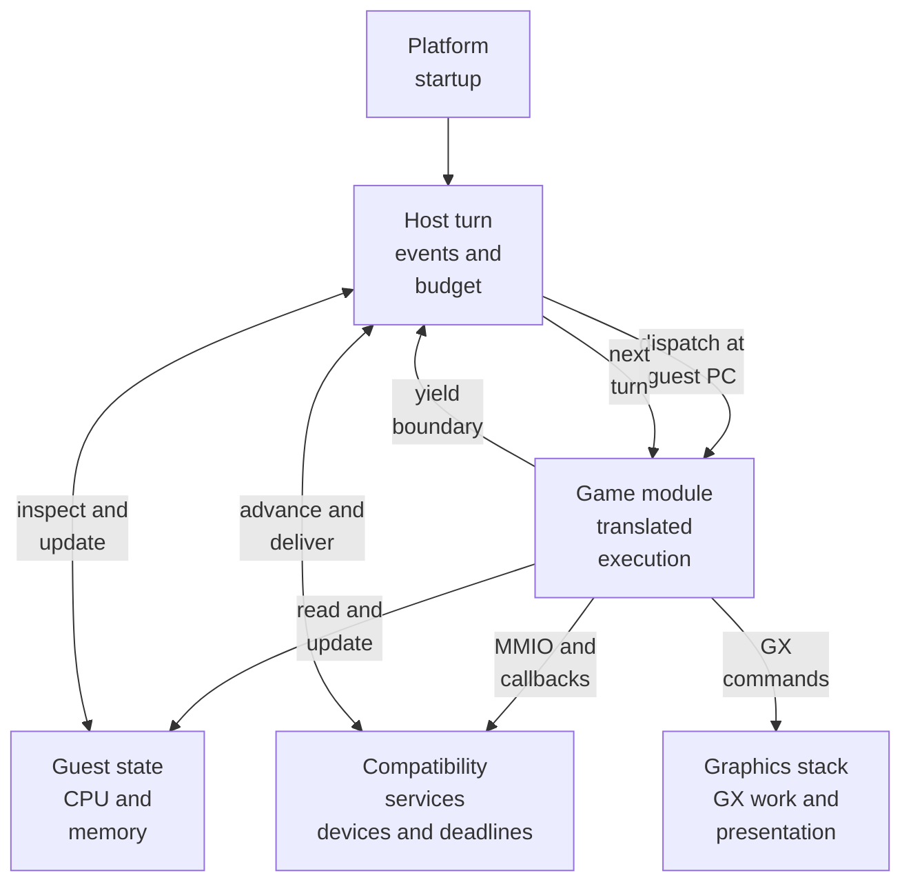
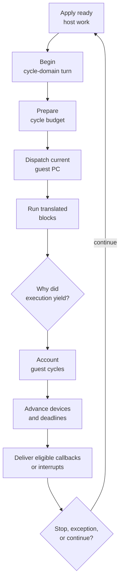
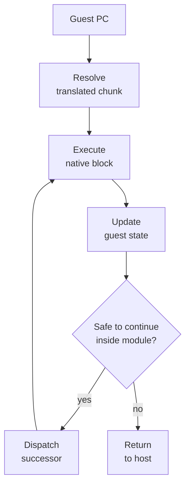
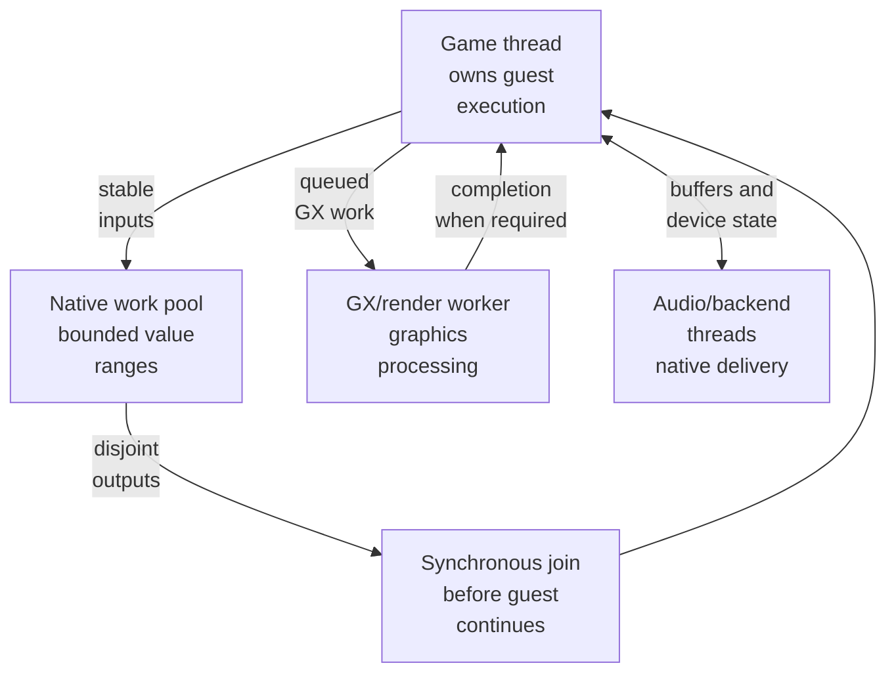
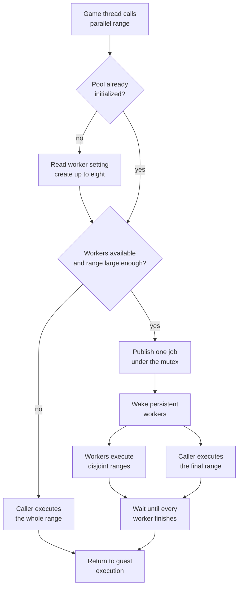
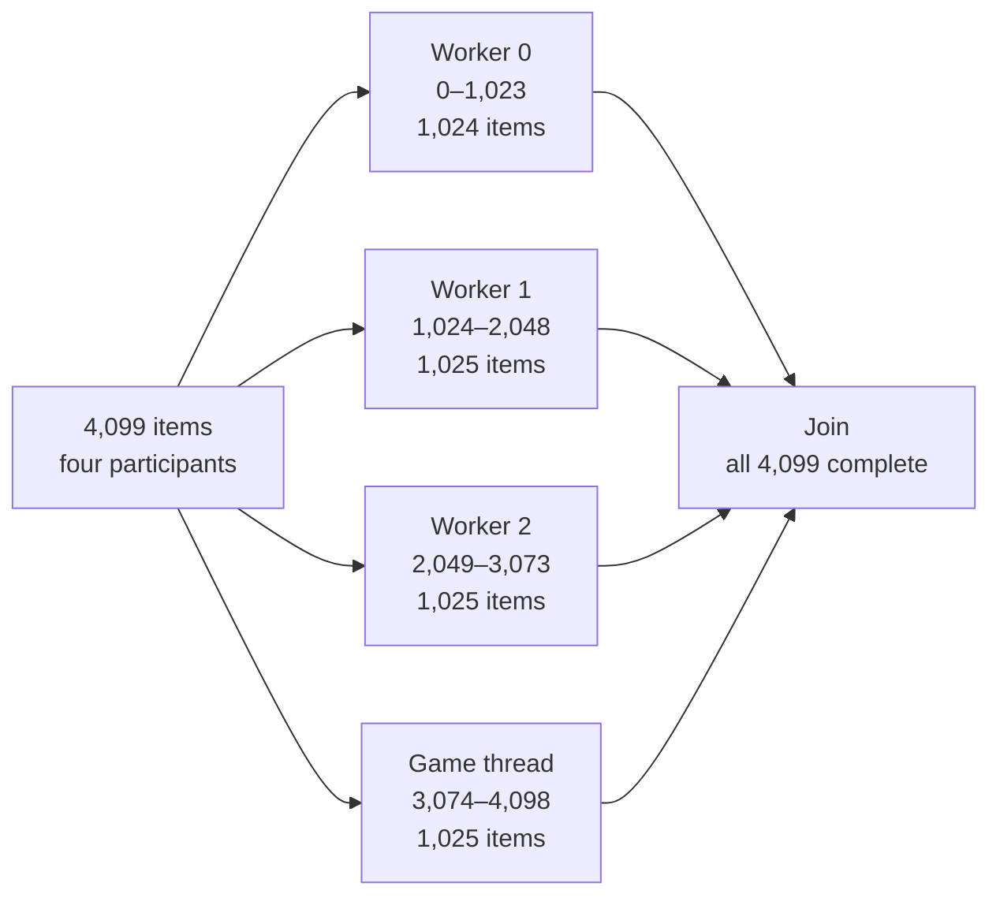

# BlueWake game thread

## Contents

- [Purpose](#purpose)
- [What the game thread is](#what-the-game-thread-is)
- [High-level execution](#high-level-execution)
- [One guest turn](#one-guest-turn)
- [Translated dispatch](#translated-dispatch)
- [State, services, and graphics](#state-services-and-graphics)
- [Concurrency boundaries](#concurrency-boundaries)
  - [Native work-pool internals](#native-work-pool-internals)
- [Performance model](#performance-model)
- [Testing and evidence](#testing-and-evidence)
- [Source map](#source-map)

Architecture path: [Overview](Overview.md) → [Runtime](Runtime.md) → **Game thread**

## Purpose

The game thread is the native execution path that advances Wind Waker. It
alternates between BlueWake host coordination and ahead-of-time translated game
code while preserving one authoritative guest machine state. This chapter
explains that execution path, its yield boundaries, and how it interacts with
services, graphics, and native helper threads.

This is an architecture description, not a claim that every frame follows the
same call sequence or that every listed subsystem is expensive. Measurement and
tuning procedures belong in the [performance documentation](../performance/Overview.md).

## What the game thread is

“Game thread” refers to the native OS thread executing the shared host loop and
the game module synchronously. The host calls the module dispatcher; translated
code runs on that caller until it reaches a boundary and returns control.

It is distinct from three similarly named concepts:

| Concept | Meaning |
|---|---|
| BlueWake game thread | Native thread alternating between host turns and translated execution |
| Guest OS thread | Wind Waker/GameCube scheduler state represented in guest memory and registers; switching it changes guest context, not the native owner of `CPUState` |
| Native helper thread | Renderer, audio, diagnostic, or work-pool thread with a bounded native responsibility |

The native game thread is not necessarily the platform UI thread. Platform
startup decides where the shared host entry runs, but once inside the runtime,
the ownership contract is the same: guest execution and host boundary work are
serialized through one authoritative [`CPUState`](GuestState.md#cpustate-layout).

## High-level execution

The arrows describe ownership and control transfer, not independent pipelines.
Translated code, host checks, and service work all contribute to the time needed
to advance the game. Graphics work can continue on another native thread, but
the game thread may still prepare commands or wait at required synchronization
points.

## One guest turn

The host divides execution into bounded guest-time turns. A turn begins with
pending host work, establishes how far guest time may advance, calls the module,
and ends by reconciling elapsed cycles with devices and deliverable events.

| Phase | Responsibility | Primary source |
|---|---|---|
| Turn setup | Apply ready state, begin cycle accounting, and establish dispatch conditions | [`bluewake_cycle_domain_begin_turn`](../../runtime/host/src/main.c#L8708) |
| Module entry | Call the module dispatcher with the current guest PC | [`mod->dispatch`](../../runtime/host/src/main.c#L14140) |
| Translated run | Execute successive DOL or REL blocks while the chassis can continue safely | [`bluewake_chassis_dispatch_loop`](../../cmake/composite/dispatch_loop.h#L39-L84) |
| Turn accounting | Flush translated cycle charges and close the cycle-domain turn | [`bluewake_cycle_domain_end_turn`](../../runtime/host/src/main.c#L15755) |
| Device synchronization | Advance time-based compatibility services to the new guest time | [`host_sync_cycle_devices_end_turn`](../../runtime/host/src/main.c#L15805) |
| Event delivery | Publish eligible disc callbacks, decrementer work, and guest exceptions | [end-of-turn delivery](../../runtime/host/src/main.c#L15806-L15854) |

A turn is not a rendered frame. Many turns can occur within one retrace, and a
turn may end because a device deadline or exception must be observed before the
game reaches its next frame boundary.

## Translated dispatch

The module dispatcher maps the current guest program counter to native code
generated from the DOL or a linked REL. That native code directly updates guest
registers, memory, program counter, and timing fields. Normal execution is
translation, not per-instruction interpretation.

Within the module, the chassis can continue across block boundaries without
returning to the outer host loop when the boundary is known to be quiet. Direct
calls can similarly enter another translated chunk without a complete host
round trip. These paths remain conditional: exceptions, exhausted budgets,
watched addresses, host observations, or unknown mappings force a yield.

Relevant surfaces are the generated dispatcher in
[`module_export.c`](../../cmake/composite/module_export.c), the chassis in
[`dispatch_loop.h`](../../cmake/composite/dispatch_loop.h), and the direct-call
contract in [`direct_calls.h`](../../cmake/composite/direct_calls.h). The host's
corresponding observation predicates and edge service remain in
[`main.c`](../../runtime/host/src/main.c#L2120-L2235).

## State, services, and graphics

The game thread crosses several runtime contracts during one update:

| Boundary | Game-thread role | Other owner |
|---|---|---|
| Guest state | Execute reads/writes and apply host-visible events against the authoritative CPU and memory model | [Guest state](GuestState.md) is shared data, not an executing entity |
| Compatibility services | Reach MMIO/HLE paths, then yield where deadlines, callbacks, or interrupts require host coordination | [Services](Services.md) own guest-visible device state |
| Graphics | Produce GX gather-pipe and display-list work; wait only where guest-visible completion requires it | [Graphics](Graphics.md) converts and presents work through GXRuntime, Aurora, Dawn, and the platform API |
| Host integrations | Apply scoped camera, input, mod, diagnostic, or lifecycle behavior at verified boundaries | [Host](Host.md) owns native coordination |

For example, drawing an outdoor scene runs translated actor and scene logic,
writes GX commands, and updates guest memory on the game thread. The graphics
stack may process queued GX work concurrently, but an idle GPU does not make the
serial actor, dispatch, or command-preparation work execute in parallel.

## Concurrency boundaries

BlueWake uses native concurrency without turning guest execution into a freely
parallel shared-state system.

The optional native work pool in
[`native_work_pool.c`](../../cmake/composite/native_work_pool.c) is synchronous:
workers receive immutable inputs and disjoint output ranges, the calling game
thread handles one range, and the function returns only after every worker has
finished. Workers do not independently advance `CPUState`. The vector batch in
[`native_math.c`](../../cmake/composite/native_math.c#L220-L257) demonstrates
this pattern by calculating ranges first and applying final guest CPU effects on
the execution thread after the join.

Whole actors or guest threads cannot be assumed independent. They can observe
shared memory, scheduler order, devices, callbacks, and each other's effects.
Parallelizing such work requires a proven stable-input/disjoint-output contract,
not merely the availability of unused CPU cores.

### Native work-pool internals

The native work pool is a small range executor compiled into the game module.
It lets one eligible calculation use persistent native workers while the game
thread remains the sole submitter and owner of guest execution. It does not
schedule guest threads, interpret PowerPC code, or automatically parallelize
translated routines.

Its public contract is intentionally small:

| Interface | Contract |
|---|---|
| [`BluewakeRangeWork`](../../cmake/composite/native_work_pool.h) | Callback over the half-open range `[first, end)` using caller-owned context |
| [`bluewake_parallel_range`](../../cmake/composite/native_work_pool.c) | Select the serial or parallel path and return only after the complete range finishes |
| [`bluewake_parallel_batches`](../../cmake/composite/native_work_pool.c) | Report how many submissions used workers; serial calls do not increment it |

| Stage | Mechanics | Result |
|---|---|---|
| Initialize | The first submission uses `pthread_once`, reads `BLUEWAKE_NATIVE_WORKERS`, caps a valid request at eight, and retains however many threads were created successfully | One process-lifetime pool, or the serial fallback when no worker is available |
| Select path | A submission stays serial when there are no workers or `count / (workers + 1)` is below `minimum_grain` | Small jobs avoid wake-up and synchronization overhead |
| Publish | Under the mutex, the caller stores the count, callback, and context; sets the remaining-worker count; advances the generation and parallel-batch counters; then broadcasts the ready condition | Each persistent worker observes the same immutable job descriptor |
| Partition | With `P = workers + 1`, participant `i` receives `[count * i / P, count * (i + 1) / P)`; the calling thread takes the final partition | Integer boundaries cover the range once without overlap |
| Join | Workers decrement `remaining` after their callbacks; the caller waits on the finished condition after completing its own partition | All range results are available before the function returns |
| Unload | The module destructor sets the stop flag, wakes the pool, and joins every created worker | No worker continues executing module code after unload |

For example, a 4,099-item submission with three workers has four
participants. The workers receive `[0, 1024)`, `[1024, 2049)`, and
`[2049, 3074)`; the game thread receives `[3074, 4099)`. The split can differ
by one item, but every index belongs to exactly one participant.

The prose uses half-open ranges because that is the callback interface. The
diagram shows the equivalent inclusive item numbers so each participant's
ownership is visible without overlapping endpoints.

In the current production caller, one item is one 12-byte vector containing
three big-endian floats: `(x, y, z)`. Every participant reads the same immutable
3-by-4 transformation matrix, transforms the vectors in its assigned range,
and writes one 12-byte result per input. Depending on the game caller, those
vectors can represent positions or directions; the pool only sees numbered
elements and byte ranges.

Using the same illustrative 4,099-item batch:

| Participant | Example item | Input location | Work performed |
|---|---:|---:|---|
| Worker 0 | Vector 0 `(x0, y0, z0)` | `input + 0` | Read item 0, apply the shared matrix, and write result 0 |
| Worker 1 | Vector 1,024 | `input + 12,288` | Process the first item in worker 1's range |
| Worker 2 | Vector 2,049 | `input + 24,588` | Process the first item in worker 2's range |
| Game thread | Vector 3,074 | `input + 36,888` | Process the first item in the caller's range |
| Game thread | Vector 4,098 | `input + 49,176` | Process the final item in the batch |

The output offsets follow the same `12 * index` calculation. Thus worker 1 can
write vector 1,024 while worker 2 writes vector 2,049 without sharing an output
element. The complete batch occupies 49,188 input bytes and 49,188 output
bytes. The 4,099 count is a partitioning example, not a claim that every game
submission contains that many vectors. See the production
[`vector_range`](../../cmake/composite/native_math.c#L197-L214) callback and its
[`bluewake_parallel_range`](../../cmake/composite/native_math.c#L241) call.

The component test substitutes simple indexed values for game vectors. This
checks that every item runs once and all results are ready at the join.

Safe pool work reads shared, stable input and writes separate output ranges.
Guest state remains on the game thread and is updated after the join.

POSIX builds can use persistent workers; Windows currently uses the same API
serially.

The focused component test runs without a disc, translated module, or renderer.
It checks empty and serial ranges, uneven partitions, repeated submissions,
configuration parsing, worker-count clamping, immediate result publication,
and untouched boundaries. See the
[`native_work_pool_test.c`](../../tests/native_work_pool_test.c) implementation,
its [CTest registration](../../tests/native_work_pool/CMakeLists.txt), and the
[integration-test plan](../planning/2026-10-18-gamethread-integtests/TECH_PLAN.md#test-contracts).
Draft [PR #424](https://github.com/chrissotraidis/bluewake/pull/424) extends that
foundation with creation-failure and unload-lifecycle coverage.

## Performance model

The game reaches its 30 FPS logic target only when the complete critical path
for an update fits the available wall time. The relevant cost includes translated
work, dispatch and guest-state bookkeeping, host/service crossings, GX command
preparation, and required waits. Utilization on another CPU core or the GPU does
not identify which part limits the update.

| Signal | What it answers | What it does not prove |
|---|---|---|
| Game FPS or retraces/s | Whether the workload advances faster | Which function caused the result |
| Game-thread busy share | Whether the execution thread is near its wall-time ceiling | That every busy cycle is useful game logic |
| Flat `perf` self-time | Which native symbols consume sampled CPU time | That optimizing the hottest symbol produces the same percentage gain |
| Cycles/instructions per retrace | Whether the same game progress requires less CPU work | Correct behavior or stable rendered pacing |
| GX/GPU/present waits | Whether execution blocks on downstream graphics work | That low GPU utilization implies a graphics problem |
| Candidate activation counters | Whether an optimized path actually ran | Correctness or net benefit |

Use the [Steam Deck profiling guide](../PROFILING.md) for collection commands and
the [performance overview](../performance/Overview.md) for the profile → measure
→ tune → validate loop.

The active Steam Deck investigation is tracked separately as planning work:
[requirements](../planning/2026-10-19-gamethread-optimizations/PRD.md),
[technical plan](../planning/2026-10-19-gamethread-optimizations/TECH_PLAN.md),
and [progress](../planning/2026-10-19-gamethread-optimizations/PROGRESS.md).
Those artifacts may select or reject candidates; this chapter remains the
architecture baseline they reference.

## Testing and evidence

Different layers establish different parts of the contract:

| Evidence | Establishes |
|---|---|
| Dispatch, scheduler, cycle, and service component tests | Synthetic boundary behavior without private game data |
| Native guard/source tests | Eligibility, decline, and bounded guest-state effects |
| Native work-pool tests | Current foundation: partitioning, publication, configuration, and repeated reuse; draft PR #424 adds creation-failure and unload-lifecycle coverage |
| Private translated differential oracle | Candidate results agree with the locally generated translated reference |
| Benchmark checkpoints | Selected guest state agrees across a repeatable route where exactness is expected |
| Hardware profile and gameplay | The candidate activates, improves the target device, and preserves player-visible behavior |

No single layer substitutes for the others. In particular, a pool test does not
prove a game calculation is safe to parallelize, and a faster Deck run does not
prove guest-state equivalence. See [test architecture](Testing.md) for execution
and evidence boundaries.

## Source map

| Concern | Source |
|---|---|
| Host lifecycle and outer execution loop | [`runtime/host/src/main.c`](../../runtime/host/src/main.c) |
| Generated module entry and dispatch | [`cmake/composite/module_export.c`](../../cmake/composite/module_export.c) |
| In-module dispatch chassis | [`cmake/composite/dispatch_loop.h`](../../cmake/composite/dispatch_loop.h) |
| Direct translated calls and quiet-boundary checks | [`cmake/composite/direct_calls.h`](../../cmake/composite/direct_calls.h), [`direct_skip.h`](../../cmake/composite/direct_skip.h) |
| Authoritative guest storage contract | [`cmake/composite/module_cpu_contract.h`](../../cmake/composite/module_cpu_contract.h) |
| Guest cycle accounting | [`runtime/host/src/cycle_domain.c`](../../runtime/host/src/cycle_domain.c) |
| Native range workers | [`cmake/composite/native_work_pool.c`](../../cmake/composite/native_work_pool.c) |
| Performance logging | [`runtime/host/src/main.c`](../../runtime/host/src/main.c#L747-L782), [`fps_watch.c`](../../runtime/host/src/fps_watch.c) |
| Deck sampling and fixed workloads | [`profile_deck.sh`](../../scripts/linux/profile_deck.sh), [`bench_tour.py`](../../scripts/bench_tour.py) |

Return to the runtime [high-level view](Runtime.md#high-level-view), or continue
to the [performance workflow](../performance/Overview.md#performance-workflow).
