# Graphics stack

## Contents

- [Responsibility](#responsibility)
- [Concepts](#concepts)
  - [Stack-level view](#stack-level-view)
- [Platform graphics stacks](#platform-graphics-stacks)
  - [Build-time backend set](#build-time-backend-set)
  - [Runtime backend resolution](#runtime-backend-resolution)
  - [Supported target mappings](#supported-target-mappings)
- [Host and guest-state integration](#host-and-guest-state-integration)
  - [Ownership boundary](#ownership-boundary)
  - [Guest memory and native GPU memory](#guest-memory-and-native-gpu-memory)
  - [From guest bytes to a GPU resource](#from-guest-bytes-to-a-gpu-resource)
  - [End-to-end interaction](#end-to-end-interaction)
- [Mechanical contents](#mechanical-contents)
  - [Component ownership](#component-ownership)
  - [Guest-visible GX state](#guest-visible-gx-state)
  - [Artifact-to-game examples](#artifact-to-game-examples)
  - [Guest resource resolution](#guest-resource-resolution)
- [Representative model draw: a tree](#representative-model-draw-a-tree)
  - [End-to-end flow](#end-to-end-flow)
  - [What changes the image](#what-changes-the-image)
- [GX command path](#gx-command-path)
  - [Gather-pipe transport](#gather-pipe-transport)
  - [FIFO and display-list parsing](#fifo-and-display-list-parsing)
  - [From GX state to a native draw](#from-gx-state-to-a-native-draw)
- [Textures, frame buffers, and presentation](#textures-frame-buffers-and-presentation)
  - [Textures and palettes](#textures-and-palettes)
  - [EFB, copies, and VI presentation](#efb-copies-and-vi-presentation)
- [Synchronization and completion](#synchronization-and-completion)
- [Contribution case studies](#contribution-case-studies)
- [State, fallback, and shutdown](#state-fallback-and-shutdown)

Architecture path: [Overview](Overview.md) → [Runtime](Runtime.md) → **Graphics stack**

## Responsibility

The graphics stack preserves the game's GX-facing command model while
producing native GPU work. Translated code still performs the original scene
traversal and issues the original GX command stream. GXRuntime reconstructs
the GameCube graphics state represented by that stream; Aurora converts the
result into native renderer work; Dawn connects that work to Vulkan, Metal,
Direct3D, or another enabled platform API.

This is neither high-level replacement of Wind Waker's renderer nor direct
execution of GameCube GPU instructions by the host GPU. Guest addresses remain
guest addresses. The host exposes a bounded native view only while a graphics
consumer needs the backing bytes.

## Concepts

### Stack-level view

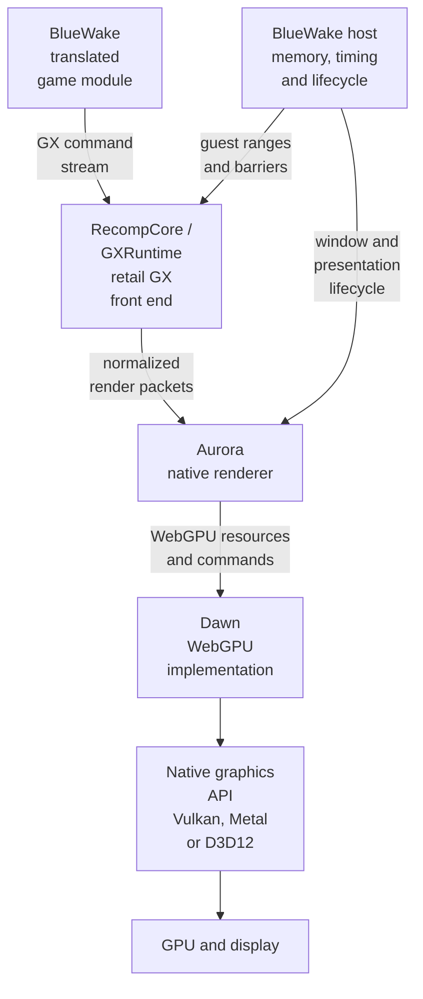

| Stack layer | Project anchor | Role in BlueWake graphics |
| --- | --- | --- |
| Game module and host | [Game module](GameModule.md), [BlueWake host](Host.md) | Supplies translated Wind Waker code plus the native process, guest memory, timing, window, and lifecycle integration. |
| Retail GX semantics | [GXRuntime README](https://github.com/chrissotraidis/RecompCore/blob/f647d03d3886eb2357950190fe1cba3fa3d10242/GXRuntime/README.md) | Reconstructs GameCube FIFO, CP, XF, BP, PE, texture, EFB, and VI behavior inside the pinned RecompCore dependency. |
| Native renderer | [Aurora README](https://github.com/chrissotraidis/RecompCore/blob/f647d03d3886eb2357950190fe1cba3fa3d10242/GXRuntime/graphics/aurora/README.md) | Converts GXRuntime's normalized state and draws into native renderer resources and work. BlueWake uses RecompCore's owned Aurora fork. |
| WebGPU implementation | [Dawn README](https://dawn.googlesource.com/dawn/+/HEAD/README.md) | Implements the WebGPU device and command interfaces through which Aurora reaches platform graphics APIs. |

The translated module is a BlueWake build artifact, GXRuntime is part of the
pinned RecompCore dependency, and Aurora is vendored there as an owned fork.
Dawn and the selected native graphics API sit below those project-specific
layers.

- **GX** — the GameCube graphics API and hardware-facing command model used by
  the game. BlueWake preserves its retail FIFO, register, memory, and
  synchronization semantics. See the [GXRuntime front-end contract](https://github.com/chrissotraidis/RecompCore/blob/f647d03d3886eb2357950190fe1cba3fa3d10242/GXRuntime/graphics/frontend/ARCHITECTURE.md).
- **Gather pipe and FIFO** — the game writes an ordered byte stream to the
  gather-pipe address `0xCC008000`. The FIFO assembles those bytes into
  register writes, display-list calls, and draws.
- **Display list** — a command sequence stored in guest memory and invoked from
  the FIFO. It reuses model commands without turning the guest address into a
  persistent native pointer.
- **CP, VCD, and VAT** — command-processor state describes where vertex arrays
  live and how each draw encodes positions, normals, colors, texture
  coordinates, and matrix indices. VCD selects direct or indexed attributes;
  VAT defines their formats and sizes.
- **XF** — transform-unit state: position and normal matrices, projection,
  viewport, lights, material channels, and texture-coordinate generation.
- **BP, PE, and TEV** — BP commands configure rasterization and the pixel
  pipeline. The Pixel Engine (PE) owns depth, blending, tokens, finish state,
  EFB access, and copies. The Texture Environment (TEV) combines sampled
  textures, vertex colors, lighting, and constants into output pixels.
- **Texture, TLUT, and TMEM** — texture descriptors refer to guest image data.
  A Texture Lookup Table (TLUT) supplies palette entries for indexed formats;
  TMEM is the console-visible texture-memory model reconstructed by the front
  end.
- **EFB, XFB, and VI** — the Embedded Frame Buffer (EFB) is the render target.
  The game can copy or read it. On original hardware, display copies feed an
  External Frame Buffer (XFB) consumed by the Video Interface (VI). Aurora
  preserves the logical copy and presentation boundaries without requiring
  every implementation step to be a literal hardware framebuffer.
- **Aurora** — [Aurora](https://github.com/chrissotraidis/RecompCore/blob/f647d03d3886eb2357950190fe1cba3fa3d10242/GXRuntime/graphics/aurora/README.md)
  is a source-level GameCube and Wii compatibility layer used by decompilation
  projects. BlueWake uses RecompCore's owned Aurora fork as its native renderer:
  it maps normalized GX state to shaders, pipelines, textures, render passes,
  copies, and presentation. Aurora renders GX meaning established by GXRuntime;
  it does not decide what the game draws.
- **Dawn** — Chromium's WebGPU implementation beneath Aurora. It connects
  Aurora's GPU resources and commands to native APIs such as Vulkan, Metal,
  and Direct3D 12.

## Platform graphics stacks

BlueWake sends the same normalized GX work to Aurora on every platform. The
platform split begins below that boundary: the build decides which Dawn
backends are present, then Aurora selects a backend and Dawn resolves a native
surface and GPU adapter at startup. The paths below cover BlueWake's supported
targets, not every platform that upstream Aurora can build.

### Build-time backend set

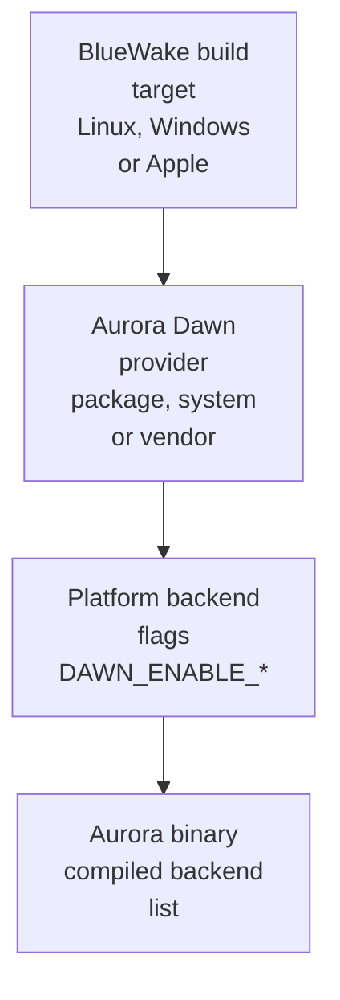

The Dawn *provider* controls where the implementation comes from, not which
API the player will necessarily use. `package` downloads Aurora's pinned
prebuilt Dawn, `system` consumes a prepared Dawn installation, and `vendor`
builds the pinned source. The resulting `DAWN_ENABLE_*` values compile the
platform-appropriate backend bindings into Aurora.

| Build path | Dawn source | Code reference |
| --- | --- | --- |
| Linux player build | Pinned prebuilt package; Linux CI can build the pinned vendored source | [Linux configuration](../../scripts/linux/build.py#L504-L516), [provider implementation](https://github.com/chrissotraidis/RecompCore/blob/f647d03d3886eb2357950190fe1cba3fa3d10242/GXRuntime/graphics/aurora/cmake/AuroraDawnProvider.cmake#L107-L195) |
| Windows player build | Auto-resolution selects the available pinned Windows package | [Windows host configuration](../../scripts/windows/build.py#L512-L544), [package resolution](https://github.com/chrissotraidis/RecompCore/blob/f647d03d3886eb2357950190fe1cba3fa3d10242/GXRuntime/graphics/aurora/cmake/AuroraDawnProvider.cmake#L176-L245) |
| macOS | Pinned prebuilt macOS package | [Apple builder](../../scripts/builder/profiles/bluewake.sh#L277-L288) |
| iPhone, iPad, and Apple TV | Prepared pinned Dawn installation supplied as a CMake package | [Apple device builder](../../scripts/builder/profiles/bluewake.sh#L290-L300) |

### Runtime backend resolution

BlueWake requests `BACKEND_AUTO`. Aurora tries only the backends compiled for
the target, in its fixed preference order. A candidate succeeds only if SDL
can create the required native window and Dawn can obtain a compatible surface
and high-performance adapter for that backend.

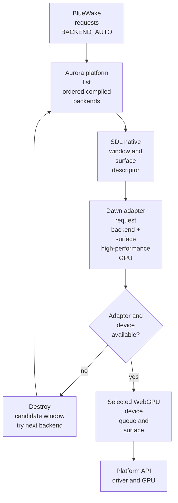

The surface descriptor is platform-specific: an `HWND` on Windows, an Xlib or
Wayland surface on Linux, and a `CAMetalLayer` obtained through SDL on Apple
platforms. Dawn then translates the shared WebGPU calls into the selected
native API. The chosen backend is retained by Aurora and reported by BlueWake
as `[renderer] D3D12`, `Vulkan`, `Metal`, or the applicable fallback.

References: [BlueWake requests automatic selection](https://github.com/chrissotraidis/RecompCore/blob/f647d03d3886eb2357950190fe1cba3fa3d10242/GXRuntime/backends/aurora/aurora_backend.cpp#L259-L333),
[Aurora preference loop](https://github.com/chrissotraidis/RecompCore/blob/f647d03d3886eb2357950190fe1cba3fa3d10242/GXRuntime/graphics/aurora/lib/aurora.cpp#L73-L99),
[backend selection](https://github.com/chrissotraidis/RecompCore/blob/f647d03d3886eb2357950190fe1cba3fa3d10242/GXRuntime/graphics/aurora/lib/aurora.cpp#L143-L169),
[native surface bindings](https://github.com/chrissotraidis/RecompCore/blob/f647d03d3886eb2357950190fe1cba3fa3d10242/GXRuntime/graphics/aurora/lib/dawn/BackendBinding.cpp),
and [Dawn adapter request](https://github.com/chrissotraidis/RecompCore/blob/f647d03d3886eb2357950190fe1cba3fa3d10242/GXRuntime/graphics/aurora/lib/webgpu/gpu.cpp#L791-L865).

### Supported target mappings

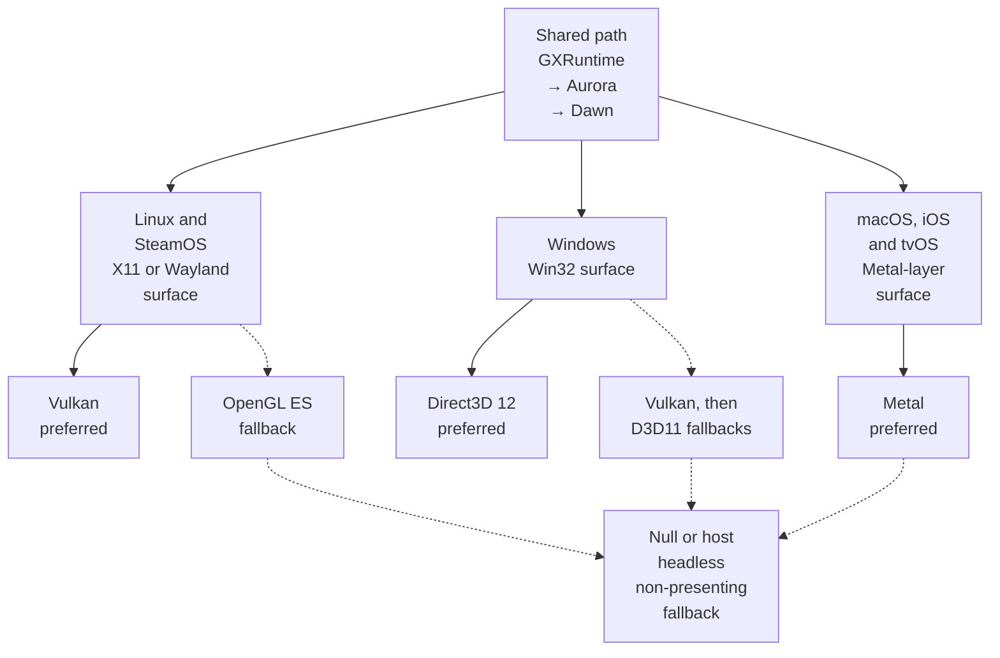

| BlueWake target | Compiled candidates | Automatic attempt order | Native surface | Expected player path |
| --- | --- | --- | --- | --- |
| Linux, including SteamOS | Vulkan, desktop OpenGL, OpenGL ES, and Null | Vulkan → OpenGL ES → Null; desktop OpenGL is currently not enumerated by the automatic preference list | SDL X11 or Wayland window | `GXRuntime → Aurora → Dawn → Vulkan → driver/GPU` |
| Windows | D3D12, Vulkan, D3D11, and Null | D3D12 → Vulkan → D3D11 → Null | SDL Win32 window / `HWND` | `GXRuntime → Aurora → Dawn → D3D12 → driver/GPU` |
| macOS | Metal and Null | Metal → Null | SDL Cocoa window / `CAMetalLayer` | `GXRuntime → Aurora → Dawn → Metal → Apple GPU` |
| iPhone and iPad | Metal and Null | Metal → Null | SDL UIKit window / `CAMetalLayer` | `GXRuntime → Aurora → Dawn → Metal → Apple GPU` |
| Apple TV | Metal and Null | Metal → Null | SDL tvOS window / `CAMetalLayer` | `GXRuntime → Aurora → Dawn → Metal → Apple GPU` |

`Null` is the final non-presenting backend, not a normal player graphics path.
If Aurora initialization still fails and the user did not explicitly require
it, the BlueWake host can fall back to its headless backend. On Linux, BlueWake
warns when the selected backend name begins with `OpenGL`, because the Vulkan
path is expected to perform substantially better. [PR #353](https://github.com/chrissotraidis/bluewake/pull/353)
is a concrete Vulkan-specific contribution: it keeps the surface configured
through Linux window resizes without changing guest GX state.

The compile-time platform mapping is defined by the
[Dawn provider](https://github.com/chrissotraidis/RecompCore/blob/f647d03d3886eb2357950190fe1cba3fa3d10242/GXRuntime/graphics/aurora/cmake/AuroraDawnProvider.cmake#L14-L47),
while the actual attempt order comes from
[Aurora's compiled preference list](https://github.com/chrissotraidis/RecompCore/blob/f647d03d3886eb2357950190fe1cba3fa3d10242/GXRuntime/graphics/aurora/lib/aurora.cpp#L73-L99).

## Host and guest-state integration

The graphics stack is not separate from the host or guest machine model. The
translated module produces GX work from guest data; the host connects that
work to GXRuntime, resolves guest resources, and publishes completion at the
correct guest-time boundaries. Aurora remains below this contract and owns
native rendering resources rather than authoritative game state.

### Ownership boundary

| State domain | Examples | Owner and lifetime | Architecture reference |
| --- | --- | --- | --- |
| Core guest state | `CPUState`, MEM1, linked REL storage, camera and actor data | Shared authoritative machine state used by the translated module and host | [Guest machine state](GuestState.md#responsibility) |
| Guest-visible GX state | FIFO contents; CP, XF, BP, PE, texture, EFB-copy, and VI state | GXRuntime's native structures model the GameCube graphics machine across draws and barriers | [Guest-visible GX state](#guest-visible-gx-state) |
| Native renderer state | Dawn device and surface, pipelines, shaders, converted textures, command buffers, and caches | Aurora and Dawn implementation state; recreated or invalidated without changing guest addresses | [Component ownership](#component-ownership) |
| Coordination state | Renderer lifecycle, resolver cache, retrace clock, module bridge, and pending completion delivery | BlueWake host state that connects the other domains | [Host responsibility](Host.md#responsibility) |

`CPUState` does not contain MEM1, the complete GX front end, or Aurora's GPU
objects. Conversely, a native texture or pipeline is not guest state merely
because it currently represents guest bytes. The guest-visible meaning lives
in the addressable data and GX machine model; Aurora's objects are an
implementation of that meaning.

### Guest memory and native GPU memory

BlueWake does not expose the host GPU's video memory as another guest-address
range. Graphics source data commonly shares ordinary guest memory with the
rest of the game, but GXRuntime and Aurora create separate state and native GPU
resources when that data is consumed.

| Storage | Typical contents | Guest access |
| --- | --- | --- |
| MEM1 and linked REL storage | Model vertices, display lists, texture images, palettes, matrices, and other game data | Normal 32-bit guest addresses and translated loads/stores |
| GXRuntime graphics state | FIFO bytes, CP/XF/BP/PE registers, texture/TLUT descriptors, TMEM semantics, and copy configuration | GX commands, graphics MMIO, and guest-visible synchronization |
| Aurora and Dawn resources | Converted textures, vertex/index buffers, shaders, pipelines, color/depth targets, and command buffers | No direct guest address; these are native implementation resources |
| EFB representation | Current rendered color and depth results | GX copy, clear, peek, poke, and synchronization semantics rather than ordinary MEM1 access |

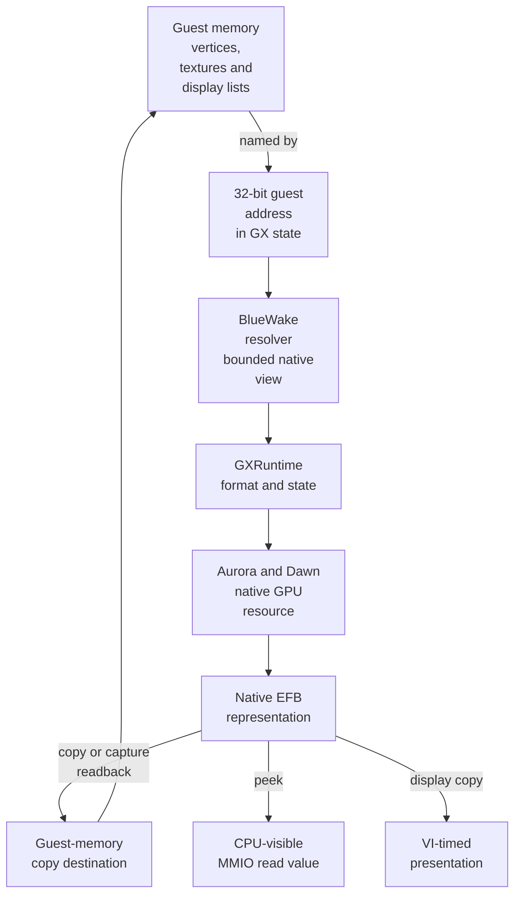

Resolution does not replace the original guest address with a native pointer.
Aurora may convert, upload, or cache the resolved bytes, and those native
resources can be invalidated or rebuilt without changing guest state. The
rendered EFB becomes guest data only through a defined operation such as a
copy or readback; otherwise it proceeds toward presentation.

This mirrors the important GameCube distinction: graphics resources can be
sourced from main memory, while embedded graphics storage and framebuffer
operations are not ordinary CPU-addressable MEM1. BlueWake models that
behavior rather than allocating a flat guest VRAM region. An integrated host
GPU may physically share system memory, but Dawn still preserves the logical
resource and synchronization boundary; BlueWake does not assume zero-copy
access.

References: [guest-memory resource kinds](https://github.com/chrissotraidis/RecompCore/blob/f647d03d3886eb2357950190fe1cba3fa3d10242/GXRuntime/include/gxruntime/guest_memory.h),
[texture and copy state](https://github.com/chrissotraidis/RecompCore/blob/f647d03d3886eb2357950190fe1cba3fa3d10242/GXRuntime/include/gxruntime/gx_recomp.h#L138-L194),
and [BlueWake's bounded resolver](../../runtime/host/src/main.c#L5073-L5161).

### From guest bytes to a GPU resource

BlueWake does not copy data to a visible VRAM address. GXRuntime resolves the
guest source and establishes its GX meaning; Aurora converts it when necessary
and asks Dawn to create native buffers or textures. Aurora writes the prepared
data into CPU-mapped staging storage, records buffer or texture copy commands,
and submits the command buffer through Dawn.

```text
guest memory -> resolve and decode -> staging buffer -> Dawn copy command
             -> Vulkan / D3D12 / Metal -> driver-managed GPU resource
```

The native API and graphics driver choose the physical memory heap and manage
residency. A discrete GPU will normally transfer staged data from system memory
to device-local VRAM; an integrated or unified-memory GPU may use shared
physical memory. The Dawn resource and synchronization boundary remains the
same in either case. Cached resources can be reused until guest changes or
renderer state require them to be updated or rebuilt.

For example, a guest texture is converted from its GameCube format, created as
a Dawn texture with copy-destination usage, and queued for upload. Aurora uses
the same staging model for vertex, index, uniform, and storage buffers. Queue
ordering guarantees that these copies complete before a dependent draw reads
the resources and writes the native EFB targets.

References: [texture conversion and creation](https://github.com/chrissotraidis/RecompCore/blob/f647d03d3886eb2357950190fe1cba3fa3d10242/GXRuntime/graphics/aurora/lib/gfx/texture.cpp#L54-L145),
[mapped staging resources](https://github.com/chrissotraidis/RecompCore/blob/f647d03d3886eb2357950190fe1cba3fa3d10242/GXRuntime/graphics/aurora/lib/gfx/common.cpp#L1164-L1192),
[queued texture uploads](https://github.com/chrissotraidis/RecompCore/blob/f647d03d3886eb2357950190fe1cba3fa3d10242/GXRuntime/graphics/aurora/lib/gfx/common.cpp#L660-L705),
and [GPU copy encoding](https://github.com/chrissotraidis/RecompCore/blob/f647d03d3886eb2357950190fe1cba3fa3d10242/GXRuntime/graphics/aurora/lib/gfx/common.cpp#L1834-L1900).

### End-to-end interaction

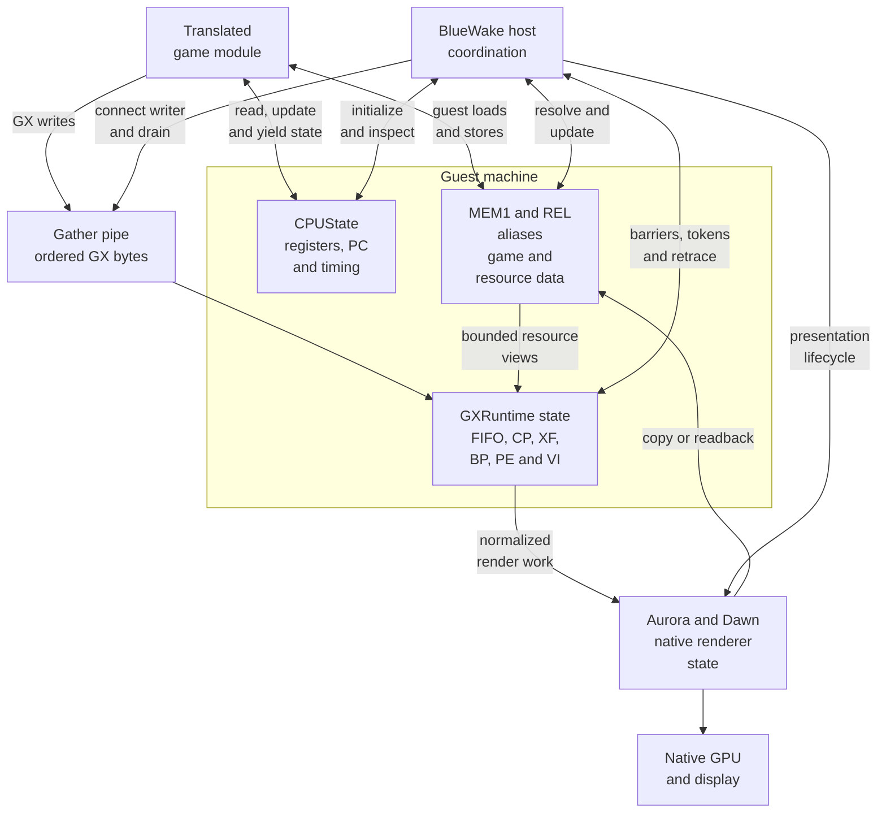

The diagram shows ownership and data movement, not an exact call order. In
particular, a GX completion event may be produced asynchronously and then
published by the host at a translated-code boundary; not every draw performs a
copy or interrupts the guest.

| Direction | Mechanical interaction | Why it matters | Code reference |
| --- | --- | --- | --- |
| Module → GXRuntime | Translated stores reach the gather pipe; direct or batched transport preserves their guest byte order. | The original game remains responsible for draw order and GX configuration. | [Gather-pipe writer](../../cmake/composite/gather_pipe.h), [host connection](../../runtime/host/src/main.c#L8289-L8300) |
| Guest memory → GXRuntime | A display list, vertex array, texture, TLUT, or copy destination is resolved from its 32-bit guest address to a bounded native view. | Graphics can consume MEM1 or linked REL resources without replacing the address stored by the game. | [Host resolver](../../runtime/host/src/main.c#L5073-L5161), [guest address model](GuestState.md#guest-to-host-address-resolution) |
| Host → GXRuntime | The host installs the resolver, drains FIFO work at observable barriers, and coordinates draw-sync and draw-done publication. | Native worker latency cannot make guest-visible GPU progress early or indefinitely late. | [Resolver installation](../../runtime/host/src/main.c#L7709-L7718), [completion commits](../../runtime/host/src/main.c#L10273-L10297) |
| Aurora → guest state | Required EFB copies or readbacks make GPU-produced bytes available to guest memory before the corresponding completion is exposed. | The game can use a rendered image as input, as the Picto Box does. | [PR #341](https://github.com/chrissotraidis/bluewake/pull/341) |
| Host → Aurora | Completed VI retraces service pending presentation and platform lifecycle work. | A finished draw is displayed according to guest video timing rather than immediately after any FIFO write. | [Retrace service](../../runtime/host/src/main.c#L5397-L5419), [host main loop](Host.md#main-loop-execution) |

Two concrete flows show the boundary in both directions:

1. With controller zoom enabled, the host updates guest camera data. Translated
   camera code reads that data and emits changed XF transforms; GXRuntime and
   Aurora render the new view. [PR #221](https://github.com/chrissotraidis/bluewake/pull/221)
   changes the host/guest integration, not the native graphics API.
2. During a Picto Box capture, Aurora renders the EFB result and the runtime
   makes the required copy readable through guest memory before the host
   publishes the draw-sync token. The translated game then evaluates those
   bytes. [PR #341](https://github.com/chrissotraidis/bluewake/pull/341) fixes
   that renderer-to-guest direction.

## Mechanical contents

### Component ownership

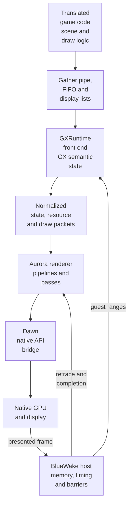

The diagram is a component view, not a thread or call-order diagram. FIFO
translation, render work, and presentation can cross worker boundaries; guest
barriers determine when their effects must become observable.

| Entity | Owns | Produces | Code reference |
| --- | --- | --- | --- |
| Translated game | Original scene traversal, GX control flow, command writes, and guest addresses | FIFO bytes and display-list calls | [Runtime entities](Runtime.md#runtime-entities) |
| Gather-pipe bridge | Ordered module-to-host transport | GX byte stream | [Bridge selection](../../runtime/host/src/gather_pipe_bridge.h), [translated writer](../../cmake/composite/gather_pipe.h) |
| GXRuntime front end | FIFO decoding and CP, XF, BP, PE, texture, copy, and VI semantics | Normalized state, resource, draw, copy, and completion events | [Front-end contract](https://github.com/chrissotraidis/RecompCore/blob/f647d03d3886eb2357950190fe1cba3fa3d10242/GXRuntime/graphics/frontend/ARCHITECTURE.md), [state model](https://github.com/chrissotraidis/RecompCore/blob/f647d03d3886eb2357950190fe1cba3fa3d10242/GXRuntime/include/gxruntime/gx_recomp.h#L120-L278) |
| Aurora | GX-to-renderer mapping, shaders, pipelines, resource conversion, render passes, copies, and interpolation | Native GPU command work | [Aurora graphics](https://github.com/chrissotraidis/RecompCore/tree/f647d03d3886eb2357950190fe1cba3fa3d10242/GXRuntime/graphics/aurora) |
| Dawn | Device, queue, shader, resource, surface, and API-neutral submission interfaces | Work for an enabled native GPU API | [Aurora backend integration](https://github.com/chrissotraidis/RecompCore/blob/f647d03d3886eb2357950190fe1cba3fa3d10242/GXRuntime/backends/aurora/aurora_graphics.cpp) |
| BlueWake host | Renderer lifecycle, guest-address resolution, FIFO connection, barriers, retrace, and shutdown order | Resolved ranges, flushes, PE events, and presents | [Renderer setup](../../runtime/host/src/main.c#L7571-L7640), [resolver installation](../../runtime/host/src/main.c#L7709-L7718) |

BlueWake does not replace the game's draw logic. It supplies the environment in
which translated GX writes retain their ordering and meaning.

### Guest-visible GX state

GXRuntime converts command bytes into explicit front-end state. That state is
separate from native GPU objects that Aurora and Dawn create to implement it.

| State family | Examples | Guest-visible purpose | Code reference |
| --- | --- | --- | --- |
| FIFO and command processor | Buffered bytes, array bases and strides | Orders commands and locates vertex data | [FIFO and CP state](https://github.com/chrissotraidis/RecompCore/blob/f647d03d3886eb2357950190fe1cba3fa3d10242/GXRuntime/include/gxruntime/gx_recomp.h#L120-L137) |
| Vertex description | VCD/VAT formats, indexed attributes, vertex layouts | Defines how each draw payload becomes vertex inputs | [Vertex layout](https://github.com/chrissotraidis/RecompCore/blob/f647d03d3886eb2357950190fe1cba3fa3d10242/GXRuntime/include/gxruntime/gx_recomp.h#L157-L175) |
| Transform unit | Matrices, viewport, projection, lights, texture matrices | Supplies geometry, camera, lighting, and texture-coordinate inputs | [GX state](https://github.com/chrissotraidis/RecompCore/blob/f647d03d3886eb2357950190fe1cba3fa3d10242/GXRuntime/include/gxruntime/gx_recomp.h#L196-L278) |
| Raster and pixel engine | BP, TEV, blend, depth, token, and finish state | Controls pixel production and observable completion | [Event model](https://github.com/chrissotraidis/RecompCore/blob/f647d03d3886eb2357950190fe1cba3fa3d10242/GXRuntime/include/gxruntime/gx_recomp.h#L69-L87) |
| Textures and TLUTs | Image descriptors, palettes, invalidation, source ranges | Connects guest image data to sampled resources | [Texture and TLUT records](https://github.com/chrissotraidis/RecompCore/blob/f647d03d3886eb2357950190fe1cba3fa3d10242/GXRuntime/include/gxruntime/gx_recomp.h#L138-L156) |
| Copy state | EFB source rectangle, destination, format, scale, and clear bit | Publishes rendered results to memory or presentation | [Copy state](https://github.com/chrissotraidis/RecompCore/blob/f647d03d3886eb2357950190fe1cba3fa3d10242/GXRuntime/include/gxruntime/gx_recomp.h#L177-L194) |

### Artifact-to-game examples

| Graphics artifact or data | In-game action | Runtime contact | Example contribution |
| --- | --- | --- | --- |
| FIFO and command-processor state | Drawing Link, an actor, the HUD, or a room sends ordered GX commands and array configuration. | Translated stores enter the gather pipe; GXRuntime updates FIFO and CP state before decoding draws. | [PR #37](https://github.com/chrissotraidis/bluewake/pull/37) consolidated the direct and batched gather-pipe paths used by the native module. |
| Vertex descriptions and guest arrays | A model draw selects positions, normals, colors, and texture coordinates from guest memory. | VCD/VAT and CP array state tell GXRuntime how to resolve and decode the draw's guest-backed vertices. | [PR #37](https://github.com/chrissotraidis/bluewake/pull/37) integrated the guest resolver and renderer paths used by translated model draws. |
| Transform state | The camera moves or an actor animates, changing matrices, viewport, projection, or lights. | XF commands update front-end state consumed by the native draw. | [PR #221](https://github.com/chrissotraidis/bluewake/pull/221) changes guest camera data; the existing translated transform and graphics path renders the result. |
| Raster, TEV, depth, and blend state | Water, fog, transparency, lighting, particles, and interface elements combine into the frame. | BP commands configure pixel processing; GXRuntime normalizes that state for Aurora. | [PR #37](https://github.com/chrissotraidis/bluewake/pull/37) brought the current GXRuntime/Aurora rendering integration into BlueWake. |
| Textures and TLUTs | A scene, character, or HD replacement samples image and palette data. | GXRuntime resolves the guest image range; Aurora converts, caches, and samples a native resource. | [PR #37](https://github.com/chrissotraidis/bluewake/pull/37) consolidated texture-pack and renderer-resource integration. |
| EFB and copy state | The game copies a frame for display or reads current EFB content for a gameplay test. | Copy and synchronization state determines which rendered result is visible to the game or presenter. | [PR #341](https://github.com/chrissotraidis/bluewake/pull/341) pins the matching runtime so Picto Box subject recognition reads the current EFB. |
| Dawn surface and presentation resources | Resizing the game window recreates or reconfigures native presentation while play continues. | Aurora and Dawn retain GX work while the platform surface changes; VI timing still services presentation. | [PR #353](https://github.com/chrissotraidis/bluewake/pull/353) adopts the runtime fix that keeps a resized Vulkan window drawing. |

### Guest resource resolution

GX commands carry 32-bit guest addresses, not native pointers. Before reading a
display list, vertex array, texture, TLUT, or copy destination, GXRuntime asks
BlueWake for a bounded native view of the corresponding bytes.

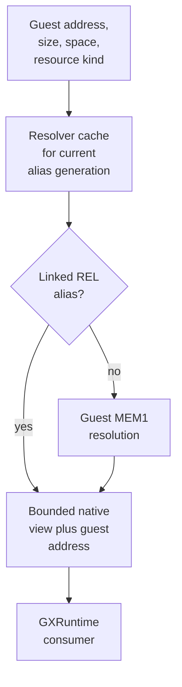

The cache key includes address, size, address-space mode, and alias generation.
Linked REL aliases take precedence over ordinary MEM1 backing. The result is a
temporary native view; it does not replace the address stored in guest state.
The resolver exists because graphics resources can live in linked REL data as
well as ordinary MEM1—for example, its source comments identify linked
display-list data and Molgera's texture-coordinate array.

References: [BlueWake resolver](../../runtime/host/src/main.c#L5073-L5161),
[guest-memory contract](https://github.com/chrissotraidis/RecompCore/blob/f647d03d3886eb2357950190fe1cba3fa3d10242/GXRuntime/include/gxruntime/guest_memory.h),
and [guest address resolution](GuestState.md#guest-to-host-address-resolution).

## Representative model draw: a tree

This example follows a representative textured tree draw through the actual
runtime boundaries. It is not a verified instruction-by-instruction trace of a
specific Wind Waker tree asset: the game may split bark, leaves, translucency,
or distance variants into several draws, and may emit commands directly or
through display lists. Those variations use the same contracts below.

### End-to-end flow

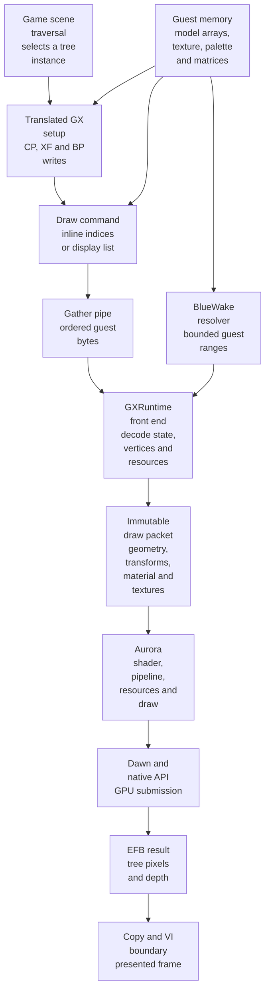

| Step | Concrete data or action | What the runtime does | Code reference | Visible effect |
| --- | --- | --- | --- | --- |
| 1. Select | Scene code selects the tree model, instance transform, material, and texture. | Original translated game logic decides that the object is visible and should draw. | [Native game module](Runtime.md#runtime-entities) | Removing or changing this decision removes or relocates the tree; the host renderer does not invent it. |
| 2. Configure vertices | CP array bases/strides and VCD/VAT describe position, normal, color, and texture-coordinate inputs. | FIFO parsing reconstructs a vertex layout and the byte spans needed from guest arrays. | [Leaf-strip decoder fixture](https://github.com/chrissotraidis/RecompCore/blob/f647d03d3886eb2357950190fe1cba3fa3d10242/GXRuntime/graphics/aurora/tests/gx_dl_test.cpp#L54-L84) | Wrong formats or indices deform geometry, attach the wrong colors, or make leaves disappear. |
| 3. Configure transforms | XF receives the tree's position/normal matrix, camera projection, viewport, and relevant lighting state. | GXRuntime snapshots the active transform state for the draw. | [GX state definition](https://github.com/chrissotraidis/RecompCore/blob/f647d03d3886eb2357950190fe1cba3fa3d10242/GXRuntime/include/gxruntime/gx_recomp.h#L196-L278) | Wrong matrices move the tree, distort it, or place it outside the camera; wrong normals or lights change its shading. |
| 4. Configure material | BP/TEV, depth, blend, cull, and texture state describe how fragments become pixels. | The front end turns register state into a renderer-facing pipeline and material description. | [Retail GX front end](https://github.com/chrissotraidis/RecompCore/blob/f647d03d3886eb2357950190fe1cba3fa3d10242/GXRuntime/graphics/frontend/src/retail_gx_frontend.cpp) | These choices determine opaque bark, cutout or blended leaves, fog, depth ordering, and color combination. |
| 5. Resolve resources | Draw indices, display lists, texture images, and optional TLUTs still name guest addresses. | BlueWake resolves exact bounded ranges; GXRuntime reads the guest bytes under the active descriptors. | [Resolver](../../runtime/host/src/main.c#L5073-L5161), [resource kinds](https://github.com/chrissotraidis/RecompCore/blob/f647d03d3886eb2357950190fe1cba3fa3d10242/GXRuntime/include/gxruntime/guest_memory.h) | Resolving the wrong REL or MEM1 range can corrupt geometry or substitute unrelated texture data. |
| 6. Normalize | Active state, decoded geometry, transforms, texture views, and ordering become a draw packet. | GXRuntime freezes the inputs required by Aurora so later FIFO changes cannot rewrite an earlier draw. | [Packet adapter](https://github.com/chrissotraidis/RecompCore/blob/f647d03d3886eb2357950190fe1cba3fa3d10242/GXRuntime/graphics/frontend/src/retail_gx_frontend.cpp#L15-L79) | Preserves the state belonging to this tree when the next object changes GX registers. |
| 7. Render | Aurora selects or builds a compatible shader and pipeline, converts or reuses textures, binds resources, and records the draw. | Renderer work is queued through Dawn to the native graphics API. | [Draw-plan submission](https://github.com/chrissotraidis/RecompCore/blob/f647d03d3886eb2357950190fe1cba3fa3d10242/GXRuntime/graphics/aurora/lib/gfx/gxcore_draw.cpp#L1599-L1614), [native draw](https://github.com/chrissotraidis/RecompCore/blob/f647d03d3886eb2357950190fe1cba3fa3d10242/GXRuntime/graphics/aurora/lib/gx/pipeline.cpp#L1-L44) | The native GPU writes the tree's color and depth into the current EFB representation. |
| 8. Present | The completed scene reaches a display-copy and VI/retrace boundary. | The host services pending Aurora presentation according to guest VI time. | [Retrace service](../../runtime/host/src/main.c#L5397-L5419) | The tree appears as part of the completed frame rather than being presented independently. |

The source tests make two parts of this example tangible. The
[leaf-strip fixture](https://github.com/chrissotraidis/RecompCore/blob/f647d03d3886eb2357950190fe1cba3fa3d10242/GXRuntime/graphics/aurora/tests/gx_dl_test.cpp#L54-L84)
decodes a four-vertex triangle strip whose tuples index position, normal,
color, and texture coordinates. The
[frame-interpolation fixture](https://github.com/chrissotraidis/RecompCore/blob/f647d03d3886eb2357950190fe1cba3fa3d10242/GXRuntime/graphics/aurora/tests/frame_interp_test.cpp#L252-L292)
uses two distinct tree instances to verify that reordered draws match the
nearby prior instance and that a camera cut rejects unsafe interpolation. These
are synthetic renderer tests, not Wind Waker asset descriptions.

### What changes the image

| Change | Owner | How it reaches the tree |
| --- | --- | --- |
| Camera rotation or zoom | Guest camera state plus translated game code | New camera matrices are written through XF state; Aurora renders the same model from the changed view. [PR #221](https://github.com/chrissotraidis/bluewake/pull/221) is a concrete host-to-guest camera example. |
| Widescreen or ultrawide framing | Game/mod state and projection/HUD adjustments | The translated renderer emits changed projection or placement; the graphics backend consumes the resulting state. [PR #279](https://github.com/chrissotraidis/bluewake/pull/279) is a game-facing example. |
| HD tree texture | Texture replacement in Aurora | Guest texture identity selects a replacement while geometry, transforms, and GX material state remain part of the original draw path. [PR #37](https://github.com/chrissotraidis/bluewake/pull/37) integrated texture-pack support. |
| Smooth Motion | Aurora frame interpolation | Matching draws can interpolate transforms between game frames; discontinuities such as camera cuts must reject interpolation. [Tree fixture](https://github.com/chrissotraidis/RecompCore/blob/f647d03d3886eb2357950190fe1cba3fa3d10242/GXRuntime/graphics/aurora/tests/frame_interp_test.cpp#L252-L292). |
| Missing or corrupt geometry | GX front end, resolver, or guest data | Incorrect VCD/VAT decoding, array bounds, REL resolution, or transform state can remove or deform the model before native rasterization. [Resolver rationale](../../runtime/host/src/main.c#L5121-L5133). |

## GX command path

### Gather-pipe transport

The game writes commands and inline draw data to the emulated GX gather pipe.
The bridge can send each write directly or batch consecutive bytes before they
cross the module/host ABI. Both modes must deliver the same guest-order stream.

Recognizing the hardware address is separate from deciding whether a store is
actually hardware I/O. BlueWake recognizes stores in the 32-byte GX FIFO
window at `0xCC008000–0xCC00801F`, but registered guest-memory aliases take
precedence over that interpretation. The ordinary `get_ram_ptr()` check asks
whether the particular access resolves to alias-backed storage; if it does,
the store must remain on the normal guest-memory path. See
[guest-to-host address resolution](GuestState.md#guest-to-host-address-resolution).

Normal optimized Linux builds cache only whether *any* registered alias can
overlap the FIFO window. The check covers both `0xCC008000–0xCC00801F` and its
canonical `0x8C008000–0x8C00801F` form because the memory resolver accepts the
mirrored address when applying alias precedence. Only the `0xCC008000` window
is recognized here as the hardware gather-pipe address. The cached value is a
boolean overlap decision, not a guest mapping or native pointer.

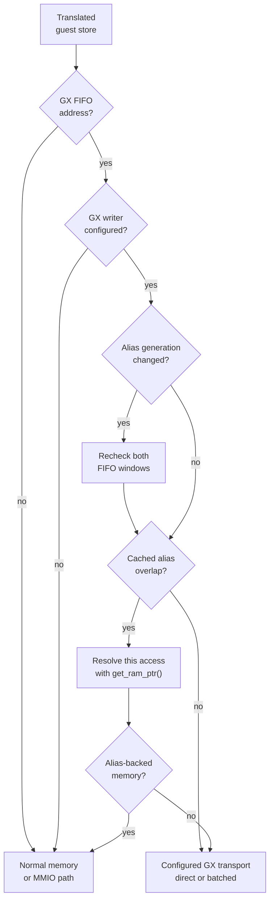

This is a contract map, not a literal call graph. RecompCore increments the
guest-alias registry generation whenever aliases change. A generation change
therefore refreshes both range checks before another cached decision is used.
If either range can overlap an alias, BlueWake retains per-access resolution,
including partial-alias and registration-precedence behavior. If neither can
overlap, repeated FIFO stores skip that resolver work. [RecompCore #45](https://github.com/chrissotraidis/RecompCore/pull/45)
defines the overlap query and generation contract.

| Step | Runtime result | Code reference |
| --- | --- | --- |
| Recognize `0xCC008000` | A translated hardware store is identified as a gather-pipe write rather than guest RAM | [Translated writer](../../cmake/composite/gather_pipe.h) |
| Preserve alias precedence | A generation-keyed overlap result skips resolution only when neither FIFO address form can overlap guest-backed storage | [Alias gate](../../cmake/composite/gather_pipe.h), [registry contract](https://github.com/chrissotraidis/RecompCore/pull/45) |
| Preserve guest byte order | 1-, 2-, 4-, or 8-byte stores become the FIFO byte sequence expected by GXRuntime | [Batch encoding](../../cmake/composite/gather_pipe.h), [batch storage](../../cmake/composite/gather_pipe_batch.h) |
| Select direct or batched mode | The host connects module exports to the active platform backend | [Bridge selection](../../runtime/host/src/main.c#L8289-L8300) |
| Drain at an observable boundary | Earlier bytes reach the parser before hardware access, a host boundary, or a return can observe progress | [Writer contract](../../cmake/composite/gather_pipe.h), [flush implementation](../../cmake/composite/gather_pipe.c) |

| Mode | Purpose | Ordering rule | Code reference |
| --- | --- | --- | --- |
| Direct | Avoid generic MMIO dispatch for safe writes | Each write crosses the host ABI immediately | [Direct writer](../../cmake/composite/gather_pipe.h) |
| Batched | Amortize crossings | A 256-byte guest-order batch drains before a boundary that can observe FIFO progress | [Batch writer](../../cmake/composite/gather_pipe_batch.h), [implementation](../../cmake/composite/gather_pipe.c) |
| Generic MMIO | Compatibility and diagnostics | Follow external-memory routing | [Bridge selection](../../runtime/host/src/gather_pipe_bridge.h) |

The bridge disables old writers before selecting a mode. Modules without the
new exports retain the MMIO path, and diagnostic MMIO forces that fallback.
Writer selection happens before translated stores use this path. The alias
gate decides whether a store may reach that already-configured writer; it does
not select direct versus batched mode. It does not change FIFO byte ordering,
batch drains, GX decoding, guest synchronization, or the original memory/MMIO
fallback. This changes transport cost, not GX meaning.

### FIFO and display-list parsing

GXRuntime buffers fragmented writes until a complete command is available. It
then mutates front-end state or emits a draw/resource event. A display-list call
resolves another guest range and parses its nested stream before returning to
the surrounding FIFO; not every model draw must use a display list.

| Command category | Front-end effect | Downstream result |
| --- | --- | --- |
| CP writes | Update arrays, strides, VCD/VAT, and FIFO state | Later vertices use the new layout |
| XF loads | Update matrices, projection, viewport, and lights | Draws receive transform inputs |
| BP writes | Update raster, texture, TEV, copy, token, and finish state | Draws and completion events use new pixel state |
| Indexed loads | Resolve guest array data through CP configuration | Selected inputs are populated |
| Draws | Decode vertices under active state | Aurora receives normalized geometry |
| Display-list calls | Resolve and parse another guest command range | Nested commands preserve GX order |

The parser rejects malformed or incomplete streams rather than guessing
resource sizes. The [retail front end](https://github.com/chrissotraidis/RecompCore/blob/f647d03d3886eb2357950190fe1cba3fa3d10242/GXRuntime/graphics/frontend/src/retail_gx_frontend.cpp#L667-L770)
implements FIFO and explicit display-list entry points; its recursive parser
resolves guest display-list ranges at the point of consumption.

### From GX state to a native draw

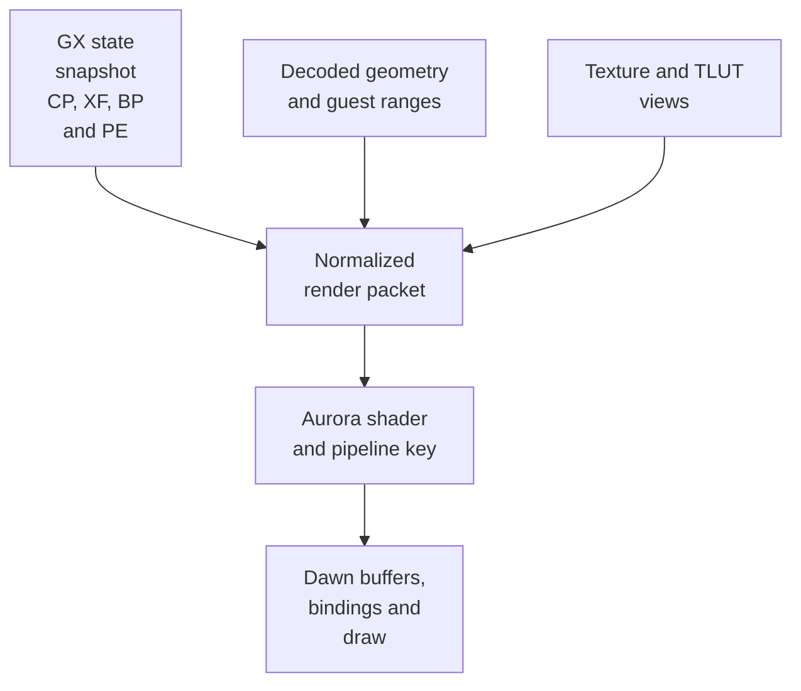

The packet is the ownership boundary: GXRuntime determines what the retail GX
stream means; Aurora determines how to render that meaning efficiently. A
pipeline cache or converted texture may be reused, so this diagram does not
imply shader compilation or texture upload for every draw.

## Textures, frame buffers, and presentation

### Textures and palettes

A texture descriptor supplies dimensions, format, guest base, mipmap policy,
and optional TLUT selection. GXRuntime derives the required guest byte range
and resolves it when the command consumes the resource. Aurora converts the
console layout into a native sampleable texture or reuses a coherent cached
resource. HD texture replacement can substitute an image at this renderer
boundary without changing the guest address held by the game.

| Input | Interpretation | Failure visible in game |
| --- | --- | --- |
| Texture image bytes | Tiled GameCube format, dimensions, levels, and source range | Missing, scrambled, or wrongly colored surfaces |
| TLUT bytes | Palette format and entries used by an indexed texture | Correct shapes with incorrect palette colors, or no valid sample |
| TEV and sampler state | How samples, lighting, vertex color, filtering, and constants combine | Incorrect fog, alpha, water, highlights, or cutout edges |
| Cache identity and coherency | Whether an existing native resource still represents current guest bytes | A stale texture after the game updates its source memory |

Correctness cannot assume that every guest CPU write is intercepted. Resource
bounds and current bytes must therefore be established when GX consumes the
resource, using a trustworthy generation or an exact hash/snapshot strategy.
See the [resource coherency rule](https://github.com/chrissotraidis/RecompCore/blob/f647d03d3886eb2357950190fe1cba3fa3d10242/GXRuntime/graphics/frontend/ARCHITECTURE.md#resource-coherency-rule).

### EFB, copies, and VI presentation

Rendering first changes the EFB representation. A later GX operation can copy
color or depth to guest-visible memory, clear the EFB, expose a pixel through a
peek, or make a completed image available for presentation. VI/retrace timing
is a separate boundary: completing a draw does not by itself authorize an
immediate host-window present.

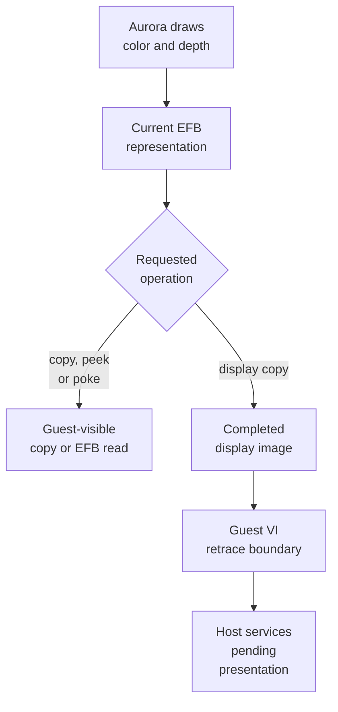

This distinction is game-visible. The Picto Box can inspect rendered EFB
content as gameplay data, while a window resize changes the native surface but
must not discard subsequent GX work. [PR #341](https://github.com/chrissotraidis/bluewake/pull/341)
and [PR #353](https://github.com/chrissotraidis/bluewake/pull/353) exercise those
different sides of the boundary.

## Synchronization and completion

Native rendering is asynchronous, but guest software observes GX progress
through draw-done status, draw-sync tokens, PE interrupts, copies, and later
reads. The runtime drains the necessary work at these semantic barriers so the
guest cannot observe completion too early—or wait forever for work still held
in a host-side batch.

| Boundary | Required observation | Code reference |
| --- | --- | --- |
| Gather-pipe drain | Earlier batched bytes reached the FIFO parser | [Batch contract](../../cmake/composite/gather_pipe_batch.h) |
| GX flush | Complete buffered commands were parsed before guest progress is published | [Platform contract](https://github.com/chrissotraidis/RecompCore/blob/f647d03d3886eb2357950190fe1cba3fa3d10242/GXRuntime/include/gxruntime/platform.h#L89-L100) |
| Draw-sync token | The visible token follows all earlier submitted work | [Host token commit](../../runtime/host/src/main.c#L10273-L10280) |
| Draw done | PE finish becomes visible after the FIFO reaches the required point | [Host finish commit](../../runtime/host/src/main.c#L10282-L10297) |
| PE interrupt | Finish or token state reaches the interrupt controller and guest callback path | [Interrupt delivery](Services.md#interrupt-delivery) |
| EFB read or copy | GPU-produced data is current before a CPU-visible result is consumed | [PR #341](https://github.com/chrissotraidis/bluewake/pull/341) |
| Save/load or shutdown | Front-end and worker state reaches a coherent lifecycle boundary | [Backend ABI](https://github.com/chrissotraidis/RecompCore/blob/f647d03d3886eb2357950190fe1cba3fa3d10242/GXRuntime/include/gxruntime/aurora_backend.h) |

These barriers preserve expected completion semantics; they do not imply that
every translated GX write waits for the native GPU or that every host hook
replaces an original game routine.

## Contribution case studies

| Contribution | Boundary changed | Game-visible result | What it did not replace |
| --- | --- | --- | --- |
| [PR #37](https://github.com/chrissotraidis/bluewake/pull/37) | Integrated GXRuntime/Aurora, gather-pipe transport, texture packs, and Smooth Motion into BlueWake. | The translated game can render through the native graphics stack, use replacement textures, and optionally display interpolated frames. | Wind Waker's scene traversal and per-object draw decisions remain translated game code. |
| [PR #221](https://github.com/chrissotraidis/bluewake/pull/221), carrying [PR #213](https://github.com/chrissotraidis/bluewake/pull/213) | Host controller gestures modify guest camera structures used by existing camera integration. | Holding the configured controller gesture changes zoom; the next translated camera and transform work renders the changed view. | It does not directly edit generated draw chunks or replace Nintendo's whole camera renderer. |
| [PR #279](https://github.com/chrissotraidis/bluewake/pull/279) | Game/mod projection, camera, and HUD behavior feeds the same graphics path with ultrawide-aware state. | More world is framed at 21:9 and interface placement can be corrected. | Dawn and the native GPU do not decide the game's field of view. |
| [PR #341](https://github.com/chrissotraidis/bluewake/pull/341) | EFB CPU-read coherence and the matching RecompCore pin. | Picto Box subject recognition sees the current rendered image rather than stale EFB data. | The host does not replace the game's subject-recognition decision. |
| [PR #353](https://github.com/chrissotraidis/bluewake/pull/353) | Vulkan surface reconfiguration in the runtime renderer. | Rendering continues after a Linux window resize. | Guest GX state and the game's draw sequence do not need to change. |

These examples locate a visual feature or bug at its actual contract. Camera
and widescreen work can change data before GX; EFB correctness sits at the
guest-visible render-result boundary; resize correctness sits after GX in the
native surface lifecycle.

## State, fallback, and shutdown

GX front-end state belongs to the guest machine model. Native caches, pipelines,
converted textures, and surfaces are implementation resources that can be
rebuilt from front-end and guest data.

| Situation | Behavior | Reason |
| --- | --- | --- |
| Save or load | Drain asynchronous work and preserve supported front-end state | Avoid mixing two guest timelines |
| Explicit renderer failure | Report failure instead of silently changing the requested backend | Preserve an explicit choice |
| Automatic selection failure | Use the supported headless fallback where configured | Permit non-presenting execution |
| Desktop OpenGL fallback | Warn about the selected compatibility path | Expose capability or performance limits |
| Shutdown | Disable gather-pipe writers before destroying Aurora | Prevent late writes into torn-down resources |

Lifecycle entry points are defined by the [Aurora backend ABI](https://github.com/chrissotraidis/RecompCore/blob/f647d03d3886eb2357950190fe1cba3fa3d10242/GXRuntime/include/gxruntime/aurora_backend.h)
and coordinated by the [BlueWake host](../../runtime/host/src/main.c).

Graphics evidence also spans layers. Synthetic Aurora/gxcore fixtures protect
parsing, interpolation, shared state, worker identity, shutdown, and selected
pixel contracts; platform integration tests prove the linked backend builds and
runs; GPU readback, complete scenes, resizing, presentation, and visual quality
still require the relevant backend or hardware. See
[runtime and renderer tests](Testing.md#runtime-and-renderer-tests),
[platform entry points](Testing.md#platform-entry-points), and
[private and hardware validation](Testing.md#private-and-hardware-validation).

Return to the runtime [high-level view](Runtime.md#high-level-view).
