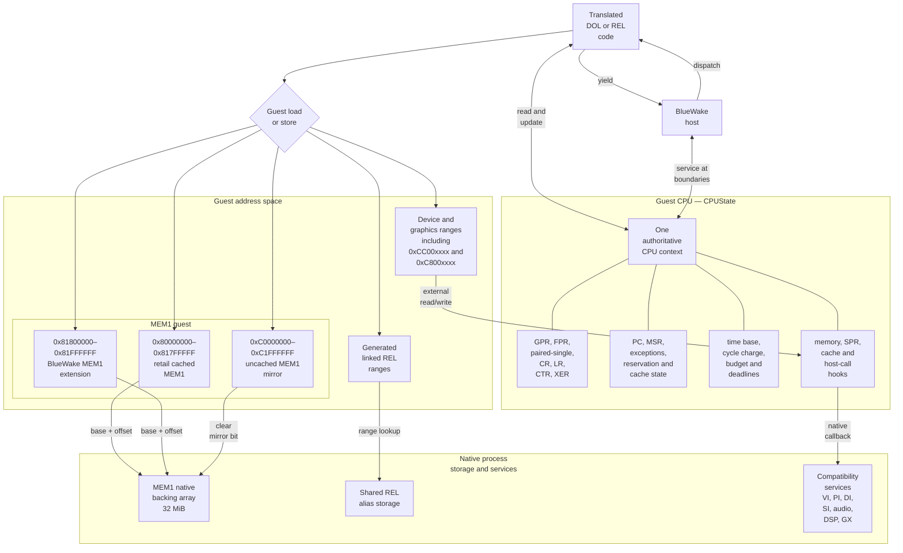
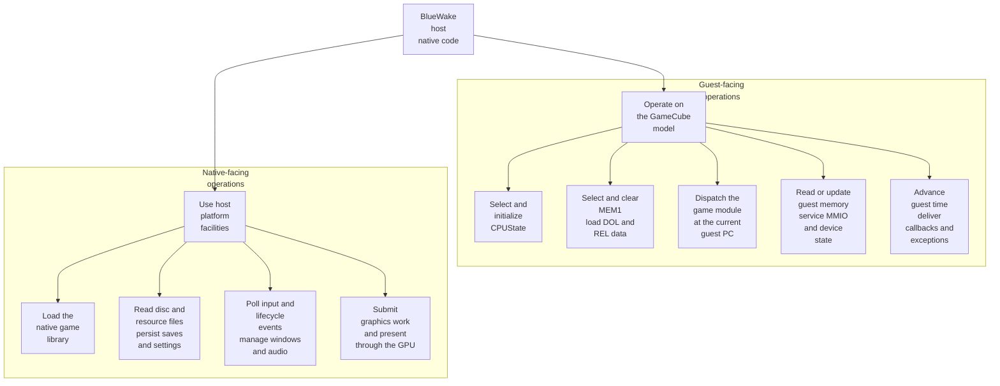
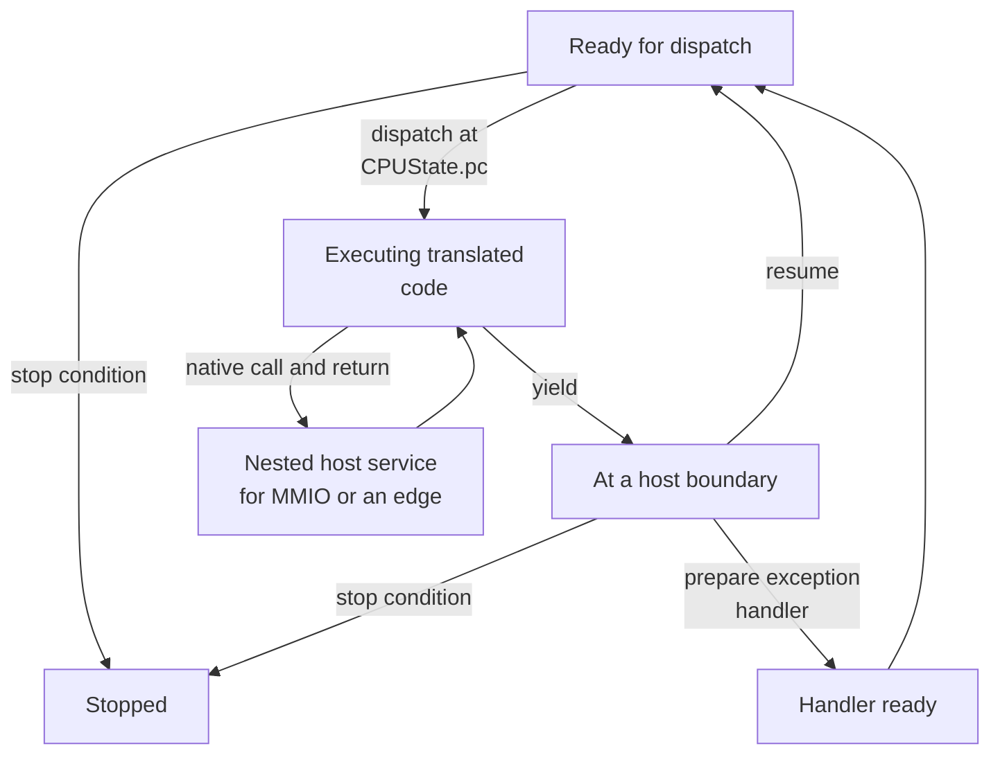
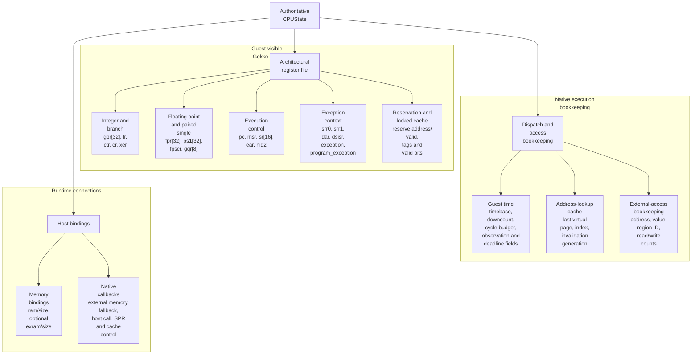
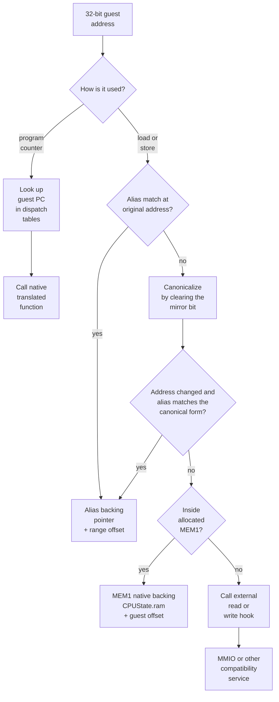
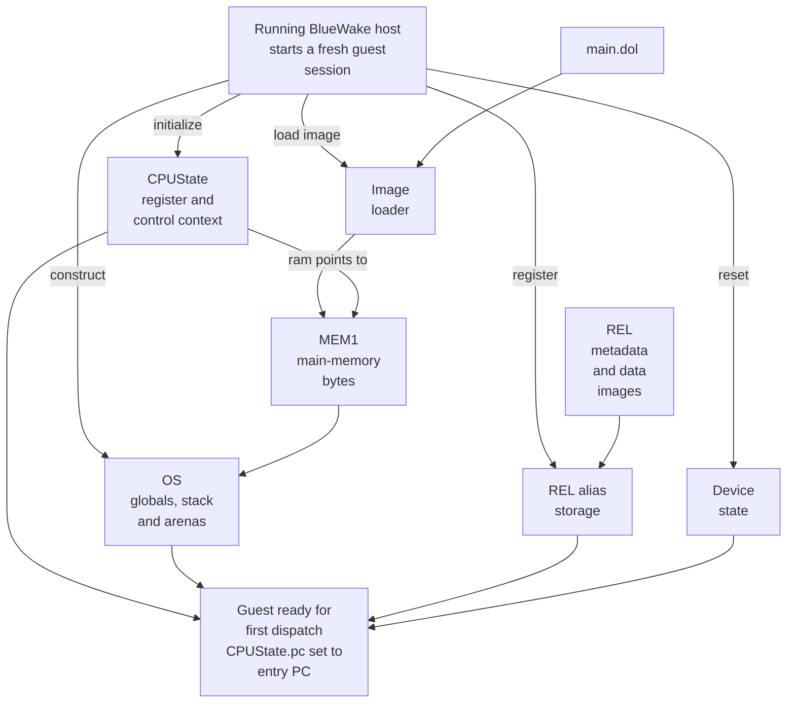
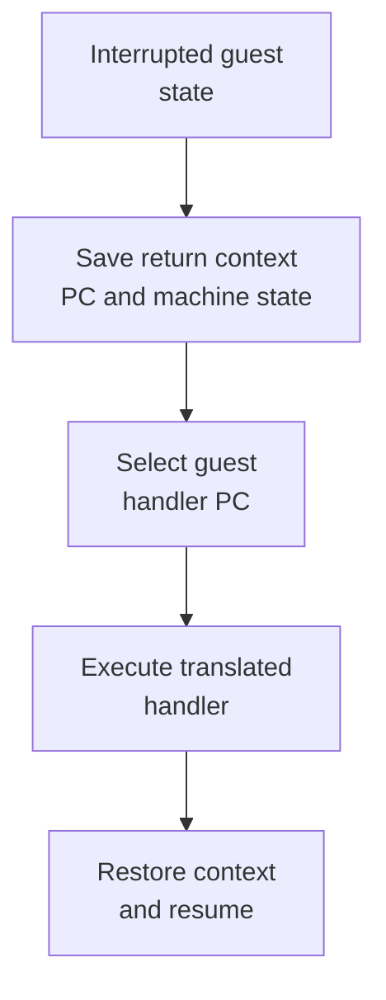

# Guest machine state

## Contents

- [Responsibility](#responsibility)
- [Mechanical contents](#mechanical-contents)
  - [CPU, memory space, and I/O](#cpu-memory-space-and-io)
  - [Host work across the guest/native boundary](#host-work-across-the-guestnative-boundary)
  - [State versus execution transitions](#state-versus-execution-transitions)
  - [CPUState layout](#cpustate-layout)
  - [Game-perspective examples](#game-perspective-examples)
- [DOL and REL roles](#dol-and-rel-roles)
- [Ownership and address model](#ownership-and-address-model)
  - [MEM1 layout](#mem1-layout)
  - [Guest-to-host address resolution](#guest-to-host-address-resolution)
- [Starting a fresh guest session](#starting-a-fresh-guest-session)
- [Guest time, callbacks, and exceptions](#guest-time-callbacks-and-exceptions)
- [Project history references](#project-history-references)

Architecture path: [Overview](Overview.md) → [Runtime](Runtime.md) → **Guest machine state**

## Responsibility

Guest state is the GameCube-visible machine model shared by the host and the
translated module. Its core pieces are `CPUState`, which is the authoritative
guest processor context, and MEM1, which holds the guest main-memory bytes.
`CPUState` is not a complete machine snapshot: REL alias storage and the
services that model devices, DSP, graphics, timing, and interrupts retain
additional state needed to resume the guest.

## Mechanical contents

The two main pieces are separate native allocations with different jobs:

| Term | Plain meaning | Concrete representation in BlueWake |
| --- | --- | --- |
| `CPUState` | The current state of the guest Gekko processor: what its registers contain, which guest instruction comes next, and what timing or exception work is pending. It does **not** contain the guest's RAM bytes. | One C structure containing the guest register file, `pc`, control and exception fields, cycle accounting, a pointer to memory, and native access hooks. [Current structure](https://github.com/chrissotraidis/RecompCore/blob/f647d03d3886eb2357950190fe1cba3fa3d10242/GXRuntime/include/core/cpu.h#L129-L192) |
| MEM1 | The guest's main-memory contents: program data, stacks, heaps, loaded DOL sections, and materialized REL data addressed by the game. It does **not** contain the CPU registers. | A 32 MiB byte array in the BlueWake process. `CPUState.ram` points to that array; the first 24 MiB corresponds to retail GameCube MEM1 and the remaining 8 MiB supports BlueWake's linked layout. [Storage contract](../../cmake/composite/module_cpu_contract.h#L16-L27), [storage selection](../../cmake/composite/module_cpu_contract.h#L58-L94) |

Put another way, `CPUState` answers “what is the guest processor doing now?”,
while MEM1 answers “what bytes are currently in guest main memory?”. Together
they form the core guest machine state, with REL alias storage and device state
attached through the address and service interfaces described below.

Generated code expresses guest-register reads and updates through `CPUState`,
while the native compiler may temporarily keep working values in native
registers. When execution reaches a boundary at which the host or runtime can
observe guest state, the updates required by the generated C program are
visible in `CPUState`; this is not a blanket flush of every field at every
boundary. A translated block performs loads and stores through the runtime
memory helpers, charges guest cycles and leaves the next guest address in `pc`.
The host receives the same authoritative state when the block yields rather
than reconstructing the CPU from native registers. [Generated-state
optimization](https://github.com/chrissotraidis/RecompCore/blob/f647d03d3886eb2357950190fe1cba3fa3d10242/GXRuntime/include/core/cpu.h#L193-L200)

### CPU, memory space, and I/O

The CPU context carries guest-visible registers and execution control. Memory
instructions keep their 32-bit guest addresses until the access helpers route
them to native backing storage or an I/O callback. In the diagram, DOL is the
always-loaded main executable and RELs are relocatable game modules; both have
already had their executable instructions translated to native functions.

Cached and uncached MEM1 addresses converge on the same backing bytes. REL
aliases preserve generated linked addresses while pointing both the host and
translated module at shared storage. Device ranges do not become host memory
pointers; they invoke compatibility services through the access hooks.

### Host work across the guest/native boundary

The BlueWake host is always native code. “Guest-facing” and “native-facing”
describe what that code operates on: guest-facing work changes or observes the
GameCube machine model, while native-facing work calls process, file, window,
audio, input, or GPU facilities. Dispatch is the handoff between host code and
translated game code; it is not a switch into an emulated CPU process.

| Runtime phase | Guest-facing host work | Native-facing host work |
| --- | --- | --- |
| Startup | Selects the authoritative `CPUState` and MEM1 storage, installs access hooks, copies DOL data, establishes REL aliases, initializes guest-visible devices, and sets the entry `pc`. | Opens the native game library, resolves its ABI export, opens configured files, and creates renderer, audio, input, and platform resources. [Host initialization](../../runtime/host/src/main.c#L7316-L8115) |
| Guest-time turn | Sets a cycle budget, calls `mod->dispatch(&cpu, cpu.pc)`, then examines the returned PC, cycle charge, exception, and stop state. | Checks platform quit state and performs host scheduling around the native module call. [Main loop](Host.md#main-loop-execution) |
| I/O and services | Resolves guest addresses, models MMIO registers, advances device deadlines, writes DMA or callback results into guest memory, and publishes interrupts. | Reads disc and player-data files, samples controllers, sends audio to the platform queue, and passes graphics work toward the GPU. [Compatibility services](Services.md) and [graphics stack](Graphics.md) |
| Persistence and shutdown | Serializes or restores CPU, MEM1, alias, and device state only at a safe host boundary. | Persists mutable data through its owning adapter, writes save states, settings, and logs at their defined points, and releases native resources at shutdown. [Runtime inputs and persistence](Host.md#runtime-inputs-and-persistence) and [shutdown](Host.md#shutdown) |

### State versus execution transitions

`CPUState` stores processor context; it does not contain an enum describing
where control currently sits. The labels below are a conceptual state machine
for explaining handoffs between the host and translated module. They are not
fields or named states in the implementation.

Normal execution calls ahead-of-time translated native functions; it does not
simulate a hardware instruction fetch/decode pipeline. A translated block can
call an MMIO or edge service and return without first yielding the whole turn,
which is why the nested service path does not imply a new persistent state.
The detailed scheduling and module handoff are shown in the [host main
loop](Host.md#main-loop-execution).

### CPUState layout

This is an inventory of the `CPUState` used by the current BlueWake build, not
a general specification of every register in a GameCube emulator. BlueWake
pins RecompCore at `f647d03d3886eb2357950190fe1cba3fa3d10242`; the groups
below come directly from that revision's structure. `CPUState` combines the
architectural fields used by translated PowerPC instructions with the runtime
fields that connect them to BlueWake's scheduler, memory, and services.

| Register or field group | Concrete layout | Mechanical role |
| --- | --- | --- |
| Integer and branch state | `gpr[32]`, `lr`, `ctr`, `cr`, and `xer` are 32-bit fields | Holds integer operands and results, branch targets, condition bits, and fixed-point status. |
| Floating-point and paired-single state | `fpr[32]` and `ps1[32]` hold the two 64-bit lanes; `fpscr` records floating-point status and `gqr[8]` controls paired-single quantization | Preserves the Gekko floating-point and paired-single register file used by translated instructions. |
| Program and machine control | `pc`, `msr`, `sr[16]`, `ear`, and `hid2` | Selects the next guest instruction and retains processor mode, segment, external-access, and Gekko-specific control state. |
| Exception context | `srr0`, `srr1`, `dar`, `dsisr`, `exception`, and `program_exception` | Records the interrupted PC and machine state, fault address and cause, and the exception awaiting delivery. |
| Reservation and locked cache | Reservation address/valid flag plus 512 locked-cache tags and validity bits | Preserves `lwarx`/`stwcx.` semantics and the Gekko locked-cache model across translated blocks. |
| Guest time | `timebase`, `downcount`, `cycle_budget`, `cycle_observation_suffix`, `cycle_deadline_active`, and `cycle_deadline_budget` | Charges translated work and forces a yield before a device, callback, or interrupt deadline. |
| Address and external-access bookkeeping | Cached translation-lookup fields plus the last external address, value, region ID, and access counts | Avoids repeated address work and carries special-access state between generated code and the runtime. |
| Memory and runtime bindings | `ram` and `ram_size` identify the separate MEM1 allocation; optional EXRAM fields and function pointers cover external memory, instruction fallback, host calls, SPR access, and cache control | Connects the guest CPU context to MEM1 and compatibility services without storing native pointers in guest registers. |

### Game-perspective examples

The following examples start with behavior the game needs and identify the
guest state involved. They are representative mechanical paths, not verified
instruction-by-instruction traces of one specific frame.

| Guest-state artifact | In-game action | What touches the artifact |
| --- | --- | --- |
| Integer and branch state | A gameplay routine reads flags, chooses a branch, updates an actor field, and calls another routine. | Translated integer instructions use `gpr`, condition operations update `cr`, direct calls place a return address in `lr`, and indirect calls or jump tables can use `ctr`. |
| Floating point, paired single, and camera data | Link, the camera, an animation, or a model transform updates positions, angles, matrices, or vertex-related values. | Translated floating-point and paired-single instructions use `fpr`, `ps1`, `fpscr`, and `gqr`; host integrations can also adjust specific camera structures in guest memory. |
| Program and machine control | Execution moves from the current gameplay block to another DOL or REL routine and later returns to its caller. | A translated branch changes `pc`, `lr`, or `ctr`; the dispatcher maps the guest code address to a native translated function. `msr` and related fields retain guest CPU mode. |
| Exception and callback context | A retrace or enabled device event enters a guest handler, or an asynchronous disc read invokes the game's completion callback. | Interrupt delivery records architectural exception state; callback delivery temporarily runs guest code under the expected register, stack, interrupt, and scheduler conventions. |
| Reservation and locked cache | Guest OS or synchronization code performs an atomic update while gameplay systems share state. | Translated `lwarx`/`stwcx.` operations use reservation fields; Gekko locked-cache operations use modeled tags and validity bits. These support gameplay but are not one player-facing feature. |
| Guest time | A gameplay update runs until the next video, audio, DSP, callback, decrementer, or interrupt boundary. | Translated blocks charge `downcount`; the host uses cycle budget, time base, observations, and deadlines to decide when the module yields. |
| Address and external-access bookkeeping | The game reads an actor or asset in RAM, follows a REL-linked address, or touches controller, disc, audio, or graphics registers. | Memory helpers cache ordinary resolution and record accesses crossing into host MMIO. The value held by the game remains a guest address. |
| Memory and runtime bindings | The same translated load reaches MEM1, while a hardware-address load reaches a compatibility service. | RAM bindings provide ordinary backing bytes; callback bindings route non-RAM accesses without placing native pointers in guest registers. |

Two short end-to-end examples show how these areas combine:

1. **Moving Link:** the platform input snapshot becomes a GameCube pad sample
   through SI. Guest PAD code reads that result into MEM1; translated gameplay
   instructions use integer and floating-point state to update actor and camera
   data; later GX work reads the resulting guest data to render the frame.
   [Input path](Services.md#input) and [graphics resource resolution](Graphics.md#guest-resource-resolution)
2. **Completing an asynchronous disc read:** the game programs DI registers
   with a guest destination. The host copies disc bytes into that guest range,
   advances the completion on guest time, then exposes status, an interrupt, or
   a guest callback. Gameplay resumes with the loaded data still addressed in
   the GameCube memory model. [Disc completion](Services.md#disc-commands-and-asynchronous-completion)

The field order and widths form the generated-code ABI. The host rejects a
module when its CPU ABI version or `sizeof(CPUState)` does not match, preventing
translated code from interpreting a different layout. BlueWake's diagnostic
checkpoint independently enumerates the same fields, which also keeps this
documentation grounded in the state the current host observes. [Pinned
revision](../../scripts/builder/profiles/bluewake.sh#L37-L44), [CPU
layout](https://github.com/chrissotraidis/RecompCore/blob/f647d03d3886eb2357950190fe1cba3fa3d10242/GXRuntime/include/core/cpu.h#L130-L185),
[ABI validation](../../cmake/composite/module_cpu_contract.h#L35-L79), and
[checkpoint field list](../../runtime/host/src/guest_checkpoint.h#L9-L38).

The translated native instructions themselves are not guest state, and the
original DOL and REL files are inputs rather than live state. Compatibility
services also retain their own device-specific state. Their guest-visible
effects enter this machine state through MMIO results, memory writes, timing
updates, callbacks, and pending exceptions.

## DOL and REL roles

Ahead-of-time translation replaces executable instructions with native
functions, but the original executable formats still define runtime data and
addresses.

| Artifact | In-game action | Runtime role and source |
| --- | --- | --- |
| DOL sections and data | The game starts in its always-loaded program and reads initialized global data. | DOL sections define the initial guest layout; data is copied into MEM1 while translated functions live in the native module. [DOL loading](../../runtime/host/src/main.c#L7978-L7981) |
| REL data and BSS | The game enters content whose relocatable module reads or updates its linked data. | Each REL contributes relocatable layout, initialized data, zeroed BSS, and linked guest addresses; its translated functions live in the native module. [REL alias setup](../../runtime/host/src/main.c#L7968-L8101) |
| Dispatch metadata | A gameplay call, return, callback, or interrupt resumes at a DOL or REL code address. | Generated tables map the guest `pc` to the corresponding native translated function. [Composite generation](../../scripts/generate_composite.py#L562-L707) |

These artifacts become live guest state through the storage and address rules
below.

## Ownership and address model

The module can export two aligned, non-overlapping allocations: one `CPUState`
structure and one MEM1 byte array. The host selects those exports when present,
initializes both, and sets `CPUState.ram` to the selected MEM1 base. Dispatch,
memory, device, and callback paths then receive the same CPU pointer and reach
the same memory through it. No CPU or MEM1 copy is required when execution
crosses the host/module ABI.

### MEM1 layout

BlueWake provides one contiguous 32 MiB MEM1 allocation. Each byte can be
reached through a cached or uncached guest address. The stacked boxes follow
the current boot layout from high to low; the side callout shows the uncached
view of the same bytes. Fixed boundaries are labeled directly. `ArenaLo` and
the DOL ranges come from the loaded image, so their box heights are only
schematic.

In GameCube OS terminology, an **arena** is the contiguous portion of guest
MEM1 made available to the game's memory allocators. `ArenaLo` is its lower
boundary and `ArenaHi` is its upper boundary; the game carves one or more heaps
from the interval between them. BlueWake places `ArenaLo` after the DOL BSS and
guest stack reserve and sets `ArenaHi` to `0x817FEC60`. This is guest memory
inside MEM1, unrelated to the BlueWake process's native heap. [Boot arena
setup](https://github.com/chrissotraidis/RecompCore/blob/f647d03d3886eb2357950190fe1cba3fa3d10242/GXRuntime/src/boot.c#L25-L78).

The 128 KiB stack reserve and the initial stack pointer serve different boot
purposes. The reserve is the interval immediately above the DOL BSS and is
included when boot derives `ArenaLo`. The initial `r1` value, `0x817FFF00`, is
placed in the fixed above-arena boot area, above `ArenaHi`; it does not point
into that reserved interval.

```mermaid
flowchart LR
    subgraph MEM1["`MEM1 native backing
— 32 MiB
cached ranges
· high to low`"]
        direction TB
        Extension["`&#160;
BlueWake MEM1
extension — 8 MiB
0x81800000–0x81FFFFFF
&#160;`"]
        Boot["`Above-arena boot area
0x817FEC60–0x817FFFFF
initial SP: 0x817FFF00`"]
        Arena["`&#160;
&#160;
OS arena and game heap
ArenaLo–0x817FEC60
&#160;
&#160;`"]
        Stack["`Guest stack reserve
DOL BSS end–ArenaLo
128 KiB plus alignment`"]
        DOL["`DOL sections and
BSS span
linked ranges from
main.dol`"]
        Low["`OS low-memory globals
selected words at
0x80000020–0x800000FC`"]

        Extension ~~~ Boot ~~~ Arena ~~~ Stack ~~~ DOL ~~~ Low
    end

    Mirror["`Uncached MEM1 mirror
0xC0000000–0xC1FFFFFF`"]
    MEM1 <-->|"same backing bytes"| Mirror
```

The retail and extension ranges form the cached 32 MiB window. Clearing the
mirror bit maps the uncached `0xC0000000–0xC1FFFFFF` view onto those same
backing bytes; it does not allocate a second MEM1. On GameCube hardware, a
cached access can be satisfied from Gekko's data cache while a DMA-capable
device reads or writes MEM1 directly. The uncached alias lets game code access
that physical-RAM view when coordinating buffers with hardware. BlueWake does
not maintain a separate cache copy, but translated code still produces these
`0xC0000000`-based addresses, so the runtime must recognize them and resolve
them to the same native bytes. Registered REL aliases are checked according to
the resolver rules below and can direct a linked range to separate shared
storage.
[Storage contract](../../cmake/composite/module_cpu_contract.h#L16-L27),
[host allocation](../../runtime/host/src/main.c#L7688-L7696), and
[boot layout](https://github.com/chrissotraidis/RecompCore/blob/f647d03d3886eb2357950190fe1cba3fa3d10242/GXRuntime/src/boot.c).

### Guest-to-host address resolution

A guest address is a 32-bit value in the emulated Gekko address space. It is
not normally a host pointer, and BlueWake does not require the operating system
to map memory at that numeric address. Logically, each memory access resolves
the guest value to storage or an I/O service inside the BlueWake process.
Generated fast paths can fold the arithmetic or bypass a general lookup when
they preserve the same result. The resulting host virtual address can change
between launches because the module loader and OS choose where native
allocations and code reside.

For example, if a guest register contains `0x80300000`, an ordinary MEM1 load
with no overriding alias resolves it to backing pointer `B + 0x00300000`, where
`B` is the native address of MEM1. The helper reads the bytes using the guest's
byte order and writes the loaded value to the destination guest register. The
original address remains a 32-bit guest value; resolution does not replace it
with a native pointer.

The diagram shows the logical resolution rules rather than the literal order
of every access. The pinned `get_ram_ptr()` first tries a direct MEM1 fast path
when no aliases overlap MEM1 and the address passes its range checks. It can
therefore skip alias lookup when doing so preserves the same result; ordinary
guest-memory accesses do not necessarily search the alias table. [Pinned
resolver](https://github.com/chrissotraidis/RecompCore/blob/f647d03d3886eb2357950190fe1cba3fa3d10242/GXRuntime/include/core/cpu.h#L205-L255)

Address intervals below are half-open: the first address is included and the
end address is excluded.

Address resolution locates the native bytes; interpreting those bytes is a
separate step. Multi-byte guest values use PowerPC big-endian representation,
so the memory helpers use `read_be16`/`32`/`64` and
`write_be16`/`32`/`64` when reading or writing native backing storage. A
one-byte access needs no byte-order conversion. [Byte-order helpers](https://github.com/chrissotraidis/RecompCore/blob/f647d03d3886eb2357950190fe1cba3fa3d10242/GXRuntime/include/core/types.h#L58-L90),
[memory accessors](https://github.com/chrissotraidis/RecompCore/blob/f647d03d3886eb2357950190fe1cba3fa3d10242/GXRuntime/include/core/cpu.h#L280-L374)

| Guest range or address kind | Purpose | Resolution | Host representation |
| --- | --- | --- | --- |
| `0x80000000–0x81800000` | Holds retail GameCube state: selected low-memory OS globals, DOL sections and BSS, the guest stack reserve, the OS arena/game heap, and the above-arena boot area. | Retail 24 MiB cached MEM1. Subtract `0x80000000` to obtain the byte offset. The DOL supplies its section and BSS ranges; boot derives `ArenaLo` by adding a 128 KiB stack reserve to the BSS end and aligning upward. | If the MEM1 allocation begins at host pointer `B`, guest `0x80300000` becomes `B + 0x00300000`. `B` is chosen at runtime and is not required to equal `0x80000000`. [DOL loader](https://github.com/chrissotraidis/RecompCore/blob/f647d03d3886eb2357950190fe1cba3fa3d10242/GXRuntime/src/loader.c#L57-L119), [boot layout](https://github.com/chrissotraidis/RecompCore/blob/f647d03d3886eb2357950190fe1cba3fa3d10242/GXRuntime/src/boot.c#L9-L63) |
| Boot-derived retail subranges | Makes the dynamic boundaries in the diagram concrete: selected OS globals occupy words from `0x80000020` through `0x800000FC`; the stack reserve is `[BSS end, ArenaLo)`; the arena is `[ArenaLo, 0x817FEC60)`; and the initial stack pointer is `0x817FFF00` in the above-arena area. | These are ordinary cached MEM1 addresses. Their order is fixed by boot, but the DOL-provided BSS end determines `ArenaLo`, so the lower boundaries are not universal constants. | Each resolves to `B + (address - 0x80000000)`. The BSS descriptor is a coarse span that can overlap initialized small-data sections, so DOL data and BSS are not disjoint physical partitions. [Boot setup](https://github.com/chrissotraidis/RecompCore/blob/f647d03d3886eb2357950190fe1cba3fa3d10242/GXRuntime/src/boot.c#L25-L78), [BSS loading](https://github.com/chrissotraidis/RecompCore/blob/f647d03d3886eb2357950190fe1cba3fa3d10242/GXRuntime/src/loader.c#L76-L119) |
| `0x81800000–0x81820000` | Sits below the raw REL scratch allocator and includes the callback return sentinel at `0x8180FFF0`. | A matching generated REL alias can shadow the contiguous backing. Otherwise data uses the MEM1 extension. When used as a `pc`/`lr` value, the sentinel marks completion of a host-delivered guest callback rather than translated code to dispatch. | Data resolves to the matching alias or `B + (address - 0x80000000)`; the sentinel is compared as a guest code address and is not dereferenced for callback return. [Scratch boundary](../../runtime/host/src/main.c#L195-L207), [callback sentinel](../../runtime/host/src/callback_delivery.c#L5-L112) |
| `0x81820000–0x81F80000` | Holds dynamically materialized raw REL images while their guest control objects are live. | The host performs a first-fit allocation in this window, avoiding linked REL ranges and live raw-image slots. It records executable raw-to-linked PC aliases when a module is materialized; linked data and BSS use the separate memory-alias storage described below. | Raw image bytes occupy `B + (address - 0x80000000)`. Before dispatch, a matching raw executable `pc` is rewritten to its deterministic linked address. [Scratch allocation](../../runtime/host/src/main.c#L2647-L2673), [PC alias registration](../../runtime/host/src/main.c#L2908-L2982) |
| `0x81F80000–0x82000000` | Reserves the top 512 KiB of the extension as raw REL staging space. | The composite generator rejects linked REL data or BSS ranges that overlap this interval. Ordinary accesses still have contiguous MEM1 backing. | Direct accesses resolve to `B + (address - 0x80000000)`. [Reserved range](../../scripts/generate_composite.py#L25-L28), [overlap validation](../../scripts/generate_composite.py#L220-L232) |
| `0xC0000000–0xC2000000` | Gives guest code an uncached address view of the same retail and extended MEM1 bytes. | Clearing bit `0x40000000` produces the corresponding `0x80000000–0x82000000` address before normal alias/MEM1 resolution. This range is a mirror, not another allocation. | The same host byte as the cached form; for example, `0xC0300000` and `0x80300000` both resolve to `B + 0x00300000`. [Memory resolver](https://github.com/chrissotraidis/RecompCore/blob/f647d03d3886eb2357950190fe1cba3fa3d10242/GXRuntime/include/core/cpu.h#L205-L255) |
| Generated REL data and BSS ranges | Gives each translated REL's data and BSS stable linked guest addresses. These ranges are aliases and are not additional regions of the 32 MiB MEM1 allocation. | The composite metadata supplies exact per-module ranges. The resolver checks the original address and then its bit-`0x40000000`-cleared form; a matching alias takes precedence over contiguous MEM1. | `alias.storage + (address - alias.linked_start)`. Host services and translated code register the same separate backing pointer, so both observe the same bytes. [Alias API](https://github.com/chrissotraidis/RecompCore/blob/f647d03d3886eb2357950190fe1cba3fa3d10242/GXRuntime/include/core/cpu.h#L111-L121), [shared registration](../../runtime/host/src/main.c#L141-L192) |
| Device and special ranges, including the `0xCC00xxxx` MMIO area and `0xC800xxxx` graphics paths | Carries guest communication with device and graphics registers rather than ordinary RAM. | If no RAM or REL alias matches, the memory helper invokes `CPUState.external_read` or `external_write` with the guest address, access width, and value. | A native function call into the host's device router; there is no host-memory pointer corresponding to the MMIO address. [Memory fallback](https://github.com/chrissotraidis/RecompCore/blob/f647d03d3886eb2357950190fe1cba3fa3d10242/GXRuntime/include/core/cpu.h#L280-L374), [read routing](../../runtime/host/src/main.c#L3581-L3820), [write routing](../../runtime/host/src/main.c#L4723) |
| DOL or REL code address in `pc`, `lr`, or `ctr` | Identifies guest execution locations used for branches, calls, returns, callbacks, and exception resumption. | For a materialized REL, the host first rewrites a recognized raw executable `pc` to its deterministic linked address. The generated dispatcher then searches guest code ranges and chooses the translated native function. Physical code PCs below `ram_size` and supported uncached DOL PCs are canonicalized to the cached form during dispatch lookup. | A loader-assigned native function address is used only for the native call. The architectural `pc`, `lr`, and `ctr` remain 32-bit guest addresses. [Raw REL PC alias](../../runtime/host/src/main.c#L2945-L2982), [generated dispatch](../../scripts/generate_composite.py#L630-L675) |

The formulas describe address translation, not a bulk conversion of guest
memory. Host and translated code retain guest addresses in registers and data
structures, resolving a pointer only when they access the referenced bytes.

## Starting a fresh guest session

With the storage and address rules established, BlueWake can construct a fresh
GameCube guest machine inside an already-running process. Platform startup,
native game-module loading, and native resource creation have already finished.
The host now constructs the initial
`CPUState`, MEM1 contents, REL aliases, OS globals, and device state, then sets
the guest `pc` to the translated DOL entry point. The diagram shows those setup
dependencies, ending with the guest ready for its first dispatch; it is not an
exact call sequence or a firmware/BIOS boot.

This path runs once for a fresh guest session. Normal gameplay then mutates the
resulting state through translated execution and host services. Loading a
BlueWake save state instead restores a previously captured guest-machine
snapshot at a safe host boundary.
[Host initialization](../../runtime/host/src/main.c#L7316-L8115) and
[save-state boundary](Host.md#runtime-inputs-and-persistence)

| Step | Runtime result | In-game consequence | Source |
| --- | --- | --- | --- |
| Select guest storage | Chooses one `CPUState` and one separate MEM1 allocation, initializes them, and connects them through `CPUState.ram` | Every later register access and memory access observes the same guest machine state. | [Module storage contract](../../cmake/composite/module_cpu_contract.h#L29-L101), [host selection](../../runtime/host/src/main.c#L7329-L7343) |
| Initialize devices | Reset video, disc, controller, interrupt, audio, DSP, ARAM, SRAM, and card state | The opening program sees console-like devices in a coherent reset state before it polls input, starts audio, or requests assets. | [Host initialization](../../runtime/host/src/main.c#L7550-L7686) initializes the complete device set. |
| Load DOL sections | Initialized data is copied into MEM1 and BSS is cleared | The game's always-loaded globals contain their linked initial values instead of uninitialized host memory. | [Host DOL load](../../runtime/host/src/main.c#L7978-L7981), [RecompCore loader](https://github.com/chrissotraidis/RecompCore/blob/f647d03d3886eb2357950190fe1cba3fa3d10242/GXRuntime/src/loader.c) |
| Create GameCube OS state | Low memory, arenas, stack, clocks, and machine-state registers satisfy guest startup assumptions | Startup code can allocate memory, use its stack, read clocks, and enter callbacks or exceptions under expected OS conventions. | [Host boot call](../../runtime/host/src/main.c#L8123-L8133), [RecompCore boot](https://github.com/chrissotraidis/RecompCore/blob/f647d03d3886eb2357950190fe1cba3fa3d10242/GXRuntime/src/boot.c) |
| Select the entry point | `cpu.pc` is set to the module descriptor's entry address | The first dispatch enters the translated game startup path rather than an emulated firmware sequence. | [Execution start](../../runtime/host/src/main.c#L8135-L8136) |

## Guest time, callbacks, and exceptions

After the first dispatch, translated blocks charge **guest cycles**. The cycle
domain uses that deterministic timeline to order device progress, deadlines,
callbacks, and interrupt sources. Guest cycles do not themselves measure how
quickly the native process runs. **Wall-time pacing** can wait at video retrace
boundaries so those guest events are presented at real-time speed; disabling or
temporarily bypassing pacing changes elapsed wall time without redefining their
guest-cycle order. [Cycle domain](../../runtime/host/src/cycle_domain.c),
[pacing implementation](../../runtime/host/src/main.c#L880-L907), and [retrace
pacing point](../../runtime/host/src/main.c#L5417-L5423)

CPU exceptions and guest callbacks both enter translated code, but they use
different mechanisms:

| Mechanism | Context transition | Return path |
| --- | --- | --- |
| CPU exception | Saves architectural return state such as the interrupted `pc` and `msr` in `srr0` and `srr1`, updates exception-related state, and selects the guest handler PC. | The guest exception path restores architectural or scheduler context and resumes through its return-from-interrupt path. [External interrupt delivery](../../runtime/host/src/main.c#L3216-L3230), [exception return handling](../../runtime/host/src/main.c#L15981-L16019) |
| Guest callback | Saves a host-side image of the active guest registers, prepares `r3`, `r4`, `r1`, and `lr` according to the guest calling convention, and dispatches the callback address. | Reaching the callback-return sentinel restores the saved register image. This is a function call into guest code, not a CPU exception. [Callback delivery](../../runtime/host/src/callback_delivery.c#L23-L119) |

A concrete external-interrupt example follows this path:

The host records the interrupted state, sets `srr0`/`srr1`, masks external
interrupt delivery, and selects the translated guest handler. Guest OS handler
code can save a fuller scheduler context before its return path restores the
selected context and resumes execution. This is a small implementation example,
not a claim that every exception follows an identical guest OS route.

| Step | Runtime result | Code reference |
| --- | --- | --- |
| Account completed work | All devices observe one absolute guest timeline | [Cycle domain](../../runtime/host/src/cycle_domain.c) |
| Advance to the next deadline | Video, audio, DSP, disc, and controller state remain ordered | [Device synchronization](../../runtime/host/src/main.c#L5455-L5474) |
| Publish and deliver interrupts | Guest exception state and handler PC are established at a safe boundary | [Interrupt routing](../../runtime/host/src/main.c#L3441-L3544), [delivery](../../runtime/host/src/main.c#L3078-L3234) |

Guest-state tests pair narrow synthetic invariants with broader comparisons.
Component tests cover CPU layout, aliases, cycle accounting, callbacks,
exceptions, checkpoints, and save-state ownership; conditional generated tests
then exercise those contracts through a local module; gameplay checkpoints
compare complete expected regions across a repeatable route. See
[evidence levels](Testing.md#evidence-levels),
[fixtures and test data](Testing.md#fixtures-and-test-data), and
[results and failure evidence](Testing.md#results-and-failure-evidence).

## Project history references

These changes are useful examples of the project history behind the mechanisms
described above; the implementation links beside each claim remain the source
of truth for current behavior.

- [PR #37](https://github.com/chrissotraidis/bluewake/pull/37): shared CPU and MEM1 contracts, composite dispatch, and REL alias plumbing.
- [PR #142](https://github.com/chrissotraidis/bluewake/pull/142): guest-time scheduling for asynchronous disc completion.
- [PR #211](https://github.com/chrissotraidis/bluewake/pull/211): guest callback stack and return-context handling.
- [PR #213](https://github.com/chrissotraidis/bluewake/pull/213) and [PR #221](https://github.com/chrissotraidis/bluewake/pull/221): guest camera integration and its input path.
- [PR #222](https://github.com/chrissotraidis/bluewake/pull/222): launch-time controller handoff.

Return to the runtime [high-level view](Runtime.md#high-level-view).
