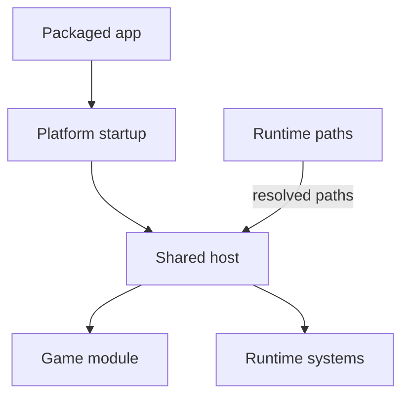
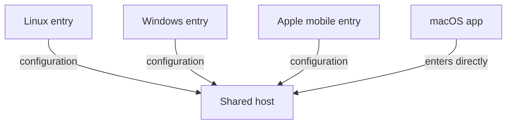
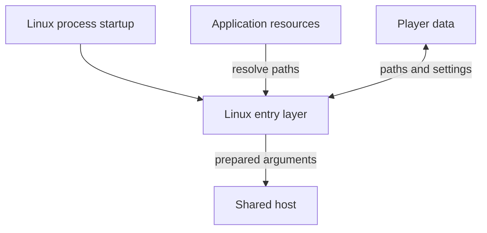
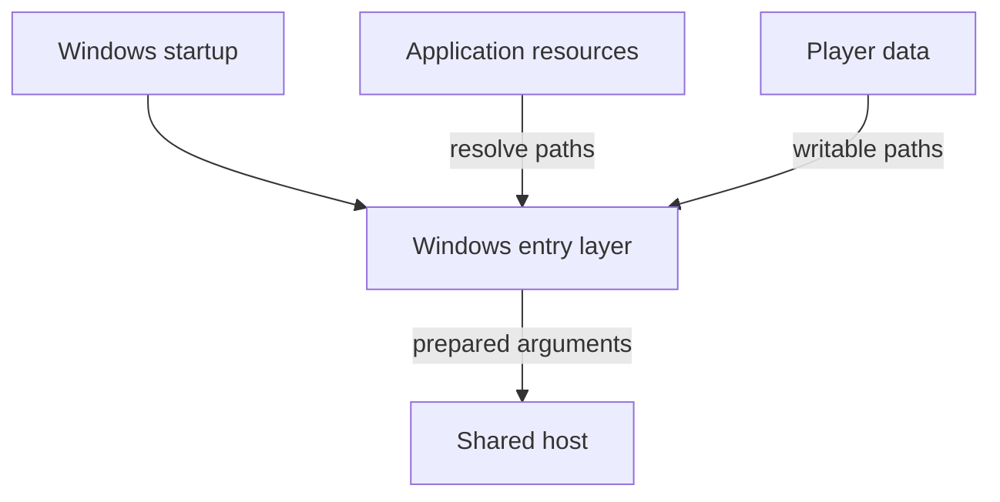
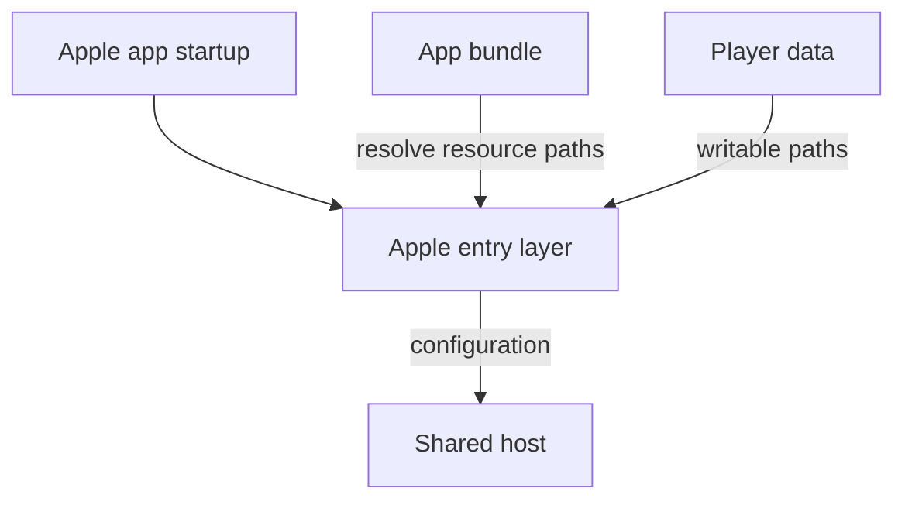
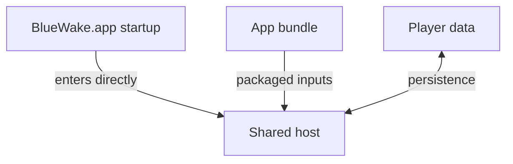
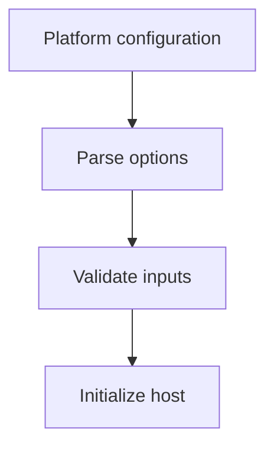
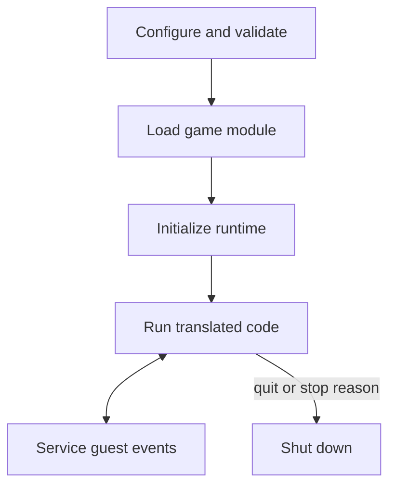
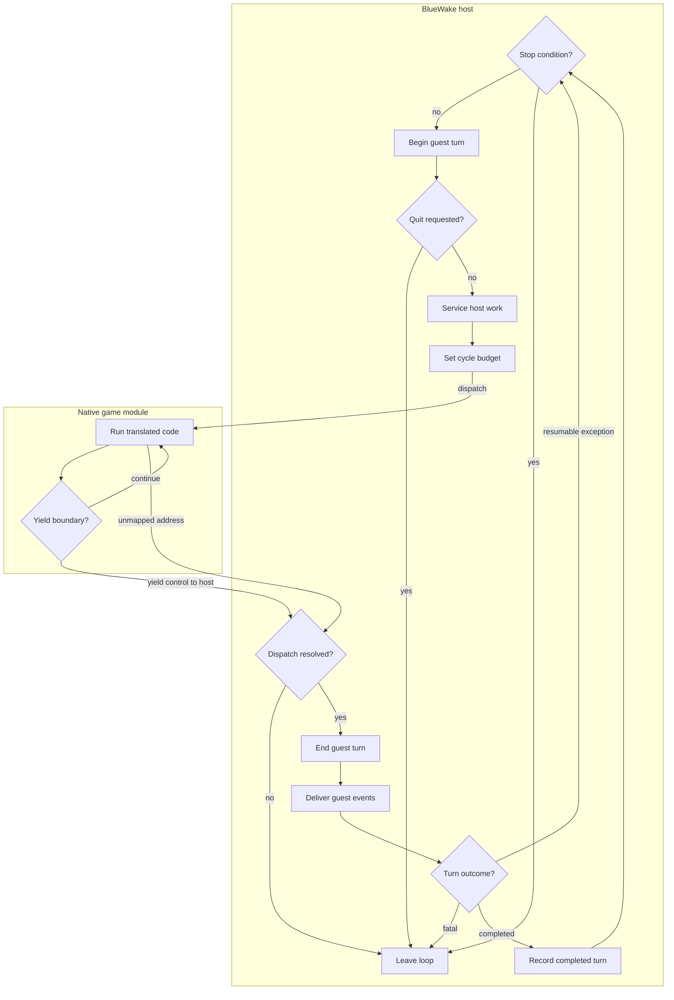

# Host and platform integration

## Contents

- [Responsibility](#responsibility)
- [Platform entry layers](#platform-entry-layers)
  - [Linux entry](#linux-entry)
  - [Windows entry](#windows-entry)
  - [Apple mobile entry](#apple-mobile-entry)
  - [macOS shared host entry](#macos-shared-host-entry)
  - [Shared host handoff](#shared-host-handoff)
- [Host lifecycle](#host-lifecycle)
  - [Main loop execution](#main-loop-execution)
- [Runtime inputs and persistence](#runtime-inputs-and-persistence)
  - [Artifact-to-game examples](#artifact-to-game-examples)
- [Shutdown](#shutdown)

Architecture path: [Overview](Overview.md) → [Runtime](Runtime.md) → **Host and platform integration**

## Responsibility

The platform application and shared BlueWake host form the handwritten native
side of the running process. Linux, Windows, and Apple mobile entry code
resolve OS-specific resources and events before calling the shared entry;
macOS enters the shared host directly. The host owns the common lifecycle,
loads the translated module, and coordinates guest execution with
compatibility and graphics services.

## Platform entry layers

Linux, Windows, and Apple mobile wrappers resolve resources and writable
storage, prepare configuration, and hand control to the shared host entry.
macOS begins at that shared entry and resolves its package there. These
diagrams show conceptual responsibilities and data flow rather than exact call
order.

| Component | What it does |
| --- | --- |
| Linux entry | Resolves executable-relative resources, Linux player-data paths, portable mode, and launch options before calling the shared host. [Source](../../linux/src/linux_entry.c#L361-L566) |
| Windows entry | Resolves executable-relative resources and Windows player data, then prepares Windows process services around the shared host. [Source](../../windows/src/win_entry.c#L563-L747) |
| Apple mobile entry | Integrates with UIKit and SDL, resolves app-container and bundle paths, and calls the renamed shared host entry on iOS, iPadOS, and tvOS. [Source](../../apple/ios/src/ios_entry.m#L276-L474) |
| macOS shared host entry | Compiles and enters the shared host's `main` directly, then lets it resolve the macOS `.app` bundle. [Entry](../../runtime/host/src/main.c#L7248), [bundle resolution](../../runtime/host/src/main.c#L6332-L6381) |

### Linux entry

Linux discovers the application directory through `/proc/self/exe`, falling
back to the current directory when that lookup fails. It selects writable data
from `BLUEWAKE_DATA_DIR`, an executable-adjacent `user/` directory when
`portable.txt` is present, `$XDG_DATA_HOME/BlueWake`, or
`~/.local/share/BlueWake`, in that order. Portable mode also moves the settings
file and Aurora user data beside the application. The entry layer converts
command-line choices into runtime configuration, resolves packaged resources,
checks the module, DOL, REL directory, and disc, installs logging and launch
recovery, and passes the module path to `bluewake_host_main`.

| Component | What it does |
| --- | --- |
| Directory resolver | Finds the executable directory and selects or creates the player-data, log, and save-state directories. [Source](../../linux/src/linux_entry.c#L137-L179) |
| Portable mode | Detects `portable.txt`, uses the executable-adjacent `user/` directory, and keeps settings and Aurora files there. [Source](../../linux/src/linux_entry.c#L149-L179), [Aurora migration](../../linux/src/linux_entry.c#L77-L116) |
| Launch configuration | Parses disc, module, graphics, mod, safe-mode, and audio options and applies product defaults without replacing explicit environment values. [Source](../../linux/src/linux_entry.c#L361-L480) |
| Resource resolver | Selects the translated module and executable-relative DOL, REL, disc, and optional DSP paths, then reports missing required game inputs before host startup. [Source](../../linux/src/linux_entry.c#L497-L543) |
| Host handoff | Installs crash and launch-recovery handling, gives the settings system its data directory, and calls `bluewake_host_main` with the module path. [Source](../../linux/src/linux_entry.c#L545-L568) |

### Windows entry

Windows obtains the executable path with `GetModuleFileNameW` and normally
places mutable data under `%APPDATA%\BlueWake`. `BLUEWAKE_DATA_DIR` overrides
that location, while `portable.txt` selects an executable-adjacent `user\`
directory. The entry layer loads saved settings after command-line choices,
resolves and checks the DLL and game resources, and prepares native process
facilities such as logging, crash handling, timer resolution, process priority,
SDL metadata, and the settings hotkey before entering the shared host.

| Component | What it does |
| --- | --- |
| Directory resolver | Converts the executable's wide-character path to UTF-8 and selects `BLUEWAKE_DATA_DIR`, portable storage, or `%APPDATA%\BlueWake`. [Source](../../windows/src/win_entry.c#L163-L188) |
| Settings and options | Converts command-line options into runtime configuration, then loads saved settings for choices the command line did not supply. [Source](../../windows/src/win_entry.c#L563-L638) |
| Resource resolver | Selects `gGZLE01_recomp.dll`, sets executable-relative DOL, REL, disc, and optional DSP defaults, and reports missing required game inputs. [Source](../../windows/src/win_entry.c#L667-L714) |
| Native process preparation | Installs crash handling, raises timer resolution and optional process priority, identifies the app to SDL, and installs the settings key hook. [Source](../../windows/src/win_entry.c#L716-L738) |
| Host handoff | Creates the launch-recovery marker and calls `bluewake_host_main` with the selected module path. [Source](../../windows/src/win_entry.c#L739-L749) |

### Apple mobile entry

On iOS and iPadOS, SDL starts `UIApplicationMain` before the Objective-C entry
shim runs on UIKit's application lifecycle. The shim uses
`Documents/BlueWake` for imported game data, logs, and other writable runtime
data; tvOS uses `Library/Caches/BlueWake` because the target cannot write the
same locations. It finds the translated module in the app's `Frameworks`
directory or mobile data directory, runs the first-use import flow when
required, and sets paths only for files that exist. iOS and iPadOS keep the
memory card under Application Support and install touch controls; tvOS keeps
the card with its cache data and omits touch controls. After the host returns,
the UIKit process exits or presents an error rather than leaving an inactive
application alive.

| Component | What it does |
| --- | --- |
| UIKit and SDL entry | Runs after SDL has established the iOS, iPadOS, or tvOS application lifecycle and owns the mobile `main`. [Source](../../apple/ios/src/ios_entry.m#L1-L45), [mobile target wiring](../../apple/ios/CMakeLists.txt#L90-L121) |
| Writable storage | Uses Documents on iOS/iPadOS and Library/Caches on tvOS, creates the BlueWake directory, and starts the session log. [Source](../../apple/ios/src/ios_entry.m#L276-L300) |
| Bundle and game resources | Reads packaged optimization metadata, selects the module from `Frameworks` or writable storage, and resolves imported DOL, REL, disc, and optional DSP files. [Source](../../apple/ios/src/ios_entry.m#L312-L356), [imported paths](../../apple/ios/src/ios_entry.m#L424-L438) |
| Platform-specific player data | Uses Application Support for the iOS/iPadOS card with non-destructive migration, while tvOS keeps the card in its cache data; touch controls are excluded from tvOS. [Source](../../apple/ios/src/ios_entry.m#L439-L473) |
| Mobile host handoff | Builds the host argument vector, calls `bluewake_host_main`, and integrates host termination and errors with UIKit. [Source](../../apple/ios/src/ios_entry.m#L457-L496) |

### macOS shared host entry

macOS does not use the UIKit entry shim or rename the shared entry point. Its
`BlueWake.app` contains the shared host executable compiled with
`runtime/host/src/main.c` as `main`. That entry recognizes the packaged bundle,
loads the module from `Contents/Frameworks`, and resolves the DOL, RELs, disc,
and optional DSP files from `Contents/Resources`.

| Component | What it does |
| --- | --- |
| Direct process entry | Starts in the shared host's `main` without an additional platform entry wrapper. [Source](../../runtime/host/src/main.c#L7248) |
| macOS bundle resolver | Detects the packaged `.app`, resolves its Frameworks and Resources contents, and applies bundle-selected runtime defaults. [Source](../../runtime/host/src/main.c#L6332-L6381), [bundle assembly](../../runtime/host/CMakeLists.txt#L82-L115) |

### Shared host handoff

The Linux, Windows, and Apple mobile entry layers normalize platform choices
into a module argument and environment variables before calling the shared
host entry. macOS starts at that shared entry directly and resolves its bundle
there. The host loads saved settings, applies packaged or developer defaults
where needed, and then checks each input at the point that consumes it. The
native module must load and expose a compatible descriptor; the DOL path must
be present and the DOL loader must accept its contents. The disc becomes
present only when its image opens successfully. The memory-card path must open
through the card runtime.

DSP means **Digital Signal Processor**. The default high-level audio path does
not require DSP support files. When the low-level DSP path is selected,
`BLUEWAKE_DSP_IROM` and `BLUEWAKE_DSP_COEF` identify the DSP instruction ROM
and coefficient files; adapter initialization validates that pair. Save-state,
SRAM, settings, cache, and log paths are consumed by their respective host or
platform subsystems rather than copied into one central path object.

| Component | What it does |
| --- | --- |
| Configuration input | Receives the selected module as `argv[1]` and the DOL, disc, DSP, memory-card, and other player-data paths through normalized environment settings. [Source](../../runtime/host/src/main.c#L7248-L7289) |
| Module validation | Opens the native library, requires `staticrecomp_get_module`, and validates module and CPU storage compatibility. [Source](../../runtime/host/src/main.c#L7316-L7343) |
| DOL and disc validation | Requires a DOL path, loads and validates the DOL image, and marks the disc present only when the configured image opens. [DOL selection](../../runtime/host/src/main.c#L7289-L7314), [DOL load](../../runtime/host/src/main.c#L7957-L7960), [disc open](../../runtime/host/src/main.c#L7819-L7826) |
| DSP validation | Uses HLE without support files by default; for LLE, opens the configured Digital Signal Processor ROM and coefficient files through the DSP adapter and stops if adapter initialization fails. [Source](../../runtime/host/src/main.c#L5590-L5626), [startup check](../../runtime/host/src/main.c#L7961-L7965) |
| Player-data validation | Opens the configured memory-card path before guest boot; platform layers separately establish writable settings, SRAM, save-state, cache, and log locations. [Source](../../runtime/host/src/main.c#L7630-L7636) |
| Lifecycle continuation | Proceeds from validated configuration into module, renderer, device, guest-state, and execution setup described below. [Host lifecycle](#host-lifecycle) |

## Host lifecycle

The host is the process coordinator; it is not the translated game. After
loading the module ABI, it selects shared machine-state storage, initializes
devices and graphics, boots guest state, and repeatedly alternates translated
execution with service work.

| Phase | Host responsibility | Cooperating entity | Code reference |
| --- | --- | --- | --- |
| Configure | Applies settings and feature flags and validates required inputs. | Platform application | [Host startup](../../runtime/host/src/main.c#L7248-L7314) |
| Load | Opens the native game module and validates its descriptor and ABI. | [Native game module](GameModule.md) | [Module loading](../../runtime/host/src/main.c#L7316-L7343) |
| Initialize | Creates renderer, device, storage, audio, DSP, and guest-memory state. | [Guest state](GuestState.md), [services](Services.md), and [graphics](Graphics.md) | [Host initialization](../../runtime/host/src/main.c#L7550-L7686) |
| Run | Dispatches translated code for a bounded guest-time interval, then services deadlines, callbacks, and interrupts. | Module and compatibility services | [Main runtime loop](../../runtime/host/src/main.c#L8651-L8662) |
| Stop | Reaches a safe host boundary, finishes pending durable work, and tears down native services. | Platform application and player storage | [Host shutdown](../../runtime/host/src/main.c#L16364-L16373) |

### Main loop execution

Each outer turn applies pending host work and establishes the next guest-time
budget. At the **Dispatch** transition, the host calls the game module's
dispatcher with `CPUState.pc`; this is where the main loop enters the game
module. The module's chassis can execute
several translated blocks before returning at a cycle budget, exception, edge
service, or no-progress boundary. Once control returns, the host accounts for
elapsed guest cycles, advances devices, delivers ready disc callbacks and the
decrementer, handles exceptions, and begins another turn unless a stop
condition was set. MMIO and edge services can also run while translated code
is dispatching, so the diagram summarizes control flow rather than exact call
order.

For the complete ownership, dispatch, service, graphics, worker, and profiling
view of this execution path, see the [game-thread architecture](GameThread.md).

| Component | What it does |
| --- | --- |
| Turn setup | Applies save-state and other ready host work, begins the cycle-domain turn, checks quit conditions, and services pending card callbacks. [Source](../../runtime/host/src/main.c#L8651-L8662) |
| Interrupt boundary | Delivers a pending external interrupt only when the guest scheduler and architectural state allow it. [Source](../../runtime/host/src/main.c#L9577-L9589) |
| Host-to-module dispatch | Once per guest-time turn, the host computes the cycle budget and calls `mod->dispatch(&cpu, cpu.pc)`, entering the game module at the current guest program counter. [Source](../../runtime/host/src/main.c#L14079-L14094) |
| Game-module execution | The module's chassis continues through translated DOL or REL blocks until a budget, exception, edge-service, unmapped-address, or no-progress boundary yields control back to the host. [Source](../../cmake/composite/dispatch_loop.h#L39-L84) |
| End-of-turn service | Commits translated cycle charges, synchronizes devices, delivers ready disc callbacks and decrementer work, and updates guest-visible state. [Source](../../runtime/host/src/main.c#L15704-L15802) |
| Exception and stop handling | Handles resumable guest exceptions, records completed turns, or leaves the loop with a fatal or configured stop reason. [Source](../../runtime/host/src/main.c#L15981-L16019) |

## Runtime inputs and persistence

Executable artifacts, original game content, and mutable player data remain
separate even though the host coordinates all three.

| Input or data | Runtime role | Lifetime | Code reference |
| --- | --- | --- | --- |
| Native game module | Supplies translated functions, dispatch tables, REL metadata, and the module ABI. | Read-only for the process lifetime | [Module path selection](../../runtime/host/src/main.c#L7248-L7322) |
| `main.dol` | Supplies section layout and initialized bytes loaded into guest memory. | Read during guest boot | [DOL load](../../runtime/host/src/main.c#L7957-L7960) |
| Supported disc image | Supplies the file-system table and original assets requested through disc interfaces. | Read throughout play | [Disc initialization](../../runtime/host/src/main.c#L7819-L7865) |
| DSP data | Supplies the program or donor-backed data used by the selected audio path. | Read during audio initialization and execution | [DSP adapter](../../runtime/host/src/dsp_adapter.cpp) |
| Memory card and SRAM | Preserve game saves and console-like configuration. | Loaded at startup; accepted writes are persisted during play, and storage is closed at shutdown | [Memory-card runtime](../../runtime/host/src/card_runtime.c), [SRAM runtime](../../runtime/host/src/ipl_sram.c) |
| Settings and logs | Preserve host preferences and diagnostics. | Platform-managed player data | [Host startup](../../runtime/host/src/main.c#L7248-L7314) |
| Save states | Serialize authoritative CPU, memory, alias, device, DSP, and GX state. | Created or restored on request | [Save-state implementation](../../runtime/host/src/save_state.c) |

### Artifact-to-game examples

| Runtime artifact or data | In-game action | Host contact | Example project contribution |
| --- | --- | --- | --- |
| Native game module | Starting BlueWake enters translated title and gameplay routines. | The host loads the library, validates its descriptor, and dispatches guest addresses into native functions. | [PR #37](https://github.com/chrissotraidis/bluewake/pull/37) consolidated the explicit module ABI and shared runtime. |
| `main.dol` | Fresh startup initializes the always-loaded game and its global data. | The host copies DOL sections into MEM1, clears BSS, and starts at the module entry point. | [PR #37](https://github.com/chrissotraidis/bluewake/pull/37) integrated module-owned guest memory and the shared boot path. |
| Supported disc image | Scene transitions, cutscenes, music, models, and other asset requests read original disc content. | The disc service resolves FST paths or offsets and transfers requested bytes into guest memory. | [PR #142](https://github.com/chrissotraidis/bluewake/pull/142) changes when asynchronous disc work completes to preserve an intro music transition. |
| DSP data | Selecting LLE audio runs the console DSP program and coefficient data rather than the default HLE path. | The host validates support files and connects them to the DSP adapter. | [PR #37](https://github.com/chrissotraidis/bluewake/pull/37) consolidated the DSP adapter and cross-platform audio integration. |
| Memory card and SRAM | Loading or saving a game changes the card; console-like settings persist through SRAM. | Host adapters expose guest transactions while storing durable player data outside the application. | [PR #37](https://github.com/chrissotraidis/bluewake/pull/37) integrates card validation, locking, backups, atomic writes, and SRAM storage. |
| Settings | Changing controls, display, renderer, or gameplay options affects later play and can survive relaunch. | Platform code loads writable settings before host initialization and saves accepted preferences. | [PR #221](https://github.com/chrissotraidis/bluewake/pull/221) adds the optional controller-zoom preference to the Controls settings. |
| Logs | A reproduced gameplay fault records native and guest context for diagnosis without becoming guest state. | Platform and host code write diagnostics to the selected player-data location. | [PR #211](https://github.com/chrissotraidis/bluewake/pull/211) uses a reproducible unmapped-PC failure and guest return state to diagnose callback corruption. |
| Save states | A player requests a snapshot or resumes one, restoring execution, memory, devices, DSP, and GX coherently. | The host serializes or restores supported authoritative state only at a safe boundary. | [PR #37](https://github.com/chrissotraidis/bluewake/pull/37) imported and hardened the shared save-state implementation and graphics-worker synchronization. |

## Shutdown

Normal termination begins at a host boundary, where no translated block is
partially executed. The host can complete durable writes, disconnect the GX
bridge, stop haptics, rendering, DSP and audio, and then release module-owned
CPU storage.

| Step | Runtime result | Code reference |
| --- | --- | --- |
| Detect a quit request, configured limit, or runtime stop reason | Guest dispatch ends at a controlled boundary | [Main runtime loop](../../runtime/host/src/main.c#L8651-L8662) |
| Finish pending settings and diagnostic writes, then close mutable storage | Player data written during the run remains available to the next launch | [Card runtime](../../runtime/host/src/card_runtime.c), [SRAM runtime](../../runtime/host/src/ipl_sram.c) |
| Tear down services and shared storage | Native resources are released before returning to the platform layer | [Host shutdown](../../runtime/host/src/main.c#L16364-L16373) |

The host is the broadest compiled source-only test graph. Focused executables
exercise scheduling, persistence, input, audio, shutdown, and renderer-facing
contracts; conditional tests add a local composite module or optional DSP
adapter; platform CMake entry points prove that shared behavior still compiles
and runs under Linux and Windows. See
[compiled component tests](Testing.md#compiled-component-tests),
[generated and conditional tests](Testing.md#generated-and-conditional-tests),
and [platform entry points](Testing.md#platform-entry-points).

Return to the runtime [high-level view](Runtime.md#high-level-view).
