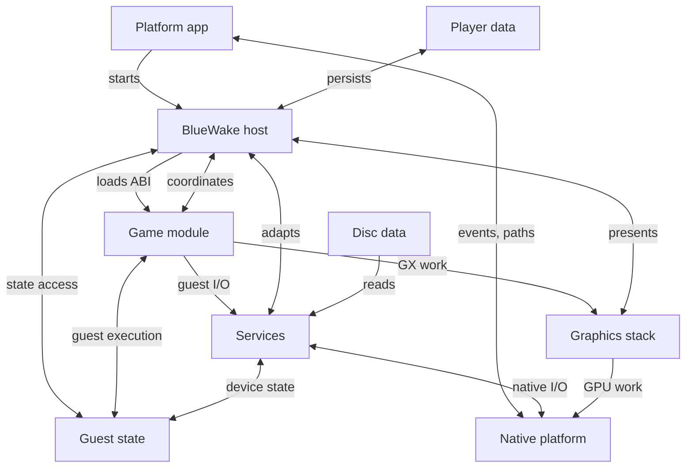
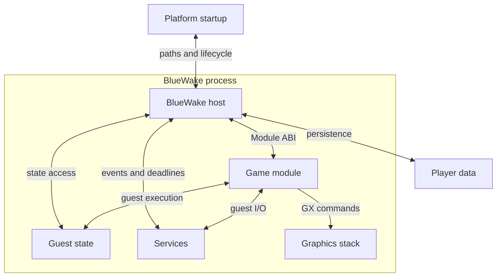
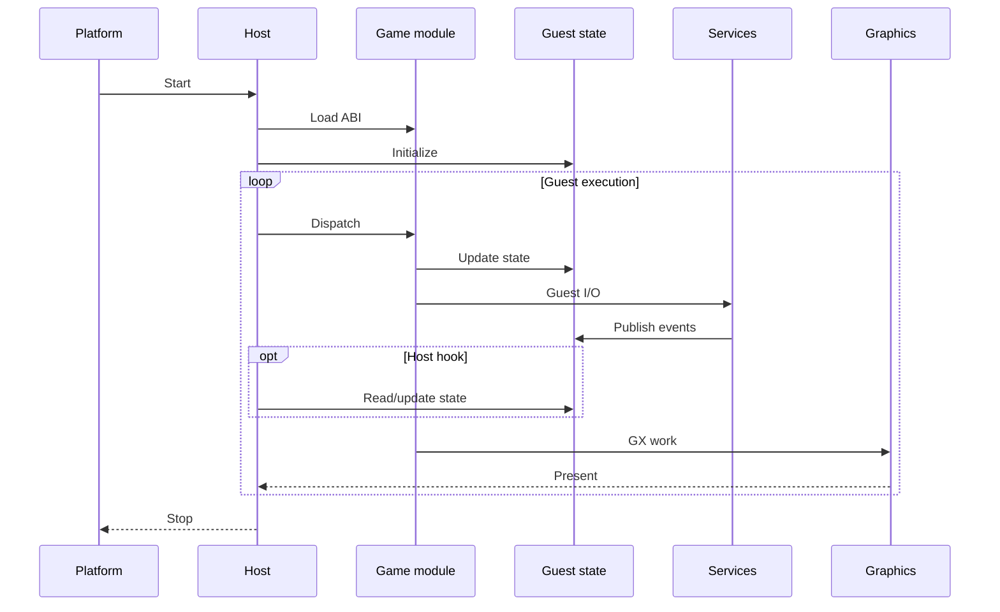

# BlueWake runtime architecture

## Contents

- [Purpose](#purpose)
- [High-level view](#high-level-view)
- [Runtime entities](#runtime-entities)
- [Interaction boundaries](#interaction-boundaries)
- [Runtime lifecycle](#runtime-lifecycle)

Architecture path: [Overview](Overview.md) → **Runtime**

## Purpose

This chapter maps the principal entities in a running BlueWake application and
the contracts between them. It describes runtime ownership and interaction;
the process that produces these artifacts belongs in the
[build architecture](Build.md).

BlueWake runs as one native process containing two separately compiled
components: the handwritten platform host and the ahead-of-time translated
game module. They cooperate through shared guest state and the module ABI. The
host connects that guest-facing environment to native files, input, audio,
graphics, timing, and presentation.

## High-level view

The diagram below is the runtime half of the
[architecture overview](Overview.md#high-level-view), expanded around the
entities that exist while BlueWake is running and the connections between
them.

These edges describe conceptual access and data flow, not necessarily a direct
function call between every pair of entities.

## Runtime entities

| Entity | Runtime responsibility | Owns or exposes | Internals |
| --- | --- | --- | --- |
| Platform application | Forms the OS boundary: creates the native application environment and forwards lifecycle and presentation events. Platform wrappers or the shared macOS host entry resolve packaged resources, writable storage, paths, and settings. | Process entry, platform paths, windows, and application lifecycle | [Platform entry layers](Host.md#platform-entry-layers) |
| BlueWake host | Validates launch configuration, loads the game module, initializes guest execution, coordinates services and graphics, applies game-specific host integrations, and owns persistence and orderly shutdown. | Runtime lifecycle, guest-state access, and host-side adapters | [Host lifecycle](Host.md#host-lifecycle) and [shutdown](Host.md#shutdown) |
| Native game module | Executes native translations of DOL and REL instructions against shared guest state, using guest addresses rather than a rewritten high-level game API. | `StaticRecompModuleDesc`, translated functions, dispatch and metadata tables, callbacks, and optional shared storage | [Native game module](GameModule.md) |
| Guest machine state | Preserves the GameCube-visible CPU, memory, address, timing, and exception model across host/module transitions; DOL and REL layouts still supply runtime data and addresses. | `CPUState`, MEM1, guest aliases, program counter, cycle counters, and exception state | [Guest machine state](GuestState.md) |
| Compatibility services | Preserve guest-visible hardware and operating-system semantics while adapters connect device work to native facilities. | MMIO devices, timing, callbacks, interrupts, disc, card, input, audio, and DSP state | [Compatibility services](Services.md) |
| Graphics stack | Accepts GX FIFO and display-list work; GXRuntime interprets it, Aurora creates renderer work, Dawn reaches the platform GPU API, and the host coordinates retrace and presentation. | GX state, renderer resources, command submission, synchronization, and presentation | [Graphics stack](Graphics.md) |
| Runtime data | Keeps read-only original game content separate from mutable player data and from translated code. | Disc image and DOL; memory card, SRAM, settings, logs, and save states in platform-managed storage | [Runtime inputs and persistence](Host.md#runtime-inputs-and-persistence) and [disc and storage services](Services.md#disc-and-persistent-storage) |

For concrete in-game uses and contribution history, follow the artifact-example
section in each entity's linked chapter.

## Interaction boundaries

> This diagram maps contracts, not execution order or threads. Guest state is data stored within the native process. Service interactions may pass through host routing and shared guest state rather than direct module-to-service calls.

The module descriptor carries ABI versions, game identity, entry and dispatch
functions, callbacks, and metadata. Module-owned `CPUState` and MEM1 are
obtained through the separate `bluewake_composite_guest_cpu` and
`bluewake_composite_guest_mem1` getter exports when the declared ABI requires
them; they are not fields of `StaticRecompModuleDesc`.
[Storage contract](../../cmake/composite/module_cpu_contract.h#L9-L64) and
[host symbol lookup](../../runtime/host/src/main.c#L7340-L7357)

| Boundary | Runtime contract | Why it exists | Reference |
| --- | --- | --- | --- |
| Platform startup ↔ host | Native lifecycle events plus paths and settings resolved by a platform wrapper or within the shared macOS entry | Keeps each platform's startup contract explicit while allowing macOS to enter the shared host directly | [Platform entry layers](Host.md#platform-entry-layers) |
| Host ↔ game module | Descriptor fields for ABI, identity, entry, dispatch, callbacks, and metadata; separate getter exports for optional module-owned CPU and MEM1 storage | Allows the host and translated code to be compiled separately without treating storage getters as descriptor fields | [Module loading and ABI](GameModule.md#module-loading-and-abi) |
| Host ↔ guest state | Access to shared CPU state and guest memory through runtime interfaces and guest-memory helpers | Supports execution control, event delivery, and game-specific integrations | [Host lifecycle](Host.md#host-lifecycle), [ownership and address model](GuestState.md#ownership-and-address-model) |
| Module ↔ guest state | Shared `CPUState`, memory access, guest PC, and address aliases | Preserves the machine model expected by translated PowerPC code | [Ownership and address model](GuestState.md#ownership-and-address-model) |
| Guest execution ↔ services | MMIO, HLE calls, deadlines, callbacks, and interrupts | Turns guest-visible hardware operations into host-managed work | [MMIO dispatch](Services.md#mmio-dispatch) |
| Game module → graphics | GX gather-pipe data and display lists | Preserves the original graphics command model while using a native renderer | [GX command path](Graphics.md#gx-command-path) |
| Host ↔ persistent data | Platform storage paths and durable file formats | Keeps mutable player data outside the application and game module | [Runtime inputs and persistence](Host.md#runtime-inputs-and-persistence) |

## Runtime lifecycle

The entities above remain present throughout play. Their main runtime
interaction sequence is:

Execution is cyclical, not a one-way pipeline. The host gives translated code a
bounded amount of guest time, services devices at a safe boundary, publishes
pending callbacks or interrupts, and resumes at the guest program counter.
The sequence is conceptual: host hooks access guest state only at relevant
integration points, not on every dispatch.

The [game-thread architecture](GameThread.md) expands this loop, distinguishes
native execution from guest OS threads, and documents its concurrency and
performance boundaries.

Testing follows the same boundaries. Source-only component tests isolate host,
guest-state, service, and renderer contracts with synthetic data; integration
tests link those components through a platform graph; private module and
gameplay runs establish that translated code reaches the expected boundaries.
The evidence levels are related but not interchangeable. See the
[end-to-end test view](Testing.md#end-to-end-view) and
[evidence levels](Testing.md#evidence-levels).

Return to the [architecture overview](Overview.md), or review how these runtime
artifacts are produced in the [build architecture](Build.md).
