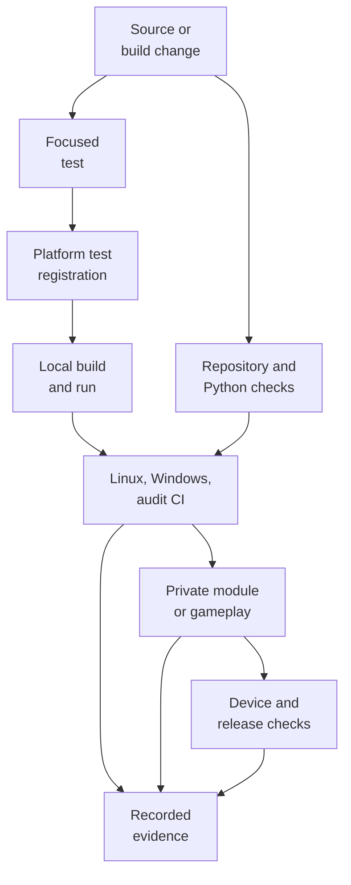
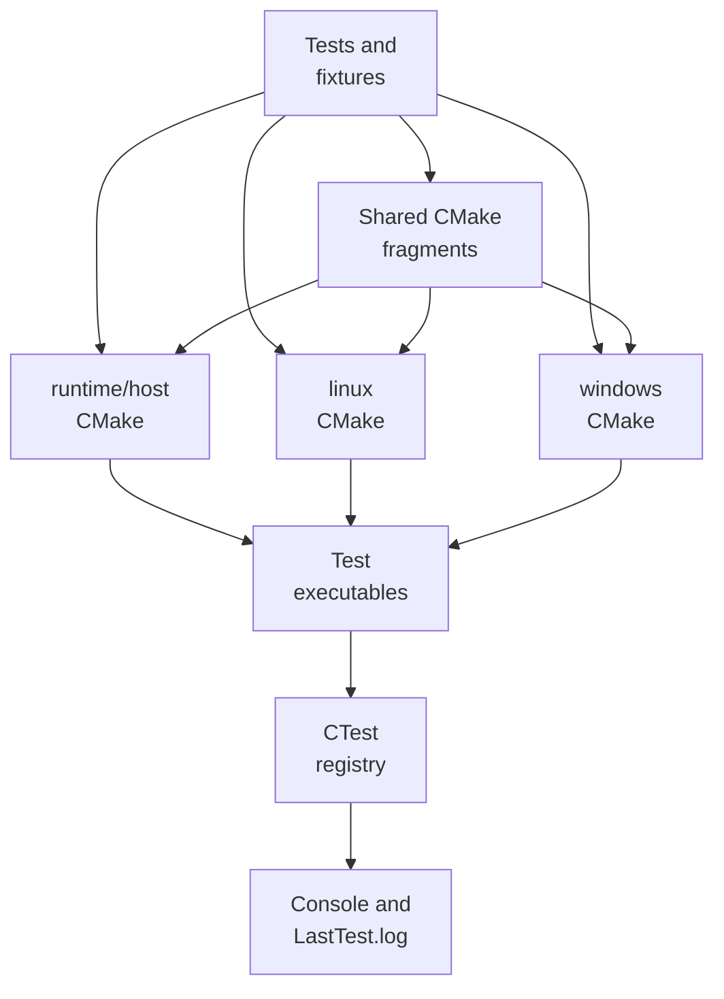
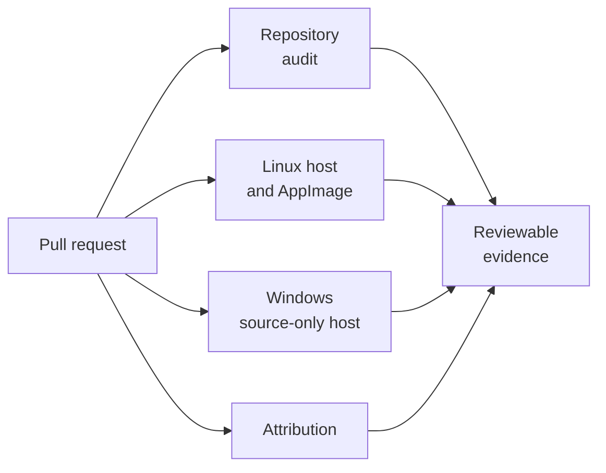
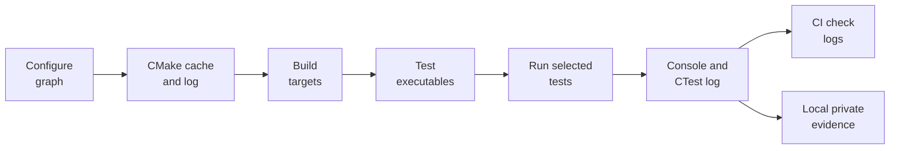
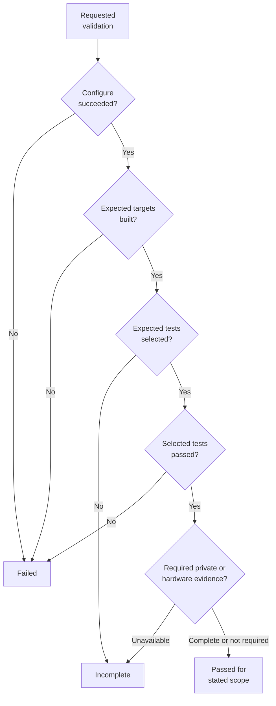
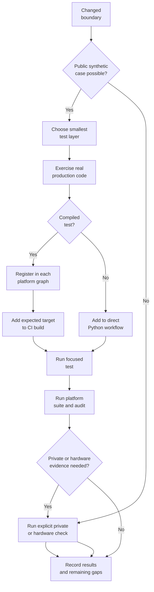

# BlueWake test architecture

## Contents

- [Purpose](#purpose)
- [End-to-end view](#end-to-end-view)
- [Evidence levels](#evidence-levels)
- [Test families](#test-families)
- [Registration and execution](#registration-and-execution)
- [Platform entry points](#platform-entry-points)
- [Continuous integration](#continuous-integration)
- [Fixtures and test data](#fixtures-and-test-data)
- [Results and failure evidence](#results-and-failure-evidence)
  - [Output artifact lifecycle](#output-artifact-lifecycle)
  - [Artifact locations and meaning](#artifact-locations-and-meaning)
  - [Interpreting a run](#interpreting-a-run)
  - [Reporting results](#reporting-results)
- [Running tests locally](#running-tests-locally)
- [Adding or changing a test](#adding-or-changing-a-test)
- [Private and hardware validation](#private-and-hardware-validation)
- [Source map](#source-map)

Architecture path: [Index](README.md) → [Overview](Overview.md) → **Testing**

## Purpose

BlueWake tests code at several boundaries: repository policy, build scripts,
generated source, the native host, GXRuntime and Aurora integration, packaged
applications, translated game modules, and player-visible behavior. No single
runner owns all of this coverage. Python scripts, standalone compiled tests,
CTest graphs, platform builders, GitHub Actions, and private hardware runs each
cover a different part of the system.

This chapter explains how those parts connect from a source change to evidence
that can support a merge. It describes the current framework on `main`; planned
or draft additions are labeled separately.

The central distinction is between **public source-only evidence** and
**private game-backed evidence**:

- public tests use repository source and generated synthetic fixtures, so they
  can run in CI without a disc, extracted game code, save, or console key;
- private tests may use a contributor's own translated module, disc, state, or
  memory card, and their artifacts remain local; and
- hardware checks establish behavior that a source-only process cannot prove,
  such as controller feel, renderer output, device packaging, or sustained
  Steam Deck performance.

Passing one layer does not imply that a later layer passed. A successful
compile is not a test execution, a source-only test is not a gameplay run, and
a CI result is not a hardware qualification.

## End-to-end view

The usual path starts with the changed component and expands only as far as the
risk requires.



Not every change travels through every node. A documentation edit may need
only the repository audit and link review. A host service change normally needs
focused CTest coverage on Linux and Windows. A renderer or timing change needs
source-only checks first, followed by representative gameplay and hardware
evidence. A release additionally has its own artifact gate.

The test system consumes the same pinned public runtime described in
[Build](Build.md#2-fetch). Linux and Windows CI fetch the
RecompCore revision from `config/dependencies.lock.json`; they do not fetch or
construct a personal game module.

## Evidence levels

The layers below answer progressively broader questions.

| Level | Question answered | Typical runner | Public CI |
| --- | --- | --- | --- |
| Repository safety | Is the tree structurally safe and free of prohibited tracked artifacts or unresolved merges? | `scripts/audit_repo.sh` | Yes |
| Static/source contract | Do scripts, generated text, manifests, and build rules retain an expected contract? | Direct Python tests | Yes |
| Component behavior | Does a host helper, service, parser, state machine, or native routine behave correctly with synthetic data? | Compiled C/C++/Objective-C tests under CTest | Yes |
| Integration behavior | Do components compile, link, and cooperate through the Linux, Windows, or host build graph? | Platform CMake entry point plus CTest | Yes |
| Packaging behavior | Can a disc-free fixture be assembled, audited, and launched far enough to check its container contract? | Builder/package scripts in CI | Yes, without playable game data |
| Generated-module behavior | Does the locally generated composite module satisfy ABI and guest-behavior contracts? | Conditional or explicit local test | No module in public CI |
| Gameplay behavior | Does a repeatable route preserve guest checkpoints and player-visible behavior? | Local headless/rendered app and benchmark tooling | No private inputs in CI |
| Hardware/release behavior | Does the result work on the target device and meet packaging, performance, and release gates? | Maintainer hardware and release tools | Only public-safe checks run in CI |

Evidence is cumulative, not interchangeable. For example, a synthetic renderer
fixture can prove a blend equation but cannot prove that a complete scene has
no visual regression. Conversely, a scene that looks correct does not exercise
all malformed inputs or concurrency boundaries that a focused test can cover.

## Test families

### Repository and policy checks

`scripts/audit_repo.sh` is the common safety baseline. It checks the tracked
tree for private/generated artifact types and directories, validates the
dependency lock, requires core planning/status files, and rejects unresolved
merge markers. It is intentionally fast and does not compile the project.

| Check | Source references | What it protects | Execution model |
| --- | --- | --- | --- |
| Repository audit | [`scripts/audit_repo.sh`](../../scripts/audit_repo.sh), [audit workflow](../../.github/workflows/audit.yml) | Tracked-tree safety, dependency-lock validity, required records, and merge-marker detection | Shell check run locally and in public CI |
| Attribution | [`scripts/check_attribution.py`](../../scripts/check_attribution.py), [attribution workflow](../../.github/workflows/attribution.yml) | Human commit authorship and permitted co-author metadata | Python check run by its dedicated public-CI workflow |

The attribution workflow separately checks commit authors and co-authors. A
repository-audit pass does not imply that attribution passed, and neither
implies that compiled tests ran.

### Python source-contract tests

Python files under `tests/` exercise build and tooling contracts directly.
They commonly create temporary synthetic trees, invoke a script or import its
logic, and compare generated output, manifests, commands, or failure behavior.

Representative groups include:

| Area | Source references | What they protect | Execution model |
| --- | --- | --- | --- |
| Composite preparation | [`test_composite.py`](../../tests/test_composite.py), [`test_prepare.py`](../../tests/test_prepare.py), [`test_return_ranges.py`](../../tests/test_return_ranges.py) | Generated-source composition, deterministic preparation, and address/range rules | Direct Python scripts with synthetic temporary inputs |
| Native preparation | [`native_math_source_test.py`](../../tests/native_math_source_test.py), [`test_direct_calls.py`](../../tests/test_direct_calls.py), [`test_inline_gpr.py`](../../tests/test_inline_gpr.py) | Certified source transformations and host boundaries | Direct Python scripts over source or generated text |
| Timing and checkpoints | [`test_guest_clock.py`](../../tests/test_guest_clock.py), [`test_cycle_invariance.py`](../../tests/test_cycle_invariance.py), [`test_guest_checkpoints.py`](../../tests/test_guest_checkpoints.py) | Clock contracts and completeness of comparison evidence | Direct Python scripts over source and synthetic logs |
| Builder behavior | [`test_mac_package.py`](../../tests/test_mac_package.py), [`test_windows_training.py`](../../tests/test_windows_training.py), [`test_linux_ci_container.py`](../../tests/test_linux_ci_container.py) | Platform command construction, cache selection, interrupted builds, and packaging inputs | Direct Python scripts with mocked or temporary build state |
| Benchmark tooling | [`test_bench_tour.py`](../../tests/test_bench_tour.py), [`test_sample_owners.py`](../../tests/test_sample_owners.py), [`test_one_game_guard.py`](../../tests/test_one_game_guard.py) | Synthetic logs, ownership, process isolation, and complete measurement grids | Direct Python scripts with synthetic processes and measurements |
| Import and storage | [`wwhd_disc_fixture.py`](../../tests/wwhd_disc_fixture.py), [`wwhd_disc_import_test.py`](../../tests/wwhd_disc_import_test.py), [`wwhd_staging_recovery_test.py`](../../tests/wwhd_staging_recovery_test.py) | Generated disc structures, decoding, staging, cancellation, and recovery | Fixture generator plus direct Python integration scripts |

Most of these tests use Python's standard assertion or `unittest` behavior and
are invoked as scripts, for example `python3 tests/test_bench_tour.py`. The
audit workflow lists the public Python set explicitly rather than discovering
every `test_*.py`; some scripts are helpers, private comparison tools, or need a
compiled executable.

### Compiled component tests

C, C++, Objective-C, and Objective-C++ files under `tests/` exercise production
headers and sources with synthetic inputs. For the ordinary component suite,
CMake creates one executable per contract or closely related group, links only
the dependencies it needs, and registers it with CTest through `add_test`.

| Area | Source references | What they protect | Execution model |
| --- | --- | --- | --- |
| Scheduling and ABI | [`scheduler_contract_test.c`](../../tests/scheduler_contract_test.c), [`cycle_domain_test.c`](../../tests/cycle_domain_test.c), [`interrupt_sources_test.c`](../../tests/interrupt_sources_test.c), [`cpu_boundary_test.c`](../../tests/cpu_boundary_test.c) | CPU scheduling, cycle accounting, interrupt sources, callbacks, and ABI boundaries | Compiled synthetic harnesses registered with CTest |
| Guest memory and dispatch | [`external_memory_test.c`](../../tests/external_memory_test.c), [`gather_memory_test.c`](../../tests/gather_memory_test.c), [`inline_gpr_memory_test.c`](../../tests/inline_gpr_memory_test.c), [`composite_dispatch_loop_test.c`](../../tests/composite_dispatch_loop_test.c) | Memory aliases, gather and inline-memory paths, and dispatch loops | Compiled harnesses; CMake may generate separate mode variants |
| Services and persistence | [`audio_dma_stereo_test.c`](../../tests/audio_dma_stereo_test.c), [`aram_dma_contract_test.c`](../../tests/aram_dma_contract_test.c), [`card_runtime_test.c`](../../tests/card_runtime_test.c), [`save_state_test.c`](../../tests/save_state_test.c) | Audio, ARAM DMA, cards, save states, and service state | Compiled synthetic service tests registered with CTest |
| Input and camera | [`desktop_controller_test.cpp`](../../tests/desktop_controller_test.cpp), [`haptics_test.c`](../../tests/haptics_test.c), [`mouse_motion_test.c`](../../tests/mouse_motion_test.c), [`dpad_menus_test.c`](../../tests/dpad_menus_test.c) | Controller mapping, haptics, menus, camera, and motion | Compiled harnesses, sometimes repeated with CTest arguments |
| Native guards | [`native_math_guard_test.c`](../../tests/native_math_guard_test.c), [`native_vec_guard_test.c`](../../tests/native_vec_guard_test.c), [`native_skin_guard_test.c`](../../tests/native_skin_guard_test.c), [`native_j3d_guard_test.c`](../../tests/native_j3d_guard_test.c) | Native math, vector, skinning, and J3D guard behavior | Compiled focused tests against production native implementations |
| Native work pool | [`native_work_pool_test.c`](../../tests/native_work_pool_test.c), [CTest registration](../../tests/native_work_pool/CMakeLists.txt), [detailed test contract](../planning/2026-10-18-gamethread-integtests/TECH_PLAN.md#native-work-pool-test) | Work partitioning, completion, publication, configuration, failure recovery, and repeated pool reuse | Source-only production-pool harness run through standalone, platform, and sanitizer CTest graphs |
| Renderer integration | [`renderer_shared_flags_test.cpp`](../../tests/renderer_shared_flags_test.cpp), [`render_worker_identity_test.cpp`](../../tests/render_worker_identity_test.cpp), [`fifo_trace_worker_test.cpp`](../../tests/fifo_trace_worker_test.cpp) | Shared renderer state, worker identity, and trace ownership | Compiled tests linked to the real runtime/renderer targets |
| HD import | [`wwhd_cancellation_test.cpp`](../../tests/wwhd_cancellation_test.cpp), [`wwhd_import_job_test.cpp`](../../tests/wwhd_import_job_test.cpp), [`wwhd_output_staging_test.cpp`](../../tests/wwhd_output_staging_test.cpp), [`wwhd_wiiu_disc_test.cpp`](../../tests/wwhd_wiiu_disc_test.cpp) | Disc and texture import, cancellation, staging, and recovery | Compiled fixtures and import components registered with CTest |

Tests often compile a production `.c` file directly beside the harness. This
keeps the exercised logic identical to the application while avoiding the full
host or renderer when those dependencies are irrelevant. Other tests link the
real `gxruntime`, Aurora, or gxcore targets because the integration boundary is
the behavior under test.

### Generated and conditional tests

| Area | Source references | What they protect | Execution model |
| --- | --- | --- | --- |
| Generated module contracts | [`generated_scheduler_contract_test.c`](../../tests/generated_scheduler_contract_test.c), [`generated_aram_stream_contract_test.c`](../../tests/generated_aram_stream_contract_test.c), [`generated_dvd_callback_contract_test.c`](../../tests/generated_dvd_callback_contract_test.c), [`bluewake_generated_scheduler_contract_test` and adjacent registrations](../../runtime/host/CMakeLists.txt) | Scheduler, ARAM stream, and DVD callback behavior in a locally generated module | Registered with CTest only when the composite module exists at configure time |
| Fast-block comparison | [`fast_blocks_test.c`](../../tests/fast_blocks_test.c), [`bluewake_fast_blocks_test` target](../../runtime/host/CMakeLists.txt) | Selected translated blocks against the ordinary dispatch path | `EXCLUDE_FROM_ALL`; explicitly built and run with a private module |
| Native differential oracles | [`native_math_test.c`](../../tests/native_math_test.c), [`native_vec_test.c`](../../tests/native_vec_test.c), [`native_skin_test.c`](../../tests/native_skin_test.c) | Candidate native implementations against translated behavior | Explicit developer targets with locally generated inputs |

Some targets can compile publicly but can run only when a local generated
artifact exists. In `runtime/host/CMakeLists.txt`, the generated scheduler,
ARAM-stream, and DVD-callback contracts are registered only when the local
composite module path exists. This distinction matters:

- a target declared by CMake may not be a registered CTest;
- a target that built successfully may not have run; and
- the absence of a private module is an expected public-CI condition, not
  evidence that the generated contract passed.

Other manual targets use `EXCLUDE_FROM_ALL`. They must be named explicitly in
`cmake --build --target ...` and run with their required local arguments.
Native differential oracles and the fast-block comparison follow this pattern.

### Runtime and renderer tests

| Area | Source references | What they protect | Execution model |
| --- | --- | --- | --- |
| Shared state and workers | [`renderer_shared_flags_test.cpp`](../../tests/renderer_shared_flags_test.cpp), [`render_worker_identity_test.cpp`](../../tests/render_worker_identity_test.cpp), [`fifo_trace_worker_test.cpp`](../../tests/fifo_trace_worker_test.cpp) | Shared renderer flags, worker identity, and trace ownership | BlueWake-owned compiled tests linked to real renderer targets and registered with CTest |
| Presentation and lifecycle | [frame interpolation](https://github.com/chrissotraidis/RecompCore/blob/338a3dbcdd384142f0fe40db44e0cd1d1b0c61e4/GXRuntime/graphics/aurora/tests/frame_interp_test.cpp), [pipeline shutdown](https://github.com/chrissotraidis/RecompCore/blob/338a3dbcdd384142f0fe40db44e0cd1d1b0c61e4/GXRuntime/graphics/aurora/tests/pipeline_shutdown_test.cpp), [audio sink](https://github.com/chrissotraidis/RecompCore/blob/338a3dbcdd384142f0fe40db44e0cd1d1b0c61e4/GXRuntime/graphics/aurora/tests/audio_sink_test.cpp) | Frame interpolation, pipeline shutdown, and audio delivery through the pinned runtime | Pinned RecompCore tests compiled through the host graph and registered with CTest |
| Frontend and texture encoding | [frontend replay](https://github.com/chrissotraidis/RecompCore/blob/338a3dbcdd384142f0fe40db44e0cd1d1b0c61e4/GXRuntime/graphics/frontend/tests/frontend_replay_test.cpp), [texture encoding](https://github.com/chrissotraidis/RecompCore/blob/338a3dbcdd384142f0fe40db44e0cd1d1b0c61e4/GXRuntime/graphics/gxcore/tests/gxcore_texture_encode_test.cpp), [`bluewake_frontend_test` and `bluewake_texture_encode_test` registrations](../../windows/CMakeLists.txt) | Frontend command replay and texture output through real renderer components | Pinned RecompCore tests registered by the Windows graph |
| Pixel GPU oracles | [`gxcore_alpha_pixels_test.cpp`](../../tests/gxcore_alpha_pixels_test.cpp), [`gxcore_indirect_pixels_test.cpp`](../../tests/gxcore_indirect_pixels_test.cpp), [`gxcore_ztexture_pixels_test.cpp`](../../tests/gxcore_ztexture_pixels_test.cpp), [`bluewake_gxcore_*_pixels_test` target definitions](../../runtime/host/CMakeLists.txt) | Texture decoding, TEV operations, depth behavior, and EFB copies through gxcore/Aurora | Manual executables requiring a usable graphics backend |

BlueWake reuses selected tests from the pinned RecompCore checkout when the
actual linked runtime or renderer behavior is the contract. The host CMake
graph can build Aurora/gxcore fixtures for frame interpolation, audio sink,
pipeline shutdown, frontend replay, texture encoding, and pixel-level GPU
oracles.

Not every renderer target is registered in ordinary CTest. Several pixel
oracles are deliberately manual because they require an available graphics
backend or are intended for focused visual/readback investigation. The CMake
target definition, CTest registration, and CI target list together determine
whether a test is automatic.

### Packaging and process tests

| Area | Source references | What they protect | Execution model |
| --- | --- | --- | --- |
| Process lifecycle | [`process_close_test.c`](../../tests/process_close_test.c), [`launch_marker_test.c`](../../tests/launch_marker_test.c) | Child-process closure, launch state, and restart boundaries | Compiled process tests registered by supported host graphs |
| Atomic filesystem changes | [`atomic_file_test.c`](../../tests/atomic_file_test.c), [`atomic_copy_race_test.c`](../../tests/atomic_copy_race_test.c), [`host_state_save_failure_test.c`](../../tests/host_state_save_failure_test.c) | Replacement, concurrent copies, and failed state persistence | Compiled tests using temporary owned output paths |
| AppImage packaging | [`make_appimage.sh`](../../scripts/linux/make_appimage.sh), [`check_appimage_abi.py`](../../scripts/linux/check_appimage_abi.py), [`Package and validate a disc-free AppImage fixture` workflow step](../../.github/workflows/linux-host.yml) | Package layout, ABI ceiling, launch smoke, and zsync output | Disc-free synthetic fixture built and checked in Linux CI |

Some failures appear only across process or filesystem boundaries. These tests
use real child processes, temporary output directories, generated fixtures,
and bounded timeouts to cover atomic replacement, killed-child recovery,
launcher behavior, packaging, and ABI checks.

Linux CI builds a non-playable AppImage fixture with an empty synthetic module
and placeholder DSP files. It checks packaging, the glibc ABI ceiling, `--help`,
and zsync creation, then deliberately does not upload the fixture. That proves
the packaging path without publishing game data or claiming gameplay success.

## Registration and execution

CTest is the main coordinator for compiled tests, but CMake registration is
distributed across platform entry points and reusable `.cmake` fragments.



The main registration styles are:

| Style | Location | Use | When does it run? | Code reference |
| --- | --- | --- | --- | --- |
| Direct target and `add_test` | Platform `CMakeLists.txt` | Platform-specific linkage or a small single-use test | After its executable is built, whenever the configured CTest selection includes its registered name. | [`bluewake_scheduler_contract_test` registration](../../runtime/host/CMakeLists.txt) |
| Shared CMake fragment | `cmake/*_test.cmake` | The same target definition is included by multiple entry points | When an including platform graph is configured, builds the shared target, and runs the matching registered CTest. | [DVD completion registration](../../cmake/dvd_completion_test.cmake) and [`dvd_completion_test.cmake` inclusion](../../linux/CMakeLists.txt) |
| Loop-generated variants | Platform CMake | One harness runs against compile-time modes such as plain/global guest memory | Each generated target becomes a separate test; selected variants run independently in the same CTest invocation. | [`foreach(_variant plain global)` gather-memory variants](../../runtime/host/CMakeLists.txt) |
| Repeated CTest command | `add_test` plus properties | One binary runs with different arguments or environments, such as haptics modes | CTest starts the same built executable once for every registered case whose name matches the selection. | [`bluewake_haptics_*` modes](../../cmake/haptics_test.cmake) |
| CTest fixture | `FIXTURES_SETUP` and dependent tests | A generated artifact is created before consumers run | When a dependent consumer is selected, CTest schedules the fixture setup first and then runs consumers against its outputs. | [`bluewake_wwhd_disc_fixtures` test and `wwhd_disc` fixture identifier](../../cmake/wwhd_disc_image_test.cmake) |
| Conditional registration | `if(EXISTS ...)` or target availability | A local module or optional runtime component is required | Only when the requirement existed at CMake configure time; otherwise the target or CTest entry is absent from that build graph. | [`bluewake_generated_scheduler_contract_test` conditional registration](../../runtime/host/CMakeLists.txt) |
| Manual target | `EXCLUDE_FROM_ALL`, no `add_test` | Private input, GPU oracle, or explicit developer workflow | Only when a developer explicitly names the target during the build and then invokes the executable with its required local inputs. | [`bluewake_native_math_test` private oracle and `bluewake_gxcore_*_pixels_test` GPU oracles](../../runtime/host/CMakeLists.txt) |

CTest properties carry operational contracts such as environment variables,
timeouts, labels, and fixture dependencies. A new test should encode these in
CMake rather than rely on a developer remembering an unstated invocation.

`ctest --test-dir BUILD --show-only` is the authoritative list for one
configured build. Reading `tests/` alone overstates coverage because helpers and
manual targets are present; reading only CMake understates direct Python and
shell checks.

## Platform entry points

### Host CMake graph

`runtime/host/CMakeLists.txt` is the broad native-host test graph. It uses
`include(CTest)`, builds many source-only component tests, incorporates shared
CMake fragments, and conditionally registers tests that need a local composite
module or optional DSP adapter.

The macOS helper `scripts/build_macos_dsp_host.sh` builds the pinned donor DSP,
configures the host with the DSP adapter and ThinLTO, builds the host graph, and
runs CTest serially while excluding `_NOT_BUILT` placeholders.

### Linux graph

`linux/CMakeLists.txt` keeps regression targets behind
`BLUEWAKE_LINUX_REGRESSION_TESTS=ON`. The option enables CTest, builds focused
host-service tests through the Linux application dependencies, and includes
shared tests for state saving, DVD completion, cache fallback, and HD import.

Linux CI configures this graph with the pinned runtime inside the repository's
container environment, names the targets it expects to compile, verifies that
no `gGZLE01_recomp*` personal module appeared, and then runs tests whose names
begin with `bluewake_`.

### Windows graph

`windows/CMakeLists.txt` uses
`BLUEWAKE_WINDOWS_REGRESSION_TESTS=ON` for source-only regression targets. The
Windows graph adds compatibility includes and forced-include flags where the
same portable harness needs Win32 shims, and it links those targets through the
Windows host/runtime configuration.

Windows CI fetches the same pinned public runtime, runs Windows-specific Python
contracts, configures with Visual Studio's Clang/LLD toolchain, explicitly
builds the host and expected tests, rejects any unexpected personal module,
and runs the `bluewake_` CTest set.

### Apple application and device paths

The host CMake graph supplies native macOS component coverage, while Apple
application packaging and launcher contracts are also exercised by direct
Python and Objective-C/Objective-C++ tests in the audit workflow. Simulator,
signed-device, PadMint, controller, and app-only packaging checks remain
separate workflows or maintainer commands where SDK, signing, or hardware is
required.

An Apple package building successfully does not imply that it launched on a
device, imported a private module, rendered a scene, or passed controller and
persistence checks. Those results must be stated independently.

## Continuous integration

Four GitHub Actions workflows form the public pull-request gate.



| Workflow | Environment | Principal work | Deliberate limit |
| --- | --- | --- | --- |
| Repository Audit | `macos-latest` | Safety audit, dependency-lock check, direct Python contracts, focused sanitizer builds, Objective-C++ import operation | Does not build the complete host |
| Linux host and AppImage | Ubuntu 24.04 container | Fetch pinned runtime, configure/build source-only host tests, run CTest, create and audit disc-free AppImage fixture | Fixture is non-playable and not uploaded |
| Windows source-only host | Windows Server 2025 | Fetch pinned runtime, run Windows Python contracts, compile host/test targets with Clang/LLD, run CTest | No disc or personal module; no artifact upload |
| Attribution | Ubuntu | Check commit and co-author identities over the PR range | Does not assess code behavior |

The Linux container image is cached, but the commands inside it remain the
test contract. CI explicitly names build targets before running CTest so that a
registered test cannot appear to pass merely because its executable was never
built. Windows follows the same principle with an explicit target list.

CI logs are the public evidence for the exact pull-request commit. They should
be read together: a green audit cannot compensate for a failed Windows build,
and a green Linux CTest cannot establish attribution or hardware behavior.

## Fixtures and test data

Public fixtures are generated, bounded, and disposable. Common patterns are:

- arrays, CPU structures, memory images, logs, manifests, and filesystem trees
  constructed entirely by a harness;
- toy disc/container structures with synthetic keys and payloads;
- temporary directories created by Python or CTest and removed by the test;
- empty or stub modules used only to exercise packaging and loader boundaries;
  and
- source snippets that resemble generated output structurally without
  containing translated game code.

The HD disc tests use a CTest fixture: a Python setup test creates toy WUD/WUX
inputs under the ignored build tree, and native/Python consumers use those
outputs. The fixture is synthetic; it is not a redacted game dump.

Private inputs follow a different policy. Disc images, extracted DOL/REL files,
translated modules, saves, memory cards, keys, profiles, and rendered assets are
never committed or uploaded by ordinary test jobs. Tests that accept such an
input should keep the path explicit, avoid copying it into public artifacts,
and report only safe derived results.

`tests/coverage/catalog.json` records public-safe coverage claims and provenance
summaries. It is required by the repository audit. The catalog is evidence
metadata, not a dynamic test runner and not a substitute for the referenced
test result.

## Results and failure evidence

Each runner has a different result surface:

| Runner | Success signal | Failure evidence |
| --- | --- | --- |
| Repository audit | `AUDIT PASS` and exit 0 | Named prohibited path, missing file, invalid lock, or merge-marker list |
| Direct Python test | Exit 0 | Assertion traceback, subprocess output, or explicit contract error |
| Build command | Requested targets complete | Compiler/linker diagnostic and failed target |
| CTest | All selected registered tests pass | Failing command, captured output, timeout, and `Testing/Temporary/LastTest.log` |
| Packaging smoke | Audit and launch probes exit 0 | Package script, ABI report, launch output, or missing expected file |
| Private/gameplay run | Complete expected route and comparison | Retained local logs, checkpoint differences, hashes, and platform context |

### Output artifact lifecycle

Test output is produced in stages. A later artifact exists only if the earlier
stage completed:



Configuration artifacts describe the graph CMake generated; they do not show
that a target compiled. Test executables show that compilation and linking
succeeded; they do not show that CTest selected or ran them. Result logs show
what ran; they prove only the selected cases on that checkout and environment.

### Artifact locations and meaning

| Artifact | Usual location | How to interpret it |
| --- | --- | --- |
| CMake option/dependency cache | `BUILD/CMakeCache.txt` | Records resolved options and paths for that build directory. Check regression-test flags and dependency providers before comparing runs. |
| CMake configure diagnostics | `BUILD/CMakeFiles/CMakeConfigureLog.yaml` | Explains compiler, feature, header, and library probes. A configure failure means no build or test result exists. |
| Test executables and libraries | Generator-selected paths under `BUILD/` | Their presence proves the requested target linked. It does not prove execution; manual and conditional targets may never enter CTest. |
| CTest inventory | Console output from `ctest --test-dir BUILD --show-only` | The authoritative registered set for that configured graph. Save the names/count when missing optional inputs can change registration. |
| CTest summary | Console output from the run | Reports selected, passed, failed, and elapsed tests. Interpret the count together with the selection expression. |
| Detailed CTest log | `BUILD/Testing/Temporary/LastTest.log` | Contains commands and captured output for the most recent CTest execution. A later run replaces its role as “last” evidence. |
| CTest timing history | `BUILD/Testing/Temporary/CTestCostData.txt` | Helps CTest estimate scheduling cost; it is not a correctness or benchmark report. |
| Direct Python/audit output | Calling terminal or CI step log | These runners normally report through exit status and stdout/stderr; they do not share a repository-wide result-file schema. |
| Generated public fixtures | Owned paths under `build/`, such as `build/wwhd-disc-import/fixtures` | Inputs for dependent tests, not proof those consumers passed. They may be deleted and regenerated. |
| Packaging fixture | CI-local `build/appimage-ci/` | Non-playable package used for layout, ABI, launch-smoke, and zsync checks. The current workflow deliberately does not upload it. |
| GitHub Actions evidence | Individual check and step logs on the pull request | Ties commands and results to a commit and runner image. Inspect every required workflow; one green check does not summarize the others. |
| Private/gameplay evidence | Explicit developer-selected local output directory | May contain logs, checkpoint summaries, hashes, profiles, or copied mutable inputs. Keep private data local and publish only safe summaries. |

Temporary fixtures and binaries are reproducible working output, not source
artifacts. Do not commit them. If a test fails, retain the smallest relevant log
and owned fixture long enough to reproduce the failure; do not retain or share
private inputs merely because a test consumed them.

### Interpreting a run

Classify the outcome against the intended evidence, not just the final exit
code:



- **Passed for stated scope** means the expected targets built, the intended
  tests were present and selected, all selected tests passed, and any required
  external evidence was either completed or explicitly outside that claim.
- **Failed** means configuration, compilation, linking, execution, an assertion,
  a timeout, packaging, or a required comparison failed. A configure/build
  failure is not a test failure; it is an earlier-stage failure and no later
  test result should be claimed.
- **Incomplete** means the command succeeded but required evidence is absent:
  zero tests matched, a conditional test was not registered, a manual target
  was not invoked, or required private/hardware capability was unavailable.
- **Warning** is context, not an outcome. Attribute it to the owning source and
  determine whether the tested contract treats it as fatal; do not silently
  relabel a warning-producing build as warning-free.

If a target was excluded or conditional, a shorter CTest count may indicate
missing coverage rather than success. Compare `--show-only` output with the
expected target list and test selection before interpreting `100% tests
passed`.

### Reporting results

A useful test report states:

1. the commit and working-tree state;
2. platform, device, compiler, and relevant dependency revision;
3. the exact configure, build, and execution commands;
4. test counts and any selected/excluded expression;
5. whether private fixtures, a renderer, or real hardware were involved; and
6. failures, warnings, skips, unavailable capabilities, and retained log paths.

## Running tests locally

The correct command depends on the changed boundary. These are entry points,
not a promise that every test can run on every host.

### Fast repository and Python checks

```bash
scripts/audit_repo.sh
python3 tests/test_composite.py
python3 tests/test_bench_tour.py
```

Run the audit for every change. Select Python contracts that own the changed
script or generated format. The full public list is explicit in
`.github/workflows/audit.yml`.

### Native host tests

With the pinned RecompCore checkout present:

```bash
cmake -S runtime/host -B build/runtime-host -DCMAKE_BUILD_TYPE=Debug
cmake --build build/runtime-host --parallel
ctest --test-dir build/runtime-host --show-only
ctest --test-dir build/runtime-host --output-on-failure
```

Configuration describes available targets; building creates them; `--show-only`
reveals the registered set; the final command executes it. Optional components
and local generated modules change the registration count.

### Linux source-only integration

The normal Linux builder fetches `ref/recompcore`; see
[Linux build behavior](../LINUX.md#build-behavior). Configure the regression
graph and build only the affected targets when iterating:

```bash
cmake -S linux -B build/linux-host \
  -DBUILD_TESTING=OFF \
  -DBLUEWAKE_LINUX_REGRESSION_TESTS=ON
cmake --build build/linux-host --parallel --target TARGET_NAME
ctest --test-dir build/linux-host --show-only
ctest --test-dir build/linux-host --output-on-failure -R '^bluewake_'
```

`BUILD_TESTING=OFF` matches CI: the BlueWake regression option registers the
explicit source-only suite without enabling dependency test suites. For full
parity—including Ninja, Clang 18, Release mode, the container, dependency
providers, and the explicit target set—use
`.github/workflows/linux-host.yml`.

### Windows source-only integration

Windows uses the analogous opt-in graph:

```powershell
cmake -S windows -B build/windows-host -G Ninja `
  -DBUILD_TESTING=OFF `
  -DBLUEWAKE_WINDOWS_REGRESSION_TESTS=ON
cmake --build build/windows-host --parallel --target TARGET_NAME
ctest --test-dir build/windows-host --show-only
ctest --test-dir build/windows-host --output-on-failure -R '^bluewake_'
```

`BUILD_TESTING=OFF` keeps dependency suites disabled while the BlueWake option
registers the source-only regressions. The CI workflow also supplies its exact
Visual Studio environment, Clang/LLD flags, Release mode, runtime checkout,
Python fixture environment, and complete target list. A local developer may
need the same prerequisites before these abbreviated commands configure.

### Focused and verbose execution

Use CTest names or labels to shorten iteration without weakening final scope:

```bash
ctest --test-dir BUILD --show-only -R 'PATTERN'
ctest --test-dir BUILD --output-on-failure -R 'PATTERN'
ctest --test-dir BUILD --verbose -R 'ONE_TEST_NAME'
```

The complete captured log is under `BUILD/Testing/Temporary/LastTest.log`.
Delete or use a new build directory when changed options, optional dependencies,
or stale conditional registration make the configured graph ambiguous.

## Adding or changing a test

Start at the changed production boundary and move outward only as the evidence
requires:



Use the boundary to select the route:

| Changed boundary | First test layer | Registration path |
| --- | --- | --- |
| Build script, manifest, or generated text | Python source contract | Invoke it explicitly from the relevant workflow |
| Host or service behavior | Compiled synthetic component | Add the target and CTest entry to each affected platform graph |
| Shared cross-platform behavior | Compiled component with common definition | Put the common target in a reusable `cmake/*_test.cmake` fragment |
| Optional module or renderer capability | Conditional or manual target | State the requirement and keep absence distinguishable from a pass |
| Gameplay, device, or private artifact | Local qualification after the narrow public invariant | Keep inputs and retained artifacts out of git and CI |

At every route, keep the test deterministic and bounded: use production code,
owned temporary paths, stable inputs, explicit synchronization, and timeouts.
CTest registration and the CI build list are separate obligations; a test must
be in both to run there. Finish by reporting what executed and what still needs
private, gameplay, or hardware evidence.

## Private and hardware validation

Several important tests cannot run in public CI:

- native differential oracles compare a contributor's own translated module
  with guarded native replacements;
- generated scheduler/ARAM/DVD contracts consume a local composite module;
- benchmark tours and checkpoint comparisons consume local states, modules,
  or gameplay logs;
- renderer pixel or visual checks may require a real GPU/backend;
- controller, haptics, signing, installation, persistence, thermal, and
  performance checks require the corresponding device; and
- save/load and long soak qualification use copied private player data.

These are not reasons to weaken CI. Public synthetic coverage should establish
the narrow invariant first; private runs then establish that real generated
code and gameplay reach it. Keep private artifacts outside git and CI, retain
local failure evidence, and publish only safe summaries.

Performance runs follow the separate
[performance methodology](../performance/Overview.md). They require correctness,
complete routes, comparable settings, and path-activation evidence before a
timing difference is treated as an optimization result.


## Source map

| Responsibility | Source of truth |
| --- | --- |
| Repository safety gate | [`scripts/audit_repo.sh`](../../scripts/audit_repo.sh) |
| Public audit/Python workflow | [`.github/workflows/audit.yml`](../../.github/workflows/audit.yml) |
| Linux build, CTest, and package workflow | [`.github/workflows/linux-host.yml`](../../.github/workflows/linux-host.yml) |
| Windows build and CTest workflow | [`.github/workflows/windows-host.yml`](../../.github/workflows/windows-host.yml) |
| Commit attribution workflow | [`.github/workflows/attribution.yml`](../../.github/workflows/attribution.yml) |
| Broad native host registration | [`runtime/host/CMakeLists.txt`](../../runtime/host/CMakeLists.txt) |
| Linux source-only registration | [`linux/CMakeLists.txt`](../../linux/CMakeLists.txt) |
| Windows source-only registration | [`windows/CMakeLists.txt`](../../windows/CMakeLists.txt) |
| Reusable CTest fragments | [`cmake/`](../../cmake) |
| Test sources and fixture helpers | [`tests/`](../../tests) |
| Public-safe coverage catalog | [`tests/coverage/catalog.json`](../../tests/coverage/catalog.json) |
| macOS DSP/host build and CTest entry | [`scripts/build_macos_dsp_host.sh`](../../scripts/build_macos_dsp_host.sh) |
| Performance validation methodology | [`docs/performance/Overview.md`](../performance/Overview.md) |

For the systems these tests protect, continue to [Build](Build.md),
[Runtime](Runtime.md), [Host](Host.md), [Game module](GameModule.md),
[Guest state](GuestState.md), [Services](Services.md), and
[Graphics](Graphics.md).
