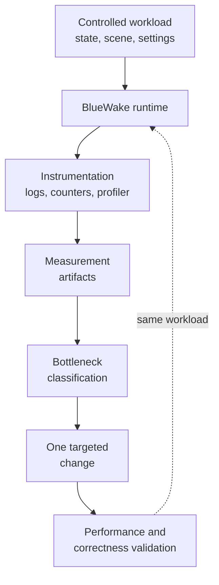
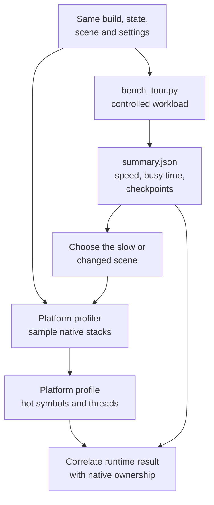
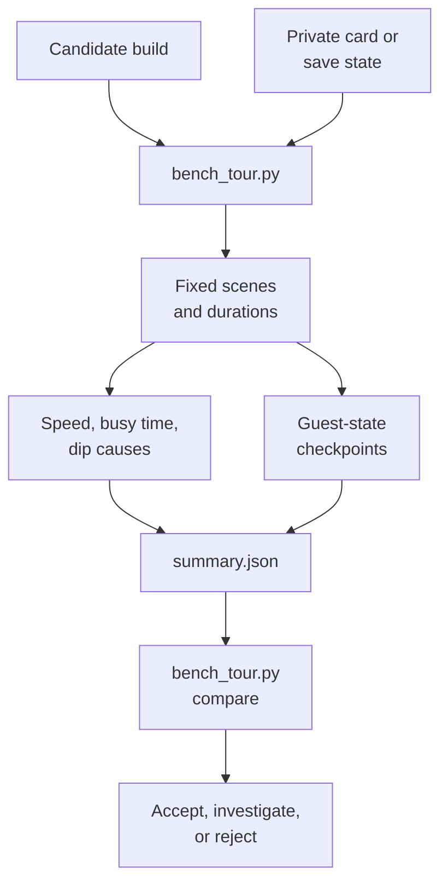
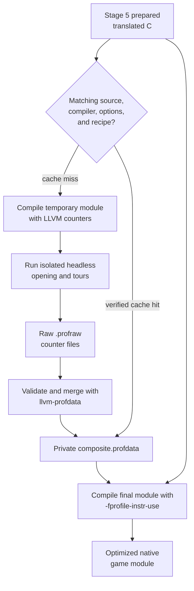
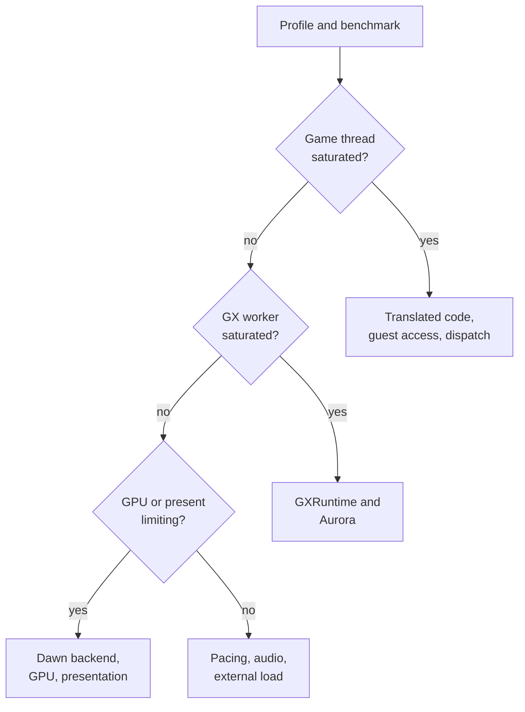
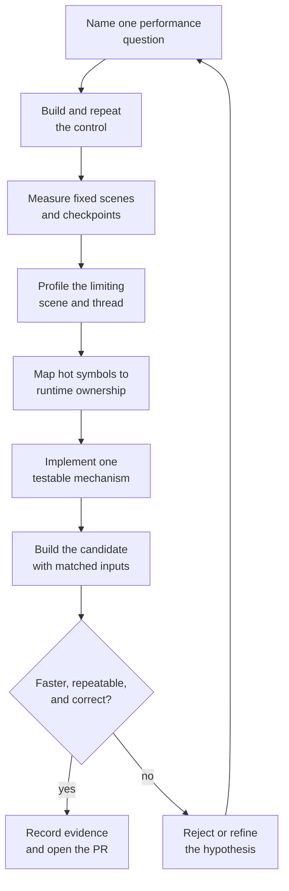

# BlueWake performance overview

## Contents

- [Introduction](#introduction)
- [Performance workflow](#performance-workflow)
- [Tool roles and platform coverage](#tool-roles-and-platform-coverage)
- [Performance domains](#performance-domains)
- [Profiling](#profiling)
- [Benchmarking](#benchmarking)
- [Training and PGO](#training-and-pgo)
  - [What a PGO profile is](#what-a-pgo-profile-is)
  - [Mechanical steps](#mechanical-steps)
  - [What the profile changes](#what-the-profile-changes)
  - [Coverage and limits](#coverage-and-limits)
- [Tuning](#tuning)
- [Evidence and results](#evidence-and-results)
- [Worked investigation](#worked-investigation)
  - [1. State the question and freeze the variables](#1-state-the-question-and-freeze-the-variables)
  - [2. Build the control](#2-build-the-control)
  - [3. Measure same-build noise first](#3-measure-same-build-noise-first)
  - [4. Read the benchmark finding](#4-read-the-benchmark-finding)
  - [5. Profile the same scene](#5-profile-the-same-scene)
  - [6. Turn the profile into an investigation](#6-turn-the-profile-into-an-investigation)
  - [7. Implement one change and its safety check](#7-implement-one-change-and-its-safety-check)
  - [8. Build a matched candidate](#8-build-a-matched-candidate)
  - [9. Compare control and candidate](#9-compare-control-and-candidate)
  - [10. Re-profile and validate behavior](#10-re-profile-and-validate-behavior)
  - [11. Decide, iterate, and report](#11-decide-iterate-and-report)

Performance path: [Index](README.md) → **Overview**

## Introduction

Performance work in BlueWake has three separate jobs:

- **Profiling** identifies where a run spends its time.
- **Benchmarking** measures whether a build became faster under a repeatable
  workload.
- **Tuning** changes one measured bottleneck and verifies both performance and
  game behavior.

None of these alone proves that an optimization is safe. A profile can name a
hot function without showing that changing it helps. A faster result can be
noise or can come from skipped work. A correct checkpoint can show that sampled
guest state agrees while still requiring player-visible checks for timing,
audio, graphics, and input.

The entities being measured are introduced in the
[runtime architecture](../architecture/Runtime.md). The build options and
profile-guided optimization (PGO) stages that shape the resulting binaries are
described in the [build architecture](../architecture/Build.md).

## Performance workflow

A performance change starts and ends with the same controlled workload. The
measurement artifacts determine the limiting component; they do not prescribe
an optimization by themselves.



The loop has four practical rules:

1. Compare the same scene, state, settings, pacing, and hardware conditions.
2. Use multiple samples and report a representative result, not the best run.
3. Change one hypothesis at a time so the result has one plausible cause.
4. Check guest behavior and the player-visible systems affected by the change.

The fixed-scene harness is
[`scripts/bench_tour.py`](../../scripts/bench_tour.py). Linux and Steam Deck CPU
sampling is automated by
[`scripts/linux/profile_deck.sh`](../../scripts/linux/profile_deck.sh).

## Tool roles and platform coverage

The benchmark harness and CPU profiler are independent tools with a useful
handoff between them. Neither invokes the other:



[`bench_tour.py`](../../scripts/bench_tour.py) controls **what the game does**.
It launches a BlueWake executable with an isolated card and settings, loads one
state, visits fixed scenes, reads BlueWake's shared session instrumentation, and
compares guest checkpoints. It answers questions such as “did this build make
Outset faster?” and “did the sampled guest state remain the same?” It does not
sample native call stacks, so it cannot name the function responsible for a
change.

[`profile_deck.sh`](../../scripts/linux/profile_deck.sh) measures **where one
Linux process spends CPU time**. It launches one state, attaches Linux `perf`,
and produces `perf.data` plus a flat symbol report. It can identify translated
chunks, host helpers, services, or graphics functions consuming time, but it
does not run the multi-scene tour or compare two builds.

They can therefore be used separately:

- Run only the benchmark when a before-and-after result and guest-state check
  are sufficient.
- Run only the profiler when a reproducible slow scene is already known and
  the question is where its CPU time goes.
- Use both when developing an optimization: benchmark first to identify the
  affected scene and size of the change, then profile the same build and state
  to explain it. Re-run the benchmark after the change for the acceptance
  result.

The tools correlate through their inputs and BlueWake's runtime instruments,
not through a shared artifact. A `summary.json` cannot be opened as a CPU
profile, and `perf.data` does not contain the tour's checkpoint comparison.

Training is a third, separate workflow. It runs instrumented headless playbacks
to create `.profraw` and `.profdata` inputs for a later compile; the benchmark
and platform profiler measure the resulting executable. Neither measurement
tool generates or modifies the PGO profile. The benchmark decides whether the
trained build helped, while the native profile can explain which compiled paths
changed cost. [Training and PGO](#training-and-pgo) describes that build loop.

### Platform matrix

BlueWake's session-log counters, environment-controlled states, and guest
checkpoints are shared runtime facilities. Process launching and native CPU
sampling are platform-specific, so the automation is not equally complete on
every target.

| Platform | Repeatable workload and comparison | Native CPU sampling | Current boundary |
| --- | --- | --- | --- |
| Linux desktop and SteamOS | [`bench_tour.py`](../../scripts/bench_tour.py) can invoke the Linux executable or AppImage in rendered, headless, or both modes. | [`profile_deck.sh`](../../scripts/linux/profile_deck.sh) wraps Linux `perf` for headless or rendered captures. | This is the complete automated path described here. A rendered capture must run in a desktop or game session with access to the display. |
| Windows | `bench_tour.py` is written to launch the Windows executable, set the pacing controls, and request the headless renderer when selected; rendered mode leaves the normal renderer in place. | Windows Performance Recorder/Analyzer can sample the process, but the repository has no equivalent wrapper that correlates its output with the tour. | The script explicitly records that Windows headless mode has not been confirmed. Results need a Windows desktop-session run. |
| macOS | BlueWake exposes the same session instrumentation and state controls. [`profile_play.sh`](../../scripts/profile_play.sh) drives one fixed developer route and uses macOS `sample`. | `sample` or Instruments can inspect the native process; `profile_play.sh` produces a `sample.txt` ownership report for its fixed route. | `bench_tour.py` has no `.app`-bundle launcher or validated general macOS workflow yet. `profile_play.sh` depends on development-tree artifacts and is not a portable replacement for the tour. |
| iPhone, iPad, and Apple TV | The runtime can emit the shared measurements, but `bench_tour.py` cannot directly launch, seed, and collect files from a sandboxed device app. | Instruments can profile a device process manually. | A device transport and lifecycle adapter is still needed before the desktop tour can control these targets. |
| Android (in progress) | [`scripts/android/measure.py`](../../scripts/android/measure.py) copies a private card through `adb`, controls one fixed measurement window, and records speed, busy time, instructions, and cycles per retrace in rendered or headless mode. | The same script uses `simpleperf stat` for counters. A sampled call-graph wrapper equivalent to `profile_deck.sh` is not currently provided. | Android has a dedicated device workflow rather than `bench_tour.py`; its thermal and CPU-frequency checks are part of result validity. See [Android: Measure](../ANDROID.md#measure). |

Adding another platform does not require changing the benchmark's meaning. It
requires an adapter that can install or locate the build, provide private input
files, set the same runtime controls, start and stop the app, retrieve its log,
and invoke that platform's profiler. The resulting measurements should retain
the same scene, settling interval, pacing, and checkpoint contract before they
are used to compare builds on that platform. Numbers from different hardware
or operating systems describe those environments and are not direct A/B data.

## Performance domains

The first decision is which runtime domain limits the measured workload.
BlueWake's game logic, compatibility services, graphics conversion, and native
presentation run in one process, but they do not necessarily compete on the
same thread or wait for the same resource.

The metric column names the quantities compared before and after a change. The
evidence column names the runtime record or profiler used to obtain and explain
those numbers.

| Domain | Work being measured | Primary performance metrics | Useful evidence | Architecture owner |
| --- | --- | --- | --- | --- |
| Translated game execution | Native translations of DOL and REL instructions, dispatch, and generated helper calls | Game frames or retraces per second; game-thread busy percentage; instructions or cycles per retrace; CPU self-time | Game-thread utilization and translated symbols in a CPU profile | [Game module](../architecture/GameModule.md) |
| Guest-state access | Register synchronization, guest-address resolution, memory helpers, and execution bookkeeping | CPU self-time in access helpers; resolver calls, alias iterations, or memory accesses per retrace | Hot guest-memory or dispatch helpers, optional resolver counters, and guest checkpoints | [Guest state](../architecture/GuestState.md) |
| Compatibility services | MMIO, deadlines, callbacks, interrupts, audio, input, disc, and storage work | Service CPU self-time; calls, callbacks, interrupts, or deadline checks per retrace | Service symbols, deadline activity, audio diagnostics, and session events | [Services](../architecture/Services.md) |
| Host coordination | Module dispatch, host hooks, lifecycle, persistence, and frame coordination | Host CPU self-time; dispatches or host turns per retrace; callback rate | Host symbols, callback frequency, and session timing | [Host](../architecture/Host.md) |
| GX processing | Gather-pipe and display-list interpretation, graphics-state conversion, and renderer command construction | GX-worker busy percentage; game-thread GX wait time; GX CPU self-time; draws per frame | GX-worker utilization and GXRuntime or Aurora symbols | [Graphics](../architecture/Graphics.md#gx-command-path) |
| GPU and presentation | Dawn backend submission, native GPU execution, synchronization, display pacing, and Smooth Motion | Displayed frames per second; encode and present time; GPU or present wait time; seconds below target | Backend selection, GPU or present waits, frame-pacing logs, and rendered results | [Graphics](../architecture/Graphics.md#textures-frame-buffers-and-presentation) |
| Build and code generation | Compiler selection, generated-code transformations, optimization profiles, and code layout | Training and compile wall time; module size; resulting instructions per retrace | Matched build receipts, module size, compile logs, and repeatable runtime comparisons | [Build](../architecture/Build.md) |

A low rendered frame rate does not identify the GPU as the cause. For example,
a saturated game thread can leave both the graphics worker and GPU waiting.
Likewise, a fast headless run does not prove that presentation is the only
remaining cost: the rendered profile is still needed to distinguish CPU-side
graphics conversion from GPU or display waits.

## Profiling

Profiling answers **where time went in one run**. BlueWake provides two
complementary evidence streams:

- Session instrumentation records frame-rate dips, component utilization,
  renderer selection, pacing, and a final performance summary. The watcher is
  implemented by [`runtime/host/src/fps_watch.c`](../../runtime/host/src/fps_watch.c).
- A platform profiler samples native call stacks and attributes CPU time to
  translated functions, the host, services, GXRuntime, Aurora, or driver code.

On Linux, [`profile_deck.sh`](../../scripts/linux/profile_deck.sh) supports two
intentional modes:

| Mode | What it isolates | Primary artifacts |
| --- | --- | --- |
| Headless, unpaced | Game-thread and runtime throughput without native rendering or wall pacing | `perf.data`, `report.txt`, and `run.log` |
| Rendered, wall-paced | The game, GX worker, renderer, GPU, and presentation working together | The same profiler artifacts plus `[fps-dip]` and `[perf-summary]` session evidence |

The current Steam Deck procedure and artifact interpretation remain in
[Profiling BlueWake on the Steam Deck](../PROFILING.md). Profiling artifacts can
contain local paths and runtime details; they must be reviewed before excerpts
are posted publicly.

## Benchmarking

Benchmarking answers **whether one build is faster than another under the same
workload**. [`bench_tour.py`](../../scripts/bench_tour.py) creates a private
scratch environment, starts measured runs from the same state, visits fixed
scenes, discards each stop's settling interval, and writes `summary.json`.



The speed measurement and checkpoint comparison answer different questions:

- Stop speed and busy time quantify performance and identify unstable samples.
- Guest checkpoints compare CPU, memory, alias, and timing state at defined
  retraces. They catch behavioral divergence; they are not an FPS metric.
- A player-visible check covers behavior outside the sampled state, including
  audio, input, transitions, rendering, and persistence.

The command, output contract, default stops, and synthetic parser tests live in
[`scripts/bench_tour.py`](../../scripts/bench_tour.py) and
[`tests/test_bench_tour.py`](../../tests/test_bench_tour.py). The original
implementation task is retained in [The benchmark tour](../BENCHMARK_TOUR.md).

## Training and PGO

Training is BlueWake's local **profile-guided optimization (PGO)** stage. It is
not machine learning: the builder runs an instrumented copy of the translated
game module, records LLVM execution counters, and supplies those counts to
Clang when compiling the final module.

The generated module contains hundreds of thousands of translated blocks. The
compiler can understand each function's static control flow, but it cannot know
which translated routes a player will execute frequently. Training supplies
that frequency information so LLVM can favor observed hot paths when making
decisions such as inlining, branch layout, and code-size placement.



### What a PGO profile is

In this section, a **profile** is an LLVM instrumentation profile: a database of
how often instrumented parts of the program executed during the training
playbacks. The word is also used elsewhere in the repository for two different
things:

| Meaning | Artifact | Question it answers |
| --- | --- | --- |
| PGO instrumentation profile | `*.profraw`, then `composite.profdata` | Which functions and control-flow paths did the training workload execute, and how frequently? |
| CPU sampling profile | Linux `perf.data`, macOS `sample.txt`, or a platform profiler capture | Where did the running process spend CPU time? |
| BlueWake build profile | [`scripts/builder/profiles/bluewake.sh`](../../scripts/builder/profiles/bluewake.sh) | Which game, dependency revisions, build hooks, and expected generated-source digest should the builder use? |

Only the first artifact is consumed by Clang for PGO. A `perf.data` capture may
show that a function is expensive, but it cannot be passed to
`-fprofile-instr-use`. Conversely, `composite.profdata` records execution
frequency rather than sampled CPU duration, so it does not by itself say which
function took the most wall time.

The instrumented module writes one or more binary `*.profraw` files. Each file
contains counter values associated with the instrumented program's functions
and control-flow regions, together with the identity information LLVM needs to
interpret those counters. BlueWake gives the files distinct module and process
names through `LLVM_PROFILE_FILE`, allowing independent training playbacks to
write within the same training attempt without overwriting one another.

`llvm-profdata merge` combines those raw files into the indexed
`composite.profdata` database. Counts from repeated or concurrent playbacks are
aggregated: a route executed more often contributes more weight. The merged
profile no longer represents a timeline or an individual scene; it represents
the total frequency distribution of the complete training workload.

During the final compile, Clang matches profile records to the corresponding
functions and control-flow structure in the prepared source. Function identity
and instrumentation hashes prevent arbitrary counter arrays from being applied
to unrelated code. BlueWake adds a stronger build-level guard by fingerprinting
the prepared source, compiler, options, runtime, host playback code, and recipe
before reusing the profile.

For inspection, `llvm-profdata show --all-functions composite.profdata` reports
the recorded functions, their execution counts, and their counter data. The
builder uses that view to confirm that translated `func_*` functions actually
ran and to identify chunks with no recorded execution for optional cold-source
tiering. The binary profile is a compiler input, not a source file, save state,
replay, call graph, or packaged runtime asset.

### Mechanical steps

| Step | What happens | Why it happens | Output or code reference |
| --- | --- | --- | --- |
| Fingerprint | The builder hashes the prepared source, compiler, runtime revision, enabled source transformations, host playback code, and training recipe. | A profile is reused only when its counters still describe the code and playback that produced it. | `OUT/pgo-local/training.json`; Linux [`training_fingerprint`](../../scripts/linux/build.py), Windows [`training_fingerprint`](../../scripts/windows/build.py), and Apple [`fingerprint`](../../scripts/builder/train_local_pgo.py) |
| Instrumented compile | The prepared composite is compiled once with `-fprofile-instr-generate`. This is a disposable training module, not the final release module. | LLVM inserts counters associated with translated functions and control-flow paths. | Instrumented build under `OUT/pgo-local/`; Linux [`train`](../../scripts/linux/build.py), Windows [`train`](../../scripts/windows/build.py), and Apple [`train_local_pgo.py`](../../scripts/builder/train_local_pgo.py) |
| Playback | The host loads the instrumented module in an isolated data directory and advances deterministic, headless input routes. Linux and Windows exercise the opening, enabled mod variants, and a multi-scene tour. | Executing representative game paths increments the counters without touching the player's normal card or settings. Headless, unpaced playback shortens the build step. | Per-playback logs, temporary state, and `*.profraw` files under `OUT/pgo-local/` |
| Merge and validate | `llvm-profdata` merges all raw counter files. The builder rejects an unreadable profile, a failed route, or a profile with no executed translated functions. | The final compiler needs one verified profile rather than independent files from concurrent playbacks. | `OUT/pgo-local/composite.profdata` |
| Final compile | The prepared composite is compiled again with `-fprofile-instr-use=<profile>`. The profile's hash is included in the compiler input path. | Clang can optimize observed hot code differently, and a changed profile forces Ninja to rebuild the affected module. | Hashed profile under `OUT/profiles/` and the final native game module |

Linux and Windows can run several **independent tour playbacks** concurrently
to shorten training. This parallelizes collection across separate processes;
it does not make one instance of the translated game execute on several cores.

### What the profile changes

LLVM attaches the recorded frequencies to the final compilation. Its
optimization passes may use them to:

- inline frequently exercised calls more selectively;
- arrange likely branches and hot blocks for the common route;
- avoid spending the same code-size budget on paths the training never visits;
- improve instruction layout and related downstream optimization decisions.

BlueWake also applies an explicit tiering policy around the LLVM profile. On
the supported builders, translated chunks with no recorded function execution
can be listed in `OUT/composite-cold-sources.txt` and compiled at `-O1`; visited
chunks use the normal optimization level and PGO counts. This limits compile
time and module size. It is a BlueWake build policy layered on top of LLVM PGO,
not a property of the profile format itself.

The local profile consumed by the current builders primarily guides the
translated game module. The host and graphics stack are separate native
targets and require their own representative profile where one is configured.
A headless game-module tour intentionally does not represent rendered Aurora,
Dawn, GPU, or presentation work.

### Coverage and limits

Training records only what its playback executes. An unvisited boss, cutscene,
item, dungeon, or mod path has no observed frequency in that local profile.
That does not make the path unavailable or incorrect; it means the final
compiler has less runtime evidence for optimizing it.

Training also does not establish a performance result:

- The training tour favors the routes used to build the profile, so it cannot
  be the only benchmark used to judge that profile.
- A faster trained build still needs comparison from identical save states,
  including scenes outside the training tour.
- PGO is intended to preserve program behavior, but the final build still
  needs guest checkpoints and the relevant player-visible checks.
- Adding every possible route can enlarge hot code and reduce instruction-cache
  locality; broader coverage is not automatically faster.

The complete per-platform build flow, cache behavior, and artifact locations
are documented in [Build: Train](../architecture/Build.md#6-train). A concrete
profile-reuse change is [PR #243](https://github.com/chrissotraidis/bluewake/pull/243),
which keeps the existing module profile when a host-only build does not change
the translated code it describes.

Profiles are derived from the player's private game build. They remain inside
the private `OUT` directory and are not committed or uploaded.

## Tuning

Tuning begins only after the evidence assigns a bottleneck. The implementation
layer should match the limiting domain:



A tuning pull request should state:

1. The profile evidence and bottleneck it addresses.
2. The single mechanism being changed.
3. The before-and-after benchmark from identical inputs.
4. The correctness checks appropriate to that mechanism.
5. The platforms tested, and any platform still awaiting a hardware check.

Generated-code and build-option changes normally require a new game module.
Host-only changes can often reuse the module. Graphics changes require rendered
measurements, while changes intended to preserve translated behavior require
guest-state comparison in addition to play testing.

The active strategy, acceptance gates, and measured work are maintained in
[Making BlueWake faster](../PERFORMANCE.md). Implemented optimizations and their
switches are catalogued in
[Performance optimizations](../PERFORMANCE_OPTIMIZATIONS.md).

## Evidence and results

Performance documentation serves three different lifetimes:

| Material | Role | Location |
| --- | --- | --- |
| Stable concepts and workflow | Explain how to profile, benchmark, diagnose, and validate | This performance documentation |
| Active strategy and next experiments | Record what is currently worth testing and its acceptance gate | [`docs/PERFORMANCE.md`](../PERFORMANCE.md) |
| Implemented or rejected work | Preserve measured results, switches, and supporting contribution history | [`docs/PERFORMANCE_OPTIMIZATIONS.md`](../PERFORMANCE_OPTIMIZATIONS.md) and dated [`docs/status`](../status/) records |

Results should identify the build commit, compiler and options, device, scene or
state, rendered mode, pacing, sample count, representative result, and relevant
correctness check. Disc images, extracted game files, translated modules, cards,
save states, raw private logs, and optimization profiles do not belong in the
repository.

## Worked investigation

This hypothetical Linux and SteamOS example shows the complete loop for a
game-thread optimization. Its shape follows the investigations recorded in
[issue #215](https://github.com/chrissotraidis/bluewake/issues/215), but the
sample numbers below are illustrative rather than a claim about a particular
build.



### 1. State the question and freeze the variables

Begin with one falsifiable question, for example:

> Is repeated guest-address resolution a material part of the game-thread cost
> at Outset, and can one guarded fast path reduce it without changing guest
> state?

Record the source commit, compiler, builder options, device power settings,
scene, state or card, display mode, and Smooth Motion setting. Keep every one of
them fixed between the control and candidate. Use private paths outside the
repository for game-derived inputs and measurements:

```bash
repo=/path/to/bluewake
disc=/private/path/GZLE01.iso
card=/private/path/GZLE01.card
state=/private/path/outset.bwstate
control_out=/private/build/control
candidate_out=/private/build/candidate
results=/private/results/bluewake-performance
mkdir -p "$results"
```

The card and state remain private. They are inputs to a local measurement, not
pull-request artifacts.

### 2. Build the control

Build the unchanged commit with the reproducible Linux container:

```bash
cd "$repo"
git rev-parse HEAD
python3 scripts/linux/build.py "$disc" \
  --out "$control_out" --ci-container
```

Keep the complete logs and provenance under `control_out`. If training is on,
this build creates a profile for the control's exact source and options. Record
that fact; do not silently compare a trained control with an untrained
candidate.

The directly runnable control is:

```text
CONTROL_OUT/BlueWake/bluewake
```

An AppImage is optional for the measurement. Use `--appimage` when the build
must be transferred to a Steam Deck as one file.

### 3. Measure same-build noise first

Before comparing code, run the control twice. Each run writes `summary.json` in
its current directory. Run rendered measurements from the device's desktop or
game session; a remote shell without display access can run only the headless
mode reliably.

```bash
mkdir -p "$results/control-1" "$results/control-2"

( cd "$results/control-1" && \
  python3 "$repo/scripts/bench_tour.py" \
    "$card" "$control_out/BlueWake/bluewake" --mode both )

( cd "$results/control-2" && \
  python3 "$repo/scripts/bench_tour.py" \
    "$card" "$control_out/BlueWake/bluewake" --mode both )

python3 "$repo/scripts/bench_tour.py" compare \
  "$results/control-1/summary.json" \
  "$results/control-2/summary.json"
```

The comparison should report matching checkpoints. The speed difference shows
the machine's current run-to-run noise; `bench_tour.py` calls out a stop whose
difference exceeds 3%. Stabilize temperature, power limits, background work,
and display conditions before continuing if identical runs move too much.

### 4. Read the benchmark finding

Inspect the complete summaries rather than copying only the fastest stop:

```bash
python3 -m json.tool "$results/control-1/summary.json" | less
```

An illustrative slow rendered stop might show:

```text
sea:44:0 Outset: 22.1 game frames/s, busy 98.0%, loaded, dips: none
```

That result suggests the game thread is saturated while the game is below its
30-frame-per-second target. An unpaced run may not emit `[fps-dip]`, so `none`
does not clear every other subsystem. The rendered profile and session summary
must still determine whether translated code, guest-state access, host
coordination, a compatibility service, GX, GPU, or presentation owns the cost.

### 5. Profile the same scene

Use the same build and a saved state for the slow stop. On Linux or SteamOS,
capture headless and rendered profiles into separate directories:

```bash
"$repo/scripts/linux/profile_deck.sh" \
  --state "$state" \
  --appimage "$control_out/BlueWake/bluewake" \
  --out "$results/profile-control-headless"

"$repo/scripts/linux/profile_deck.sh" --rendered \
  --state "$state" \
  --appimage "$control_out/BlueWake/bluewake" \
  --out "$results/profile-control-rendered"
```

The `--appimage` option accepts either an AppImage or the runnable host binary.
Run the rendered command from the device's desktop or game session so it can
reach the display.

Read the runtime diagnosis and native symbol ranking:

```bash
grep -aE 'fps-dip|perf-summary' \
  "$results/profile-control-rendered/session.log"

sed -n '1,80p' "$results/profile-control-headless/report.txt"
sed -n '1,80p' "$results/profile-control-rendered/report.txt"
```

The headless profile isolates the game thread and runtime. The rendered profile
adds GXRuntime, Aurora, Dawn, and presentation. A hotspot that appears in both
is upstream of rendering; cost that appears only rendered belongs to the
graphics path or its interaction with the game.

### 6. Turn the profile into an investigation

Do not edit the first symbol in the report immediately. Establish what it owns
and why it is hot:

1. Separate samples by thread when necessary with `perf report --sort=tid,symbol`.
2. Use `perf annotate` to find the expensive instructions inside a named host
   or runtime function.
3. For a translated `func_<address>` chunk, locate the containing address range
   in [`config/GZLE01/symbols.txt`](../../config/GZLE01/symbols.txt); do not guess
   from the nearest name.
4. Follow the owner into the [game module](../architecture/GameModule.md),
   [guest state](../architecture/GuestState.md),
   [services](../architecture/Services.md), or
   [graphics](../architecture/Graphics.md) chapter.
5. Enable a focused existing counter only after the sampled hotspot calls for
   it. For guest alias resolution, for example, `BLUEWAKE_TRACE_ALIAS_COST=1`
   reports resolver calls, bounds pruning, iterations, and hits at exit.

Suppose the profile attributes a meaningful share to guest-address resolution
and the resolver counter confirms repeated searches of the same safe region.
That supports a guarded fast-path experiment. If the samples are spread across
translated gameplay instead, the resolver hypothesis is rejected before code
is changed.

### 7. Implement one change and its safety check

Change only the measured mechanism. A guest-address fast path would need to
preserve alias precedence, bounds checks, byte order, and fallback behavior.
Where practical, add a verification mode that computes both the old and new
answers and reports any disagreement before making the fast path a default.

Run focused tests and repository checks before spending time on another full
build:

```bash
cd "$repo"
python3 tests/test_guest_checkpoints.py
scripts/audit_repo.sh
git diff --check
```

The actual test set should match the changed component. A renderer change needs
renderer tests; a RecompCore runtime change must first follow that repository's
own pull-request and pinning process. The commands above are repository sanity
checks, not a substitute for a focused resolver correctness test.

### 8. Build a matched candidate

Build into a fresh output directory with the same compiler, options, training
policy, and source base apart from the intended change:

```bash
python3 scripts/linux/build.py "$disc" \
  --out "$candidate_out" --ci-container
```

A source change invalidates the training fingerprint, so the candidate normally
collects its own counters before the final compile. That is expected. Reusing a
control profile across changed generated code would make profile compatibility
another uncontrolled variable.

### 9. Compare control and candidate

Run the candidate under the same conditions and compare it with the adjacent
control run:

```bash
mkdir -p "$results/candidate-1"

( cd "$results/candidate-1" && \
  python3 "$repo/scripts/bench_tour.py" \
    "$card" "$candidate_out/BlueWake/bluewake" --mode both )

python3 "$repo/scripts/bench_tour.py" compare \
  --qualification \
  "$results/control-1/summary.json" \
  "$results/candidate-1/summary.json"
```

For native game-thread comparisons, pass `--workers 0` to the control run and
the candidate worker count to the candidate run. The option is applied after
environment sanitization and enables activation diagnostics. `--qualification`
rejects missing modes, scenes, loads, checkpoints, or mismatched retrace grids
instead of treating incomplete evidence as a successful comparison.

An illustrative useful result might read:

```text
sea:44:0 Outset: speed 22.1 -> 24.0 (+8.6%), busy 98.0% -> 90.2%
checkpoints match
```

That is a candidate result, not yet a conclusion. Repeat the runs in an
alternating order such as control, candidate, candidate, control and use the
representative result across the samples. A gain confined to one noisy run or
one scene should be investigated rather than reported as general.

Also exercise scenes outside the training tour when PGO or code layout could be
involved:

```bash
mkdir -p "$results/control-untrained" "$results/candidate-untrained"

( cd "$results/control-untrained" && \
  python3 "$repo/scripts/bench_tour.py" \
    "$card" "$control_out/BlueWake/bluewake" --mode headless --untrained )

( cd "$results/candidate-untrained" && \
  python3 "$repo/scripts/bench_tour.py" \
    "$card" "$candidate_out/BlueWake/bluewake" --mode headless --untrained )
```

### 10. Re-profile and validate behavior

Profile the candidate at the same state if the benchmark shows a repeatable
change. The expected hotspot should shrink without merely moving equivalent
work elsewhere. If the benchmark improves but the original hotspot does not,
the hypothesis is incomplete and the result needs further investigation.

Matching checkpoints are required for a change intended to be exact, but they
are not the entire acceptance test. Exercise the affected player-visible paths:

- boot and load the measured state;
- transition between scenes;
- play a cutscene with music and effects;
- test input and controller behavior;
- save, quit, and continue;
- inspect rendering in a rendered run.

The exact list should follow the component changed. A timing change may
intentionally move checkpoint timing and therefore needs the separately agreed
timing, audio, stage-sweep, and play gates rather than a false claim of exact
state equality.

### 11. Decide, iterate, and report

Accept the hypothesis only when the improvement exceeds measured noise, appears
in the intended workload, and passes the relevant correctness checks. Otherwise:

- **No measurable change:** record the negative result and stop or choose a new
  hotspot; do not stack another speculative optimization on it.
- **Checkpoint disagreement:** find the first differing retrace and fix or
  reject the change before making a speed claim.
- **One scene improves and another regresses:** determine whether the tradeoff
  is code layout, training coverage, or a workload-specific mechanism.
- **Hotspot moves:** profile again; the next owner may now be the actual limit.

A performance pull request can summarize the final evidence compactly:

```text
Question: <measured bottleneck and proposed mechanism>
Builds: <control commit/options> -> <candidate commit/options>
Hardware: <device, OS, power/display conditions>
Workload: <state or tour, rendered/headless, sample count>
Result: <representative per-stop before/after and module size>
Correctness: <checkpoint result and player-visible checks>
Profile: <hot owner before/after; private raw captures retained locally>
```

Commit only the implementation, tests, and concise derived results. Keep the
disc, extracted game data, module, card, save state, raw session logs, profiler
captures, and PGO profiles private.

Return to the [performance index](README.md), or review the components being
measured in the [architecture overview](../architecture/Overview.md).
