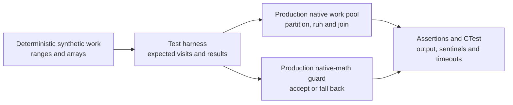
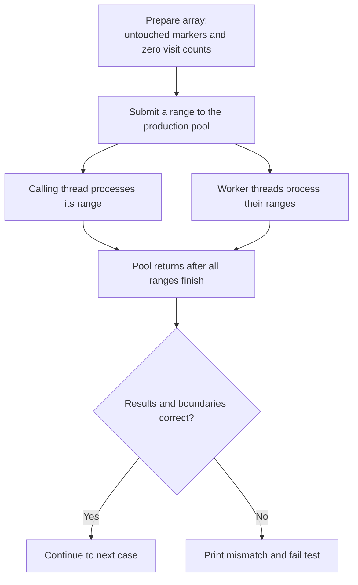

# Technical plan — Native work-pool test foundation

## Contents

- [Overview](#overview)
- [Build and execution](#build-and-execution)
- [Test contracts](#test-contracts)
- [Validation](#validation)
- [Deferred work](#deferred-work)

[Requirements](PRD.md) · [Progress](PROGRESS.md)

## Overview

This work creates a source-only harness around the production native work pool
and native-math dispatch. It tests concurrency contracts that later game-thread
optimizations depend on without requiring a disc, translated module, renderer,
or gameplay run.



The pool tests verify partitioning, publication, configuration, failure
recovery, and safe unload. The native-math tests verify dispatch boundaries and
result agreement. Sanitizer lanes run the same synthetic contracts to expose
memory, undefined-behavior, and race defects; they do not claim gameplay
equivalence or a Steam Deck speedup.

## Build and execution

Implementation is included in this PR; its added paths are not claimed to exist
on `main` until this PR merges.

| Component | Responsibility |
|---|---|
| `cmake/native_math_tests.cmake` | Share existing guard/oracle registration between host and Linux, preserving flags and names |
| `tests/native_work_pool/CMakeLists.txt` | Build the production pool with a synthetic harness, without GXRuntime or renderer dependencies |
| `tests/native_work_pool_test.c` | Verify partitions, sentinels, publication and repeated submissions |
| `linux/CMakeLists.txt` and host CMake | Register the applicable source-only suite |
| `.github/workflows/linux-host.yml` | Build the test executables before selecting their CTest entries |

### Native work-pool test

[`tests/native_work_pool_test.c`](../../../tests/native_work_pool_test.c)
checks that the production worker pool divides, executes, and finishes
synthetic work correctly. It needs no game, renderer, or disc. This validates
the machinery that future parallel game calculations depend on. The
[compiled component tests](../../architecture/Testing.md#compiled-component-tests)
section places this harness within BlueWake's broader test architecture.



The synthetic callback is equivalent to:

```c
visits[index]++;              // Track how often this item ran.
output[index] = index ^ salt; // Produce an easily checked result.
```

The POSIX visitation counter is atomic. `salt` changes between submissions to
help expose stale job data.

| Contract | Verification | Detects |
|---|---|---|
| Every item runs exactly once | Each submitted element has one visit | Missing work or overlapping partitions |
| Results are complete on return | Inspect outputs immediately after the pool call | Early return or incomplete publication |
| Unsubmitted entries remain untouched | Check marker values outside the requested range | Incorrect boundaries or overruns |
| Expected threads participate | On POSIX, verify thread identities, exact partitions and caller participation | Silent serial execution or incorrect assignment |
| Successive jobs stay independent | Run 1,000 submissions with changing counts and values | Stale context, missed wakeups or previous-job results |
| Configuration selects the expected path | Check effective workers and parallel-batch counters | Ignored settings or unexpected fallback |

| Workload | Purpose |
|---|---|
| 0 items | Safe empty submission |
| 17 items, minimum grain 256 | Small-job serial fallback |
| 4,099 items | Correct uneven partitioning |
| 1,000 changing submissions | Repeated reuse of the pool and context |

CTest launches fresh processes because worker configuration initializes once
per process. Configurations cover invalid and zero settings, 1/2/3 workers, an
oversized request capped at eight, and simulated total and partial
worker-creation failures. Windows exercises its serial backend.

A pass establishes these synthetic execution contracts. It does **not**
establish gameplay equivalence, a Steam Deck speedup, or safe library unload;
those require the separate oracle, hardware/performance, and lifecycle tests.

Sources: [test implementation](../../../tests/native_work_pool_test.c),
[CTest configuration](../../../tests/native_work_pool/CMakeLists.txt), and
[production pool](../../../cmake/composite/native_work_pool.c).

The private native-math oracle stays `EXCLUDE_FROM_ALL` and is not registered
as a public CTest. Windows keeps its existing serial implementation; this
foundation does not add a Windows worker backend.

## Test contracts

Worker configuration is initialized once, so each setting runs in a fresh
process. Invalid/zero settings exercise serial behavior; POSIX tests also
cover 1, 2, 3 and over-limit requests. Check effective participants rather
than interpreting a requested setting as proof of worker activity.

Use deterministic synthetic arrays, uneven/empty work, exact visit counts,
boundary sentinels and 1,000 changing submissions. Assertions remain enabled
in the harness. Timeouts make deadlock failures bounded.

## Validation

Run on this PR's branch:

```bash
cmake -S tests/native_work_pool -B build/native-work-pool -DCMAKE_BUILD_TYPE=Debug
cmake --build build/native-work-pool --parallel
ctest --test-dir build/native-work-pool --output-on-failure
```

For Linux integration, use the pinned runtime and CI compiler/provider options;
set `BUILD_TESTING=OFF` and `BLUEWAKE_LINUX_REGRESSION_TESTS=ON`, build
`bluewake_native_math_guard_test` and `bluewake_native_work_pool_test`, then
select `bluewake_native_(work_pool|math_(guard|workers))` with CTest.
The [Linux workflow](../../../.github/workflows/linux-host.yml) owns the full environment.

Run repository audit, diff and attribution checks. A Linux pass does not
replace Windows CI, a private oracle, gameplay verification or Deck measurements.

## Deferred work

[#424](https://github.com/chrissotraidis/bluewake/pull/424) combines #406–#411's test coverage into one review unit. It is
not a mandatory prerequisite for every optimization. Broader qualification
tools (#412–#417) and #421 remain deferred on preserved branches.
A performance change must show benchmark-tour improvement and unchanged
gameplay, independently of the test-foundation result.
