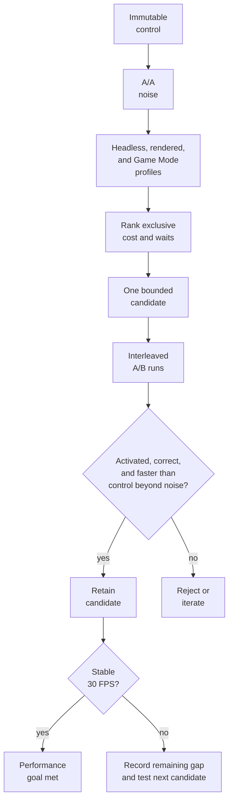

# TECH_PLAN — Steam Deck game-thread optimization

Status: Planning only

Source: upstream `main` at `2ab8118fc09fa08569100201a871616d18a1b771`

[PRD](PRD.md) · [Tracker](PROGRESS.md)

Architecture: [game thread](../../architecture/GameThread.md) ·
[test evidence](../../architecture/Testing.md) ·
[performance workflow](../../performance/Overview.md)

## Inspected facts

- [`bench_tour.py`](../../../scripts/bench_tour.py) controls fixed scenes and
  emits speed, busy time, dip causes, and guest checkpoints in `summary.json`.
- [`profile_deck.sh`](../../../scripts/linux/profile_deck.sh) launches one state,
  samples the Linux process with `perf`, and emits `perf.data`, `report.txt`,
  `run.log`, and a session-log copy. Headless and rendered runs answer different
  questions; neither invokes the benchmark tour.
- [`native_work_pool.c`](../../../cmake/composite/native_work_pool.c) provides
  synchronous range work on POSIX; Windows remains serial. [PR #424 (merged)](https://github.com/chrissotraidis/bluewake/pull/424)
  adds broader pool/lifecycle coverage but is not evidence that any game candidate is faster.
- Each completed experiment retains its own source label and conclusion. Those
  records do not establish a current-source control.

## Planned changes

| Status | Surface | Practical change | Requirement |
|---|---|---|---|
| Modify | Steam Deck measurement procedure and evidence record | Freeze inputs, measure A/A noise, profile, and rank current costs | FR-01, FR-02 |
| Proposed | One M0-selected game-thread code path | Implement one bounded, opt-in candidate with activation evidence | FR-03 |
| Modify | Benchmark and profiling evidence | Compare matched builds against cost reduction and the overall 30 FPS goal | FR-04 |
| Modify | Candidate-specific tests and qualification record | Prove behavior, fallback, lifecycle, and platform compatibility | FR-05 |
| Proposed | Deck build-time variants | Compare compiler, CPU tuning, native-entry and PGO variants independently | FR-06 |

## Steam Deck procedure

Keep the control immutable. Build candidates from the same source revision,
compiler, PGO inputs, options, and AppImage environment; change only the
candidate. Never publish the personal module, state, card, or raw private log.

### Optional: SSH setup and limits

SSH can drive the headless benchmarks, profiles, comparisons, and evidence
collection. On the Deck, enter Desktop Mode, open Konsole, set a password if
needed, start the server, and obtain its LAN address:

```bash
passwd
sudo systemctl enable --now sshd
hostname -I
```

From the development machine, connect as `deck` and copy the private test bundle
only between machines you control:

```bash
ssh deck@DECK_IP
rsync -av ./deck-test/ deck@DECK_IP:~/bluewake-test/
```

Prefer SSH keys over leaving password authentication exposed. To stop and
disable the service after testing, run `sudo systemctl disable --now sshd` on
the Deck.

| Task | From SSH? | Boundary |
|---|---|---|
| Copy AppImages/scripts and collect redacted evidence | Yes | Keep the personal AppImage, state, card, module, and raw logs private |
| Headless `bench_tour.py`, `profile_deck.sh`, `perf report`, hashes, and comparisons | Yes | No display session is required |
| Rendered Desktop Mode benchmark/profile | Partly | A local graphical session must already be active; SSH needs its valid `DISPLAY` and `XAUTHORITY` |
| Game Mode launch and gameplay checks | No | Start and play the Steam entry on the Deck |
| Attach `perf` to an already-running Game Mode process and retrieve logs | Yes | Launch locally first, then attach by the verified process ID over SSH |

Commands in the following sections run in an SSH shell unless they explicitly
require Desktop Mode or Game Mode. Do not use X11 forwarding as a substitute
for measuring the Deck's own rendered session.

### 1. Build and identify the control

On the development machine:

```bash
git switch --detach 2ab8118fc09fa08569100201a871616d18a1b771
python3 scripts/linux/build.py /path/to/GZLE01.iso \
  --out build/deck-control --ci-container --appimage
sha256sum build/deck-control/BlueWake-x86_64.AppImage \
  build/deck-control/composite/gGZLE01_recomp.so
```

Record the commit, dependency-lock hash, compiler, builder command, AppImage and
module hashes, PGO/training status, and build summary. Copy the AppImage plus
`scripts/bench_tour.py` and `scripts/linux/profile_deck.sh` to the Deck. The
[#433](https://github.com/chrissotraidis/bluewake/issues/433) regression claim
was retracted. A control requiring certified `--native-entries` is blocked by
[#451](https://github.com/chrissotraidis/bluewake/issues/451), whose native
generators cannot reproduce the current prepared leaves.

### Verified profiling control

[`3b5c5c4826ef62bd1f8ff387734ff2ef295898e5`](https://github.com/chrissotraidis/bluewake/commit/3b5c5c4826ef62bd1f8ff387734ff2ef295898e5)
is the source revision used for the recorded measurements. It compiles the
Clang 22 application
through the earlier packaged-Dawn route (RecompCore
`77d4717d868cec8b4014932bb22978c284a535a7`). Its AppImage ABI audit fails on
`GLIBCXX_3.4.32`, but that warning is not a Deck compatibility verdict: the
resulting AppImage launched on the Deck, loaded the fixed state, and executed
gameplay. It is the profiling control, not a release candidate.

### Deck test bundle

Copy only the private AppImage, the two measurement scripts, and selected save
states. Do not copy the build tree, ISO, generated sources, standalone module,
or local logs.

```text
~/bluewake-test/
├── BlueWake-x86_64.AppImage
├── bench_tour.py
├── profile_deck.sh
├── evidence/
└── states/
    └── quick-N.bwstate
```

Create the evidence directory once, then run every command below from the
bundle root:

```bash
cd ~/bluewake-test
mkdir -p evidence
```

With `./bench_tour.py --state states/quick-N.bwstate`, its positional card
argument is unused; pass `unused.card`. The private translated module remains
inside the AppImage; BlueWake's prepared disc data remains in its configured
Deck data directory. Retain both only on machines you control.

### 2. Freeze the Deck environment and private workload

Record Steam Deck revision, SteamOS/kernel, Game Mode or Desktop Mode, refresh
rate, frame cap, TDP/clock limits, power source, renderer, resolution, textures,
Smooth Motion, and state hash. Use one heavy state (initially Outset), another
measured slow scene, and a low-load control. Fix cooling/power conditions and
discard warmup before comparing runs.

### 3. Establish same-build noise

From the Deck, run the control at least three times per mode:

```bash
python3 ./bench_tour.py unused.card ./BlueWake-x86_64.AppImage \
  --state states/quick-N.bwstate --mode headless
mv summary.json evidence/control-headless-1.json

python3 ./bench_tour.py unused.card ./BlueWake-x86_64.AppImage \
  --state states/quick-N.bwstate --mode rendered
mv summary.json evidence/control-rendered-1.json

python3 ./bench_tour.py compare \
  evidence/control-headless-1.json evidence/control-headless-2.json
```

Repeat with identical settings. If same-build speed varies by more than 3%, or
checkpoints differ, fix the workload before profiling candidates.

### 4. Capture CPU profiles

Headless/unpaced isolates execution throughput; rendered/Desktop Mode exposes
GX, GPU, and presentation waits:

```bash
./profile_deck.sh --seconds 30 \
  --appimage ./BlueWake-x86_64.AppImage \
  --state states/quick-N.bwstate \
  --out evidence/profile-headless

./profile_deck.sh --rendered --seconds 30 \
  --appimage ./BlueWake-x86_64.AppImage \
  --state states/quick-N.bwstate \
  --out evidence/profile-rendered
```

For the primary Game Mode capture, launch the same AppImage/state through Steam,
then attach over SSH rather than launching a second process:

```bash
PID=$(pgrep -n -f 'mount_.*bluewake')
perf record -g -F 99 -p "$PID" -o evidence/game-mode.data -- sleep 30
perf report -i evidence/game-mode.data --stdio --no-children \
  > evidence/game-mode-flat.txt
perf report -i evidence/game-mode.data --stdio --sort=tid,symbol \
  > evidence/game-mode-threads.txt
```

Reject a capture with the wrong PID/scene, lost samples, thermal/power changes,
missing symbols, or insufficient post-warmup duration.

### 5. Rank and investigate candidates

Correlate flat self-time, per-thread ownership, session `busy`/wait fields, and
cycles/instructions per retrace. Use `perf annotate` on each leading symbol.
Generated `func_<address>` symbols are chunks, not original game functions;
map ranges before naming game logic.

### 6. Compare a candidate

Build A and B from the same revision and inputs. Run five interleaved pairs
(`A/B/B/A/...`) in headless and rendered modes, then repeat the Game Mode scene.
Use `bench_tour.py compare`, verify candidate activation, compare medians and
noise, re-profile B, and complete the gameplay route. A candidate qualifies
when it activates, preserves correctness, and improves on the matched control
beyond noise. Reaching 30 FPS completes the broader performance goal; it is not
required to retain an independently useful improvement.



## Build-time optimization experiments

The [build pipeline](../../architecture/Build.md) already prepares the module,
trains an LLVM profile, compiles hot and cold chunks separately, and packages
the resulting host and module. Linux defaults already include `x86-64-v3`, PGO,
lean blocks/memory/deadlines, behaviour timing, direct calls, fixed guest state,
the gather pipe and the established native groups.

| Priority | Experiment | Required change | Decision boundary |
|---:|---|---|---|
| 1 | Clang 18 versus optional Clang 22 | Use the existing [`--clang22`](../../../scripts/linux/build.py) container path | Same source and flags; each compiler's trained PGO is part of its recipe; retain only a repeatable Deck gain |
| 2 | Zen 2 scheduling | [Rejected in PR #438](https://github.com/chrissotraidis/bluewake/pull/438): module-only `-mtune=znver2` measured +0.0% mean across five Deck scenes | Keep `-march=x86-64-v3` and the portable default; result is limited to this flag and workload |
| 3 | Certified native entries | Build with [`--native-entries`](../../../scripts/linux/build.py) and retain its hook/activation reports | Require certified hooks, positive activation, differential tests and a gain beyond noise |
| 4 | Deck-scene PGO weighting | Add a separate training recipe emphasizing the measured Fortress and Forest Haven routes | Compare outside the emphasized scenes; reject overfitting or code-size regressions |

Run these as isolated A/B experiments rather than one cumulative build. Only
after each contribution is known should a final combined candidate be measured.
Record compiler version, effective flags, profile hash, module hash and module
size for every artifact.

The normal Linux and Windows builders leave `--native-entries` off. M7 is an
explicit candidate build, not a change to either builder's default behavior.

Do not pursue `--no-cold`/`--no-tiered` first: existing project measurements
found the larger all-`-O2` module slower. `-O3` has no current performance case.
`--native-gx` and `--native-set4` have no active hooks, and full-module LTO has
no measured benefit proportional to its compile/link risk.

## Findings

These are findings from the source-identified profiling control. The raw
AppImage, state, logs, and `perf.data` remain private.

### Environment

| Item | Measured value |
|---|---|
| Hardware / OS | Steam Deck Jupiter; SteamOS 3.8.28; kernel 6.18.50 |
| Power / CPU policy | AC power; `powersave`; 2.42 GHz observed during collection; reported power cap `15000000` |
| Temperature | 29°C Deck sensor; 48°C APU |
| Sessions | Plasma Wayland Desktop Mode on an external 1920×1080/120 Hz display; Game Mode at 1280×800 |
| Controlled rendered configuration | Vulkan/Mailbox; 960×720 host window and framebuffer; scale 1; default GXCore renderer; blank isolated settings, so no HD texture pack or personal options |
| Artifact | Source [`3b5c5c4`](https://github.com/chrissotraidis/bluewake/commit/3b5c5c4826ef62bd1f8ff387734ff2ef295898e5); AppImage `2fdd36…2dd2b6b`; module `0775a8…e28c552` |
| Instrumentation | `perf` 6.15; process-attached cycle sampling works; system-wide `perf stat` is denied by `perf_event_paranoid=2` |
| Worker pool | The benchmark runs were serial because `bench_tour.py` clears inherited `BLUEWAKE_*` settings. A separate two-worker probe also reported `parallel=0`: its largest vector array was 8 items, below the 768-item split threshold (`256 × 3` participants). |

### Measurement methodology

- Loaded the same private `quick-23874.bwstate`. The original single-scene A/A
  runs produced matching checkpoints.
- Ran three five-scene headless sweeps with the benchmark's explicit virtual-pad
  pulse sequence. Every requested scene loaded, all 31 checkpoints matched
  across all runs, and every scene stayed below the 3% same-build noise guide.
- Ran three wall-paced rendered sweeps over the three slowest headless scenes in
  the active Desktop session. Every requested scene loaded and all 19
  checkpoints matched. These controlled runs used isolated default settings,
  not the personal HD-texture/options configuration.
- Attached `perf record -g -F 99` to one 30-second headless run. It captured
  2K user-space cycle samples with zero loss. `perf annotate` was used to
  inspect the leading symbols.
- Ran the guide's wall-paced rendered command,
  [`profile_deck.sh --rendered`](../../../scripts/linux/profile_deck.sh), in
  the Deck's local Wayland session. Its post-warmup samples were 27–29 game
  FPS, `busy=97%`, `cause=game-thread`, `workers: gx=32–38%`, and `gpu=1ms`.
  This is a single Desktop Mode capture, not a Game Mode qualification.
- Ran one non-comparative, headless probe with `BLUEWAKE_NATIVE_WORKERS=2` and
  allowed normal shutdown so the native-math counters were printed. It is
  activation evidence only, not an A/B result.
- Captured one post-settle 30-second `perf` profile per scene. Starting `perf`
  after the eight-second settle retained the module mapping events, so symbols
  resolved in every report. More than 99.5% of samples in every capture
  belonged to the main thread; all captures lost zero samples.

### Five-scene workload survey

These are unpaced computational-throughput results, not player-visible FPS.
All scene windows stayed below the 3% same-build noise guide and checkpoints
were identical. Earlier divergence came from omitting the explicit virtual-pad
sequence, so those runs are excluded.

| Scene | Mean game frames/s | Range / mean | Relative cost |
|---|---:|---:|---|
| Sea by Forsaken Fortress | 33.63 | 0.52% | Slowest |
| Forest Haven | 36.35 | 0.47% | Second slowest |
| Outset | 40.76 | 0.73% | Third slowest |
| Windfall | 43.14 | 0.95% | Fourth |
| Dragon Roost Cavern | 58.57 | 1.31% | Fastest / low-load control |

### Rendered Desktop slow-scene survey

These are wall-paced observations in the controlled Desktop configuration
listed above. They establish repeatability and expose the active wait domain;
they are not Game Mode or representative-HD-texture qualification.

| Scene | Mean game FPS | Range / mean | Mean game-thread busy |
|---|---:|---:|---:|
| Sea by Forsaken Fortress | 29.979 | 0.55% | 97.48% |
| Forest Haven | 29.943 | 0.25% | 96.39% |
| Outset | 29.955 | 0.03% | 88.55% |

Only transient startup/load samples fell below target after warmup. Their
reported cause was `game-thread`, with zero recorded GPU-wait milliseconds.

### Source-matched Game Mode capture

After the `3b5c5c4` control was built and copied to the Deck, it was launched
ad hoc through Steam in Game Mode and the Fortress sea state was loaded. Once
gameplay was running, measurement was performed from the development machine
over SSH: the active process and loaded module were verified, then `perf` was
attached to that existing Game Mode process. The running AppImage hash was
`2fdd36…2dd2b6b`; its module hash was `0775a8…e28c552`. Three matched 30-second
captures lost zero samples.

| Run | Estimated game FPS | Range | Busy | Leading main-thread symbol |
|---|---:|---:|---:|---|
| 1 | 28.65 | 26.15–29.65 | 97.72% | `func_802456E0` 4.55% |
| 2 | 28.46 | 26.60–28.95 | 97.63% | `func_802456E0` 4.28% |
| 3 | 28.25 | 25.30–28.70 | 97.58% | `func_802456E0` 4.04% |

Game FPS is derived from every per-second retrace-rate sample, not only
`fps-dip` lines. `build_draw_plan_into` is 4.10–4.49% of process samples but
runs on the secondary render thread. The module reports
`direct-calls=on inline-answer=on`.

### Mapped leading candidate

The leading annotated offsets in `func_802456E0` map to guest range
`0x802491F4–0x80249368`: Wind Waker's
[`cBgW::GroundCrossGrpRp`](https://github.com/zeldaret/tww/blob/cb24f55fbbb183af5a04783d163468eb9b61536b/src/SSystem/SComponent/c_bg_w.cpp#L577-L602).
It filters a collision group, checks its bounds and ground tree, then recursively
visits child groups. Nearby samples map to other `cBgS`/`cBgW` collision paths,
including registration and line crossing.

The guarded `GroundCrossGrpRp` experiment is implemented and rejected as a
performance optimization in [PR #436 (closed)](https://github.com/chrissotraidis/bluewake/pull/436).
It preserved the supported early-return paths, but covered 28.1% of calls and
was slower than translation for that accepted path on Deck. Its stateful
recursion remains unsafe to parallelize without a separate equivalence proof.

### Native reimplementation workstream

The detailed design, tests, evidence, and rejection decision are in the
[closed PR #436 technical-plan files](https://github.com/chrissotraidis/bluewake/pull/436/files).
This parent plan records only its milestone result; it does not duplicate the
experiment's implementation design.

Critical path: M0 control → runtime M1–M4 and build-time M5–M8 → M9 combined
qualification. M1–M4 and M5–M8 are separate ordered tracks; they may run in
parallel, but each track tests only one new variable at a time.

## Implementation order

### Shared control

| Milestone | Status | Depends | What is built or run | Artifact / evidence | Compared with | Advance when |
|---|---|---|---|---|---|---|
| M0 | Pending — current control | Candidate ranking | Build current source with `build.py --ci-container --appimage`; repeat the target scene | AppImage/module hashes, provenance, A/A summaries and `perf.data` | Same artifact against itself | Inputs match and repeated results establish usable noise |

After M0, the runtime and build-time tracks can proceed independently. Each
track changes one variable at a time and carries forward only retained results.

### Runtime track

| Milestone | Status | Depends | What is built or run | Artifact / evidence | Compared with | Advance when |
|---|---|---|---|---|---|---|
| M1 | Rejected — [#436](https://github.com/chrissotraidis/bluewake/pull/436) | M0 | Add and test the serial `GroundCrossGrpRp` native entry | [PR #436 (closed)](https://github.com/chrissotraidis/bluewake/pull/436): differential report, certified hook, activation count and Deck A/B summaries | M0 control | **Rejected:** supported paths matched, but coverage was 28.1% and the accepted path was slower on Deck |
| M2 | Rejected — [#447](https://github.com/chrissotraidis/bluewake/pull/447) | M1 decision | Measure `ppc_guest_alias_resolve` before changing it | [PR #447](https://github.com/chrissotraidis/bluewake/pull/447): Deck census, CPU profile, and source comparison | M1 was not retained | **Rejected:** the measured non-overlapping lookup is the existing sorted-index binary search; no distinct guard was selected |
| M3 | Rejected — [#448](https://github.com/chrissotraidis/bluewake/pull/448) | M2 decision | Measure dispatch and native numeric activation | [PR #448](https://github.com/chrissotraidis/bluewake/pull/448): M3 source-matched Deck census, profile, and annotation | M2 was not retained | **Rejected:** the dispatch cache already implements the measured hit path; numeric guards expose no distinct reduction and the pool has no eligible batch |
| M4 | Conditional — render limit | M3 decision | Re-profile GX ownership only if the render thread becomes limiting | Per-thread profile and optional isolated GX candidate | Retained M3 build | Render-thread work limits frame delivery and an isolated change improves it |

### Build-time track

| Milestone | Status | Depends | What is built or run | Artifact / evidence | Compared with | Advance when |
|---|---|---|---|---|---|---|
| M5 | In progress — [#437](https://github.com/chrissotraidis/bluewake/pull/437) | M0 | Build and compare Clang 18 and Clang 22 recipes | Compiler/flag records, per-recipe PGO hashes, Deck A/B summaries and qualified rendered/Game Mode observations | M0 build-time control | Headless fixed-state evidence on source `48a5872` favors Clang 18 by 3.2%. Rendered scenes are not accepted until loading is confirmed; repeat the controlled rendered/Game Mode comparison before selection. See [PR #437](https://github.com/chrissotraidis/bluewake/pull/437). |
| M6 | Rejected / parked — [#438](https://github.com/chrissotraidis/bluewake/pull/438) | — | [Measure module-only `-mtune=znver2`](https://github.com/chrissotraidis/bluewake/pull/438) while retaining `-march=x86-64-v3` | Fixed-source four-round, five-scene Deck comparison | Identical untuned build | **Rejected / parked:** +0.0% mean; no builder flag or portable-default change |
| M7 | Blocked — [#451](https://github.com/chrissotraidis/bluewake/issues/451) | M6 decision, #451 | Build with `--native-entries` | Certification log, hook/activation report, differential results and Deck A/B summaries | Retained build | Native generation succeeds; hooks certify and activate, tests pass, and Deck improves beyond noise |
| M8 | Blocked — M7 | M7 decision | Train a separately fingerprinted Fortress/Forest Haven PGO profile | Profile hash, module size, target and out-of-tour summaries | Retained M7 build | Target improves without meaningful out-of-tour regression |

### Integration

| Milestone | Status | Depends | What is built or run | Artifact / evidence | Compared with | Advance when |
|---|---|---|---|---|---|---|
| M9 | Blocked — M4, M8 | M4, M8 | Build only the retained runtime and build-time candidates together | Final AppImage, checkpoints, gameplay log, profile and A/B summaries | M0 plus each track's last retained build | Combined result remains correct and better; record whether 30 FPS is reached |

### Candidate status after the scene sweep

`gGZLE01_recomp.so` entries execute in the loaded game module; `bluewake`
entries execute in the host. The headless scene profiles isolate the main
thread, while the earlier wall-paced rendered profile is process-wide. No
optimization target is retained yet.

| Candidate surface | Evidence across scenes | Decision |
|---|---|---|
| Ground-collision traversal in translated chunk [`func_802456E0`](../../../cmake/composite/module_export.c) | The chunk leads the Game Mode main thread at 4.04–4.55% and four headless scenes at 5.41–6.29%. Its leading annotated offsets map to `cBgW::GroundCrossGrpRp`; `func_803256E0` and `chassis_dispatch` also recur. | [PR #436 (closed)](https://github.com/chrissotraidis/bluewake/pull/436) completed the bounded experiment: correct supported paths, but 28.1% coverage and slower accepted Deck calls. Reject this partial hook; do not extend it for performance. |
| Guest alias resolver in RecompCore [`cpu.c`](https://github.com/chrissotraidis/RecompCore/blob/338a3dbcdd384142f0fe40db44e0cd1d1b0c61e4/GXRuntime/src/core/cpu.c) | The fixed-route Deck profile attributed 1.60% self time to `ppc_guest_alias_resolve`; its two normal-exit traces average about 11 comparisons for successful lookups among ~1,900 aliases. | [PR #447](https://github.com/chrissotraidis/bluewake/pull/447) rejected a new guard: that cost matches the existing sorted-index binary search, not a linear scan. |
| Generated PC dispatch cache in [`generate_composite.py`](../../../scripts/generate_composite.py) | Fixed-route Deck profile: `chassis_dispatch` 2.01% and `selected_dispatch` 1.34% self time; annotation lands on the exact cache's tag check and cached function-pointer return. | [PR #448](https://github.com/chrissotraidis/bluewake/pull/448) rejected a duplicate cache change; the generated cache and its contract test already cover this hit path. |
| Native math/vector paths: [`native_game_math.c`](../../../cmake/composite/native_game_math.c), [`native_math.c`](../../../cmake/composite/native_math.c), [`native_vec.c`](../../../cmake/composite/native_vec.c) | Numeric paths activated, but reports did not identify a redundant readiness guard. The only pool client recorded `array_max=8` and `parallel=0`, below the 256-item grain. | [PR #448](https://github.com/chrissotraidis/bluewake/pull/448) rejected routing and worker changes without a distinct removable operation or eligible production batch. |
| GX draw-plan construction in [`gxcore.cpp`](https://github.com/chrissotraidis/RecompCore/blob/338a3dbcdd384142f0fe40db44e0cd1d1b0c61e4/GXRuntime/graphics/gxcore/src/gxcore.cpp) | `build_draw_plan_into` is 4.10–4.49% in the source-matched Game Mode profiles. | Secondary render-thread cost, not the leading game-thread candidate. Keep separate from the 30 FPS critical path. |
| Host-specific helpers in [`main.c`](../../../runtime/host/src/main.c) | Corrected symbol-complete reports do not show actor search or another concrete host helper as a dominant recurring cost. | Do not select from the earlier unresolved reports. Reconsider only if Game Mode or annotated call paths expose a specific host cost. |

The current ranking is an investigation order, not M0 candidate selection.
The [#433](https://github.com/chrissotraidis/bluewake/issues/433) regression
claim was retracted. [#451](https://github.com/chrissotraidis/bluewake/issues/451)
blocks a certified native-entry current control. The source-matched Game Mode
captures reproduce [#215](https://github.com/chrissotraidis/bluewake/issues/215)
at 28.25–28.65 FPS, but do not substitute for a current control.
