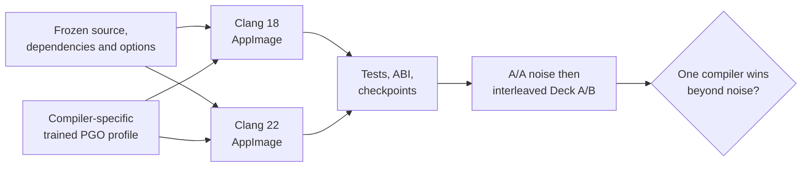

# TECH_PLAN — Clang version evaluation

Status: Planning only  
Source: pre-merge [PR #446](https://github.com/chrissotraidis/bluewake/pull/446)
at `48a5872e213db41117e5bb4321a7aefbcf77993e`

[Product brief](PRD.md) · [Tracker](PROGRESS.md) ·
[Parent M5](https://github.com/chrissotraidis/bluewake/pull/421) ·
[M6 follow-up](https://github.com/chrissotraidis/bluewake/pull/438)

## Inspected facts

- [`scripts/linux/Dockerfile`](../../../scripts/linux/Dockerfile) installs both
  LLVM 18 and 22; PATH and CI explicitly retain Clang 18 by default.
- [`--clang22`](../../../scripts/linux/build.py) prepends LLVM 22 only inside a
  `--ci-container` build. The wrapper forwards the original arguments.
- [`training_fingerprint`](../../../scripts/linux/build.py) includes the full
  compiler version and `--march`. Changing compiler therefore trains a distinct
  profile, which is part of that compiler's build recipe.
- [`BuilderProvenance.json`](../../../scripts/linux/build.py) records compiler,
  profile hash, module hash and CPU target, but not a complete effective command.
- #446 fixes the current Dawn/Abseil build path, but remains unmerged; #433
  therefore remains the upstream qualification blocker.
- Private #446 Deck smoke/ABI checks passed for both AppImages. Recipe selection
  includes compiler-trained PGO; rendered and Game Mode gates remain.

## Proposed changes

| Status | File / symbol | Practical edit | Milestone |
|---|---|---|---|
| Existing | `scripts/linux/build.py` profile selection | Retain compiler-specific training and record its profile hash as recipe provenance | M0 |
| Modify | `scripts/linux/build.py` provenance | Record compiler executable/version, effective CPU/compiler flags and generated profile hash | M0 |
| Modify | `tests/test_linux_ci_container.py` | Cover default/opt-in compiler selection and provenance | M0 |
| Conditional | Dockerfile, docs and toolchain tests | Make Clang 22 the default only after M2 qualifies it; keep explicit Clang 18 selection for CI unless separately approved | M2 |

The existing interfaces select the recipes:

```text
python3 scripts/linux/build.py GZLE01.iso --out build/clang18 --ci-container --appimage

python3 scripts/linux/build.py GZLE01.iso --out build/clang22 --ci-container --clang22 --appimage
```

Each recipe records its generated profile hash and training recipe; private
profiles never enter Git. The goal is the fastest correct recipe, not isolated
compiler-code-generation attribution.

## Comparison flow



## Verification

| Layer | Method | Required evidence | Failure / skip |
|---|---|---|---|
| Source contract | `python3 tests/test_linux_ci_container.py` | Compiler selection and recipe provenance pass | Fix before building |
| Build | Two clean container builds after #433 | Same commit, dependency lock, flags and options; generated PGO SHA recorded per recipe | Comparison invalid |
| Linux/AppImage | Existing Linux CTest plus ABI and launch smoke paths | Both variants pass; no private artifact uploaded | Candidate rejected |
| A/A control | At least three repeated control runs | Checkpoints match and noise band is recorded | A/B deferred |
| CPU profiles | Capture headless, rendered, and Game Mode profiles after A/A is stable | Flat and per-thread evidence used only to explain a result | Missing profile leaves selection incomplete |
| Controlled A/B | Five interleaved pairs with the same states/scenes in headless and rendered modes | Per-scene medians, dispersion, game FPS and game-thread busy | Incomplete grid is inconclusive |
| Game Mode | Launch each matched AppImage locally, then collect over SSH and repeat the scene | Correct process/artifact, settled window, FPS/busy/waits and thermal/power context | Not a qualification without both variants |

Use [`bench_tour.py`](../../../scripts/bench_tour.py) to control the workload and
[`profile_deck.sh`](../../../scripts/linux/profile_deck.sh) only when a profile
is needed to explain a result. Follow the comparison rules in the
[performance guide](../../performance/Overview.md#worked-investigation).

## Implementation order

| Milestone | Depends | Can run with | Deliverable / gate |
|---|---|---|---|
| M0 | #433 resolution | Parent runtime track | Frozen recipe contract and complete provenance |
| M1 | M0 | Parent runtime track | Two validated artifacts with compiler-specific PGO provenance |
| M2 | M1 | Parent runtime track | Deck comparison and explicit retain/reject/inconclusive decision |

Critical path: #433 → M0 → M1 → M2. Building the variants may run in
parallel after the immutable inputs are frozen; Deck runs are interleaved, not
parallel, so they share the same hardware conditions.

## Preliminary #446 build-path evidence

This evidence verifies the candidate build path before #446 merges. The initial
one-state observation does not complete M2; the later full-tour headless grid
does. Both private AppImages used the same source, dependency revisions,
`x86-64-v3` target and options, with compiler-specific trained profiles.

| Build | Private AppImage SHA-256 | Deck headless fixed-state runs | Checkpoints |
|---|---|---|---|
| Clang 18 | `ad467905…c243a76b5e` | 33.75, 33.86, 33.91 FPS (mean 33.84) | match within A/A |
| Clang 22 | `97e9291d…e7c73cf25` | 32.45, 32.41, 32.40 FPS (mean 32.42) | match within A/A and across builds |

The early one-state 4.2% observation is superseded by the full-tour grid below.
Raw states, logs, modules and AppImages remain private.

| Full-tour headless grid | Scope | Result |
|---|---|---|
| Five warmed A/B/B/A interleaved pairs | 10 samples per recipe; five default scenes; fixed setup state; 31 checkpoints each | all checkpoints match; Clang 18 recipe median is 3.2% faster overall (scene range 2.0–4.3%) |

| Preliminary rendered and Game Mode evidence | Scope | Result / limitation |
|---|---|---|
| One warmed Desktop Mode rendered pair | Same private setup state; five default scenes; Aurora renderer; 31 checkpoints each | Clang 18 mean 272.06 versus Clang 22 265.67 unpaced rendered game FPS (+2.4%). Raw logs show all five requested warps and checkpoints match, but the summary marks stages `not loaded`: its completion parser does not recognize this build's warp-log form. Do not use this pair as the rendered M2 gate. |
| One 30-second Game Mode profile per recipe | Same Fortress sea location; verified `48a5872` AppImage/process; 99 Hz `perf` with zero lost samples | Both runs were game-thread limited at roughly 27–29 game FPS. The samples identify comparable hotspot classes, but are directional only, not a repeated controlled FPS comparison. |

The Desktop Mode tour measures rendered throughput with wall pacing disabled;
it is not player-visible Game Mode FPS. Keep the raw state, session logs and
`perf.data` private. Repeat the rendered grid after the stage-completion
contract is repaired, then run the required interleaved pairs before deciding
the default.

## References

- [Linux build process](../../architecture/Build.md#linux-builder)
- [Linux build instructions](../../LINUX.md#container-build-recommended)
- [Steam Deck profiling](../../PROFILING.md)
- [Steam Deck performance issue #215](https://github.com/chrissotraidis/bluewake/issues/215)
