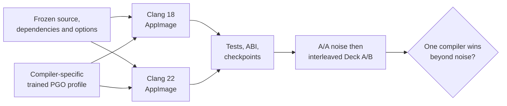
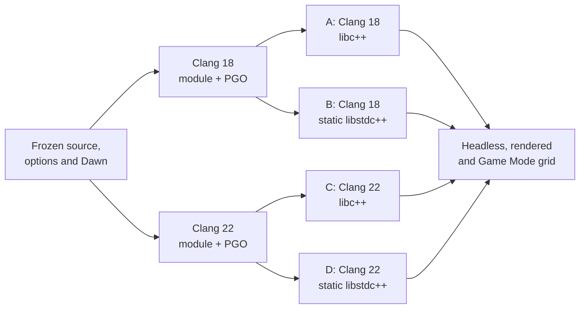

# TECH_PLAN — Clang version evaluation

Status: Done: Clang 22 with libc++ selected
Source: pre-merge [PR #446](https://github.com/chrissotraidis/bluewake/pull/446)
at `48a5872e213db41117e5bb4321a7aefbcf77993e`
Current matrix foundation: upstream `main` at `ee991d312d97` plus successful
performance work through [#531](https://github.com/chrissotraidis/bluewake/pull/531);
packaging candidate [#472](https://github.com/chrissotraidis/bluewake/pull/472)

[Product brief](PRD.md) · [Tracker](PROGRESS.md) ·
[Parent M5](https://github.com/chrissotraidis/bluewake/pull/421) ·
[Current parent status](https://github.com/chrissotraidis/bluewake/pull/421)

## Inspected facts

- [`scripts/linux/Dockerfile`](../../../scripts/linux/Dockerfile) installs both
  LLVM 18 and 22; PATH and CI explicitly retain Clang 18 by default.
- [`--clang22`](../../../scripts/linux/build.py) prepends LLVM 22 only inside a
  `--ci-container` build. The wrapper forwards the original arguments.
- [`training_fingerprint`](../../../scripts/linux/build.py) includes the full
  compiler version and `--march`. Changing compiler therefore trains a distinct
  profile, which is part of that compiler's build recipe.
- [`BuilderProvenance.json`](../../../scripts/linux/build.py) records compiler,
  profile hash, module hash and CPU target, but not a complete effective command.
- Private #446 Deck smoke/ABI checks passed for both AppImages. Recipe selection
  includes compiler-trained PGO; only the headless grid is qualified so far.
- [#451](https://github.com/chrissotraidis/bluewake/issues/451) blocks native
  generation for a certified current control; #446 remains a separately labeled
  pre-merge experiment.
- Current `main` builds AppImages with libc++ and source-built Dawn. #472
  changes both the runtime and Dawn provider, so its existing comparison is a
  practical recipe result, not a runtime-only factorial comparison.
- Current `main` includes merged #480, #495 and #501. #531 is stacked on #504,
  but only uses #503 as its measured baseline; it does not contain #503.
  Therefore the matrix needs a dedicated combined snapshot rather than using
  #531's head directly.

## Performance foundation

| Layer | Included work | Matrix treatment |
|---|---|---|
| Upstream `main` | [#480](https://github.com/chrissotraidis/bluewake/pull/480), [#495](https://github.com/chrissotraidis/bluewake/pull/495), [#501](https://github.com/chrissotraidis/bluewake/pull/501) | Starting point |
| Outset CPU | [#503](https://github.com/chrissotraidis/bluewake/pull/503) | Merge onto current `main` |
| Efficient effects | [#504](https://github.com/chrissotraidis/bluewake/pull/504) | Already carried by #531; enable in every runtime cell |
| GX batching | [#531](https://github.com/chrissotraidis/bluewake/pull/531) | Merge after #503; keep batching enabled in every cell |
| No-go records | [#529](https://github.com/chrissotraidis/bluewake/pull/529), [#530](https://github.com/chrissotraidis/bluewake/pull/530) | Excluded: planning-only, no retained candidate |
| Packaging dimension | [#472](https://github.com/chrissotraidis/bluewake/pull/472) | Runtime selector only; packaged Dawn checked after the factorial grid |

Create the combined branch in this order: current `main` → #503 → #531. Since
#503 and #531 both reach host/runtime files, resolve conflicts by retaining both
behaviors and run their focused tests. Record the resulting commit SHA before
building A–D; that SHA—not an individual PR head—is the matrix source.

The frozen branch is
[`perf/clang-runtime-matrix`](https://github.com/irregularthanis/bluewake/tree/perf/clang-runtime-matrix)
at [`14c558d62`](https://github.com/irregularthanis/bluewake/commit/14c558d62).
Its only merge conflict was Linux CI target registration; the resolution keeps
both #503's direct-call test and #531's gather-host test. Builder contracts
(29/29), Windows builder tests (11/11), Android tests (6/6), PadMint tests
(10/10), direct-call source tests (6/6), syntax, diff and repository audit pass.
The AppImage selectors, provenance, multi-build benchmark, and cross-platform
default contracts are implemented. Compiled playable-artifact gates remain M4.

## Proposed changes

| Status | File / symbol | Practical edit | Milestone |
|---|---|---|---|
| Existing | `scripts/linux/build.py` profile selection | Retain compiler-specific training and record its profile hash as recipe provenance | M0 |
| Modify | `scripts/linux/build.py` provenance | Record compiler executable/version, effective CPU/compiler flags and generated profile hash | M0 |
| Modify | `tests/test_linux_ci_container.py` | Cover default/opt-in compiler selection and provenance | M0 |
| Conditional | Dockerfile, docs and toolchain tests | Make Clang 22 the default only after M2 qualifies it; keep explicit Clang 18 selection for CI unless separately approved | M2 |
| Implemented | `scripts/linux/build.py` AppImage host configuration | Select libc++ or static libstdc++ independently of the Dawn provider for measurement builds; defaults unchanged | M3 |
| Implemented | Builder provenance and tests | Record runtime and Dawn identity; verify valid runtime/provider selections and unchanged defaults | M3 |
| Implemented | `scripts/render_bench` | Run arbitrary build counts in balanced forward/reverse order; report reference and full pairwise FPS deltas | M3 |
| Measurement | Private AppImages and reports | Build and measure the current-source 2×2 grid without uploading game artifacts | M4–M5 |

Proposed measurement-only builder surface, exact spelling to be settled during
M3 without changing either default:

```text
--appimage-stdlib=libc++|static-libstdc++
--appimage-dawn-provider=vendor|package
```

The first selector creates the factorial column. The second keeps `vendor`
fixed for A–D, then selects `package` only for #472's shipping confirmation.

The existing interfaces select the recipes:

```text
python3 scripts/linux/build.py GZLE01.iso --out build/clang18 --ci-container --appimage

python3 scripts/linux/build.py GZLE01.iso --out build/clang22 --ci-container --clang22 --appimage
```

Each recipe records its generated profile hash and training recipe; private
profiles never enter Git. The goal is the fastest correct recipe, not isolated
compiler-code-generation attribution.

## Comparison flow



## Current 2×2 contract

Use the frozen combined performance snapshot, one settings set, and one Dawn
provider/revision for all four cells:

| Cell | Compiler | AppImage C++ runtime | Game module |
|---|---|---|---|
| A | Clang 18 | libc++ | Clang 18 module/profile |
| B | Clang 18 | static libstdc++ | Exact module from A |
| C | Clang 22 | libc++ | Clang 22 module/profile |
| D | Clang 22 | static libstdc++ | Exact module from C |

This isolates the runtime delta within A/B and C/D. The Clang comparison still
evaluates complete compiler recipes, including compiler-specific PGO, as #437
originally intended. The report calculates `B−A`, `D−C`, `C−A`, `D−B`, and the
interaction `(D−C)−(B−A)`.

All cells explicitly enable opt-in Efficient Soft Effects and retain default-on
GX batching. Render scale, Smooth Motion, scene states and every other runtime
setting remain identical.



#472's packaged-Dawn recipe receives a separate final confirmation after the
factor-isolated grid. It must not be substituted into only B/D, because that
would make the runtime column also a Dawn-provider comparison.

## Verification

| Layer | Method | Required evidence | Failure / skip |
|---|---|---|---|
| Source contract | `python3 tests/test_linux_ci_container.py` | Compiler selection and recipe provenance pass | Fix before building |
| Build | Two clean container builds | Same commit, dependency lock, flags and options; generated PGO SHA recorded per recipe | Comparison invalid |
| Linux/AppImage | Existing Linux CTest plus ABI and launch smoke paths | Both variants pass; no private artifact uploaded | Candidate rejected |
| A/A control | At least three repeated control runs | Checkpoints match and noise band is recorded | A/B deferred |
| CPU profiles | Capture headless, rendered, and Game Mode profiles after A/A is stable | Flat and per-thread evidence used only to explain a result | Missing profile leaves selection incomplete |
| Controlled grid | Five forward/reverse rounds with A–D in one `render_bench` invocation | Per-scene medians, pairwise FPS matrix, dispersion, game FPS and busy | Incomplete grid is inconclusive |
| Game Mode | Launch each matched AppImage locally, then collect over SSH and repeat the scene | Correct process/artifact, settled window, FPS/busy/waits and thermal/power context | Not a qualification without both variants |
| Grid identity | Provenance plus module hashes | A/B share a module; C/D share a module; all four share source, options and Dawn | Any mismatch invalidates the grid |
| 2×2 analysis | Per-scene and overall contrasts | Four main-effect deltas and interaction, with dispersion and A/A noise | Missing cell or unmatched run is inconclusive |

Use [`bench_tour.py`](../../../scripts/bench_tour.py) to control the workload and
[`render_bench.py`](https://github.com/irregularthanis/bluewake/blob/14c558d62/scripts/render_bench.py)
(through the `scripts/render_bench` wrapper) to collect all four cells in one
balanced `A/B/C/D/D/C/B/A` run and produce pairwise results. Use
[`profile_deck.sh`](../../../scripts/linux/profile_deck.sh) only when a profile
is needed to explain a result. Follow the comparison rules in the
[performance guide](../../performance/Overview.md#worked-investigation).

## Implementation order

| Milestone | Depends | Can run with | Deliverable / gate |
|---|---|---|---|
| M0 | — | Parent runtime track | Frozen #446 experiment contract and provenance |
| M1 | M0 | Parent runtime track | Two validated artifacts with compiler-specific PGO provenance |
| M2 | M1 | Parent runtime track | Qualified headless comparison complete; rendered/Game Mode decision gates remain open |
| M3 | — | #472 rebase work | Create and test the combined #503/#531 foundation; freeze source/Dawn; expose independent compiler/runtime selectors |
| M4 | M3 | — | Build and validate A–D; enforce shared module identities within compiler pairs |
| M5 | M4 | — | Qualified headless, rendered and Game Mode 2×2 measurements; recipe decision or inconclusive result |

Historical path: M0 → M1 → M2. Current critical path: M3 → M4 → M5. Building the variants may run in
parallel after the immutable inputs are frozen; Deck runs are interleaved, not
parallel, so they share the same hardware conditions.

## Recorded #446 findings

Both private AppImages used source `48a5872`, the same dependency revisions,
`x86-64-v3` target, options, and compiler-specific trained profiles. Their
private artifact identities are Clang 18 `ad467905…c243a76b5e` and Clang 22
`97e9291d…e7c73cf25`. Raw states, logs, modules, and AppImages remain private.

| Full-tour headless grid | Scope | Result |
|---|---|---|
| Five warmed A/B/B/A interleaved pairs | 10 samples per recipe; five default scenes; fixed setup state; 31 checkpoints each | all checkpoints match; Clang 18 recipe median is 3.2% faster overall (scene range 2.0–4.3%) |

| Run | What ran | Outcome | Decision use |
|---|---|---|---|
| Build and smoke | Clean Clang 18 and Clang 22 container builds; ABI audit and extraction/help smoke | Both private artifacts passed | Artifact validation only |
| Headless grid | Five scenes; 10 interleaved samples per recipe | Clang 18 +3.2%; 31 checkpoints match | Accepted headless finding |
| Rendered Desktop attempt | One warmed five-scene tour | Completion parser reported scenes not loaded | Excluded; repeat after confirming loading |
| Game Mode attempt | One 30-second profile per recipe | Directional profile, not repeated controlled comparison | Excluded; repeat controlled runs |

Rendered scene loading was not confirmed, so rendered and Game Mode observations
are excluded from the decision. Repeat their qualified grids before changing a
default. Keep raw states, session logs, and `perf.data` private.

## Current 2×2 findings

Cells A–D were built from `14c558d62` (M4): A/B share the Clang 18.1.3 module,
C/D the Clang 22.1.8 module. Rendered grid with render_bench, five scenes,
render scale 3, Smooth Motion, widescreen and efficient soft effects on for all,
balanced `A/B/C/D/D/C/B/A` rounds, 10 runs per cell per machine:

| Contrast | Steam Deck, session 1 / 2 | Desktop, session 1 / 2 |
|---|---:|---:|
| Clang 22 vs 18, libc++ (C vs A) | **+1.0% / +1.3%** | **+1.1% / +0.9%** |
| Clang 22 vs 18, static libstdc++ (D vs B) | **+1.4% / +1.8%** | **+0.7% / +0.8%** |
| static libstdc++ vs libc++, Clang 18 (B vs A) | −0.5% / −0.6% | +0.5% / +0.2% |
| static libstdc++ vs libc++, Clang 22 (D vs C) | −0.1% / −0.1% | 0.0% / +0.1% |
| Interaction (D−C)−(B−A) | +0.4 / +0.5 points | −0.5 / −0.1 points |

- **Exact:** guest checkpoints identical in every run.
- **Compiler:** Clang 22 wins in all 8 contrasts, by about 1%. This supersedes
  the #446 headless result above.
- **Runtime and interaction:** noise; the static-libstdc++ choice adds nothing.
- **Picture flags** (Butterfly Room, Hyrule Castle "flicker") appear between
  same-compiler cells too and move between pairs from session to session; with
  identical checkpoints they are screenshot timing, not a rendering change.
- **Decision:** cell C, Clang 22 with libc++. Default change follows in its
  own PR; the ABI audit and smoke test (M4-T03) pass.

**Noise and #472's packaging** (C, a byte copy of C, and E = Clang 22 with
#472's static libstdc++ and packaged Dawn; three rounds on the benchmark tour,
not the grid's save states):

| | Steam Deck | Desktop |
|---|---:|---:|
| A/A: copy of C vs C | −0.64% | −0.02% |
| E (#472 packaging) vs C | −0.57% | +0.18% |

- Every Clang 22 contrast (+0.7 to +1.8%) is above the A/A gap on its machine,
  though on the Deck only by about 2×.
- #472's packaging is noise on both machines: no reason to switch from libc++.
- **Game Mode grid skipped:** the Deck grid already ran in Game Mode (gamescope), and a ~1% exact compiler speed-up has no mechanism to change pacing; the separate Game Mode grid was skipped as costly for no new information.


## Remaining measurement order

Do not reuse the private `48a5872` artifacts for the current grid. Build A–D
from the frozen combined-performance SHA, then use one workload/state/settings
set across all four cells. Within each compiler pair, verify the module SHA is
identical.

| Order | Run | What to record | Advance only when |
|---:|---|---|---|
| 1 | Artifact validation | Source/options/Dawn identity; compiler/runtime; PGO and module SHA; ABI/smoke | Four valid cells; A/B and C/D module hashes match |
| 2 | Headless grid | Full five-scene interleaved runs and checkpoints | All cells complete; checkpoints match |
| 3 (done) | Rendered preflight and A/A | Every scene loads; at least three matched controls | Loading is confirmed and noise recorded |
| 4 (done) | Rendered grid | At least five interleaved four-cell rounds | Per-scene medians/dispersion and checkpoints recorded |
| 5 (skipped) | Game Mode grid | Fixed route; at least three controls then five interleaved rounds | FPS, dips, busy/waits, temperature/power and artifact identity recorded |
| 6 (done) | #472 shipping check | Winning runtime with #472's packaged Dawn versus its factor-grid counterpart | Quantifies provider effect separately |
| 7 (done) | Decision | Main effects, interaction and shipping check | Select a complete recipe or record inconclusive; no silent default change |

The Game Mode launch is player-facing and starts locally on the Deck. SSH may
attach `perf`, retrieve redacted summaries, and collect logs after the running
process and artifact identity are confirmed.

## References

- [Linux build process](../../architecture/Build.md#linux-builder)
- [Linux build instructions](../../LINUX.md#container-build-recommended)
- [Steam Deck profiling](../../PROFILING.md)
- [Steam Deck performance issue #215](https://github.com/chrissotraidis/bluewake/issues/215)
- [#472 static-libstdc++ AppImage candidate](https://github.com/chrissotraidis/bluewake/pull/472)
- [#531 GX batching candidate and performance-stack relationships](https://github.com/chrissotraidis/bluewake/pull/531)
