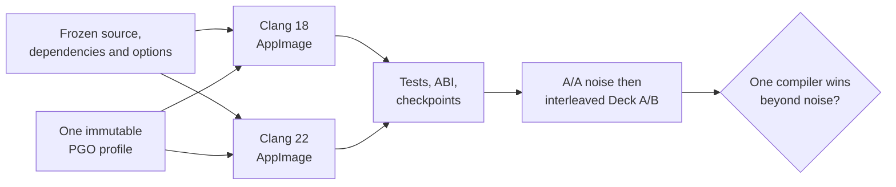

# TECH_PLAN — Clang version evaluation

Status: Planning only  
Source: pre-merge [PR #446](https://github.com/chrissotraidis/bluewake/pull/446)
at `48a5872e213db41117e5bb4321a7aefbcf77993e`

[Product brief](PRD.md) · [Tracker](PROGRESS.md) ·
[Parent M5](https://github.com/chrissotraidis/bluewake/pull/421) ·
[M6 follow-up](https://github.com/chrissotraidis/bluewake/pull/438)

## Inspected facts

- [`scripts/linux/Dockerfile`](../../../scripts/linux/Dockerfile) installs both
  LLVM 18 and 22; PATH and CI explicitly retain Clang 18 by default.
- [`--clang22`](../../../scripts/linux/build.py) prepends LLVM 22 only inside a
  `--ci-container` build. The wrapper forwards the original arguments.
- [`training_fingerprint`](../../../scripts/linux/build.py) includes the full
  compiler version and `--march`. Changing compiler therefore triggers a new
  profile instead of reusing an identical PGO input.
- [`BuilderProvenance.json`](../../../scripts/linux/build.py) records compiler,
  profile hash, module hash and CPU target, but not a complete effective command.
- #446 fixes the current Dawn/Abseil build path, but remains unmerged; #433
  therefore remains the upstream qualification blocker.
- Private #446 Deck smoke/ABI checks passed for both AppImages. Three headless
  fixed-state runs were deterministic per compiler, but their compiler-specific
  trained PGO profiles make the observed 33.84 (Clang 18) versus 32.42 (Clang
  22) game FPS unsuitable for selecting a default.

## Proposed changes

| Status | File / symbol | Practical edit | Milestone |
|---|---|---|---|
| Modify | `scripts/linux/build.py` profile selection | Add an explicit private `.profdata` input for matched experiments; validate it, hash it, and never copy it into Git | M0 |
| Modify | `scripts/linux/build.py` provenance | Record compiler executable/version, effective CPU/compiler flags and supplied profile hash | M0 |
| Modify | `tests/test_linux_ci_container.py` | Cover default/opt-in compiler selection, fixed-profile forwarding and provenance | M0 |
| Conditional | Dockerfile, docs and toolchain tests | Make Clang 22 the default only after M2 qualifies it; keep explicit Clang 18 selection for CI unless separately approved | M2 |

The central proposed interface is deliberately opt-in:

```text
python3 scripts/linux/build.py GZLE01.iso --out build/clang18 \
  --ci-container --pgo-profile /private/control.profdata --appimage

python3 scripts/linux/build.py GZLE01.iso --out build/clang22 \
  --ci-container --clang22 \
  --pgo-profile /private/control.profdata --appimage
```

The builder must reject a missing or unreadable profile and an incompatible
profile reported by `llvm-profdata`/Clang. If one indexed profile cannot safely
feed both final compilers, record M0 as blocked: two separately trained profiles
would test whole toolchains, not isolate compiler code generation.

## Comparison flow



## Verification

| Layer | Method | Required evidence | Failure / skip |
|---|---|---|---|
| Source contract | `python3 tests/test_linux_ci_container.py` | Compiler selection, CLI rejection, profile forwarding and provenance pass | Fix before building |
| Build | Two clean container builds after #433 | Same commit, dependency lock, flags, options and PGO SHA; compiler alone differs | Comparison invalid |
| Linux/AppImage | Existing Linux CTest plus ABI and launch smoke paths | Both variants pass; no private artifact uploaded | Candidate rejected |
| A/A control | At least three repeated control runs | Checkpoints match and noise band is recorded | A/B deferred |
| Controlled A/B | Five interleaved pairs with the same states/scenes | Per-scene medians, dispersion, game FPS and game-thread busy | Incomplete grid is inconclusive |
| Game Mode | Launch each matched AppImage locally, then collect over SSH | Correct process/artifact, settled window, FPS/busy/waits and thermal/power context | Not a qualification without both variants |

Use [`bench_tour.py`](../../../scripts/bench_tour.py) to control the workload and
[`profile_deck.sh`](../../../scripts/linux/profile_deck.sh) only when a profile
is needed to explain a result. Follow the comparison rules in the
[performance guide](../../performance/Overview.md#worked-investigation).

## Implementation order

| Milestone | Depends | Can run with | Deliverable / gate |
|---|---|---|---|
| M0 | #433 resolution | Parent runtime track | Frozen comparison contract and verified fixed-profile input |
| M1 | M0 | Parent runtime track | Two validated artifacts whose recorded inputs differ only by compiler |
| M2 | M1 | Parent runtime track | Deck comparison and explicit retain/reject/inconclusive decision |

Critical path: #433 → M0 → M1 → M2. Building the variants may run in
parallel after the immutable inputs are frozen; Deck runs are interleaved, not
parallel, so they share the same hardware conditions.

## Preliminary #446 build-path evidence

This evidence verifies the candidate build path before #446 merges; it does
not complete M0, M1, or M2. Both private AppImages used the same source,
dependency revisions, `x86-64-v3` target and options, but the builder trained
different profiles because `training_fingerprint` includes the compiler.

| Build | Private AppImage SHA-256 | Deck headless fixed-state runs | Checkpoints |
|---|---|---|---|
| Clang 18 | `ad467905…c243a76b5e` | 33.75, 33.86, 33.91 FPS (mean 33.84) | match within A/A |
| Clang 22 | `97e9291d…e7c73cf25` | 32.45, 32.41, 32.40 FPS (mean 32.42) | match within A/A and across builds |

The 4.2% mean difference is directionally useful only. It may include PGO
training differences, so it is not evidence that Clang 18 code generation is
faster. Raw states, logs, modules and AppImages remain private.

## References

- [Linux build process](../../architecture/Build.md#linux-builder)
- [Linux build instructions](../../LINUX.md#container-build-recommended)
- [Steam Deck profiling](../../PROFILING.md)
- [Steam Deck performance issue #215](https://github.com/chrissotraidis/bluewake/issues/215)
