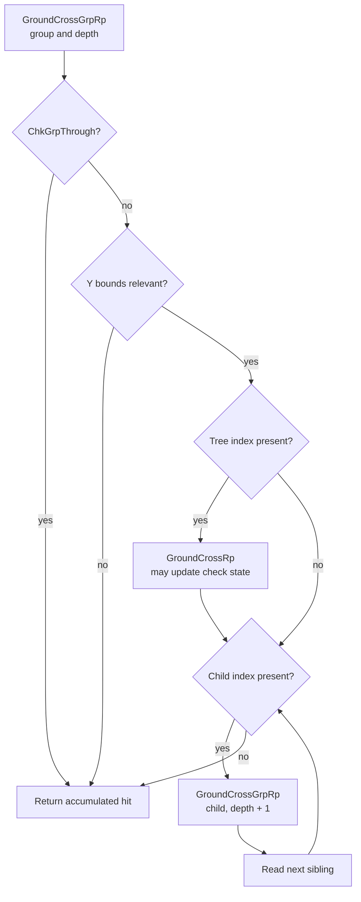

# GroundCrossGrpRp translated contract

Status: Frozen for the inspected `2ab8118` fixture; partial native path rejected for performance

[Requirements](PRD.md) · [Technical plan](TECH_PLAN.md) · [Tracker](PROGRESS.md)

This map records the observable contract of guest function `0x802491F4`
without publishing generated game code. The pinned decomp is a readable
semantic reference; the private translated fixture remains the correctness
authority.

## Inputs and traversal

| Input | Guest register | Use |
| --- | --- | --- |
| `dBgW*` | `r3` | Background groups, tree table and virtual `ChkGrpThrough` |
| `cBgS_GndChk*` | `r4` | Pass filter, test point, current height and hit output |
| Group index | `r5` | Selects the 32-byte bounds record and 52-byte group-table record |
| Depth | `r6` | Passed to the filter and incremented for each child |

The routine first invokes virtual `ChkGrpThrough`. A filtered group returns
false. Otherwise it rejects groups whose Y bounds cannot improve the current
hit, calls `GroundCrossRp` for the group's tree when present, then walks
`m_first_child` followed by each child's `m_next_sibling`. Child recursion is
depth first and preserves sibling order.

## Guest data and calls

| Kind | Address or offset | Contract |
| --- | --- | --- |
| Virtual call | `*(r3 + 4) + 32` | Must resolve to the certified `ChkGrpThrough` behavior before a native path may bypass it |
| Group bounds | `*(r3 + 156) + group * 32` | Reads floats at `+4`, `+8`, `+12`, `+16`, `+20`, and `+24` along the bounds paths |
| Ground check | `r4` | Reads pass-check pointer at `+4`, point values at `+36`, `+40`, `+44`, and current Y at `+52`; `GroundCrossRp` may update its hit state |
| Group table | `*(*(r3 + 148) + 36) + group * 52` | Reads next sibling at `+38`, first child at `+40`, and tree index at `+46` |
| Direct call | `0x80248C38` | `GroundCrossRp`; may mutate guest check data and may stop at an execution boundary |
| Recursive call | `0x802491F4` | Same routine with child index and `depth + 1` |
| Save helper | `0x80328F38` | Saves `r27` through `r31`; normally inlined by the prepared translation |
| Restore helper | `0x80328F84` | Restores `r27` through `r31`; the certification script excludes this known helper fallback from its watch test |

The translated wrapper also writes its 32-byte stack frame, saved LR and
saved nonvolatile registers. Those writes remain guest-visible after return
and are part of differential comparison, even though the registers and stack
pointer are restored.

## Control, CPU and timing effects

The routine spans one DOL chunk and has no chunk transition of its own. Its
observable paths comprise:

| Phase | Blocks / effects |
| --- | --- |
| Prologue | Stack frame and LR writes; save `r27`–`r31`; copy arguments into `r27`–`r30` |
| Filter | Load the pass check and vtable target; indirect call; update `LR`, `CTR`, `r0`, `r3`–`r6`, and `CR0` as translated execution does |
| Bounds | Floating loads and ordered compares update `f0`, `f1`, and `CR0`; early rejects set `r3 = 0` |
| Tree | Resolve table/tree index; call `0x80248C38`; fold its Boolean result into saved `r31` |
| Children | Loop at `0x80249308`; recursive return updates `r0`, `r3`, `CR0`, and the accumulated result; sibling lookup updates `r0`, `r3`, `r4`, and `r27` |
| Epilogue | Move accumulated result to `r3`; restore nonvolatile registers and LR; restore SP; set `pc = lr & ~3` |

Cycle charging occurs at every translated basic-block entry, including
prepaid copies used after direct calls and recursion. Memory accesses can add
an observation suffix. A native success must reproduce the final downcount,
deadline behavior, suffix and stop point, not merely the Boolean result.

## Native acceptance boundary

The implementation must decline without changing CPU or RAM unless it can
complete the whole accepted path. At minimum it must reject:

- pending exceptions, an active write journal, exhausted block budget, or a
  deadline that translation would observe inside the path;
- any stack, object, table, bounds, check or child access that is not stable
  plain guest RAM, including overlapping aliases;
- an uncertified virtual target or a host-observed call/return boundary;
- a `GroundCrossRp` or recursive path that can suspend after making CPU or RAM
  changes unless the native path provides an equivalent resumable protocol;
- malformed/cyclic traversal or depth that cannot be bounded before commit.

This last condition is the main implementation gate. Calling translated
`GroundCrossRp` speculatively is unsafe because it can update the ground-check
object before an execution boundary. The first implementation should accept
only fully proved paths; broader traversal requires either a resumable native
state machine or a complete native equivalent of every mutating callee.

## Private fixture identity

| Artifact | SHA-256 |
| --- | --- |
| Build source revision | `2ab8118fc09fa08569100201a871616d18a1b771` |
| `game.json` | `d5b75fda150ac8ea42a4ccfe7aed2ac0b6f68dd0ccdfbb1b02460d2ae0590d21` |
| `prepared-blocks.json` | `cb5f6918f80a106b647afcd92a06093bf960e505b75fafe7d1c5a2ac00d24230` |
| DOL chunk containing the routine | `c186702eb49b2743ad8ece1a92bac4af89320691a78df48da95bf6ceef2155c5` |
| Canonical routine plus 27 prepaid copies | `0ac24fa9c8ef280be5ed359fb406287ffaa989296c8a79a657e0feeeab839a7d` |

Generated source, the disc and the translated module are intentionally not
stored in the repository.

## Qualification result

The contract and private oracle establish correctness only for the supported
early-return paths. The Deck qualification rejected the partial native hook as
a performance optimization: it covered 28.1% of calls and its accepted path
was slower than the translated path in direct timing. The remaining traversal
contract is unchanged; no broader implementation follows from this result.

## Public references

- [`native_bg.c`](../../../cmake/composite/native_bg.c) — current collision-native contract and timing guards.
- [`native_entries.py`](../../../scripts/windows/native_entries.py) — fragment certification and hook insertion.
- [`direct_calls.h`](../../../cmake/composite/direct_calls.h) — translated-call and host-boundary interface.
- [Pinned `GroundCrossGrpRp` decomp](https://github.com/zeldaret/tww/blob/cb24f55fbbb183af5a04783d163468eb9b61536b/src/SSystem/SComponent/c_bg_w.cpp#L577-L602) — semantic names and traversal shape.
