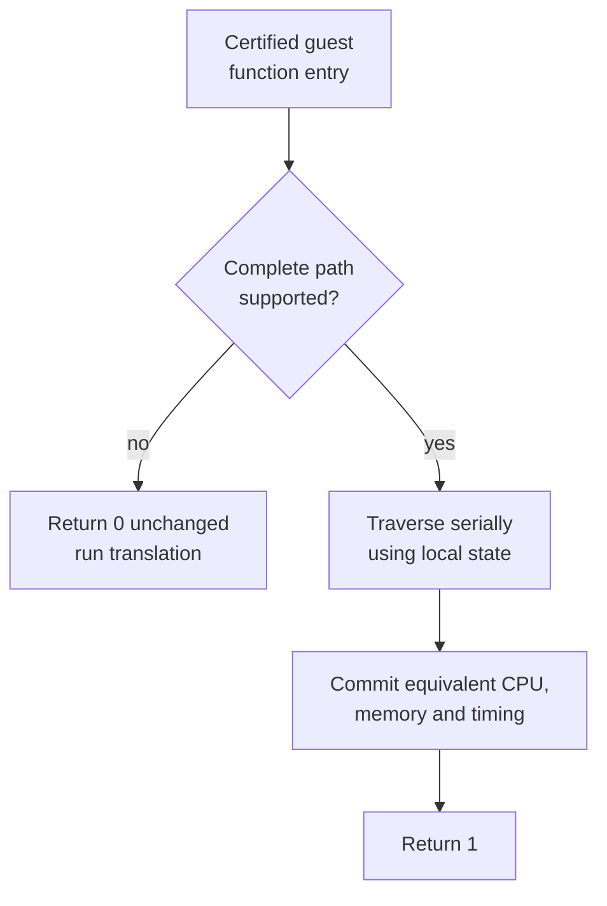

# TECH_PLAN — Native GroundCrossGrpRp reimplementation

Status: Implementation started

Source: upstream `main` at `2ab8118fc09fa08569100201a871616d18a1b771`

[PRD](PRD.md) · [Tracker](PROGRESS.md)

Frozen translated contract: [GroundCrossGrpRp contract](GROUND_CROSS_CONTRACT.md)

Temporary upstream context: [PR #421 candidate and measurement
plan](https://github.com/chrissotraidis/bluewake/pull/421/changes#diff-dd62d1af6e31824bdcd61d4b21e687cedc87ae9cfcb19111531762f73e3b7bf9) ·
[PR #435 native-routine architecture](https://github.com/chrissotraidis/bluewake/pull/435)

After those PRs merge, replace the temporary links with repository-relative
links; this plan must not assume their files already exist on `main`.

Parent mapping: **PR #421 runtime M1 — serial `GroundCrossGrpRp` native entry**
→ this plan's M0 contract map, M1 tests, M2 implementation/certification, and
M3 qualification. This is the detailed execution plan for that existing
milestone.

## Inspected facts

- [`native_bg.c`](../../../cmake/composite/native_bg.c) currently implements
  only `ChkSameActorPid` and `ChkGrpThrough`. `0x802491F4` is not registered.
- [`native_bg.h`](../../../cmake/composite/native_bg.h) defines the strict
  contract: success reproduces translated registers, flags, cycles, and bytes;
  decline changes nothing.
- [`native_entries.py`](../../../scripts/windows/native_entries.py) inserts an
  entry hook only when every listed translated fragment matches its certified
  hash and required addresses are not watched.
- [`native_bg_test.c`](../../../tests/native_bg_test.c) already compares private
  translated-module execution with native collision leaves, including exact
  CPU/RAM comparison and unchanged declines. Its loader is currently Windows-
  specific and it has no `GroundCrossGrpRp` cases.
- The revision-pinned [decomp
  routine](https://github.com/zeldaret/tww/blob/cb24f55fbbb183af5a04783d163468eb9b61536b/src/SSystem/SComponent/c_bg_w.cpp#L577-L602)
  filters a group, tests its bounds and ground tree, then visits child groups
  in sibling order. It is a semantic guide, not executable evidence.
- The current-source Clang 18 container build completed with the pinned
  RecompCore checkout; [#433](https://github.com/chrissotraidis/bluewake/issues/433)
  remains relevant if the dependency resolution failure reappears. Final Deck
  qualification still requires matched current-source control and candidate
  artifacts.
- PR #421 already plans this native routine as runtime milestone M1. No open PR
  currently implements the routine; this trio expands that parent milestone.

## Changes

| Status | File / symbol | Practical edit | Requirement |
| --- | --- | --- | --- |
| Modify | [`native_bg.h`](../../../cmake/composite/native_bg.h) | Name `BLUEWAKE_BG_GROUND_CROSS_GRP_RP` and retain the current success/decline contract | FR-01, FR-02 |
| Modify | [`native_bg.c`](../../../cmake/composite/native_bg.c) | Add guarded serial traversal, deferred commit, address dispatch, and accepted/declined counters | FR-01–FR-03 |
| Modify | [`native_entries.py`](../../../scripts/windows/native_entries.py) | Register every replaced fragment and its certified hash | FR-03 |
| Modify | [`native_bg_test.c`](../../../tests/native_bg_test.c) | Add tree, callback, timing, alias, boundary, fallback, and activation cases; make the private oracle usable with Linux `.so` and Windows `.dll` modules | FR-01–FR-04 |
| Proposed | `tests/native_bg_guard_test.c` and host CMake registrations | Add disc-free guard/decline coverage to ordinary Linux and Windows CTest | FR-02, FR-04 |
| Modify | This planning trio | Record exact commands, artifact identities, activation, correctness, and Deck comparison | FR-04 |

## Runtime contract

The proposed central dispatch follows the existing interface:

```c
/* Proposed: exact implementation follows the mapped translated contract. */
#define BLUEWAKE_BG_GROUND_CROSS_GRP_RP 0x802491F4u

case BLUEWAKE_BG_GROUND_CROSS_GRP_RP:
    done = bg_ground_cross_grp_rp(cpu);
    break;
```



M0 must map the actual generated translation before implementation: basic
blocks, cross-chunk edges, calls, guest fields, registers, flags, cycle charges,
deadlines, callbacks, and child order. Generated code is private and therefore
must not be committed. The implementation validates all pointers and observable
boundaries before mutation, computes in locals, and commits once. It may reuse
existing native leaves only after their combined call effects are proven equal.

## Verification

| Layer | Cases / command | Required evidence | Failure / skip |
| --- | --- | --- | --- |
| Public guard CTest | Valid synthetic tree plus bad pointers, alias overlap, exception, journal, deadline, watched boundary, and unsupported callback | Accepted cases execute; every declined CPU/RAM image is unchanged on Linux and Windows | Any mutation or missing platform run fails |
| Hook contract | Run `native_entries.py` against the mapped private composite and a deliberately changed copy | Exact fragments certify and hook; changed or watched input refuses the hook; global opt-out uses translation | Missing hook, stale hash acceptance, or fallback-only execution fails |
| Private differential oracle | Shallow/deep trees, empty/filtered groups, hit/no-hit, callback mutation, recursion, deadlines, interruptions, aliases, invalid addresses | Native and translated CPU plus writable RAM match byte-for-byte; positive native activation | No private module is **inconclusive**, never a pass |
| Existing suites | Repository audit, host CTest, existing native tests, Linux and Windows CI | No regression in existing contracts | Required failure blocks integration |
| Steam Deck A/B | Same source/PGO/settings/state; at least three A/A runs, then five interleaved native-off/native-on pairs and a new profile | Matching checkpoints, accepted calls, completed gameplay route, median gain beyond A/A noise | Wrong scene, thermal drift, absent activation, mismatch, or gain within noise is inconclusive/fail |

`BLUEWAKE_NATIVE_ENTRIES=0` supplies the translated control. A forced-decline
development mode may diagnose hook overhead, but must not become a second
shipping behavior. Raw private artifacts stay off-repository; record hashes,
redacted commands, aggregate metrics, and pass/fail results only.

## Implementation order

| Milestone | Depends | Parent mapping | Deliverable / gate |
| --- | --- | --- | --- |
| M0 | — | PR #421 runtime M1 preparation | Map the private translated routine and freeze its observable contract; commit no game source |
| M1 | M0 | PR #421 runtime M1 tests | Add public guards and private differential cases that prove activation and fallback |
| M2 | M1 | PR #421 runtime M1 implementation | Add the guarded serial path, counters, certified hook, opt-out, and passing correctness suites |
| M3 | M2 | PR #421 runtime M1 decision gate | Record Linux/Windows results and matched Deck A/B evidence; retain or reject explicitly |

Critical path: M0 → M1 → M2 → M3. The sequence is intentionally serial because
the tests, implementation, and certification share one frozen translated
contract and the hook must not precede its oracle. Linux/Windows build checks
and Deck bundle preparation may run concurrently within M3 after M2 is frozen.

## Decisions and gaps

- Serial child traversal is required for this change; no claim of safe
  collision parallelism is made.
- Exact fragment boundaries, call targets, cycle charges, and certification
  digest are recorded in the contract map without publishing generated game
  code.
- `GroundCrossRp` can mutate the ground-check object before a translated
  execution boundary. The native must not call it speculatively and then
  decline. The first implementation accepts the fully proved filter and first
  bounds-rejection paths; support for hit-producing traversal requires a
  resumable protocol or a complete native equivalent of its mutating callees.
- The shared POSIX loader now runs GroundCross cases against a Linux `.so`;
  equivalent Windows and recursive/hit-producing cases remain M1 work.
- PR #421 owns the parent runtime M1 and supplies provisional candidate evidence.
  Its measurements do not qualify the future implementation.

## References

- [Steam Deck performance issue #215](https://github.com/chrissotraidis/bluewake/issues/215)
- [Broader optimization plan PR #421](https://github.com/chrissotraidis/bluewake/pull/421)
- [Native/translated/decomp architecture PR #435](https://github.com/chrissotraidis/bluewake/pull/435)
- [Generated and conditional test model](../../architecture/Testing.md#generated-and-conditional-tests)
- [`GroundCrossGrpRp` decomp reference at inspected revision](https://github.com/zeldaret/tww/blob/cb24f55fbbb183af5a04783d163468eb9b61536b/src/SSystem/SComponent/c_bg_w.cpp#L577-L602)
