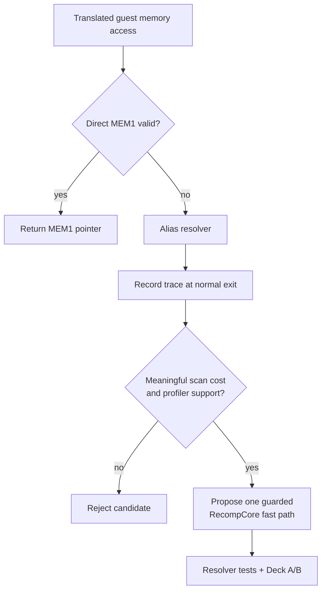

# TECH_PLAN — Guest alias-resolution evaluation

Status: M0 evidence captured; no runtime change implemented

Source: BlueWake `main` at `56a9537`; pinned RecompCore
`338a3dbcdd384142f0fe40db44e0cd1d1b0c61e4`.

[PRD](PRD.md) · [Tracker](PROGRESS.md) · [Parent runtime plan](https://github.com/chrissotraidis/bluewake/pull/421)

## Inspected facts

- [`get_ram_ptr()`](https://github.com/chrissotraidis/RecompCore/blob/338a3dbcdd384142f0fe40db44e0cd1d1b0c61e4/GXRuntime/include/core/cpu.h#L205-L245)
  already returns direct MEM1 storage when no alias overlaps MEM1. It calls the
  resolver only when that path cannot apply.
- [`ppc_guest_alias_resolve()`](https://github.com/chrissotraidis/RecompCore/blob/338a3dbcdd384142f0fe40db44e0cd1d1b0c61e4/GXRuntime/src/core/cpu.c#L273-L322)
  first bounds-prunes, then uses a sorted lookup for non-overlapping aliases or
  a linear scan for overlapping aliases.
- `BLUEWAKE_TRACE_ALIAS_COST=1` is inert by default and reports calls, pruned
  calls, iterations, hits, alias count, and MEM1 overlap at normal exit.
- The resolver returns both a backing pointer and, when requested, a guest
  journal offset. Any fast path must preserve both and alias precedence.

## M0 findings

The fixed Deck route produced two normal-exit alias-cost reports: `12,111,577`
calls / `3,930,380` iterations / `357,627` hits, and `749,168` calls /
`7,120,317` iterations / `651,784` hits. The accompanying 20-second,
99 Hz headless profile lost no samples and attributed 1.60% sampled self time
to `ppc_guest_alias_resolve` in `gGZLE01_recomp.so`.

This selects a narrowly guarded RecompCore investigation for M1. It does not
establish a player-visible gain, identify a stable caller beyond the translated
game module, or authorize a default-path change. M1 must prove equivalence for
pointer, journal offset, bounds, and alias precedence before Deck A/B work.

## Candidate flow



## Changes

| Status | File / symbol | Practical edit | Milestone | Contract |
| --- | --- | --- | --- | --- |
| Existing | `GXRuntime/src/core/cpu.c` / `ppc_guest_alias_resolve` | Measure its existing trace before modifying it | M0 | Trace is observational and off by default |
| Existing | `GXRuntime/include/core/cpu.h` / `get_ram_ptr` | Classify accesses that bypass or reach the resolver | M0 | Direct MEM1 behavior is the baseline |
| Proposed | RecompCore `cpu.c` and `runtime_tests.c` | Add one measurement-selected guarded fast path in a separate `bluewake-next` PR | M1 | Exact pointer, journal offset, alias precedence, and bounds result |
| Proposed | BlueWake dependency lock and patch export | Pin only an accepted RecompCore revision | M2 | No BlueWake runtime change before RecompCore validation |

## Proposed guard contract

```c
/* Proposed shape; the condition is selected only after M0 evidence. */
if (fast_path_proves_equivalent(address, size, &pointer, &offset)) {
    if (journal_offset != NULL) *journal_offset = offset;
    return true;
}
return existing_alias_resolution(address, size, pointer, journal_offset);
```

The proposed path must not bypass a potentially higher-precedence alias, return
a different pointer or offset, or change behavior when alias registration,
removal, or overlap state changes. A dual-path diagnostic may compare answers
before the fast path becomes default.

## Verification

| Layer | Input / command | Required evidence | Failure / skip |
| --- | --- | --- | --- |
| Deck census | `BLUEWAKE_TRACE_ALIAS_COST=1` with the fixed state and normal exit | Trace line plus matching run provenance | Missing normal-exit trace is inconclusive |
| Profile | `scripts/linux/profile_deck.sh` for the same route | Resolver self time, thread, and call context | Resolver absent or insignificant rejects candidate |
| RecompCore unit tests | Existing `GXRuntime/tests/runtime_tests.c` plus focused new cases | Original and new path agree for alias layouts and offsets | Any mismatch blocks the change |
| BlueWake integration | Pinned RecompCore build and existing checkpoint route | Module/app provenance and matching checkpoints | Missing activation or changed checkpoints blocks qualification |
| Deck qualification | At least five interleaved control/candidate pairs plus gameplay route | FPS/frame-time distribution, profile, and player result | Gain within noise, thermal drift, or route regression rejects it |

## Implementation order

| Milestone | Depends | Can run with | Deliverable / integration gate |
| --- | --- | --- | --- |
| M0 | — | — | Deck census and profile; select or reject a concrete resolver mechanism |
| M1 | M0 selects a mechanism | M2 test-design preparation | RecompCore PR with one guarded path and focused resolver tests |
| M2 | M1 accepted in RecompCore | — | BlueWake pin/export plus build/checkpoint integration |
| M3 | M2 | — | Interleaved Deck A/B, profile, gameplay route, and retain/reject decision |

Critical path: M0 → M1 → M2 → M3. RecompCore owns the runtime code, so BlueWake
integration cannot start before its accepted revision exists.

## Decisions and gaps

- Do not reintroduce a previous alias-cache idea solely because it exists in
  history; M0 must show which lookup behavior dominates on the current Deck
  route.
- The GroundCross partial hook is closed and is not a baseline or dependency.
- M0 was measured with a diagnostic AppImage carrying the pinned RecompCore
  runtime source; final qualification still requires a matched post-M1 build.
