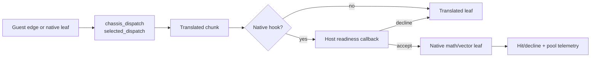
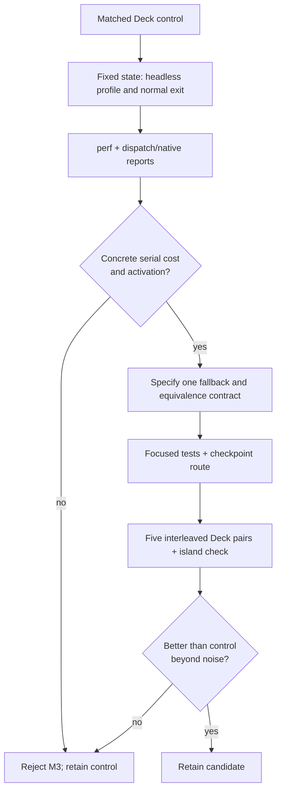

# TECH_PLAN — Native dispatch and numeric-path evaluation

Status: M0 complete; M3 rejected without a runtime change
Source: BlueWake `main` at `56a9537`.

[PRD](PRD.md) · [Tracker](PROGRESS.md) · [Parent M3](https://github.com/chrissotraidis/bluewake/pull/421)

## Inspected facts

- [`chassis_dispatch()`](../../../cmake/composite/module_export.c) enters
  [`bluewake_chassis_dispatch_loop()`](../../../cmake/composite/dispatch_loop.h)
  with `selected_dispatch()`. The latter chooses the generated x86-64-v3
  dispatcher only when the cached CPU-feature check permits it.
- [`native_math.c`](../../../cmake/composite/native_math.c) and
  [`native_vec.c`](../../../cmake/composite/native_vec.c) first require a host
  readiness callback, then either perform a proven native leaf or decline to
  the translation. Their normal-exit reports expose hits and declines.
- [`mult_vec_array()`](../../../cmake/composite/native_math.c) is the only
  current pool client. It calls `bluewake_parallel_range(count, 256, ...)`;
  the pool stays serial when each participant would receive fewer than 256
  items. [`native_work_pool.c`](../../../cmake/composite/native_work_pool.c)
  joins workers before returning.
- Earlier source-matched reports observed `chassis_dispatch` and native numeric
  work, but also an array maximum of eight and `parallel=0`. M3 must reproduce
  activation on its matched artifact before relying on that observation.

## M0 findings

The source-matched Deck control was captured with `BLUEWAKE_NATIVE_WORKERS=2`.
The normal-exit report showed direct calls active (`23,222,258` allowed from
`23,306,700` queries), active native math/vector paths, `array_max=8`, and
`parallel=0`. The 60-second headless profile at 99 Hz lost no samples and
ranked `chassis_dispatch` at 2.01% self time and `selected_dispatch` at 1.34%.

Annotation resolves `selected_dispatch` to the generated
`dolrecomp_find_original()` cache emitted by
[`scripts/generate_composite.py`](../../../scripts/generate_composite.py). Its
sampled hot instructions are the existing exact PC-key comparison and cached
function-pointer return. [`tests/test_composite.py`](../../../tests/test_composite.py)
already asserts that cache's emitted contract. The historical measurement record
documents the same cache and cold-path split as a prior retained dispatch
improvement. The profile therefore identifies real remaining cost, but not a
new, distinct reduction.

## Hypothesis and proposal

M3's hypothesis is not that native code or additional workers are inherently
faster. It is that one recurring **boundary** may be doing work that does not
contribute to the result: dispatch selection on each guest edge, or repeated
host-readiness routing before a native numeric leaf that is already safe to
run. The fixed Deck route must show both meaningful self time and successful
activation before either is a candidate.



### Dispatch-boundary hypothesis — rejected

`chassis_dispatch()` supplies `selected_dispatch()` to the chassis loop.
`selected_dispatch()` selects the generated x86-64-v3 dispatcher only after a
cached CPU-feature check; otherwise it uses `dolrecomp_call()`. The potential
cost is therefore not CPU-feature probing itself, but any remaining call,
selection, or indirect-dispatch overhead in the hot edge path.

The initial proposal was to make dispatch selection module-lifetime. Annotation
rejects it: the sampled `selected_dispatch` symbol contains the generated PC
lookup, not a remaining CPU-feature selector. Its hit path is already the
exact cache emitted by `generate_composite.py`; changing cache shape without
measured collision or miss behavior would repeat an existing optimization
experiment rather than remove a known redundant operation.

### Numeric-routing hypothesis — rejected

Generated hooks call `bluewake_native_math_try()` or
`bluewake_native_vec_try()`. Each call first invokes the host-provided readiness
predicate, then runs a native leaf only when its guard accepts; otherwise the
original translated code continues. High successful-hit counts plus samples in
this route could indicate redundant routing work around already-certified
leaves.

M0 confirms that these paths are active, but neither the profile nor module
reports identify a repeated readiness check that can be removed without
weakening the CPU, memory, timing, or host-observation contract. Native
computation self time is not evidence that its guard is redundant. No numeric
routing change is selected.

### Worker hypothesis — rejected

The pool is only reached by `mult_vec_array()`, whose current grain is 256.
The caller joins workers before it applies guest-visible state. Previous
telemetry reported a maximum vector array of eight, so a worker configuration
cannot help that observed route: it remains serial before any worker is woken.

M0 reproduced the small-batch observation (`array_max=8`, `parallel=0`) even
with two requested workers. Do not change `BLUEWAKE_NATIVE_WORKERS` or lower
the grain; no production work reaches the existing threshold.

## Measurement and selection flow



## Changes

| Status | File / symbol | Practical edit | Milestone | Contract |
| --- | --- | --- | --- | --- |
| Existing | `cmake/composite/module_export.c` / `chassis_dispatch`, `selected_dispatch` | Attribute dispatch self time and generated-dispatch selection before changing either | M0 | Preserve module dispatch, mod selection, and CPU-feature fallback |
| Existing | `cmake/composite/native_math.c`, `native_vec.c` | Read hit/decline and pool reports on the same route | M0 | A declined native leaves execution to translation unchanged |
| Proposed | One selected serial surface only | Remove a measured redundant dispatch/routing step while retaining its fallback | M1 | Same CPU/guest-memory result, cycle/deadline behavior, and disable path |
| Existing | `tests/native_*_guard_test.c`, `tests/native_work_pool_test.c` | Reuse focused contracts; add only a test that covers the selected change | M1–M2 | Guard failures, fallback, and worker publication remain covered |

## Candidate rules

| Surface | Select only when | Do not select when |
| --- | --- | --- |
| Dispatch boundary | `perf` identifies a stable serial cost and annotation identifies a removable call/check | Cost is generated translation or the current selection already inlines away |
| Native math/vector routing | Reports show frequent successful routing and the same readiness/lookup work is demonstrably redundant | Entries mostly decline, or the change would weaken guards |
| Work pool | `array_max >= 256`, completed batches are nonzero, and a pure disjoint range has a measured benefit | Telemetry stays serial, batches are small, or guest/shared state would cross workers |

`BLUEWAKE_NATIVE_WORKERS` is a measurement input, not a new player default.

## Example contract

The shape below is illustrative; M0 selects the actual symbol only after an
annotated profile.

```c
/* Proposed M1 shape: preserve the existing fallback exactly. */
if (selected_native_path_is_equivalent(cpu, address))
    return native_path(cpu, address);
return translated_path(cpu, address);
```

The selected path must preserve guest CPU state, writable guest memory, cycle
and deadline accounting, and any host observation required by the current
readiness callback. Workers may read stable inputs and write disjoint output
ranges only; guest-visible effects remain on the game thread after join.

## Verification

| Layer | Input / command | Required evidence | Failure / skip |
| --- | --- | --- | --- |
| Deck attribution | `scripts/linux/profile_deck.sh --seconds 30` plus normal-exit module reports | `perf.data`, flat report, run log, and native/dispatch counters from one artifact | Missing activation or unmatched artifact leaves M0 incomplete |
| Source mapping | `perf annotate` for the selected symbol and inspected call path | Exact removable operation and fallback identified | Generated-only cost or ambiguous symbol rejects that surface |
| Focused correctness | Existing matching guard/component test; new narrow case only if needed | Native/fallback behavior and state contract pass | Any mismatch blocks M2 |
| Pool contract | Existing `bluewake_native_work_pool_*` CTest cases | Publication and partition contracts still pass | No profitable batch means no worker experiment |
| Deck qualification | Five interleaved control/candidate pairs, checkpoints, and island play | Frame-time/FPS distribution, activation, profile, and player result | Gain within noise or route regression rejects candidate |

## Implementation order

| Milestone | Depends | Can run with | Deliverable / integration gate |
| --- | --- | --- | --- |
| M0 | — | — | Complete: evidence rejects dispatch, numeric-routing, and worker changes |
| M1 | M0 selects | Focused-test design | Not selected: no distinct serial reduction was identified |
| M2 | M1 | — | Not reached |

M0 was the only executed milestone. A new M3 investigation requires a new,
measured mechanism rather than extending these rejected proposals.

## Decisions and gaps

- A current-source control remains constrained by [#433](https://github.com/chrissotraidis/bluewake/issues/433). The source-matched evidence is sufficient to reject duplicate work, but not to qualify a player-facing change.
- M3 does not re-open M1 or M2. It starts from their rejected outcomes and uses
  the parent plan only as investigation context.
