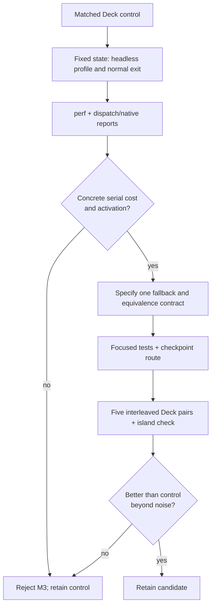

# TECH_PLAN — Native dispatch and numeric-path evaluation

Status: Planning only
Source: BlueWake `main` at `56a9537`.

[PRD](PRD.md) · [Tracker](PROGRESS.md) · [Parent M3](https://github.com/chrissotraidis/bluewake/pull/421)

## Inspected facts

- [`chassis_dispatch()`](../../../cmake/composite/module_export.c) enters
  [`bluewake_chassis_dispatch_loop()`](../../../cmake/composite/dispatch_loop.h)
  with `selected_dispatch()`. The latter chooses the generated x86-64-v3
  dispatcher only when the cached CPU-feature check permits it.
- [`native_math.c`](../../../cmake/composite/native_math.c) and
  [`native_vec.c`](../../../cmake/composite/native_vec.c) first require a host
  readiness callback, then either perform a proven native leaf or decline to
  the translation. Their normal-exit reports expose hits and declines.
- [`mult_vec_array()`](../../../cmake/composite/native_math.c) is the only
  current pool client. It calls `bluewake_parallel_range(count, 256, ...)`;
  the pool stays serial when each participant would receive fewer than 256
  items. [`native_work_pool.c`](../../../cmake/composite/native_work_pool.c)
  joins workers before returning.
- Earlier source-matched reports observed `chassis_dispatch` and native numeric
  work, but also an array maximum of eight and `parallel=0`. M3 must reproduce
  activation on its matched artifact before relying on that observation.

## Measurement and selection flow



## Changes

| Status | File / symbol | Practical edit | Milestone | Contract |
| --- | --- | --- | --- | --- |
| Existing | `cmake/composite/module_export.c` / `chassis_dispatch`, `selected_dispatch` | Attribute dispatch self time and generated-dispatch selection before changing either | M0 | Preserve module dispatch, mod selection, and CPU-feature fallback |
| Existing | `cmake/composite/native_math.c`, `native_vec.c` | Read hit/decline and pool reports on the same route | M0 | A declined native leaves execution to translation unchanged |
| Proposed | One selected serial surface only | Remove a measured redundant dispatch/routing step while retaining its fallback | M1 | Same CPU/guest-memory result, cycle/deadline behavior, and disable path |
| Existing | `tests/native_*_guard_test.c`, `tests/native_work_pool_test.c` | Reuse focused contracts; add only a test that covers the selected change | M1–M2 | Guard failures, fallback, and worker publication remain covered |

## Candidate rules

| Surface | Select only when | Do not select when |
| --- | --- | --- |
| Dispatch boundary | `perf` identifies a stable serial cost and annotation identifies a removable call/check | Cost is generated translation or the current selection already inlines away |
| Native math/vector routing | Reports show frequent successful routing and the same readiness/lookup work is demonstrably redundant | Entries mostly decline, or the change would weaken guards |
| Work pool | `array_max >= 256`, completed batches are nonzero, and a pure disjoint range has a measured benefit | Telemetry stays serial, batches are small, or guest/shared state would cross workers |

`BLUEWAKE_NATIVE_WORKERS` is a measurement input, not a new player default.

## Example contract

The shape below is illustrative; M0 selects the actual symbol only after an
annotated profile.

```c
/* Proposed M1 shape: preserve the existing fallback exactly. */
if (selected_native_path_is_equivalent(cpu, address))
    return native_path(cpu, address);
return translated_path(cpu, address);
```

The selected path must preserve guest CPU state, writable guest memory, cycle
and deadline accounting, and any host observation required by the current
readiness callback. Workers may read stable inputs and write disjoint output
ranges only; guest-visible effects remain on the game thread after join.

## Verification

| Layer | Input / command | Required evidence | Failure / skip |
| --- | --- | --- | --- |
| Deck attribution | `scripts/linux/profile_deck.sh --seconds 30` plus normal-exit module reports | `perf.data`, flat report, run log, and native/dispatch counters from one artifact | Missing activation or unmatched artifact leaves M0 incomplete |
| Source mapping | `perf annotate` for the selected symbol and inspected call path | Exact removable operation and fallback identified | Generated-only cost or ambiguous symbol rejects that surface |
| Focused correctness | Existing matching guard/component test; new narrow case only if needed | Native/fallback behavior and state contract pass | Any mismatch blocks M2 |
| Pool contract | Existing `bluewake_native_work_pool_*` CTest cases | Publication and partition contracts still pass | No profitable batch means no worker experiment |
| Deck qualification | Five interleaved control/candidate pairs, checkpoints, and island play | Frame-time/FPS distribution, activation, profile, and player result | Gain within noise or route regression rejects candidate |

## Implementation order

| Milestone | Depends | Can run with | Deliverable / integration gate |
| --- | --- | --- | --- |
| M0 | — | — | Matched Deck evidence; select one serial surface or reject M3 |
| M1 | M0 selects | Focused-test design | One isolated code change behind existing fallback/guards |
| M2 | M1 | — | Focused tests, checkpoints, interleaved Deck pairs, and retain/reject record |

Critical path: M0 → M1 → M2. The work is serial because M0 must choose one
surface and M1/M2 would otherwise edit and measure incompatible controls.

## Decisions and gaps

- A current-source control remains constrained by [#433](https://github.com/chrissotraidis/bluewake/issues/433). Source-matched evidence may rank a candidate, but cannot qualify a player-facing result.
- M3 does not re-open M1 or M2. It starts from their rejected outcomes and uses
  the parent plan only as investigation context.
