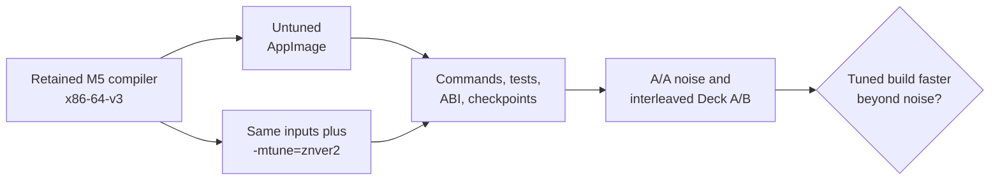

# TECH_PLAN — Steam Deck Zen 2 tuning

Status: Planning only  
Source: pre-merge [PR #446](https://github.com/chrissotraidis/bluewake/pull/446)
at `48a5872e213db41117e5bb4321a7aefbcf77993e`

[Product brief](PRD.md) · [Tracker](PROGRESS.md) ·
[Parent M6](https://github.com/chrissotraidis/bluewake/pull/421) ·
[M5 prerequisite](https://github.com/chrissotraidis/bluewake/pull/437)

## Inspected facts

- [`--march`](../../../scripts/linux/build.py) defaults to `x86-64-v3`, is
  checked against the build CPU, and reaches both host and module CMake flags.
- [`compile_composite`](../../../scripts/linux/build.py) constructs the module's
  Clang flags; [`configure_app`](../../../scripts/linux/build.py) constructs the
  C and C++ flags for the host and its configured dependencies.
- [`training_fingerprint`](../../../scripts/linux/build.py) records compiler and
  `--march`; [`BuilderProvenance.json`](../../../scripts/linux/build.py) records
  those values and artifact hashes. Neither currently records `-mtune`.
- Steam Deck's CPU is Zen 2, but a scheduling hint does not enable a new ISA.
  The experiment must preserve `-march=x86-64-v3` and the current default.
- #446 provides a private working container baseline for Clang 18 and 22, but
  it has no `--mtune` interface and M5 has not selected a compiler. It is
  preparation evidence only, not an M6 control or candidate.

## Proposed changes

| Status | File / symbol | Practical edit | Milestone |
|---|---|---|---|
| Modify | `scripts/linux/build.py` CLI | Add opt-in `--mtune znver2`; reject unsupported values or incompatible compiler invocation before the long build | M0 |
| Modify | `configure_app`, `compile_composite` | Append the selected `-mtune` to host C/C++ and game-module flags without replacing `--march` | M1 |
| Modify | `training_fingerprint`, package provenance | Include the tune value so profiles/caches cannot cross variants and artifacts identify the option | M1 |
| Modify | `tests/test_linux_ci_container.py` | Assert default absence, option forwarding, both CMake flag paths and provenance/fingerprint separation | M1 |
| Modify | `docs/LINUX.md` | Document the experimental Deck option, portable default and separate output directory | M1 |

Proposed invocation after [M5](https://github.com/chrissotraidis/bluewake/pull/437)
selects the comparison compiler:

```text
python3 scripts/linux/build.py GZLE01.iso --out build/deck-control \
  --ci-container --appimage <retained-M5-compiler-option>

python3 scripts/linux/build.py GZLE01.iso --out build/deck-znver2 \
  --ci-container --appimage <retained-M5-compiler-option> --mtune znver2
```

`<retained-M5-compiler-option>` is empty for Clang 18 or `--clang22` for Clang
22. The documentation must show the concrete command after M5 decides; it must
not leave this placeholder in an implemented workflow.

## Build and comparison flow



## Verification

| Layer | Method | Required evidence | Failure / skip |
|---|---|---|---|
| Source contract | `python3 tests/test_linux_ci_container.py` | Default has no `-mtune`; opt-in reaches host/module, fingerprint and provenance | Fix before building |
| Effective flags | Inspect configure logs/compile commands | Both use retained compiler and `-march=x86-64-v3`; only candidate adds `-mtune=znver2` | Comparison invalid |
| Build | Two clean container AppImages | Same revision, dependency lock, PGO input and options; distinct output directories | Comparison invalid |
| Linux/AppImage | Existing Linux CTest plus ABI and launch smoke paths | Both variants pass without private uploads | Candidate rejected |
| A/A control | At least three repeated untuned runs | Matching checkpoints and recorded noise | A/B deferred |
| Controlled A/B | Five interleaved pairs with identical Deck conditions | Per-scene medians, dispersion, FPS and game-thread busy | Incomplete grid is inconclusive |
| Game Mode | Local launch followed by SSH collection | Correct artifact/process, settled window, FPS/busy/waits and thermal/power context | Not qualified without both variants |

Use [`bench_tour.py`](../../../scripts/bench_tour.py) for workload/checkpoint
control and the [performance workflow](../../performance/Overview.md#worked-investigation)
for A/A and A/B decisions. Re-profile only to explain a changed result.

## Implementation order

| Milestone | Depends | Can run with | Deliverable / gate |
|---|---|---|---|
| M0 | Parent compiler decision and #433 resolution | Parent runtime track | Frozen compiler/control and tune-option contract |
| M1 | M0 | Parent runtime track | Tested opt-in builder path and two validated artifacts |
| M2 | M1 | Parent runtime track | Deck comparison and explicit retain/reject/inconclusive decision |

Critical path: M5 decision and #433 → M0 → M1 → M2. The two builds may
run in parallel after inputs are frozen. Deck measurements remain interleaved
on one device. This planning PR is independent for review; its implementation
must consume the actual retained M5 result rather than assume Clang 18 or 22.

## References

- [Linux build process](../../architecture/Build.md#linux-builder)
- [Linux build instructions](../../LINUX.md#container-build-recommended)
- [Steam Deck profiling](../../PROFILING.md)
- [Steam Deck performance issue #215](https://github.com/chrissotraidis/bluewake/issues/215)
