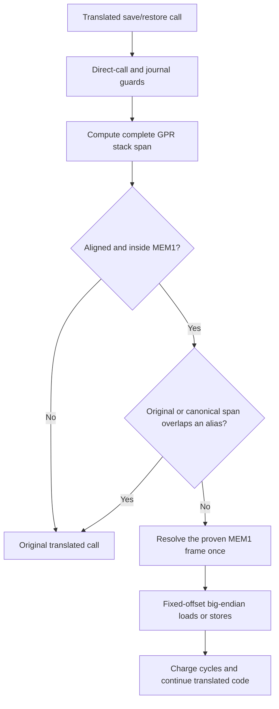

# TECH_PLAN — Inline GPR frame validation

Status: Candidate implemented and measured; integration gates remain
Inspected: tested BlueWake `f9205a53de307caac4e306e2a744609b1565135b`; tested RecompCore `0ab73ca9a673553675b8e511882e6f6b485407eb`; rebased RecompCore companion `47a5229cbfb3387cfd21c2b9d304b303a54a6767`; upstream BlueWake `main` `211abfdecf13beb5b9f2120459a1a3cde50dd84e`

[PRD](PRD.md) · [Tracker](PROGRESS.md) · [guest memory model](../../architecture/GuestState.md#guest-to-host-address-resolution) · [translated-code dispatch](../../architecture/GameModule.md#translated-code-dispatch)

## Code snapshot and inspected facts

| Role | Exact snapshot | Relevant state |
|---|---|---|
| Tested control | BlueWake `45e503fb869215ce3b4cb2490d12a53851268071` | Clang 18, `x86-64-v3`, composite `54f544…`, PGO `7334fd…` |
| Tested candidate | BlueWake `f9205a53de307caac4e306e2a744609b1565135b` | Same compiler, architecture and composite; PGO `880e00…` |
| Tested candidate runtime | RecompCore `0ab73ca9a673553675b8e511882e6f6b485407eb` | Exact commit used by the measured artifact |
| Rebased runtime companion | RecompCore `47a5229cbfb3387cfd21c2b9d304b303a54a6767` | Same API rebased onto current `bluewake-next`; [RecompCore #45](https://github.com/chrissotraidis/RecompCore/pull/45) |
| Current upstream | BlueWake `211abfd`, RecompCore `1446450` | PR branch rebased; dependency must still be integrated before merge |

The generator inserts guarded inline loads/stores through [`inline_save_restore_gpr.py`](../../../scripts/windows/inline_save_restore_gpr.py). [`inline_gpr.h`](../../../cmake/composite/inline_gpr.h) first proves that the complete frame is plain MEM1 with no journal; `bw_inline_gpr_frame()` then exposes that validated backing range. Generated code uses `read_be32` / `write_be32` at fixed offsets and clears an affected reservation once for a save. Cycle charging, direct-call checks and fallback remain intact. The complete control-to-candidate source diff consists only of this GPR work, its RecompCore alias-range API, integration wiring and tests; no unrelated renderer, service or gameplay source changed.

## Implemented flow



RecompCore's candidate `ppc_guest_alias_range_overlaps(address, size)` uses its sorted alias index for non-overlapping registrations and a full scan when registrations overlap, preserving registration-order resolution semantics. BlueWake checks both the supplied range and its `0x40000000`-canonical form before proving plain MEM1.

Central implemented contract:

```c
if (offset > cpu->ram_size - size ||
    ppc_guest_alias_range_overlaps(address, size) ||
    (canonical != address &&
     ppc_guest_alias_range_overlaps(canonical, size)))
    return false;
return true; /* bw_inline_gpr_frame may now reuse the proven backing range */
```

## Change and integration map

| State | File / symbol | Practical role | Milestone |
|---|---|---|---|
| Existing candidate | [`cmake/composite/inline_gpr.h`](../../../cmake/composite/inline_gpr.h) | Validate one contiguous frame and reject both alias forms | M2 |
| Integrated follow-up | [`bw_inline_gpr_frame`](../../../cmake/composite/inline_gpr.h) and the generator | Reuse the proven frame, preserve byte order and clear an affected reservation once | M2 |
| Existing candidate | [`tests/inline_gpr_memory_test.c`](../../../tests/inline_gpr_memory_test.c) | Cover ordinary, partial-alias, mirror, bounds, MMIO and journal cases | M3 |
| Existing candidate | RecompCore `ppc_guest_alias_range_overlaps` | Answer precise half-open range overlap without resolving storage | M1 |
| Under review | [RecompCore #45](https://github.com/chrissotraidis/RecompCore/pull/45) and BlueWake dependency pins | Land the runtime API upstream, then replace the temporary contributor pin | M5 |
| Integrated | Candidate branch versus current `main` | Rebased so unrelated Dawn patch history no longer appears in the PR | M5 |

## Measurement methodology and findings

The Steam Deck was in Game Mode and the benchmark was launched over SSH. Both private AppImages used Clang 18, `x86-64-v3`, local training, the same optimization switches, and the same composite digest. Candidate SHA-256: `cf972f…`; control: `51c64c…`.

The preserved state `quick-23874.bwstate` was loaded before a five-scene tour: Outset, Windfall, Dragon Roost Cavern, Forest Haven, and sea by the Fortress. Each stop covered 1,800 retraces; the harness excludes its first 300 retraces. A run-local copy of the pending `--setup-state` harness used `START=24000` to match the state's retrace; its SHA-256 is `8424ea…`. Every accepted run loaded all five scenes and produced 31 matching checkpoints. Two rounds reversed order: candidate→control, then control→candidate.

| Mode | Round 1 mean | Round 2 mean | Mean paired change |
|---|---:|---:|---:|
| Headless | `43.9139 → 44.9400` | `43.6836 → 44.8011` | **+2.447%** |
| Rendered | `39.4510 → 40.4019` | `39.9174 → 40.8888` | **+2.422%** |

### Scene-level results

Each cell reports `control → candidate (change)`. These are the accepted comparator outputs, not values reconstructed from the aggregate mean.

| Scene | Headless round 1 | Headless round 2 | Rendered round 1 | Rendered round 2 |
|---|---:|---:|---:|---:|
| Outset | `42.50 → 43.20 (+1.6%)` | `41.70 → 42.91 (+2.9%)` | `38.68 → 39.72 (+2.7%)` | `39.38 → 40.24 (+2.2%)` |
| Windfall | `45.17 → 45.65 (+1.1%)` | `44.36 → 45.75 (+3.1%)` | `40.53 → 41.51 (+2.4%)` | `40.77 → 42.02 (+3.1%)` |
| Dragon Roost Cavern | `60.43 → 62.18 (+2.9%)` | `60.42 → 61.60 (+1.9%)` | `53.70 → 55.04 (+2.5%)` | `54.44 → 55.66 (+2.3%)` |
| Forest Haven | `37.31 → 38.52 (+3.2%)` | `37.50 → 38.60 (+2.9%)` | `33.45 → 34.05 (+1.8%)` | `33.58 → 34.51 (+2.7%)` |
| Sea by the Fortress | `34.15 → 35.15 (+2.9%)` | `34.43 → 35.14 (+2.1%)` | `30.89 → 31.69 (+2.6%)` | `31.42 → 32.02 (+1.9%)` |

All five scenes improved in all four pairs. The rendered rows are the quantitative evidence closest to live play: the game rendered normally while the fixed scene windows were measured. In the separate player-controlled Game Mode island tour, the tester reported that live gameplay felt better and observed no gameplay issue. That assessment is useful anecdotal evidence, but the tour did not record a synchronized control/candidate interval and therefore does not establish an additional numeric “live gameplay” gain.

Invalid attempts using an incompatible setup state or a no-warp `--state` invocation were rejected and excluded. The different PGO profiles do not introduce an unrelated source-code variable: training each otherwise source-matched artifact can legitimately produce different profiles because the GPR optimization changes what training observes. The result therefore measures the complete GPR candidate under its normal training process; the matched-profile qualification below separates the direct source effect from its training-mediated effect.

### Matched-profile qualification (x86-64 desktop)

Run by pdale-boop to separate the source change from its training. Four builds in the Linux CI container (Clang 18, `x86-64-v3`, default switches, `--portable`) from `main` `211abfd` and this branch at `7d6a30d` (RecompCore `47a5229`), as a 2×2. `--host-only` keeps the profile already in a build folder whatever source has changed, so rebuilding there with the other source gives that source the first build's profile:

| | `main` profile (`4a95a094…`) | Candidate profile (`71f6bd72…`) |
|---|---|---|
| `main` source | A: trained | D: `main` rebuilt in B's folder |
| Candidate source | C: candidate rebuilt in A's folder | B: trained |

C − A and B − D measure the source change at a fixed profile; D − A and B − C measure the profile change at fixed source; B − A is the comparison above.

The profile match was checked rather than assumed: sample chunks of C were recompiled with `-Wprofile-instr-out-of-date` turned back on (the builder passes `-Wno-profile-instr-out-of-date`). Each main-executable chunk reported 1 mismatched function of 85–91, the per-chunk copy of the rewritten `bw_inline_gpr_memory_ready`; the sampled REL chunks reported none. The candidate source keeps every other function's counts. D has the same one-helper mismatch in reverse.

Headless, unpaced (`BLUEWAKE_WALL_PACE=0`), from three kept states (Outset 2,400 retraces, the bird 2,800, Tower of the Gods by boat 2,400), taking the median of the per-second rates with the first three and the last left out. Three rounds; the order of the four builds rotated each round and state, so every build ran in every position. 36 runs per machine, all loaded and exited cleanly. Mean over the three states:

| Comparison | i5-6500, Debian 13, all 4 cores | i5-12600KF, 4 E-cores (`taskset`), Arch |
|---|---:|---:|
| Source at `main`'s profile (C vs A) | **+1.4%** (9/9 pairs faster) | **+1.1%** (9/9) |
| Source at candidate's profile (B vs D) | +2.2% (9/9) | +2.2% (9/9) |
| `main` with the candidate's profile (D vs A) | −0.9% | −0.9% |
| Candidate with `main`'s profile (B vs C) | −0.1% | +0.2% |
| As above, each with its own training (B vs A) | **+1.3%** | **+1.3%** |

| State, i5-6500 | A | C | B | D | Instructions, C vs A |
|---|---:|---:|---:|---:|---:|
| Outset | 101.6 | 103.1 | 103.2 | 100.7 | −2.43% |
| Bird | 70.8 | 71.7 | 71.3 | 70.0 | −1.81% |
| Tower of the Gods by boat | 112.0 | 113.6 | 113.8 | 111.5 | −2.97% |

Guest checkpoints matched across all four builds on both machines, `main` and candidate included. The source change is faster in every fixed-profile pair (36/36) and does not depend on retraining: C is as fast as B. The new profile mostly costs `main` (D), so B vs D overstates the change; C vs A and B vs A are the fair figures. A rendered pass on the same E-cores (unpaced, Smooth Motion off, A and B, 3 rotated rounds) gave +1.5%, +0.6% and +2.0%, mean +1.4% (8/9 pairs faster), about the same as headless.

These Intel cores show about half the Deck's gain. That may be the Zen 2 core responding more to fewer instructions; the Deck figure was not rerun with matched profiles.

## Verification

| Layer | Command / method | Required evidence | State |
|---|---|---|---|
| Source contract | `python3 tests/test_inline_gpr.py` | 4 passing tests | Passed |
| Builder contract | `python3 tests/test_windows_prepared_cache.py` | 21 passing tests | Passed |
| Compiled component | CTest `bluewake_inline_gpr_memory_test` | Alias/mirror/bounds/journal plus direct/helper byte, value and reservation equivalence | Passed, 1/1 |
| Repository | `git diff --check`; `scripts/audit_repo.sh` | Clean diff; audit pass | Passed |
| Packaging | CI-container AppImage build and ABI audit | Successful private AppImage; max `GLIBC_2.38` | Passed |
| Hardware | Two headless and two rendered paired rounds | Loaded scenes, matching checkpoints, repeatable positive delta | Passed on tested snapshot |
| Integration | Rebase, upstream runtime pin, Linux/Windows CI | No fork pin; current-main evidence | Rebase passed; dependency, qualification and CI open |

## Implementation order

| Milestone | Depends | Deliverable / gate |
|---|---|---|
| M0 | — | Preserve existing inline behavior and define range proof |
| M1 | M0 | Tested RecompCore query; upstream dependency still required |
| M2 | M1 | Implemented eligibility change with unchanged memory operations |
| M3 | M1, M2 | Focused tests and repository checks pass |
| M4 | M3 | Repeated headless/rendered evidence and player tour |
| M5 | M1, M2, M3, M4 | Rebase, upstream RecompCore pin, matched qualification and CI |

Critical path: [RecompCore #45](https://github.com/chrissotraidis/RecompCore/pull/45) review → M5 upstream pin → current-main qualification. M3 documentation and evidence review can proceed in parallel, but BlueWake cannot merge before its RecompCore API exists upstream.

## References

- [Steam Deck performance issue](https://github.com/chrissotraidis/bluewake/issues/215)
- [Parent game-thread performance tracker](https://github.com/chrissotraidis/bluewake/pull/421)
- [Companion RecompCore API PR](https://github.com/chrissotraidis/RecompCore/pull/45)
- [Kept-state benchmark PR](https://github.com/chrissotraidis/bluewake/pull/450) and [setup validity follow-up](https://github.com/chrissotraidis/bluewake/pull/459)
