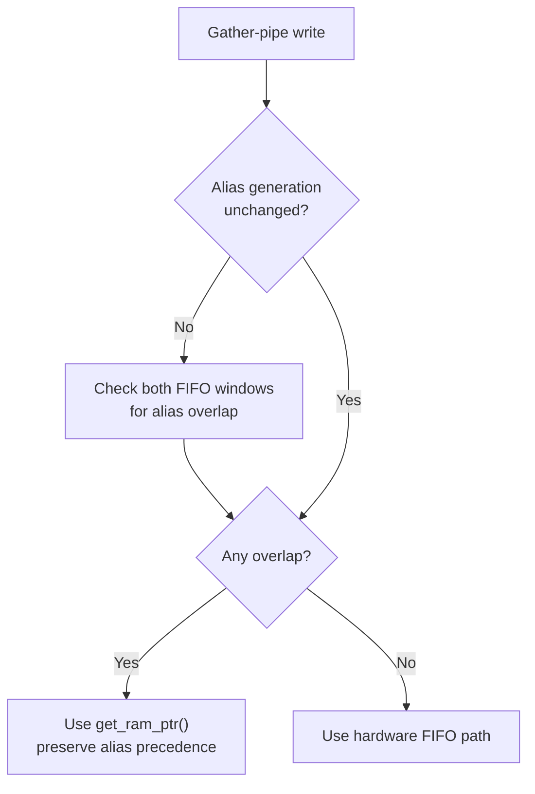

# Gather-pipe alias cache — technical basis

This is the M2 gather-pipe section of the
[runtime CPU optimization tech plan](https://github.com/irregularthanis/bluewake/blob/9cb28e3785e187c95a7ac62a45f967b43779851b/docs/planning/2026-10-27-runtime_cpu_optimization/TECH_PLAN.md#m2--split-fp-and-gather-pipe-costs),
carried with PR [#495](https://github.com/chrissotraidis/bluewake/pull/495) so
the change is reviewable with its measurements.

Control: upstream [`v0.9.0`](https://github.com/chrissotraidis/bluewake/releases/tag/v0.9.0) at [`211abfd`](https://github.com/chrissotraidis/bluewake/commit/211abfdecf13beb5b9f2120459a1a3cde50dd84e). Measurement tooling: [`d1bb41b`](https://github.com/irregularthanis/bluewake/commit/d1bb41b).

| Surface | Measurement | Safety gate | Output |
| --- | --- | --- | --- |
| [`inline_fp.h`](../../../cmake/composite/inline_fp.h) | Samples/calls by PowerPC operation and surrounding state work | Preserve results, rounding, conversion and exceptions | One bounded candidate or no-go |
| [`gather_pipe.h`](../../../cmake/composite/gather_pipe.h) | Split packing, validation, parsing, queueing and waits by thread/frame | Preserve ordering, mutation, interpolation and lifecycle | One bounded candidate or no-go |

## Initial worst-view attribution

A 120-second, 99 Hz whole-process `perf` capture used the frozen M0 control at
the fixed worst Outset view. It recorded 18,946 samples with no lost samples.

| Surface | Process cycles | Largest leaf symbols |
| --- | ---: | --- |
| Inline FP helpers | 0.46% | `bw_fp_fma` 0.08%; `bw_fp_ps_madd_op` 0.08%; `bw_fp_fsubs` 0.07% |
| Slow memory helpers | 1.48% | `bw_mem_write32_slow` 0.68%; `bw_mem_write8_slow` 0.39%; `bw_mem_read32_slow` 0.24% |
| Combined measured ceiling | 1.94% | Whole-process leaf attribution; not removable work |

FP is below a useful standalone ceiling. Gather validation and packing are
inlined inside the slow-write symbols, so this capture cannot separate them.
The attribution-only `--gather-pipe-profile` build keeps validation, packing
and draining as profiler-visible functions. It changes code shape and is not a
performance candidate; normal builds retain the existing inline path.

The diagnostic capture uses the same worst view and exclusive leaf samples to
split validation, packing, drain and fallback. Only material, removable work
advances to M3.

## Diagnostic stage split

Artifact: AppImage SHA-256 `b188e84d…`; module `9cfce5bd…`; source
[`70b8ee5`](https://github.com/irregularthanis/bluewake/commit/70b8ee5).
The same 120-second, 99 Hz worst-view capture recorded 18,617 samples.

| Stage | Process cycles | Decision |
| --- | ---: | --- |
| Gather alias/address validation | 1.01% | Advance: inspect avoidable alias resolution |
| Gather byte packing | 0.14% | Reject as standalone candidate |
| Gather drain check | 0.09% | Reject as standalone candidate |
| Remaining slow memory helpers | 0.95% | Retain; mixes required fallback work |
| Inline FP helpers | 0.44% | Reject as standalone candidate |

The diagnostic total is 2.63%, versus 1.94% in the inline control. The added
calls therefore distort absolute cost; these percentages rank stages but are
not expected gains. Validation remains the only stage large enough to test.

## Selected candidate contract

`bw_gather_pipe()` currently calls `get_ram_ptr()` so a registered guest alias
at `0xCC008000–0xCC00801F`, or its `0x8C008000` mirror, takes precedence over
the hardware FIFO.

An opt-in counter run covered the stable, slow and worst views. The primary
linked runtime copy reported 1,384,426,413 resolver calls: 1,352,936,366
(97.7%) were rejected by global alias bounds. Its 31.49 million remaining calls
produced 31.49 million hits and about 345.8 million search iterations. A second
linked runtime copy reported the same bounds-rejection pattern at smaller
scale. These counters are non-atomic diagnostics, so use them as directional
evidence rather than exact performance totals.

PR [#480](https://github.com/chrissotraidis/bluewake/pull/480) already depends
on RecompCore [#45](https://github.com/chrissotraidis/RecompCore/pull/45), which
adds `ppc_guest_alias_range_overlaps()` and retains the alias generation. The
candidate can cache whether either FIFO window overlaps an alias, recompute the
answer only when that generation changes, and call `get_ram_ptr()` only while
overlap exists. This reuses #480's dependency rather than adding another global.

The candidate must retain the ordinary resolver when overlap exists and pass
the physical/mirrored alias-precedence cases in `tests/gather_memory_test.c`.
Final qualification must be based on #480 so the measured GPR improvement and
the gather candidate are tested together against the relevant future baseline.

## Implemented gather alias cache

The candidate adds a generation-keyed decision in front of the existing
resolver. It does not cache a guest pointer. Instead, it caches only whether a
guest alias currently overlaps either FIFO window. An alias mutation advances
the RecompCore generation, invalidating that decision before the next gather
access.

This removes repeated alias-table resolution from the common no-overlap path
while retaining the original resolver whenever an alias could cover the FIFO.
Optimized Linux builds enable the cache by default; `--no-gather-alias-cache`
builds the original path for source-matched controls. The physical and mirrored FIFO alias cases are covered by the third
gather-memory test variant.

## Rendered candidate comparison

Both artifacts use PR [#480](https://github.com/chrissotraidis/bluewake/pull/480)
as their optimization foundation, Clang 18, `x86-64-v3`, and the same enabled
BlueWake optimization set. The candidate changes only the BlueWake alias-cache
integration and its RecompCore dependency. Each source snapshot performed its
normal local PGO training, so this comparison measures the complete resulting
build rather than isolating one generated instruction sequence.

| Role | BlueWake source | RecompCore | AppImage SHA-256 | Difference |
| --- | --- | --- | --- | --- |
| Control | [`73ef48e`](https://github.com/chrissotraidis/bluewake/commit/73ef48e1fe3d3ef128ff8a5ee67a2705bc74d4a3) | `47a5229` | `77b734f8…` | PR #480 foundation |
| Candidate | [`8d8587b`](https://github.com/irregularthanis/bluewake/commit/8d8587b37c360ee91f6947c40118e646a9faf4d8) | `caeedd8` | `5723637a…` | Same foundation plus generation-keyed gather alias cache |

The same Steam Deck, Game Mode launcher, disabled interpolation pacing, save,
camera positions and 20-second `perf stat` interval were used for both builds.

| Rendered view | CPU time | Cycles | Instructions | Branches |
| --- | ---: | ---: | ---: | ---: |
| Stable | -0.72% | -1.34% | -1.76% | -3.07% |
| Slow | +0.08% | +0.27% | -0.26% | -1.66% |
| Worst | -0.61% | -0.94% | -4.47% | -5.33% |

Negative values favor the candidate. The rendered samples show lower retired
work, especially in the worst view, but only small wall-time/cycle movement.
This is consistent with reduced resolver work, but the rendered samples alone
are too short and position-sensitive to qualify the candidate.

## Headless qualification

The established fixed-state tour ran ten measured passes per artifact in
candidate/control/control/candidate order. Every pass loaded all five scenes,
produced all 31 checkpoints, and matched guest-visible state across both
artifacts.

| Scene | Control | Candidate | Improvement |
| --- | ---: | ---: | ---: |
| Outset | 44.287 FPS | 45.365 FPS | +2.43% |
| Windfall | 46.711 FPS | 48.058 FPS | +2.88% |
| Dragon Roost Cavern | 63.448 FPS | 65.255 FPS | +2.85% |
| Forest Haven | 37.806 FPS | 39.079 FPS | +3.37% |
| Sea by the Fortress | 35.580 FPS | 36.445 FPS | +2.43% |

The per-run geometric-mean median improved by **2.84%**. The gain appears in
every scene and is substantially larger than the frozen same-build headless
noise. Together with identical checkpoints and the focused alias-precedence
tests, this advances the gather alias cache to M3 ranking and contract freeze.

Private Deck evidence identifier:
`8d8587b37c36-vs-73ef48e1fe3d-20261027T234341Z`.

