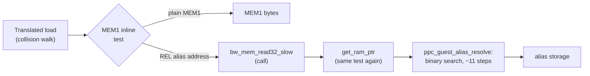
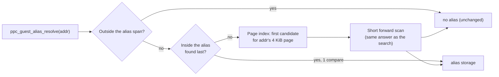

# PRD — Constant-time guest alias lookup

Status: Draft
Source: BlueWake `main` at `a773185`; RecompCore pin `1446450` ([`dependencies.lock.json`](../../../config/dependencies.lock.json)); Steam Deck measurements of 2026-10-29
Scope: the lookup inside RecompCore's `ppc_guest_alias_resolve` and the BlueWake pin that carries it; excluded: alias registration, the gather-pipe alias cache (#495), the collision code itself, MEM1's inline fast path

## Problem

Each translated REL keeps its data and BSS at generated linked addresses, registered as guest aliases ([address model](../../architecture/GuestState.md#guest-to-host-address-resolution)). An access to one of them misses the inline MEM1 test, leaves the chunk for an out-of-line wrapper, and reaches `ppc_guest_alias_resolve`, which binary-searches the sorted alias index on **every** such access. With 1,900 aliases that is about 11 dependent loads per guest load or store.

In scenes where the game thread walks REL-owned data, that search is now one of the largest costs on the thread that holds the frame rate.

## Findings

All on a Steam Deck (SteamOS, offscreen gamescope 1280×800) with `scripts/render_bench`, five save states, 2 A/B/B/A pairs, `--cpu-profile` (game thread only, measured window only). The candidate is the current optimization stack (`8d8587b37c36`); the reference is 0.9.0 (`211abfdecf13`).

| Finding | Evidence |
| --- | --- |
| In the lava room (`SubD51` room 1), `ppc_guest_alias_resolve` is **10.16 %** of the game thread: about **12.1 M of 119.3 M cycles per game frame** | Candidate profile; 10.14 % on the reference too |
| Elsewhere it is small: below the top ten (< 1.3 %) on the candidate in Outset, Hyrule Castle, the butterfly room and the shipwreck | Same run |
| The game thread is CPU-bound (≈ 99 % busy), and its cycles per frame track FPS: −11.5 % cycles against +14.7 % FPS in the lava room | Same run; the counters cover only each scene's FPS window |
| The alias set is **identical across scenes**: 1,900 non-overlapping aliases, `0xC0400FD0`–`0xC1F80954`, 1.5 MiB; `g_ppc_guest_aliases_overlap_mem1` is false | Read live from the running game in the lava room and Hyrule Castle (desktop) |
| So the cost scales with how often a scene touches REL data: per frame, the resolver costs **48×** more in the lava room than in Hyrule Castle, while the collision chunk costs 10× more | Deck profiles of both scenes |
| The lava room's next largest cost, `func_802456E0` (14 %), is ground collision: `cBgW::GroundCrossGrpRp` 35 %, `GroundCrossRp` 20 %, `cBgS::GroundCross` 14 % of the chunk; its actors' collision data lives in REL storage | Samples mapped to guest addresses through the chunk's `pc_table` and the decomp's symbol map |
| A native `GroundCross` (#436) could not beat the translation: it pays the same lookups, plus guards | #436 results |

Call stacks are not available (the game module has no unwind tables), so the link between collision and the resolver is inferred from the scene comparison. M0 of the plan measures it directly.

### Prior attempt

RecompCore #34 tried "the alias found last first" and was closed: on a Mac, at Outset and Dragon Roost Cavern, where the resolver was **2.2 %** of the game thread, gains were mixed (−3 % to +2.5 %), and lean memory had already removed most lookups. Its own close note: worth another look where a profile shows the search high again. The lava room on a Deck is that case: 10.2 %, with lean memory on.

## Proposed solution

Keep the resolver's contract and results exactly; make finding the alias cheap.

1. **Last hit first** (RC#34's idea): while no two aliases overlap, at most one alias holds an address, so the remembered alias is the search's answer whenever it holds it.
2. **A page index instead of the binary search**: for each 4 KiB page of the alias span, the sorted position the search would start from; a lookup reads one entry and scans the few aliases that begin inside the page.
3. Both are host-only: guest memory, cycle charges, checkpoints and pictures cannot change. Overlapping alias sets keep today's linear scan.

## Outcomes

- The lava room's resolver cost falls to a small share of the game thread, and its FPS rises; no other scene gets slower.
- Results are byte-identical: guest checkpoints and rendered pictures match the reference build in every run.
- If M0 shows the remembered alias rarely holds an access, and the page index alone doesn't reach the target, the plan stops at that evidence. A result inside A/A noise is a no-go, as RC#34 was, not a pass.

## Success and constraints

| Metric | Baseline | Target | Validation |
| --- | --- | --- | --- |
| Lava room: `ppc_guest_alias_resolve` share of game-thread cycles | 10.16 % (≈ 12.1 M cycles/frame) | ≤ 3 % | `render_bench --cpu-profile`, Deck |
| Lava room FPS | 29.57 (candidate stack) | Higher, beyond the A/A spread | ≥ 5 A/B/B/A pairs after one warm-up, against the same stack with the old pin |
| Other four scenes' FPS | as measured in M0 | No drop beyond the A/A spread | Same run |
| Guest checkpoints; rendered pictures | — | Identical in every run, both builds | `render_bench` checks |
| Exactness | — | Same pointer/offset as the current search for every input | Differential unit test, CTest, Linux and Windows |

Constraints: no guest-visible change; keep the API in [`cpu.h`](https://github.com/chrissotraidis/RecompCore/blob/1446450c79046bd34e43abadc27522eeab768a6e/GXRuntime/include/core/cpu.h#L111-L121); keep working with RC#45's alias-overlap query (#495) and the generation counter's readers; no thread-local storage on the hot path (a Mach-O dylib pays a call per access, per RC#34).

## Clarifications

- Motivation: confirmed as stated above (2026-10-29).
- Acceptance: resolver share ≤ 3 % and lava-room FPS beyond noise, with no regression elsewhere and identical checkpoints/pictures (confirmed 2026-10-29).
- Base: plan on BlueWake `main`; the implementation is a RecompCore PR plus a BlueWake pin bump, measured on the current optimization stack (#495/#480) (confirmed 2026-10-29).
- [#495](https://github.com/chrissotraidis/bluewake/pull/495) (gather-pipe alias cache, on RecompCore #45) is not merged but is consistently positive, so it stays in the measured baseline. It removes the gather pipe's calls into the resolver; this plan makes the remaining calls (translated loads and stores) cheap. Neither depends on the other's merge order (2026-10-29).
- Open: whether the gain carries to Mac and phones, where RC#34 was measured; the plan reports their numbers but gates only on the Deck.
