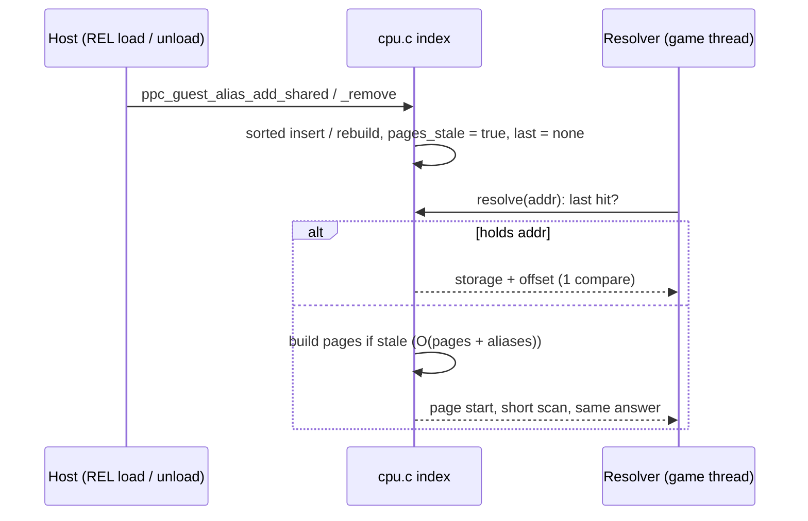

# TECH_PLAN — Constant-time guest alias lookup

Status: Planning only
Source: BlueWake `main` at `a773185`; RecompCore pin `1446450` and RecompCore #45 head `caeedd8` (base `bluewake-next`)
[PRD](PRD.md) · [Tracker](PROGRESS.md)

## Inspected facts

- **The hot path.** A translated load first tries `BW_RAM_FAST` inline. A REL alias address (`0xC0…`) fails it and calls `bw_mem_read32_slow`, then `mem_read32` → `get_ram_ptr`, which repeats the MEM1 test and calls `ppc_guest_alias_resolve` ([`gather_pipe.h` L136–L192](../../../cmake/composite/gather_pipe.h#L136-L192); [`get_ram_ptr`](https://github.com/chrissotraidis/RecompCore/blob/1446450c79046bd34e43abadc27522eeab768a6e/GXRuntime/include/core/cpu.h#L205-L255)).
- **The search.** With non-overlapping aliases, the resolver rejects by global bounds, then binary-searches `g_guest_alias_sorted` for the last alias starting at or below the address, then checks containment. Overlapping sets scan linearly in registration order ([resolver L273–L325](https://github.com/chrissotraidis/RecompCore/blob/1446450c79046bd34e43abadc27522eeab768a6e/GXRuntime/src/core/cpu.c#L273-L325)).
- **The index.** It's maintained by `ppc_guest_alias_index_insert` (insertion and overlap detection) and `ppc_guest_alias_index_rebuild` (after remove). `PPC_GUEST_ALIAS_MAX` is 4,096 ([L38–L102](https://github.com/chrissotraidis/RecompCore/blob/1446450c79046bd34e43abadc27522eeab768a6e/GXRuntime/src/core/cpu.c#L38-L102)).
- **Generation.** At the pin, `g_ppc_guest_alias_generation` moves only when MEM1 overlap changes. RecompCore #45 also bumps it on every add and remove, and adds `ppc_guest_alias_range_overlaps`. #495's gather cache keys on that.
- **Two copies.** BlueWake's host registers aliases through the game module's exported `ppc_guest_alias_add_shared` ([`main.c` L8040](../../../runtime/host/src/main.c#L8040)), and the Deck profile attributes the hot resolver to `gGZLE01_recomp.so`. The module's statically linked GXRuntime copy is the one that matters; both copies come from the same source and pin.
- **Live set** (measured): 1,900 aliases, non-overlapping, span `0xC0400FD0`–`0xC1F80954` (≈ 7,050 pages of 4 KiB), identical in the lava room and Hyrule Castle.
- **Census.** `BLUEWAKE_TRACE_ALIAS_COST=1` counts calls, bound rejections, iterations and hits, and reports from `atexit` ([L126–L156](https://github.com/chrissotraidis/RecompCore/blob/1446450c79046bd34e43abadc27522eeab768a6e/GXRuntime/src/core/cpu.c#L126-L156)). Two runs that ended at `BLUEWAKE_MAX_RETRACES` printed no report: **gap**, handled in M0.
- **Prior work.** RecompCore #34 (last hit first, as a relaxed atomic index) was closed on mixed Mac results at a 2.2 % resolver share. Its branch is reusable.

## Changes

| Status | File / symbol | Practical edit | Milestone | Architecture |
| --- | --- | --- | --- | --- |
| Modify | RecompCore `GXRuntime/src/core/cpu.c`: census | Add `same_as_last`, `page_scan_steps` and a miss count; report also via an exported `ppc_guest_alias_cost_report_now()` | M0 | [Resolution](../../architecture/GuestState.md#guest-to-host-address-resolution) |
| Modify | BlueWake `runtime/host/src/main.c` (retrace-cap exit) | Call the module's report export before exiting at `BLUEWAKE_MAX_RETRACES`, if present | M0 | [Host shutdown](../../architecture/Host.md#shutdown) |
| Modify | RecompCore `cpu.c`: `ppc_guest_alias_resolve` | Last-hit check, then a page-index start, then a bounded forward scan (below); overlapping path unchanged | M1 | [Resolution](../../architecture/GuestState.md#guest-to-host-address-resolution) |
| Modify | RecompCore `cpu.c`: `ppc_guest_alias_index_insert`/`_rebuild`, `_clear`, `_remove` | Mark the page index stale; reset the last hit | M1 | — |
| Proposed | RecompCore `GXRuntime/tests/guest_alias_lookup_test.c` + `GXRuntime/CMakeLists.txt` | Differential test against a reference linear scan, both `BW_GUEST_MEM1` variants | M2 | [Testing](../../architecture/Testing.md) |
| Modify | BlueWake `config/dependencies.lock.json`, builder profile pin | Pin the RecompCore commit | M3 | [Build](../../architecture/Build.md) |

## Contracts and examples

**Contract:** for every `(address, size)`, `ppc_guest_alias_resolve` returns the same boolean, `*pointer` and `*journal_offset` as at the pin. Overlapping sets keep the linear scan. Only the non-overlapping path changes.

**Data structure** (proposed): positions in the existing sorted index, so no second ordering exists.

```c
/* proposed, cpu.c: page index over [g_guest_alias_min_start, g_guest_alias_max_end) */
#define PPC_GUEST_ALIAS_PAGE_SHIFT 12u
static u16 g_guest_alias_page_first[(0x02000000u >> PPC_GUEST_ALIAS_PAGE_SHIFT) + 1u]; /* 16 KiB */
static u32 g_guest_alias_page_base;   /* min_start rounded down to a page */
static bool g_guest_alias_pages_stale = true;
static u32 g_guest_alias_last;        /* sorted position; relaxed atomic, no TLS */
```

`page_first[p]` holds the number of aliases whose start is at or below the start of page `p`, which is the binary search's `lo` for that page start. A lookup continues from there over aliases starting inside the page. The span is bounded by the 32 MiB `0x80…`/`0xC0…` window. A span above 32 MiB is a fallback, not an error: it keeps the binary search.

**Resolver change** (proposed, against [L286–L306](https://github.com/chrissotraidis/RecompCore/blob/1446450c79046bd34e43abadc27522eeab768a6e/GXRuntime/src/core/cpu.c#L286-L306)):

```diff
     if (!g_guest_alias_overlapping) {
-        u32 lo = 0u, hi = g_guest_alias_count;
-        while (lo < hi) { // last alias whose start is at or below the address
-            ...
-        }
+        u32 last = __atomic_load_n(&g_guest_alias_last, __ATOMIC_RELAXED);
+        if (last < g_guest_alias_count &&
+            ppc_guest_alias_holds(&g_guest_aliases[g_guest_alias_sorted[last]], address, size))
+            return ppc_guest_alias_answer(last, address, pointer, journal_offset);
+        if (g_guest_alias_pages_stale)
+            ppc_guest_alias_pages_build();           /* only if the span fits; else binary search */
+        u32 lo = g_guest_alias_page_first[(address - g_guest_alias_page_base) >> PPC_GUEST_ALIAS_PAGE_SHIFT];
+        while (lo < g_guest_alias_count &&
+               g_guest_aliases[g_guest_alias_sorted[lo]].linked_start <= address)
+            lo++;                                     /* same lo as the search */
         if (lo == 0u)
             return false;
```

The last-hit check is exact because without overlaps at most one alias holds an access, as RC#34 argued. The scan is exact because it reaches the binary search's `lo`.



**Threads and lifecycle.** Aliases change on REL load and unload, the same writers as today's sorted index, and the existing rule is that the index "is kept sorted by the mutators (never rebuilt lazily by a reader)". The page index follows the same rule: `ppc_guest_alias_pages_rebuild()` runs inside add, remove and clear, after the bounds are updated. No reader ever builds it, so the plan's open question about the gather path resolving off the game thread during a REL load doesn't arise (M0-T05). `g_guest_alias_last` is a relaxed atomic. A stale or torn value only misses, because the holds-check is complete.

**Save states.** Aliases are restored through the same add path, so the index rebuilds and nothing new is serialized.

## Verification

| Layer | Input / command | Required evidence | Failure / skip |
| --- | --- | --- | --- |
| Unit, differential | `ctest -R 'gxruntime_(guest_memory\|guest_alias_lookup)'`, both `BW_GUEST_MEM1` variants | ≥ 1 M random `(address, size)` per alias set, matching a reference linear scan: no-overlap, overlap, 1 and 4,096 aliases, page edges, sizes 1–8, mirror bit, remove/re-add | Any mismatch fails; Linux and Windows CI must both run |
| Census | `BLUEWAKE_TRACE_ALIAS_COST=1`, lava-room state, Deck | Non-empty `[alias-cost]` with `same_as_last`, scan steps, misses | No report means incomplete, not pass |
| Profile | `render_bench … --states <5 states> --cpu-profile` | Lava resolver share; per-scene game cycles/frame | Missing profile window is a failure |
| Product | `render_bench deck@… A B --states <5 states> --warmup 1 --pairs 5` | FPS per scene beyond the M0 A/A spread; checkpoints and pictures identical; 5/5 loaded | Within noise means no-go; any checkpoint/picture difference fails |

## Implementation order

| Milestone | Depends | Can run with | Deliverable / integration gate |
| --- | --- | --- | --- |
| M0 | — | — | Census counters and report export; Deck A/A spread; baseline profile; hit-rate numbers. Gate: decide last-hit only, page index only, or both |
| M1 | M0 | M2 | `cpu.c` lookup, stacked on RecompCore #45; owns `cpu.c` |
| M2 | M0 (contract) | M1 | Differential test and CMake registration; owns `tests/`, `CMakeLists.txt` |
| M3 | M1, M2 | — | RecompCore PR to `bluewake-next`; BlueWake pin PR; Deck A/B and profile against the same stack with the old pin |

Critical path: M0 → M1 → M3. Concurrency limits: M1 alone edits `cpu.c`, and RC#45 edits the same functions, so M1 rebases on #45. M2 needs only the frozen contract above, and builds against M1 for the final run.

## Decisions / gaps

- **Stacking:** on RecompCore #45, not the pin. Same file and generation semantics, and #495 (unmerged, consistently positive) needs it. If #45 changes first, M1 rebases.
- **Baseline build:** the earlier Deck numbers came from `8d8587b`, whose builder profile fetched RecompCore `47a5229`, an older #45 commit without the generation tracking #495 relies on. M0 and M3 therefore compare two fresh builds of #495's head `82371eb` (plus the host census commit), one at RecompCore `caeedd8` and one at `perf/alias-lookup` `abb3e31`, built the same way.
- **Granularity:** 4 KiB pages. Smaller pages trade memory (fine up to 64 KiB of table) for shorter scans; M0's scan-step census decides.
- **Not cached:** guest pointers or results. Only an index into the existing sorted array, so nothing can go stale silently.
- **Gap:** no call stacks for the game module. The collision link is correlational until M0's census shows the lava room's call count.
- **Gap:** Mac and phone results are reported, not gated (PRD).

## References

- RecompCore #34 (closed): last hit first, with its measurements and the relaxed-atomic rationale.
- RecompCore #45 and BlueWake [#495](https://github.com/chrissotraidis/bluewake/pull/495): range-overlap query, generation on every change, gather alias cache.
- BlueWake [#436](https://github.com/chrissotraidis/bluewake/pull/436): native GroundCross results.
- `scripts/render_bench` (pdale-boop/bluewake#2): the Deck A/B and `--cpu-profile` used for every number here.
