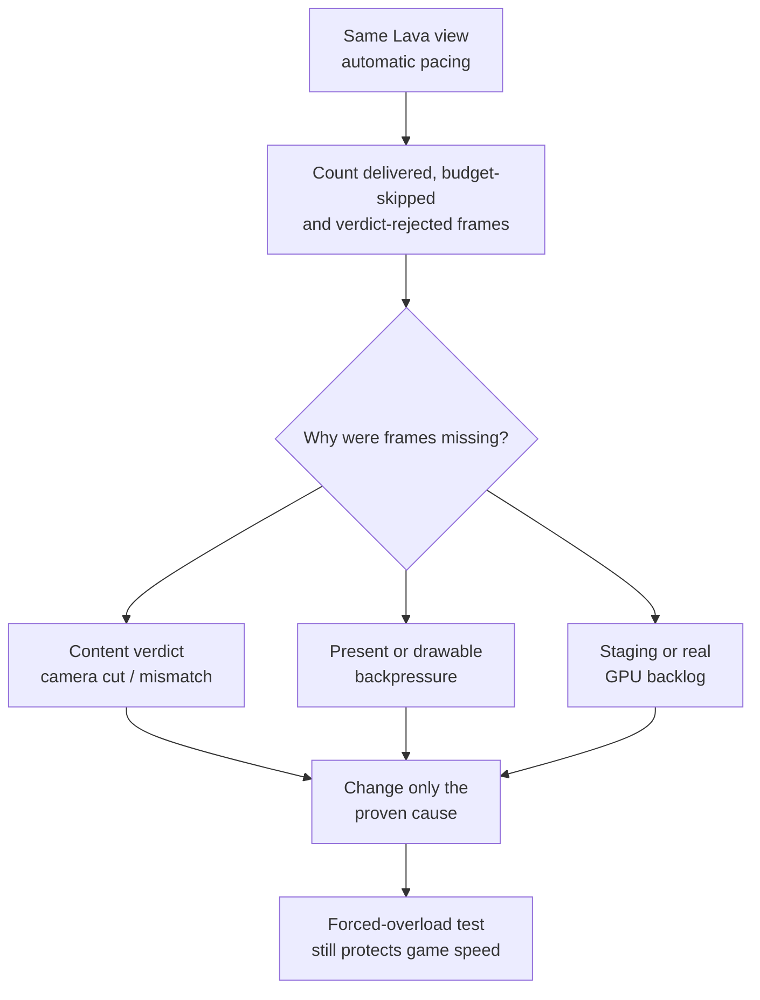

# TECH_PLAN — Lava Room Smooth Motion follow-up

Status: Planning only  
Source: BlueWake `a7731853c197cc9763a86d62e731d65ca0b25556`; performance baseline [#501](https://github.com/chrissotraidis/bluewake/pull/501) at `2749e6a194dcdba93846ebd925a33c4f95c695ab`  
[PRD](PRD.md) · [Tracker](PROGRESS.md)

## Inspected facts

- Aurora's [`pace_steps`](https://github.com/chrissotraidis/RecompCore/blob/1446450c79046bd34e43abadc27522eeab768a6e/GXRuntime/graphics/aurora/lib/gfx/frame_interp.cpp#L2369-L2451) reduces the budget after overloads in 3 of 8 frames. On an 8-thread Deck, the slow-game rule is disabled by default; render/present/GPU overloads still count.
- [`frame_verdict`](https://github.com/chrissotraidis/RecompCore/blob/1446450c79046bd34e43abadc27522eeab768a6e/GXRuntime/graphics/aurora/lib/gfx/frame_interp.cpp#L2454-L2471) can independently reject a frame for a cut/content mismatch. The overlay combines this with pacing-budget skips.
- Overload producers in `common.cpp` include frame-slot waits, staging-buffer/GPU waits, a GPU one game frame behind and a late drawable. They currently report string reasons through `note_overload`.
- #501's live check found continuous aggregate GPU saturation with Smooth Motion on and burst/idle behavior off, while BlueWake CPU remained about the same. This is evidence of interpolation/presentation pressure, not yet proof of the wrong overload source.
- The [graphics architecture](../../architecture/Graphics.md#synchronization-and-completion) separates guest GX production, Aurora/Dawn GPU work and presentation; all three must be timed in the same window.

## Decision flow



## Changes

| Status | File / symbol | Practical edit | Milestone | Architecture |
|---|---|---|---|---|
| Existing | RecompCore `frame_interp.cpp::pace_steps`, `frame_verdict` | Preserve current control and expose which path suppressed interpolation | M0–M1 | [Smooth Motion](../../architecture/Graphics.md#textures-frame-buffers-and-presentation) |
| Proposed | RecompCore `frame_interp.hpp/.cpp` | Replace unstructured overload strings at the internal boundary with typed causes and counters; keep readable logs | M1 | Pacing ownership |
| Proposed | RecompCore `common.cpp` overload producers | Record wait duration and source for slot, staging, GPU-backlog and drawable events | M1 | [Synchronization](../../architecture/Graphics.md#synchronization-and-completion) |
| Proposed | RecompCore `frame_interp_test.cpp` | Cover classification, 3-of-8 policy, recovery and forced overload | M1–M2 | Source-only correctness |
| Proposed | Cause-selected pacing/render path | Adjust only the source proven false or unnecessarily expensive | M2 | Determined by M1 |
| Proposed | BlueWake dependency pin/patch and performance docs | Deliver the reviewed RecompCore change and document the measured policy | M3 | [Build dependencies](../../architecture/Build.md) |

## Contract and proposed interface

Current code loses structure at the call boundary:

```cpp
frame_interp::note_overload("the game waited for the GPU");
```

Proposed diagnostic contract; exact names may follow RecompCore conventions:

```cpp
enum class OverloadCause { FrameSlot, StagingBuffer, GpuBacklog, LateDrawable };
void note_overload(OverloadCause cause, double wait_ms) noexcept;
```

The controller may still print the existing player-readable reason. Typed cause, duration, budget before/after and verdict outcome make the measurement unambiguous. Instrumentation stays opt-in or low-frequency and must not alter pacing. M2 is gated: if content rejection causes `paused`, modify verdict reporting or matching rather than pacing; if a present wait is incorrectly treated as interpolation capacity, separate that signal; if the GPU is genuinely behind, optimize the measured resource path or retain the drop.

## Verification

| Layer | Input / method | Required evidence | Failure / skip |
|---|---|---|---|
| M0 control | Same #501 build/state/view; automatic, never-pause and off | Build hashes, exact settings, ≥5 fixed windows per mode | Different camera/state makes comparison inconclusive |
| Classification | Per-frame counters and `[interp-pace]` transitions | Delivered, budget-skipped, verdict-rejected and overload-cause counts sum consistently | Ambiguous `paused` alone cannot select M2 |
| Source tests | RecompCore frame-interpolation test | Sparse overload does not drop; 3/8 does; recovery works; cuts still reject | Compile-only fails the gate |
| Performance | Matched control/candidate with Smooth Motion on | Game FPS within 2%; more delivered frames or lower measured wait/backlog | Higher GPU use alone is neither pass nor fail |
| Protection | Forced render load plus normal five-scene rendered run | Genuine overload still protects game speed; no image/checkpoint regression | Missing hardware run leaves M3 open |
| Platform | Linux/Windows BlueWake CI after pin | RecompCore tests compile/run through supported host builds | Deck result does not replace Windows CI |

## Implementation order

| Milestone | Depends | Can run with | Deliverable / integration gate |
|---|---|---|---|
| M0 | — | — | Reproduce: matched live modes and a classified measurement window |
| M1 | M0 | RecompCore source tests and BlueWake log parsing can proceed in parallel | Make causes observable: typed cause/duration plus verdict/budget counters with no policy change |
| M2 | M1 | Focused tests alongside implementation | Fix proven cause: one isolated policy or resource-path change |
| M3 | M2 | CI and Deck measurements can run independently | Qualify and deliver: RecompCore PR, BlueWake pin/patch, hardware decision and docs |

Critical path: M0 → M1 → M2 → M3. M2 cannot start from aggregate GPU load or the overlay label because both collapse distinct causes. RecompCore and BlueWake edits serialize at the pin: review the runtime change first, then update the dependency.

## Decisions / gaps

- [#470](https://github.com/chrissotraidis/bluewake/pull/470) remains a workaround/control, not the root fix.
- Open [#492](https://github.com/chrissotraidis/bluewake/pull/492) provides the rendered harness used by #501; until merged, record its exact revision with every run.
- Aggregate AMD GPU busy includes Gamescope. Use BlueWake waits/counters and fixed-window comparisons for attribution.

## References

- [#501 live Lava Room follow-up](https://github.com/chrissotraidis/bluewake/pull/501)
- [Issue #473](https://github.com/chrissotraidis/bluewake/issues/473)
- [Steam Deck issue #215](https://github.com/chrissotraidis/bluewake/issues/215)
- [Performance optimizations](../../PERFORMANCE_OPTIMIZATIONS.md#presentation-and-pacing)
