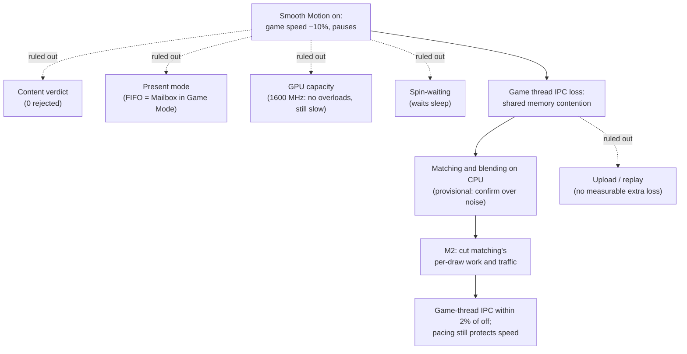

# TECH_PLAN — Lava Room Smooth Motion follow-up

Status: M0 and M1 done; M2 attribution in progress  
Source: BlueWake `a7731853c197cc9763a86d62e731d65ca0b25556`; performance baseline [#501](https://github.com/chrissotraidis/bluewake/pull/501) at `2749e6a194dcdba93846ebd925a33c4f95c695ab`  
[PRD](PRD.md) · [Tracker](PROGRESS.md)

## Inspected facts

- Aurora's [`pace_steps`](https://github.com/chrissotraidis/RecompCore/blob/1446450c79046bd34e43abadc27522eeab768a6e/GXRuntime/graphics/aurora/lib/gfx/frame_interp.cpp#L2369-L2451) reduces the budget after overloads in 3 of 8 frames. On an 8-thread Deck, the slow-game rule is disabled by default; render/present/GPU overloads still count.
- [`frame_verdict`](https://github.com/chrissotraidis/RecompCore/blob/1446450c79046bd34e43abadc27522eeab768a6e/GXRuntime/graphics/aurora/lib/gfx/frame_interp.cpp#L2454-L2471) can independently reject a frame for a cut/content mismatch. The overlay combines this with pacing-budget skips.
- Overload producers in `common.cpp` include frame-slot waits, staging-buffer/GPU waits, a GPU one game frame behind and a late drawable. They currently report string reasons through `note_overload`.
- #501's live check found continuous aggregate GPU saturation with Smooth Motion on and burst/idle behavior off, while BlueWake CPU remained about the same. This is evidence of interpolation/presentation pressure, not yet proof of the wrong overload source.
- The [graphics architecture](../../architecture/Graphics.md#synchronization-and-completion) separates guest GX production, Aurora/Dawn GPU work and presentation; all three must be timed in the same window.

### Established by M0 and M1 (2026-10-30)

- **Automatic pacing works as designed.** In the Lava Room it keeps full game speed by pausing in-between frames; never pause costs about 10% game speed in Game Mode.
- **The content verdict is not involved:** 0 frames rejected across every run.
- **Present mode is not the lever.** Headless gamescope showed FIFO backpressure, but on the live Game Mode display FIFO and Mailbox behave the same (late drawables 200 vs 178 per 50 s, game speed 75–92% vs 75–93%).
- **GPU capacity is not the limit.** With the GPU fixed at 1600 MHz, all GPU-side overloads disappear (0 late drawables, 0 render-worker waits) and the GPU is 66% busy, yet game speed is 74–82%.
- **The game thread is the limit, through memory contention.** With Smooth Motion on, the game thread runs the same instructions at lower IPC (1.89 → 1.73, same 3.35 GHz). Pinning it alone on a core halves that loss but does not restore speed. A synthetic memory-streaming load with Smooth Motion off cuts its IPC by 38%. CPU and GPU share LPDDR5 on the Deck.
- **Copies are not the source.** The same 9.5 MB of vertices are copied per game frame with Smooth Motion on and off; the in-between data is about 3.2 MB per game frame. The longer copy zone is queue wait behind the replay (queue ordering, [Graphics.md](../../architecture/Graphics.md#from-guest-bytes-to-a-gpu-resource)).
- **Spin-waiting is ruled out by the source:** the frame-slot, staging and pacing waits sleep in `wait_for_gpu_progress`.
- **Matching and blending are the larger share (5 interleaved rounds, warm cache).** Game-thread IPC versus off: matching only −2.0%, full Smooth Motion −3.3%, in that order in 5 of 5 rounds. Matching and blending on the CPU are about 60% of the loss; the upload and the replay about 40%. The earlier 8% came from a cold-cache pair.
- **In Game Mode the loss is the power limit, not IPC.** With Smooth Motion toggled in the same session, the game thread's IPC barely changes (1.89–1.90 → 1.88–1.90), but its clock falls from 3.45 to 3.11–3.16 GHz. The APU runs at its 15 W cap (13–16 W) with the GPU at 99–100% and 1.1–1.4 GHz, so the CPU cores drop to 2.9–3.3 GHz; with Smooth Motion off, the chip draws 9–15 W and the CPU holds 3.3–3.5 GHz. This also explains why fixing the GPU at 1600 MHz slowed the game, and why headless (no compositing or scanout) did not reproduce it.
- **The player's settings set the GPU cost.** In Game Mode with render scale 3 and 2× anisotropic filtering (no texture pack is active), the real frame's EFB passes take ≈ 22 ms at the governor's 0.82–0.93 GHz, two thirds of a 33 ms frame. With Smooth Motion on, the in-between replay adds ≈ 17.5 ms at 1.2–1.3 GHz, which drives the clock and power to the cap. Headless runs used default settings (scale 1, stock textures) and understated the real frame's cost about 5×. The Lava Room draws ≈ 930 draws per game frame (an earlier "9,000" misread a log field).
- **Render scale is the driver.** At scale 2, Smooth Motion costs no measurable game speed in Game Mode (in-between ≈ 9.4 ms, 13.2–13.8 W, game thread 3.45 GHz); at scale 3 it costs ≈ 10% (in-between ≈ 17.5 ms, 14.1–16.0 W at the cap, game thread ≈ 3.1 GHz). The cost per pass follows the pixel count, so the room is pixel-bound at these settings.
- **One pass holds the cost.** In Game Mode at scale 3, EFB pass 1 (776 draws, the main scene) takes 20.7–22.0 ms, 95% of the real frame; the other three passes take about 1 ms together. Next: time pass 1 in chunks of about 50 draws (a diagnostic split into timed sub-passes, each loading the previous result) to find which draws hold the time, then trace their textures, shaders and blending.
- **The in-between frame is a full second render.** By pass, the replay's four EFB passes cost ≈ 1.24 ms each against ≈ 1.16 ms for the real frame's; copy conversion and presentation are negligible on both sides, and the HD-look effects are off. Making it cheaper means drawing less (reusing what did not change) or drawing it more cheaply (for example at a lower resolution), not skipping passes. `gpu_prof`'s 4-deep readback ring drops frames with Smooth Motion on, so its per-frame totals then undercount; per-pass-instance costs hold.
- **No single large copy.** About 930 draws per game frame reach the helper; ≈ 720 copy the full 2,832-byte constants block through the job ring, the helper and the pool, and ≈ 930 produce a blended block. Together that is ≈ 0.5 GB/s, consistent with a ≈ 2% IPC loss at the game thread's measured sensitivity. Skipping unchanged draws saves almost nothing here; removing the job-ring and helper copies saves ≈ 0.12 GB/s (≈ 0.5% IPC headless).
- **Headless understates the contention.** Headless, the ≈ 3% IPC loss fits within the game thread's ≈ 14% headroom and the game holds 30 FPS; in Game Mode, gamescope's compositing and scanout add memory traffic and the game loses about 10%. Final measurements for M2 must be taken in Game Mode.

### Earlier observations

- M0 (Deck, 2026-10-30): automatic pacing holds full game speed by pausing; never pause costs about 10% game speed. Retries drop on late drawables (`aurora.cpp` acquire ≥ 20 ms) and render-worker waits; content verdict rejects 0.2–0.3%. See the [PRD's M0 findings](PRD.md#m0-findings-2026-10-30).
- `gpu_prof` bracketed only the real frame, so `[gpu-prof]` omitted the replayed passes. M1 added a frame and an `In-between replay` zone for it ([RecompCore #49](https://github.com/chrissotraidis/RecompCore/pull/49)).

## Decision flow



## Changes

| Status | File / symbol | Practical edit | Milestone | Architecture |
|---|---|---|---|---|
| Existing | RecompCore `frame_interp.cpp::pace_steps`, `frame_verdict` | Preserve current control and expose which path suppressed interpolation | M0–M1 | [Smooth Motion](../../architecture/Graphics.md#textures-frame-buffers-and-presentation) |
| Done ([#49](https://github.com/chrissotraidis/RecompCore/pull/49)) | RecompCore `frame_interp.hpp/.cpp` | Replace unstructured overload strings at the internal boundary with typed causes and counters; keep readable logs | M1 | Pacing ownership |
| Done ([#49](https://github.com/chrissotraidis/RecompCore/pull/49)) | RecompCore `common.cpp` overload producers | Record wait duration and source for slot, staging, GPU-backlog and drawable events | M1 | [Synchronization](../../architecture/Graphics.md#synchronization-and-completion) |
| Done ([#49](https://github.com/chrissotraidis/RecompCore/pull/49)) | RecompCore `common.cpp::present_with_in_between`, `present_steps`, `webgpu/gpu_prof` | Time the in-between replay as its own GPU zone so `[gpu-prof]` covers every presented frame | M1 | GPU attribution |
| Done for M1 ([#49](https://github.com/chrissotraidis/RecompCore/pull/49)); M2 to extend | RecompCore `frame_interp_test.cpp`, BlueWake `linux/CMakeLists.txt` | Cover classification, 3-of-8 policy, recovery and forced overload; run the test in Linux CI | M1–M2 | Source-only correctness |
| Done ([#49](https://github.com/chrissotraidis/RecompCore/pull/49)), diagnostic | RecompCore `common.cpp`, `DOL_AURORA_FRAME_INTERP_ABLATE` | `match` / `upload`: run matching (and the upload) but present the real frame again, to attribute cost | M2 | Measurement only |
| Proposed | RecompCore `frame_interp.cpp` capture/blend, `gxcore_draw.cpp` job queue | Candidate 1: skip capture and blending for draws whose matrices did not change since the previous frame, reusing the real frame's constants in the replay | M2 | [Smooth Motion](../../PERFORMANCE_OPTIMIZATIONS.md#smooth-motion-in-between-frames) |
| Proposed | RecompCore GX-worker capture (`capture_draw`, `queue_interp_job`) | Candidate 2: capture straight into the helper's job, without intermediate vectors | M2 | GX worker |
| Proposed (diagnostic) | RecompCore `common.cpp` pass encoding, `webgpu/gpu_prof` | Split a pass into timed sub-passes of N draws (load, not clear) to locate expensive draw ranges | M2 | GPU attribution |
| Proposed | BlueWake `scripts/rendered_run.py` | Option to keep the pipeline cache between runs; record cold/warm in results | M2–M3 | [Testing](../../architecture/Testing.md) |
| Proposed | BlueWake dependency pin/patch and performance docs | Deliver the reviewed RecompCore change and document the measured policy | M3 | [Build dependencies](../../architecture/Build.md) |

## Contract and proposed interface

Current code loses structure at the call boundary:

```cpp
frame_interp::note_overload("the game waited for the GPU");
```

Proposed diagnostic contract; exact names may follow RecompCore conventions:

```cpp
enum class OverloadCause { FrameSlot, StagingBuffer, GpuBacklog, LateDrawable };
void note_overload(OverloadCause cause, double wait_ms) noexcept;
```

The controller may still print the existing player-readable reason. Typed cause, duration, budget before/after and verdict outcome make the measurement unambiguous. Instrumentation stays opt-in or low-frequency and must not alter pacing. M2 is gated: if content rejection causes `paused`, modify verdict reporting or matching rather than pacing; if a present wait is incorrectly treated as interpolation capacity, separate that signal; if the GPU is genuinely behind, optimize the measured resource path or retain the drop.

## Verification

| Layer | Input / method | Required evidence | Failure / skip |
|---|---|---|---|
| M0 control | Same #501 build/state/view; automatic, never-pause and off | Build hashes, exact settings, ≥5 fixed windows per mode | Different camera/state makes comparison inconclusive |
| Classification | Per-frame counters and `[interp-pace]` transitions | Delivered, budget-skipped, verdict-rejected and overload-cause counts sum consistently | Ambiguous `paused` alone cannot select M2 |
| Source tests | RecompCore frame-interpolation test | Sparse overload does not drop; 3/8 does; recovery works; cuts still reject | Compile-only fails the gate |
| Attribution | `rendered_run.py --cpu-profile`, Lava Room state, window 136600–137800, ≥ 5 interleaved rounds per mode, warm pipeline cache | Mean and spread of game-thread IPC; an effect counts only beyond the spread | 2 runs per mode is not enough (spread up to 8%) |
| Performance | Matched control/candidate with Smooth Motion on, same method | Game-thread IPC with Smooth Motion on within 2% of off; Game Mode game speed within 2% of off with automatic pacing keeping in-between frames | Higher GPU use alone is neither pass nor fail |
| Protection | Forced render load plus normal five-scene rendered run | Genuine overload still protects game speed; no image/checkpoint regression | Missing hardware run leaves M3 open |
| Platform | Linux/Windows BlueWake CI after pin | RecompCore tests compile/run through supported host builds | Deck result does not replace Windows CI |

## Implementation order

| Milestone | Depends | Can run with | Deliverable / integration gate |
|---|---|---|---|
| M0 | — | — | Reproduce: matched live modes and a classified measurement window |
| M1 | M0 | RecompCore source tests and BlueWake log parsing can proceed in parallel | Make causes observable: typed cause/duration plus verdict/budget counters with no policy change |
| M2 | M1 | Focused tests alongside implementation | Fix proven cause: one isolated policy or resource-path change |
| M3 | M2 | CI and Deck measurements can run independently | Qualify and deliver: RecompCore PR, BlueWake pin/patch, hardware decision and docs |

Critical path: M0 → M1 → M2 → M3. M2 cannot start from aggregate GPU load or the overlay label because both collapse distinct causes. RecompCore and BlueWake edits serialize at the pin: review the runtime change first, then update the dependency.

## Decisions / gaps

- [#470](https://github.com/chrissotraidis/bluewake/pull/470) remains a workaround/control, not the root fix.
- Open [#492](https://github.com/chrissotraidis/bluewake/pull/492) provides the rendered harness used by #501; until merged, record its exact revision with every run.
- Aggregate AMD GPU busy includes Gamescope. Use BlueWake waits/counters and fixed-window comparisons for attribution.
- Headless gamescope has no real scanout: it hid the Game Mode presentation behaviour. Presentation conclusions need Game Mode runs.
- `rendered_run.py` starts every run with an empty data folder and pipeline cache. Reuse a folder per mode (warm after its first run) until the script has an option for it.
- The Deck's memory-traffic counters need root, so memory attribution relies on runs that isolate parts of Smooth Motion and on the synthetic memory load.

## References

- [#501 live Lava Room follow-up](https://github.com/chrissotraidis/bluewake/pull/501)
- [Issue #473](https://github.com/chrissotraidis/bluewake/issues/473)
- [Steam Deck issue #215](https://github.com/chrissotraidis/bluewake/issues/215)
- [Performance optimizations](../../PERFORMANCE_OPTIMIZATIONS.md#presentation-and-pacing)
