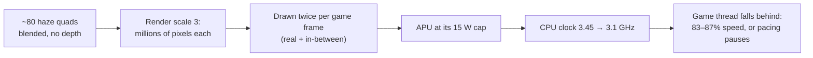
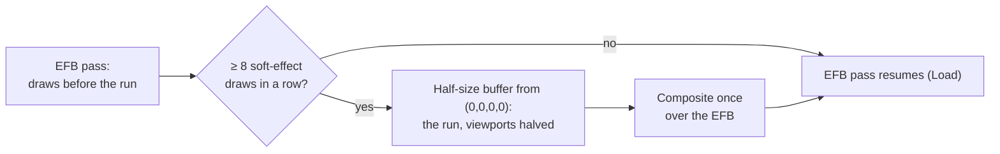

# TECH_PLAN — Lava Room Smooth Motion follow-up

Status: M0 and M1 done; M2 implemented in [RecompCore #49](https://github.com/chrissotraidis/RecompCore/pull/49) `2cc79f3`, Deck measurement next\
Source: BlueWake `a7731853c197cc9763a86d62e731d65ca0b25556`; measured on the [#501](https://github.com/chrissotraidis/bluewake/pull/501) stack\
[PRD](PRD.md) · [Tracker](PROGRESS.md)

## Inspected facts

### The frame at the player's settings

Game Mode, Lava Room, render scale 3, Smooth Motion off:

| Pass | Draws | GPU | Content |
|---|---|---|---|
| EFB 0 | 31 | 0.03 ms | cleared first |
| **EFB 1** | **776** | **20.7–22.0 ms** | the scene, then the haze |
| EFB 2 | 0 | ≈ 0 | — |
| EFB 3 | 84 | ≈ 0.9 ms | presented (HUD) |

Pass 1 timed in chunks of 50 commands (`DOL_AURORA_GPU_PROF_CHUNK`):

| Commands | GPU | What the draw log shows |
|---|---|---|
| **700–780** | **≈ 13.7 ms** | 81 quads, 6 indices each, one pipeline and texture, blended (SrcAlpha, InvSrcAlpha), **no depth test or write** |
| 50–99 | ≈ 3.8 ms | 50 opaque meshes, 27k indices |
| 650–699 | ≈ 1.7 ms | 33 opaque meshes and 14 more of the quads |
| the other ≈ 500 | < 1 ms | — |

Hiding 700–780 (`DOL_AURORA_SKIP_DRAWS`) takes pass 1 from 21.3 to 6.1–7.0 ms. Captures show the room's heat haze. The in-between replay has the same hot range (≈ 11.6 ms with Smooth Motion on).

### Across scenes (headless, scale 3)

| Scene | GPU per frame | Haze-like quads in the hot range | Share |
|---|---|---|---|
| Lava Room | 18.9 ms | 80 | ≈ 69% |
| Shipwreck | 18.1 ms | 82 | ≈ 62% |
| Outset | 13.0 ms | 45, interleaved with terrain | not separated |
| Hyrule Castle | 5.5 ms | 13 | small |
| Butterfly room | 9.7 ms | inconclusive | — |

### Ruled out on the way

| Suspect | Test | Why ruled out |
|---|---|---|
| Content verdict | `[interp-stats]` outcomes | 0 rejected in every run |
| Present mode | FIFO vs Mailbox in Game Mode | Same late drawables and game speed |
| GPU capacity | Clock fixed at 1600 MHz | No GPU overloads, game slower |
| Spin-waiting | Source | Frame-slot, staging and pacing waits sleep in `wait_for_gpu_progress` |
| Vertex copies | `[gpu-prof]` bytes | Same 9.5 MB per frame on and off; the longer zone is queue wait |
| Matching and blending (CPU) | Isolation runs, 5 rounds | ≈ 2% IPC; real but small, and secondary to power in Game Mode |

### Mechanism



## Changes

Code links are upstream permalinks: RecompCore at [#49](https://github.com/chrissotraidis/RecompCore/pull/49)'s head `2cc79f3`, BlueWake at `e58fea3`.

| Status | Code | What | Milestone |
|---|---|---|---|
| Done | [`OverloadCause`, `Stats`](https://github.com/chrissotraidis/RecompCore/blob/2cc79f39c85f2989f9ef341f07558a07626f2a1b/GXRuntime/graphics/aurora/lib/gfx/frame_interp.hpp#L51-L79), [`note_overload`](https://github.com/chrissotraidis/RecompCore/blob/2cc79f39c85f2989f9ef341f07558a07626f2a1b/GXRuntime/graphics/aurora/lib/gfx/frame_interp.cpp#L2344), [`log_stats`](https://github.com/chrissotraidis/RecompCore/blob/2cc79f39c85f2989f9ef341f07558a07626f2a1b/GXRuntime/graphics/aurora/lib/gfx/frame_interp.cpp#L2386-L2420), [`frame_verdict`](https://github.com/chrissotraidis/RecompCore/blob/2cc79f39c85f2989f9ef341f07558a07626f2a1b/GXRuntime/graphics/aurora/lib/gfx/frame_interp.cpp#L2559-L2587), [late drawable](https://github.com/chrissotraidis/RecompCore/blob/2cc79f39c85f2989f9ef341f07558a07626f2a1b/GXRuntime/graphics/aurora/lib/aurora.cpp#L437) | Typed overload causes with waits; per-frame outcomes and per-draw counters in `[interp-stats]` | M1 |
| Done | [replay zone](https://github.com/chrissotraidis/RecompCore/blob/2cc79f39c85f2989f9ef341f07558a07626f2a1b/GXRuntime/graphics/aurora/lib/gfx/common.cpp#L2854), [`set_name_prefix`](https://github.com/chrissotraidis/RecompCore/blob/2cc79f39c85f2989f9ef341f07558a07626f2a1b/GXRuntime/graphics/aurora/lib/webgpu/gpu_prof.cpp#L547), [`=2`, each pass](https://github.com/chrissotraidis/RecompCore/blob/2cc79f39c85f2989f9ef341f07558a07626f2a1b/GXRuntime/graphics/aurora/lib/webgpu/gpu_prof.cpp#L406), [timestamps for `=2`](https://github.com/chrissotraidis/RecompCore/blob/2cc79f39c85f2989f9ef341f07558a07626f2a1b/GXRuntime/graphics/aurora/lib/webgpu/gpu.cpp#L957), [chunks](https://github.com/chrissotraidis/RecompCore/blob/2cc79f39c85f2989f9ef341f07558a07626f2a1b/GXRuntime/graphics/aurora/lib/gfx/common.cpp#L2383) | GPU zones: in-between replay, `IB` names, each pass, chunks of draws | M1–M2 |
| Done | [`…_ABLATE`](https://github.com/chrissotraidis/RecompCore/blob/2cc79f39c85f2989f9ef341f07558a07626f2a1b/GXRuntime/graphics/aurora/lib/gfx/common.cpp#L1828-L1846), [`…_SKIP_DRAWS` / `…_DRAW_LOG`](https://github.com/chrissotraidis/RecompCore/blob/2cc79f39c85f2989f9ef341f07558a07626f2a1b/GXRuntime/graphics/aurora/lib/gfx/common.cpp#L1100), [draw log](https://github.com/chrissotraidis/RecompCore/blob/2cc79f39c85f2989f9ef341f07558a07626f2a1b/GXRuntime/graphics/aurora/lib/gfx/common.cpp#L2356-L2381) | Diagnostics for attribution | M2 |
| Done | [`soft_effects.hpp`](https://github.com/chrissotraidis/RecompCore/blob/2cc79f39c85f2989f9ef341f07558a07626f2a1b/GXRuntime/graphics/aurora/lib/gfx/soft_effects.hpp), [buffer and composite](https://github.com/chrissotraidis/RecompCore/blob/2cc79f39c85f2989f9ef341f07558a07626f2a1b/GXRuntime/graphics/aurora/lib/gfx/common.cpp#L2085-L2230), [pass split](https://github.com/chrissotraidis/RecompCore/blob/2cc79f39c85f2989f9ef341f07558a07626f2a1b/GXRuntime/graphics/aurora/lib/gfx/common.cpp#L2393-L2481), [`softTarget` variant](https://github.com/chrissotraidis/RecompCore/blob/2cc79f39c85f2989f9ef341f07558a07626f2a1b/GXRuntime/graphics/aurora/lib/gfx/gxcore_draw.cpp#L623-L688), [record time](https://github.com/chrissotraidis/RecompCore/blob/2cc79f39c85f2989f9ef341f07558a07626f2a1b/GXRuntime/graphics/aurora/lib/gfx/gxcore_draw.cpp#L2487-L2496), [binding](https://github.com/chrissotraidis/RecompCore/blob/2cc79f39c85f2989f9ef341f07558a07626f2a1b/GXRuntime/graphics/aurora/lib/gfx/gxcore_draw.cpp#L884), [`aurora_set_efficient_effects`](https://github.com/chrissotraidis/RecompCore/blob/2cc79f39c85f2989f9ef341f07558a07626f2a1b/GXRuntime/graphics/aurora/include/aurora/aurora.h#L163) | **Efficient soft effects** (design below) | M2 |
| Done | [`frame_interp_test.cpp`](https://github.com/chrissotraidis/RecompCore/blob/2cc79f39c85f2989f9ef341f07558a07626f2a1b/GXRuntime/graphics/aurora/tests/frame_interp_test.cpp), [`soft_effects_test.cpp`](https://github.com/chrissotraidis/RecompCore/blob/2cc79f39c85f2989f9ef341f07558a07626f2a1b/GXRuntime/graphics/aurora/tests/soft_effects_test.cpp) | Counters; selection rule, runs and blend identity | M1–M2 |
| Done | [`settings_table.h`](https://github.com/chrissotraidis/bluewake/blob/e58fea3e78d7d4daf2b083ada7b4de77b9cb07a3/runtime/host/src/settings_table.h#L128), [`desktop_menu.cpp`](https://github.com/chrissotraidis/bluewake/blob/e58fea3e78d7d4daf2b083ada7b4de77b9cb07a3/runtime/host/src/desktop_menu.cpp#L226), [`settings_table_test.cpp`](https://github.com/chrissotraidis/bluewake/blob/e58fea3e78d7d4daf2b083ada7b4de77b9cb07a3/tests/settings_table_test.cpp#L22) | The "Efficient soft effects" setting, applied live | M2 |
| Done | [`linux/`](https://github.com/chrissotraidis/bluewake/blob/e58fea3e78d7d4daf2b083ada7b4de77b9cb07a3/linux/CMakeLists.txt#L236-L246), [`windows/`](https://github.com/chrissotraidis/bluewake/blob/e58fea3e78d7d4daf2b083ada7b4de77b9cb07a3/windows/CMakeLists.txt#L637-L642), [Linux workflow](https://github.com/chrissotraidis/bluewake/blob/e58fea3e78d7d4daf2b083ada7b4de77b9cb07a3/.github/workflows/linux-host.yml#L80), [Windows workflow](https://github.com/chrissotraidis/bluewake/blob/e58fea3e78d7d4daf2b083ada7b4de77b9cb07a3/.github/workflows/windows-host.yml#L57) | `frame_interp_test` and `soft_effects_test` in CI | M1–M2 |
| Next | BlueWake pin, docs | Deliver after the Deck A/B | M3 |

Dropped approaches:

| Approach | Why dropped |
|---|---|
| Change pacing thresholds | Pacing was correct: it protects game speed |
| Mailbox presentation | No effect in Game Mode |
| Skip matching for unchanged draws | Nearly every Lava Room draw blends (≈ 930 of 930) |
| Lower-resolution whole in-between frame | Rejected by the player |

## Contracts and examples

Setting (BlueWake → Aurora), applied live:

```cpp
// settings.ini: DOL_AURORA_EFFICIENT_EFFECTS=1  ("Efficient soft effects", off by default)
void aurora_set_efficient_effects(bool on);
```

The blend identity the buffer relies on, for quads in draw order:

| Where | Colour factors | Alpha factors | Holds after the run |
|---|---|---|---|
| Buffer, from (0,0,0,0) | SrcAlpha, OneMinusSrcAlpha | One, OneMinusSrcAlpha | premultiplied colour `C`, coverage `A` |
| Composite over the EFB | One, OneMinusSrcAlpha | as the run writes alpha | `dst = C + dst × (1 − A)`, equal to blending each quad in turn |

## M2 design: blended sprites at reduced resolution



| Part | Implementation |
|---|---|
| Selection (record time) | [`qualifies_key`](https://github.com/chrissotraidis/RecompCore/blob/2cc79f39c85f2989f9ef341f07558a07626f2a1b/GXRuntime/graphics/aurora/lib/gfx/soft_effects.hpp#L37-L44): blend SrcAlpha/InvSrcAlpha, no subtract, no depth test or write, colour written, triangles, 1 TEV stage, no indirect stages, no destination alpha |
| Selection (encode time) | [`qualifies_size`](https://github.com/chrissotraidis/RecompCore/blob/2cc79f39c85f2989f9ef341f07558a07626f2a1b/GXRuntime/graphics/aurora/lib/gfx/soft_effects.hpp#L49-L51): ≤ 12 indices per batched draw; [`find_runs`](https://github.com/chrissotraidis/RecompCore/blob/2cc79f39c85f2989f9ef341f07558a07626f2a1b/GXRuntime/graphics/aurora/lib/gfx/soft_effects.hpp#L61-L78): ≥ 8 in a row, split where alpha writing changes; the variant must be compiled |
| Pipeline variant | [`PipelineConfig::softTarget`](https://github.com/chrissotraidis/RecompCore/blob/2cc79f39c85f2989f9ef341f07558a07626f2a1b/GXRuntime/graphics/aurora/lib/gfx/gxcore_draw.hpp#L114) (config v14): alpha (One, OneMinusSrcAlpha), one sample, no depth attachment, RGBA written |
| Encoding | [The EFB pass is split around each run](https://github.com/chrissotraidis/RecompCore/blob/2cc79f39c85f2989f9ef341f07558a07626f2a1b/GXRuntime/graphics/aurora/lib/gfx/common.cpp#L2393-L2481), like the chunked timing; only the last part resolves |
| Composite | [Full-screen triangle](https://github.com/chrissotraidis/RecompCore/blob/2cc79f39c85f2989f9ef341f07558a07626f2a1b/GXRuntime/graphics/aurora/lib/gfx/common.cpp#L2085-L2230) sampling the buffer at `fragcoord × 0.5 / size`, blend (One, OneMinusSrcAlpha) |
| Scope | EFB passes ≥ 1280 pixels wide (scale 2 and up), no bloom split; real and in-between frames |
| Fallback | A run whose variants are still compiling keeps the EFB |

| Risk | Mitigation |
|---|---|
| EFB alpha after the run differs from per-quad blending | The composite writes alpha only where the run did; check nothing reads EFB alpha afterwards |
| Alpha test at half resolution | Accepted for soft veils; edges reviewed in captures |
| Sharp sprites matching the rule | The rule requires no depth test, one TEV stage and long runs; captures in five scenes |
| Pass split cost | One extra store and load of the EFB per run, measured in `[gpu-prof]` |

## Verification

| Check | Method | Pass |
|---|---|---|
| Rule, runs, blend identity | `soft_effects_test` in Linux and Windows CI | All checks pass |
| Counters | `frame_interp_test` | All checks pass |
| Setting | `settings_table_test` | Key in file order |
| A/A and A/B | Game Mode, one session, setting toggled: off/off, then off/on/off/on, 15 s windows | A/B difference exceeds the A/A spread |
| GPU and speed | Same session, Smooth Motion on, Lava Room and Shipwreck | Targets in the [PRD](PRD.md#success-and-constraints) |
| Picture | Captures at scale 3, five scenes, on and off | Differences confined to soft effects, reviewed |

## Implementation order

| Milestone | Depends | Can run with | Deliverable / integration gate |
|---|---|---|---|
| M0 | — | — | Reproduce: matched live modes and a classified measurement window |
| M1 | M0 | RecompCore source tests and BlueWake log parsing can proceed in parallel | Make causes observable: typed cause/duration plus verdict/budget counters with no policy change |
| M2 | M1 | Focused tests alongside implementation | Fix the proven cause: Efficient soft effects, opt-in, with tests |
| M3 | M2 | CI and Deck measurements can run independently | Qualify and deliver: Deck A/B, CI, pin and docs |

Critical path: M0 → M1 → M2 → M3. RecompCore and BlueWake edits serialize at the pin.

## Decisions / gaps

- **Game Mode at the player's settings is the reference.** Headless hid the power cap and understated the GPU cost about 5×; it stays useful for repeatable draw counts and captures.
- **Profiler limits:** `gpu_prof`'s 4-deep readback ring drops frames with Smooth Motion on (per-instance costs hold, totals undercount); `frame_ms` is meaningless with chunking.
- **Butterfly room and Outset** are unresolved; Outset's limit is the game thread ([#503](https://github.com/chrissotraidis/bluewake/pull/503)).
- **Builds:** renderer-only rebuilds keep the trained profile (`build_script --reuse`; builder provenance in [#515](https://github.com/chrissotraidis/bluewake/pull/515)), so A/B builds share the module's optimization.
- `rendered_run.py` starts each run with an empty pipeline cache.

## References

- [#504](https://github.com/chrissotraidis/bluewake/pull/504) (this plan), [RecompCore #49](https://github.com/chrissotraidis/RecompCore/pull/49) (the code)
- [#501](https://github.com/chrissotraidis/bluewake/pull/501), [#503](https://github.com/chrissotraidis/bluewake/pull/503), [#515](https://github.com/chrissotraidis/bluewake/pull/515), [issue #473](https://github.com/chrissotraidis/bluewake/issues/473)
- [Graphics architecture](../../architecture/Graphics.md), [Performance optimizations](../../PERFORMANCE_OPTIMIZATIONS.md#presentation-and-pacing)
