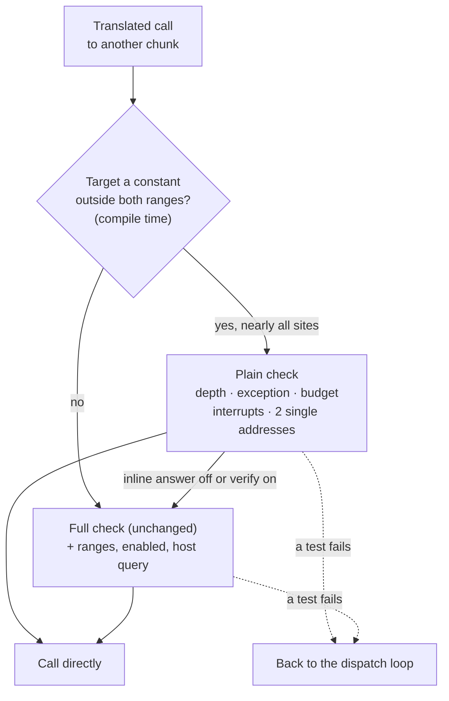

# TECH_PLAN — Outset game-thread follow-up

Status: Stack 1 retained (+1.4–1.8% Game Mode, +1.6% rendered, exact); M4 (interrupt test) closed as no-go; ready for review; follow-ups #529–#531  
Source: BlueWake `a7731853c197cc9763a86d62e731d65ca0b25556`; control build = [#504](https://github.com/chrissotraidis/bluewake/pull/504) + `main` 0.10.0 (local `f4bda45`)  
[PRD](PRD.md) · [Tracker](PROGRESS.md)

## Where the time goes

The [game-thread architecture](../../architecture/GameThread.md#performance-model) runs translated game code and the host's boundary work on one thread, so an idle GPU does not help. Measured in Outset, in M cycles per game frame (≈ 129 M total; 30 FPS allows ≈ 113 M):

| Part | M/frame | What it is |
|---|---:|---|
| Translated game code | ≈ 85 | Collision 22, animation/skinning 14, draw setup 9, actors and the rest; flat, nothing above 2.3 |
| Runtime and host | ≈ 44 | The per-call and helper costs every scene pays (table below) |

The runtime's share, with what the code and prior PRs say can still be removed:

| Cost | M/frame | Removable | Basis |
|---|---:|---|---|
| Native routines (`*_try`) | 10.8 | Low | Their own work; the routing check is 0.33% |
| **Direct-call check** (`bw_direct_call_ready`) | **5.6** | **≈ 3** | **Ceiling test below** |
| GX command stream | 5.1 | Unknown | Host-side parsing; [#495](https://github.com/chrissotraidis/bluewake/pull/495) already took the alias test out |
| Dispatch loop | 4.3 | Unknown | [#448](https://github.com/chrissotraidis/bluewake/pull/448): the dispatch cache is already exact |
| Native actor search | 2.9 | ≈ 1 | A full memory lookup per 4-byte read |
| Memory slow paths, aliases | 2.2 | Unknown | — |
| Paired-single load/store | 2.1 | ≈ 1 | Generic quantization path for the plain-float case |
| FP helpers | 1.2 | Small | — |

## Why the direct-call check first

It runs before every call from one translated chunk into another. It has 32,604 call sites in the 84 hottest chunks, each paying ≈ 35 instructions (≈ 17 loads, 12 branches) in a 252-byte function the compiler keeps out of line.

**What earlier work rules out:**

| Idea | Result | Source |
|---|---|---|
| Move the host's question into the module | No gain: "the cost is the question itself" | [`SPEED_PROFILE_2026-10-11.md`](https://github.com/chrissotraidis/bluewake/blob/main/docs/status/SPEED_PROFILE_2026-10-11.md#s2-the-hosts-per-call-checks-read-inline-october-12-no-gain) |
| Force small helpers inline | 11.5% larger module, 1–2% slower | Same document, FP helpers |
| Read the host's answer inline (address-only) | +3.9% at Outset on a Mac; now the default v3 path | [#274](https://github.com/chrissotraidis/bluewake/pull/274) |
| Hook a game function natively (collision) | Accepted path slower than translation on the Deck | [#436](https://github.com/chrissotraidis/bluewake/pull/436) |

So what remains is to make the question itself smaller, without moving it or inlining it.

**What a smaller question is worth.** A diagnostic-only ceiling module kept only depth, exception, budget and one host flag. It had the same optimization profile as the control:

| Test | Control | Ceiling | Change | Spread |
|---|---:|---:|---:|---:|
| Game Mode, worst-angle Outset state, 3 × 15 s per launch, control → ceiling → control | 26.4 FPS | 27.2 FPS | **+3.1%** | 0.5 |
| render_bench, five states, 3 pairs, scale 3, unpaced | — | — | **+4.5%** (Outset +4.3%, Lava Room +6.8%, Hyrule Castle +2.4%, Butterfly Room +2.7%, Shipwreck +5.5%) | — |

The ceiling clears the 2% bar. It also shows what must not be cut: its guest checkpoints drifted from the control in every scene, because skipping the interrupt test changes when interrupts are taken. **The shippable check keeps every runtime test and removes only work whose answer is already known.**

## Results

Every A/B ran in Game Mode from the worst-angle Outset state, launched through the Steam shortcut, in the order control → candidate → control, with 3 × 15 s windows per launch. All builds shared the control's composite profile (`--reuse`).

| Build | What changed | Game FPS | Change | Spread | Lesson |
|---|---|---:|---:|---:|---|
| Ceiling (not shippable) | Check reduced to depth, exception, budget, one flag | 26.4 → 27.2 | +3.1% | 0.5 | The bound; skipping interrupt tests drifts guest state |
| v1 | Range tests settled at build time | 26.6 → 25.8 | **−2.9%** | 0.5 | The plain check was inlined at ≈ 448 sites per chunk (+11% hot code): layout, not logic |
| v2 | v1, both checks out of line and `hot` | 26.5 → 26.7 | +0.7% | 0.6 | Exact, but too small alone |
| **Stack (retained)** | **v2 + actor-search lookup inlined** | **26.1 → 26.6** | **+1.8%** | 0.4 | Two exact shared-cost cuts add up |

Rendered, five states, 3 pairs (unpaced): the stack is **+1.6% overall** (Outset +1.9%, Lava Room +3.0%, Hyrule Castle +1.8%, Butterfly Room +0.5%, Shipwreck +0.7%), with **guest checkpoints identical to the control in every run and scene**.

Re-checked on current `main` (`6b429fe`, full build and profile) after merging it into this branch: **+1.4%** in Game Mode across six launches, with the candidate ahead of the control in every launch.

Considered and dropped: the paired-single plain-float path already exists; only call overhead remains (≈ 0.2 M cycles per frame), and inlining such helpers was slower in October.

## Approach

Of the ≈ 17 loads per call, two groups are known before the game runs:

1. **The two watched ranges** (particle and wake draws) are fixed guest addresses, and a translated call's target is a literal in the generated code. The compiler can settle "is this target in a range?" per call site.
2. **The enabled / callback / cpu tests** are implied whenever the host's inline-answer pointer is set, if every path that disables direct calls also clears that pointer.

The interrupt sources, depth, exception, budget and the two single watched addresses change at runtime and stay.



## Changes

| File / symbol | Change | Why |
|---|---|---|
| [`cmake/composite/direct_calls.h`](../../../cmake/composite/direct_calls.h) `bw_direct_call_ready` → `_plain` / `_full` | Always-inline wrapper. A constant target outside both ranges takes the plain check; anything else takes the original check, renamed `_full` | Removes the range comparisons and three implied tests from nearly every call, while every runtime test stays (the ceiling's drift shows they matter) |
| [`cmake/composite/direct_skip.h`](../../../cmake/composite/direct_skip.h) `BW_SKIP_RANGE*` | The two ranges as constants shared by host and module | The compile-time decision needs them in the module |
| [`runtime/host/src/main.c`](../../../runtime/host/src/main.c) | `_Static_assert` that those constants equal `draw_tags.h`'s | A future edit to one list cannot silently desynchronize the other |
| [`cmake/composite/direct_calls.c`](../../../cmake/composite/direct_calls.c) | Every path that disables direct calls also clears `bw_host_skip_fast` | Makes "pointer set" a valid stand-in for the dropped enabled/callback tests |
| [`tests/direct_calls_test.c`](../../../tests/direct_calls_test.c) | v3 cases on the shared ranges; plain vs full compared for six addresses in all 256 host/CPU states | Proves the two checks give the same answer, not just that each compiles |
| [`cmake/composite/direct_calls.h`](../../../cmake/composite/direct_calls.h) `noinline, hot` on both checks | Keep both out of line in the hot section, as the single check was | v1 inlined the plain check everywhere and ran 2.9% slower; the reused profile does not know the new names |
| [`runtime/host/src/main.c`](../../../runtime/host/src/main.c) `bw_search_word` | Always inline (seven call sites, one function) | Every sampled lookup took the plain-RAM path; ≈ 60% of its samples were the call and three saved registers |
| [`linux/CMakeLists.txt`](../../../linux/CMakeLists.txt), [`linux-host.yml`](../../../.github/workflows/linux-host.yml) | Run `bluewake_direct_calls_test` in the Linux host job (it already ran on Windows) | Release build, so the constant addresses take the plain path, as in the game module |

No handshake change. [#524](https://github.com/chrissotraidis/bluewake/pull/524) touches the same files for the stage select; whichever merges second rebases.

## Contract

```c
/* direct_calls.h: the plain check must equal the full one wherever it is used. */
static inline __attribute__((always_inline)) bool bw_direct_call_ready(const CPUState* cpu, u32 address) {
    if (__builtin_constant_p(address) && bw_skip_range_outside(address))
        return bw_direct_call_ready_plain(cpu, address);
    return bw_direct_call_ready_full(cpu, address);
}
```

`BLUEWAKE_DIRECT_SKIP_VERIFY=1` still routes every call through the full check and the host's answer, and counts disagreements.

## Verification

| Layer | Method | Required evidence | Status |
|---|---|---|---|
| Unit | `direct_calls_test`, -O0 and -O2/Release, Linux and Windows CI | Plain = full in every state | Passing locally and in CI |
| Exactness | render_bench, five states | Guest checkpoints identical to the control in every scene | Passed: identical in all 14 runs × 5 scenes |
| Safety | `BLUEWAKE_DIRECT_SKIP_VERIFY=1` run | Zero unsafe answers | Passed: 1,107,330,401 inline answers, 0 unsafe, 0 conservative |
| Performance | Game Mode A/B/A (Outset), rendered A/B/B/A ≥ 5 pairs | Outset gain above 2% and the A/A spread | Game Mode +1.8% (beyond spread); rendered +1.6% overall, Outset +1.9% (3 pairs) |
| Regression | Five-scene tour, Outset walk | No scene beyond noise; no player-visible issue | Passed |

## M4: the interrupt test (specification, closed as no-go)

> **Outcome (2026-11-01):** the bound (M4-T01) was +0.3% and inconsistent: a perfect word does not beat stack 1 in every launch, so this was not implemented. The first ceiling's +3.1% came mostly from taking interrupts late, not from cheaper reads. The specification is kept for the record.

### Why

The plain direct-call check (stack 1) still asks, on every call, whether an interrupt could be taken. That costs four reads through four host pointers, `bw_host_quiet` in [`direct_calls.h`](../../../cmake/composite/direct_calls.h):

```c
if (*bw_host_sources_dirty) return false;                     /* host flag */
return (cpu->msr & PPC_MSR_EE) == 0u ||                        /* guest state */
       (!*bw_host_decrementer_pending &&                       /* host flag */
        (*bw_host_pi_cause & *bw_host_pi_mask) == 0u);         /* RecompCore registers */
```

The first ceiling skipped this test along with the two single-address tests and gained +3.1% (stack 1 kept both and gained +0.7% from the check). M4-T01 bounds this test alone.

### Design

One host-owned word answers the three host-side reads at once; the guest's interrupt-enable bit stays a live read.

| Bit | Meaning | Module action |
|---|---|---|
| `BW_IRQ_DIRTY` (1) | Interrupt sources not yet recomputed | Not quiet |
| `BW_IRQ_PENDING` (2) | Decrementer pending, or `pi_cause & pi_mask` non-zero | Not quiet when `MSR.EE` is set |

```c
/* direct_calls.h, plain check only; the full check is unchanged. */
const u32 irq = fast->irq;
if ((irq & BW_IRQ_DIRTY) || ((irq & BW_IRQ_PENDING) && (cpu->msr & PPC_MSR_EE)))
    return false;
```

**Where the word lives.** A new trailing field `irq` in `BwHostSkipFast` (`direct_skip.h`). The module already holds a pointer to that struct, so no new export or handshake version is needed. The host advertises the field by setting bit 1 of `simple` (`BW_SKIP_FAST_IRQ`); a module that sees it clear keeps today's four reads. This avoids colliding with [#524](https://github.com/chrissotraidis/bluewake/pull/524)'s handshake bump, though both touch the same struct.

### Exactness: the invariant

The word must equal what the four reads would give at every direct call. The host keeps this invariant:

> While `g_interrupt_sources_dirty` is false, the PI cause and mask have not changed since `host_refresh_interrupt_sources` last ran.

With it, the word needs updating only where the host writes its own two flags, and at the end of a refresh. Every write path to the PI registers was checked:

| PI cause/mask writer (RecompCore `interrupts.c`) | Host caller | Covered by |
|---|---|---|
| `dol_interrupts_set_source` | `interrupt_sources.c`, from `host_refresh_interrupt_sources` | The refresh recomputes the word at its end |
| `dol_interrupts_mmio_write` (mask write, cause acknowledge) | `host_mmio_write` | Same function sets the dirty flag at the block boundary |
| `dol_interrupts_assert_vi_retrace` | `host_sync_vi_cycles`, from `host_sync_cycle_devices` | `host_sync_cycle_devices` sets the dirty flag first |
| `dol_interrupts_init` | `main`, at start-up | Word initialized dirty |

Host flag writes, each to go through one setter that also updates the word:

| Flag | Sites in `main.c` |
|---|---|
| `g_interrupt_sources_dirty` | `host_dsp_run_cpu_cycles`, `host_dsp_sync_mailbox_read`, `host_refresh_interrupt_sources` (clears), `host_mmio_read`, `host_mmio_write` (2), `host_sync_cycle_devices`, `host_sync_cycle_devices_end_turn`, `host_dsp_interrupt`, state load |
| `g_guest_decrementer_pending` | `host_spr_write`, `deliver_decrementer_exception`, `guest_clock_advance`, `main` |

**No RecompCore change**: its writes are all covered by the host paths above.

### Threading (answered in M4-T02)

`host_dsp_interrupt` sets the dirty flag directly, so it mattered whether it runs off the game thread. It doesn't, in either DSP mode:

- **HLE (the default):** queued, then delivered synchronously from `HleBackend::run_cycles` ([`dsp_hle_backend.cpp`](../../../runtime/host/src/dsp_hle_backend.cpp)), which the host calls from `host_dsp_run_cpu_cycles`.
- **LLE:** delivered from a control-register write in the interpreter step ([`dsp_adapter.cpp`](../../../runtime/host/src/dsp_adapter.cpp), `deliver_pending_external_interrupt`), also driven by the host.

Every writer runs on the game thread, the same thread that runs the module's check, so a plain store keeps the word exact.

### Changes (planned)

| File | Change | Why |
|---|---|---|
| `cmake/composite/direct_skip.h` | `irq` field, `BW_IRQ_DIRTY`, `BW_IRQ_PENDING`, `BW_SKIP_FAST_IRQ` | Shared contract, no new export |
| `cmake/composite/direct_calls.h` | Plain check reads `fast->irq` when `BW_SKIP_FAST_IRQ` is set, else the four reads | One read instead of six |
| `runtime/host/src/main.c` | `host_set_sources_dirty()`, `host_set_decrementer_pending()`, word recompute at the end of the refresh; `BW_SKIP_FAST_IRQ` in `host_skip_fast_refresh` | Keeps the invariant at every write |
| `cmake/composite/direct_calls.c` | Verify mode also compares the word with the four reads and counts disagreements | Runtime proof on the Deck |
| `tests/direct_calls_test.c` | Plain check with the word against the four reads over all flag, cause, mask and EE combinations; word cleared/advertised paths | Unit proof, in Windows and Linux CI |

### Verification

| Layer | Required evidence |
|---|---|
| Unit | Word answer = four-read answer in every state; old-host fallback (`BW_SKIP_FAST_IRQ` clear) unchanged |
| Runtime | `BLUEWAKE_DIRECT_SKIP_VERIFY=1` in Outset and a scene change: zero word disagreements, zero unsafe answers |
| Exactness | render_bench: guest checkpoints identical to `outset-503-stack1` in all five scenes |
| Performance | Ahead of `outset-503-stack1` in every interleaved Game Mode launch (at least six); no minimum size |
| Player | Outset walk |

### Risks

- **A missed write path** would leave the word stale, and an interrupt would be taken late. That's caught by the verify counter, plus checkpoints that drift. Mitigation: the setters replace every direct write, so a new direct assignment shows up in review (and a grep check in CI is possible).
- **Revert:** one commit; the module falls back to the four reads whenever the capability bit is clear.

## Next steps

This PR is complete. The remaining shared costs continue in separate plans, each counted and bounded before any change:

| PR | Plan | Basis in this PR |
|---|---|---|
| [#529](https://github.com/chrissotraidis/bluewake/pull/529) | Train the optimization profile on Outset | Flat profile; training has one 1,500-retrace Outset stop. **Outcome: no-go** (≤ 0.4%, not consistent); planning record only |
| [#530](https://github.com/chrissotraidis/bluewake/pull/530) | Count the dispatch-loop edges in Outset | ≈ 4.3 M cycles per frame, unattributed |
| [#531](https://github.com/chrissotraidis/bluewake/pull/531) | Profile the GX command stream in Outset | ≈ 5.1 M cycles per frame, host side not broken down |

## Implementation order

| Milestone | Depends | Deliverable |
|---|---|---|
| M0 | — | Control build, fixed Outset state, A/A spread |
| M1 | M0 | Costs attributed to game functions and runtime parts; one candidate selected |
| M2 | M1 | The candidate, its focused test and CI |
| M3 | M2 | Exactness, Game Mode and rendered A/B, five-scene regression, retain or reject |

Candidates stay separate A/B variables unless deliberately stacked (step 4).

## Gaps

- `scripts/render_bench` and `gamemode_measure.py` live in open [#492](https://github.com/chrissotraidis/bluewake/pull/492) and [#522](https://github.com/chrissotraidis/bluewake/pull/522).
- The Outset state and translated module are private hardware inputs and cannot enter CI.
- M0-T03 (five A/A pairs) is still open; the Game Mode control-twice runs give a 0.5 FPS spread meanwhile.

## References

- [#501 live follow-up](https://github.com/chrissotraidis/bluewake/pull/501) · [Steam Deck issue #215](https://github.com/chrissotraidis/bluewake/issues/215)
- [Profiling guide](../../PROFILING.md) · [Performance overview](../../performance/Overview.md)
- [Game thread: translated dispatch](../../architecture/GameThread.md#translated-dispatch)
