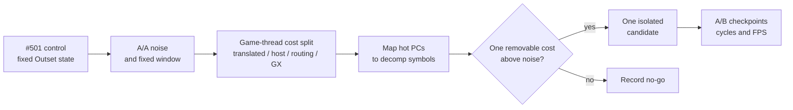

# TECH_PLAN — Outset game-thread follow-up

Status: Planning only  
Source: BlueWake `a7731853c197cc9763a86d62e731d65ca0b25556`; performance baseline [#501](https://github.com/chrissotraidis/bluewake/pull/501) at `2749e6a194dcdba93846ebd925a33c4f95c695ab`  
[PRD](PRD.md) · [Tracker](PROGRESS.md)

## Inspected facts

- The [game-thread architecture](../../architecture/GameThread.md#performance-model) keeps translated execution and host boundary work on one native thread; an idle GPU does not parallelize actor, collision or dispatch work.
- #501 reports Outset at 26.971 FPS, about 129 M game-thread cycles/frame and 99% busy. Its alias resolver is not among Outset's ten largest costs.
- The leading chunk includes collision work, but the partial native `GroundCrossGrpRp` experiment in [#436](https://github.com/chrissotraidis/bluewake/pull/436) covered only 28.1% of calls and made accepted calls slower.
- Native routing currently checks host readiness before entering native math/vector implementations; examples are [`bluewake_native_game_math_try`](../../../cmake/composite/native_game_math.c), [`bluewake_native_math_try`](../../../cmake/composite/native_math.c) and [`bluewake_native_vec_try`](../../../cmake/composite/native_vec.c).
- [`profile_deck.sh`](../../../scripts/linux/profile_deck.sh) identifies per-thread sampled costs. The fixed-state workflow and checkpoint contract are documented in the [performance guide](../../performance/Overview.md#worked-investigation).

## Investigation flow



## Changes

| Status | File / symbol | Practical edit | Milestone | Architecture |
|---|---|---|---|---|
| Existing | `scripts/linux/profile_deck.sh`, `scripts/bench_tour.py` | Reuse fixed-state CPU profiles and checkpoint comparisons | M0 | [Profiling](../../performance/Overview.md#profiling) |
| Proposed | `runtime/host/src/main.c` and native `*_report` exports | Add opt-in counters only where sampling cannot separate attempted, accepted and declined routing cost | M1 | [Host/module boundary](../../architecture/GameThread.md#state-services-and-graphics) |
| Proposed | Generated chunk/decomp mapping report | Resolve sampled PCs inside `func_802456E0`, `func_802ED6E0` and `func_800A56E0`; do not optimize an opaque chunk label | M1 | [Translated dispatch](../../architecture/GameThread.md#translated-dispatch) |
| Proposed | Candidate-selected shared or RecompCore source | Implement exactly one measured reduction; keep fallback behavior unchanged | M2 | Determined by M1 ownership |
| Proposed | Existing focused test plus five-scene Deck run | Prove semantic equivalence and measure the retained candidate | M3 | [Testing](../../architecture/Testing.md) |

## Contracts and example

The existing fallback contract must remain explicit. Instrumentation may count and time each branch, but cannot turn a decline into an acceptance:

```c
/* Existing routing shape; the selected candidate must preserve this result. */
if (!bluewake_native_game_math_try(cpu, entry_address))
    translated_entry(cpu);
```

M1 first separates `try` calls into accepted/declined counts and sampled self-time. If declined checks dominate, M2 may move a proven-invariant routing decision out of the per-call path. If accepted native work dominates, optimize that implementation instead. If translated chunks dominate, map their sampled PCs and work from the original function contract. Do not revive the partial #436 hook without new coverage and cost evidence.

## Verification

| Layer | Input / method | Required evidence | Failure / skip |
|---|---|---|---|
| Baseline | Same #501 AppImage against itself, fixed Outset state | Hashes, settings, warm-up, ≥5 interleaved A/A pairs and spread | Missing state/load/checkpoints makes M0 incomplete |
| Attribution | Rendered Game Mode profile plus headless control | Correct game-thread TID, flat and call-graph reports, cycles/frame, activation counters | Process-wide-only samples are inconclusive |
| Source tests | Existing focused guard/differential tests for the selected surface | Exact fallback and accepted-path results | Compile-only is insufficient |
| Performance | Control/candidate A/B/B/A, ≥5 pairs | Outset gain exceeds 2% and A/A spread; selected cost and cycles/frame fall | Faster FPS without matching checkpoints fails |
| Regression | Full five-scene rendered tour and Outset player tour | Identical checkpoints/images where applicable; no scene beyond noise | Unavailable Deck evidence leaves M3 open |

## Implementation order

| Milestone | Depends | Can run with | Deliverable / integration gate |
|---|---|---|---|
| M0 | — | — | Freeze control: #501 hashes, fixed Outset state, A/A distribution and valid measurement window |
| M1 | M0 | PC mapping and routing counters run in parallel | Attribute costs: ranked, source-mapped costs with attempted/accepted/declined evidence |
| M2 | M1 | Focused test work can accompany implementation | Isolated candidate: one change whose measured mechanism matches M1 |
| M3 | M2 | Source/CI tests and Deck A/B can run independently | Qualify: correctness plus Outset and five-scene decision |

Critical path: M0 → M1 → M2 → M3. Candidate implementation cannot safely begin before M1 because the profile is flat and prior collision work was a no-go. Concurrency is limited to evidence collection and focused tests; competing runtime candidates must remain separate A/B variables.

## Decisions / gaps

- **Stage select and the direct-call fast path.** `main.c` enables the module's inline skip (`direct_calls_v3`) only when `!bluewake_stage_select_live`; with the stage select on, each direct call goes through `host_direct_can_skip_stage_select` (4.5% + `bluewake_stage_select_observes_body` 1.7% of the game thread in Outset). Candidate: keep v3 with the stage select on, by adding its fixed addresses to the fast path's watch table or switching to the host query only while its menu or a warp is active. Measured gain with it off: +10.9% game FPS.

- **Fix Smooth Motion in every comparison.** It changes the game thread's IPC by about 5% in Outset (Game Mode, 2026-10-31), beyond the 2% target. Measure live with [`scripts/gamemode_measure.py`](https://github.com/chrissotraidis/bluewake/pull/522), which also records the game thread's clock: Outset was not power-limited, so clock changes there would point to a measurement problem.

- `scripts/render_bench` used for #501 lives in open [#492](https://github.com/chrissotraidis/bluewake/pull/492), not current `main`; use that exact reviewed harness or document an equivalent command until it merges.
- The private Outset state and translated module are required hardware inputs and cannot enter CI.
- A RecompCore-owned candidate requires a companion RecompCore PR, followed by a BlueWake pin and exported patch under repository policy.

## References

- [#501 live follow-up and measurements](https://github.com/chrissotraidis/bluewake/pull/501)
- [Steam Deck issue #215](https://github.com/chrissotraidis/bluewake/issues/215)
- [Profiling guide](../../PROFILING.md)
- [Performance overview](../../performance/Overview.md)
