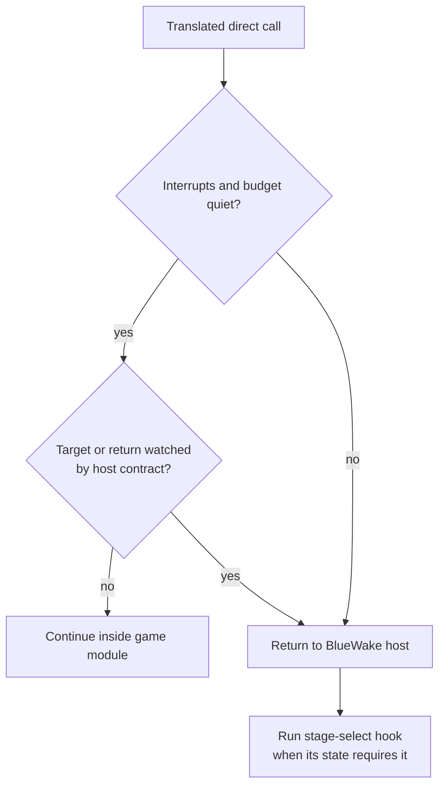

# TECH_PLAN — Stage-select direct-call cost

Status: Planning only  
Source: BlueWake [`0c8a70d`](https://github.com/chrissotraidis/bluewake/commit/0c8a70dde95d3acca12ce98a99232fc0adc7e3ac); measured control recorded by [#503](https://github.com/chrissotraidis/bluewake/pull/503)  
[Product brief](PRD.md) · [Tracker](PROGRESS.md)

## Inspected facts

- The module normally answers the host's address-only direct-call predicate inline through `bluewake_composite_direct_calls_v3`; see [`direct_calls.c`](../../../cmake/composite/direct_calls.c) and the [translated dispatch model](../../architecture/GameThread.md#translated-dispatch).
- [`main.c`](../../../runtime/host/src/main.c) disables that inline answer whenever `bluewake_stage_select_live` is true, then uses `host_direct_can_skip_stage_select` for every direct call.
- [`stage_select.h`](../../../runtime/host/src/stage_select.h) sets the live flag for the menu toggle, a requested warp, or pending file selection and does not clear it after arrival.
- The stage-select observer acts at five fixed guest-code addresses under changing state. The generated edge-watch list already discovers literal host addresses, but that alone is not a safe compatibility contract for a module built before a host hook was added.
- #503 measured 23.6 versus 26.1 FPS in the same Outset state; the two stage-select host functions accounted for 6.2% of sampled game-thread time. These are discovery measurements, not implementation results.

## Runtime contract



The safe optimization is selective: stage selection must not globally disable the inline answer, but every address it can observe must still return to the host. A versioned handshake must fall back to `v2`/`v3` when either side lacks the new contract.

Proposed shape, subject to M0 coverage results:

```c
/* Proposed v4 contract; do not change the v3 struct in place. */
typedef struct BwHostSkipFastV4 {
    u32 simple;
    u32 watched_count;
    u32 watched[BW_HOST_SKIP_WATCH_MAX];
    /* Existing dynamic singles/ranges remain represented. */
} BwHostSkipFastV4;
```

## Changes

| Status | File / symbol | Practical edit | Milestone | Architecture |
|---|---|---|---|---|
| Inspect, then modify | [`stage_select.h`](../../../runtime/host/src/stage_select.h) observer predicates | Enumerate the complete fixed-address contract and distinguish menu/warp lifecycle state | M0–M1 | [Host observations](../../architecture/GameThread.md#translated-dispatch) |
| Modify | [`direct_skip.h`](../../../cmake/composite/direct_skip.h), [`direct_calls.h`](../../../cmake/composite/direct_calls.h), [`direct_calls.c`](../../../cmake/composite/direct_calls.c) | Add a versioned fast contract; preserve conservative fallback for older modules | M1 | [Module boundary](../../architecture/GameModule.md#translated-code-dispatch) |
| Modify | [`main.c`](../../../runtime/host/src/main.c) direct-call setup | Supply stage-select watches and allow the inline answer when the new contract is available | M1 | [Host lifecycle](../../architecture/Host.md#main-loop-execution) |
| Modify | [`direct_calls_test.c`](../../../tests/direct_calls_test.c), [`test_direct_calls.py`](../../../tests/test_direct_calls.py) | Cover watched stage addresses, mirrors, fallback, verification disagreement and runtime state changes | M2 | [Compiled tests](../../architecture/Testing.md#compiled-component-tests) |
| Modify after #522 lands | [`PROFILING.md`](../../../docs/PROFILING.md) and measurement guidance | Record stage-select/warp state and distinguish absolute warp numbers from normal play | M2 | [Hardware validation](../../architecture/Testing.md#private-and-hardware-validation) |

## Verification

| Layer | Input / command | Required evidence | Failure / skip |
|---|---|---|---|
| Source contract | `python3 tests/test_direct_calls.py` | Every observed stage address is represented; generated transformations retain hooks | Missing address fails |
| Component | CTest `bluewake_direct_calls_test` | v4 inline answer, watched decline, mirror handling, old-module fallback, zero unsafe verification mismatches | Any mismatch fails |
| Stage-select function | File-select R, F7 open/return, one named warp and `BLUEWAKE_WARP_FILE` | Correct room, music, return and save refusal | Any behavioral difference fails |
| Game Mode performance | Same build/state, ≥5 interleaved windows per mode after warm-up | On/off FPS gap within A/A spread; target functions leave unrelated hot path | Missing path activation is inconclusive |
| Rendered warp tour | Existing fixed scenes, same settings and build | All scenes load; pictures and checkpoints match; absolute FPS recorded | Missing scene/checkpoint fails |

Private states, logs and `perf.data` stay outside the repository; publish hashes, settings, commands and aggregate results only.

## Implementation order

| Milestone | Depends | Can run with | Deliverable / integration gate |
|---|---|---|---|
| M0 | — | — | Freeze the address/lifecycle contract, current verification run, A/A baseline and versioned representation |
| M1 | M0 | M2 | Implement the host/module v4 handshake with conservative fallback |
| M2 | M0 | M1 | Add public contract coverage and benchmark-state documentation; owns tests/docs, not production files |
| M3 | M1, M2 | — | Integrate and qualify with CI, stage-select function, Game Mode A/B and rendered warp evidence |

Critical path: M0 → M1 → M3. M2 can proceed beside M1 after the address contract is frozen.  
Concurrency limits: M0 owns the shared ABI decision; M1 alone edits the host/module handshake. Hardware runs serialize on one Deck and one fixed state.

## Decisions / gaps

- Prefer a new versioned export over changing `BwHostSkipFast` in place; silent host/module layout disagreement is unacceptable.
- Clearing `bluewake_stage_select_live` after a warp can reduce benchmark cost but cannot serve the always-available F7 menu by itself.
- #522 is still open. If its measurement tool is unavailable, M3 remains incomplete rather than substituting an undocumented command.

## References

- [#503](https://github.com/chrissotraidis/bluewake/pull/503) — discovery measurements and Outset CPU investigation.
- [#522](https://github.com/chrissotraidis/bluewake/pull/522) — proposed repeatable Game Mode measurement tooling.
- [`GameThread.md`](../../architecture/GameThread.md#performance-model) — game-thread performance model.

