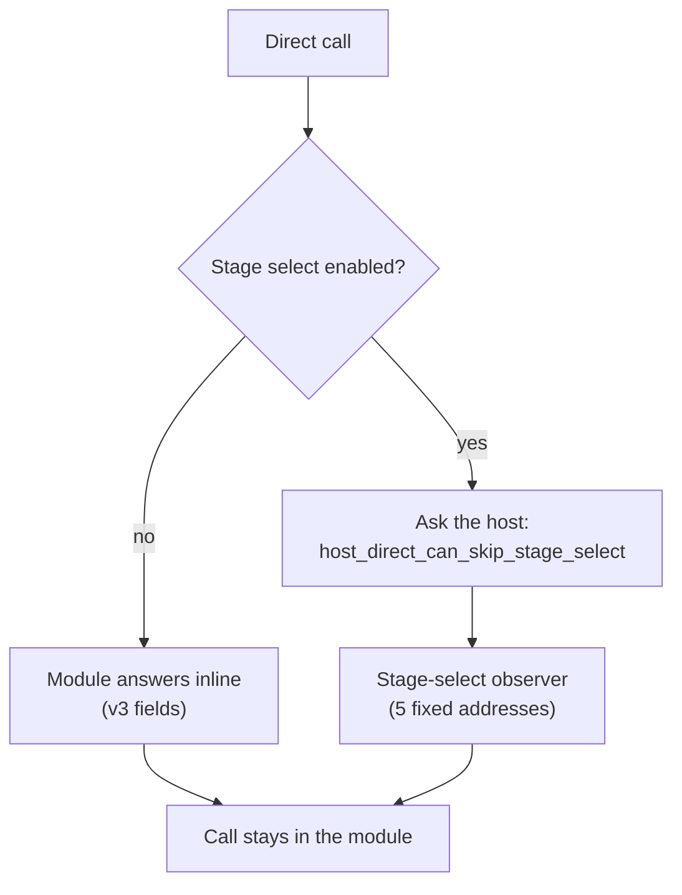
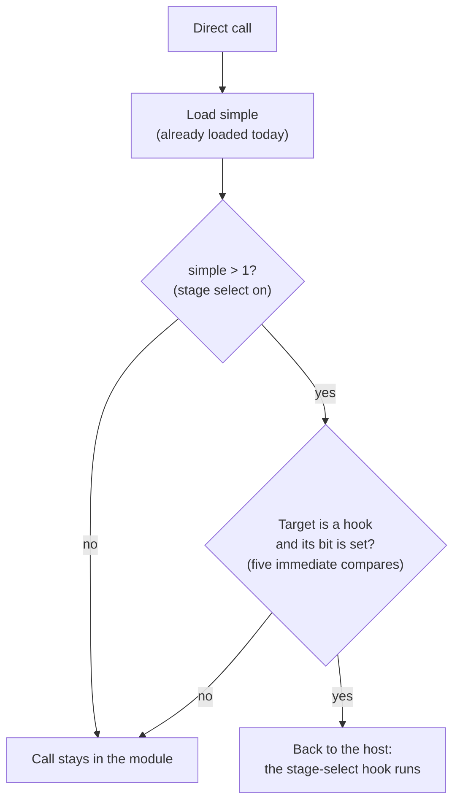

# TECH_PLAN — Stage-select direct-call cost

Status: Done (2026-11-05). This PR ships iteration 4; iteration 5 and the remaining checks are in the follow-up draft PR
Source base: BlueWake [`ee991d3`](https://github.com/chrissotraidis/bluewake/commit/ee991d312d97e1c3e23168e00f1c67443465623e)
[Product brief](PRD.md) · [Tracker](PROGRESS.md)

## How a direct call is checked

Before one translated function calls another directly, [`bw_direct_call_ready`](../../../cmake/composite/direct_calls.h) decides whether the call may stay inside the game module or must go back to the host, which has hooks at some guest addresses. The host publishes what it watches in [`BwHostSkipFast`](../../../cmake/composite/direct_skip.h): two single addresses, two ranges, and `simple`, which says whether the module may answer by itself.

### Before: the stage select switched the inline answer off



Every direct call paid a round trip into the host: about 10 % of the Deck's speed.

### After: the module knows the five hooks



```c
/* direct_skip.h: v4 is v3 plus meaning in simple's bits */
#define BW_SKIP_KNOWN_CHANGE       0x80029E6Cu /* bit 1 */
#define BW_SKIP_KNOWN_DATA_SELECT  0x80181634u /* bit 2 */
#define BW_SKIP_KNOWN_EXECUTE      0x8022ED50u /* bit 3 */
#define BW_SKIP_KNOWN_PLAY_EXECUTE 0x80234FD0u /* bit 4 */
#define BW_SKIP_KNOWN_MENU_DELETE  0x8022F320u /* bit 5 */

/* main.c, host_skip_fast_refresh */
g_skip_fast.base.simple = simple ? 1u | (bluewake_stage_select_live ? BW_SKIP_KNOWN_ALL : 0u) : 0u;
```

| Case | What a direct call does |
|---|---|
| Stage select off | One compare on `simple`, already in a register |
| Stage select on | Five immediate compares, then the hook's bit (the follow-up tries a one-bit filter first) |
| Module without v4 | Never gets the bits: the host keeps the query while the stage select is live |
| A watch the module doesn't know | The host sets `simple = 0`; every call asks the host (exact) |

## What we found, step by step

All on the Steam Deck: `render_bench`, 5 save states, 6 interleaved launches per build after a warm-up, CPU profile. Guest checkpoints were identical in every run.

### 1. The first fix worked, but left most of the cost

`f6bbf27a6` added the v4 contract: the five hook addresses as a list the module walks.

| Same build, stage select on vs off | Cost |
|---|---:|
| Control | −10.0 % |
| `f6bbf27a6` | −6.4 % |

Instructions per game frame at Outset: the stage select still added 20.5 M (241.7 M vs 221.2 M).

### 2. The remaining cost was in the module, not the host

The host's share of the game thread was the same on and off (7.14 % vs 7.12 %); the module's wasn't (58.0 % vs 56.5 %). The edge-service change aimed at the host (`cde980cc3`) gained +0.3 % with overlapping launches: reverted, as was `8f7442ade` (v3 when off), which had no effect.

### 3. The check isn't inlined, so every instruction counts

`bw_direct_call_ready` shows in the profile as its own symbol: nothing about a target folds at build time. Making the hooks constants (`f9d926907`) gained **+3.1 %** with the stage select on, every launch ahead, but cost more with it off, because every call now loaded the v4 pointer and mask. Moving the hook bits into `simple` (`c48e83f0e`), which every call already loads, kept the gain and removed that extra cost.

| Iteration | Stage select on, against the previous | Every launch ahead? |
|---|---:|---|
| `f9d926907` against `f6bbf27a6` | **+3.2 %** (+2.9 to +3.6) | Yes |
| `c48e83f0e` against `f9d926907` | 0.0 % | — (kept for the off case) |

### 4. The "loss with the stage select off" was the optimization profile

| All with stage select off, against the control | Change |
|---|---:|
| Control's own source, built with this PR's profile | −1.7 % |
| This PR, same profile | −1.3 % |
| This PR against the control's code, same profile | **+0.4 %** (within noise) |

Each build records its own profile in training, and two trainings differ by about 1.75 %. Comparisons between builds must use the same profile; comparing a build with itself (on vs off) is unaffected.

## Changes

| File / symbol | Change |
|---|---|
| [`direct_skip.h`](../../../cmake/composite/direct_skip.h) | `BW_SKIP_KNOWN_*` hooks and their bits in `simple` |
| [`direct_calls.h`](../../../cmake/composite/direct_calls.h) `bw_direct_call_ready` | Reads `simple` once; hook test only when `simple > 1` |
| [`direct_calls.c`](../../../cmake/composite/direct_calls.c) | `bluewake_composite_direct_calls_v4` export |
| [`main.c`](../../../runtime/host/src/main.c) | Sets the bits while the stage select is live; static assertion that its addresses match; v4 when available, v3 otherwise |
| [`direct_calls_test.c`](../../../tests/direct_calls_test.c) | Each bit, mirrors, run-time targets, `simple` = 0 and 1, v3 fallback, at -O0 and -O2 |
| [`test_direct_calls.py`](../../../tests/test_direct_calls.py) | The stage select's observed set equals the module's known set |

## Verification

| Layer | Evidence | Status |
|---|---|---|
| Unit | `direct_calls_test` at -O0 and -O2 | Pass |
| Source contract | `python3 tests/test_direct_calls.py` | Pass |
| Deck speed | 4-way `render_bench` per iteration | Done through iteration 4 (shipped) |
| Guest state | Checkpoints in every run | Identical |
| Stage-select behaviour | Rendered warp tour, menu open and return | In the follow-up |
| CI | Linux and Windows host jobs, audit | On the latest head |

## References

- [#503](https://github.com/chrissotraidis/bluewake/pull/503): discovery.
- [#522](https://github.com/chrissotraidis/bluewake/pull/522): measurement tooling.
- [`GameThread.md`](../../architecture/GameThread.md#translated-dispatch): translated dispatch.
