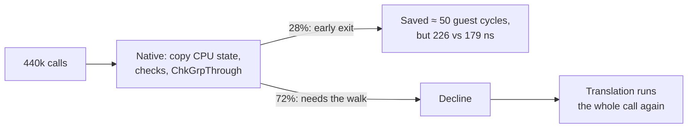
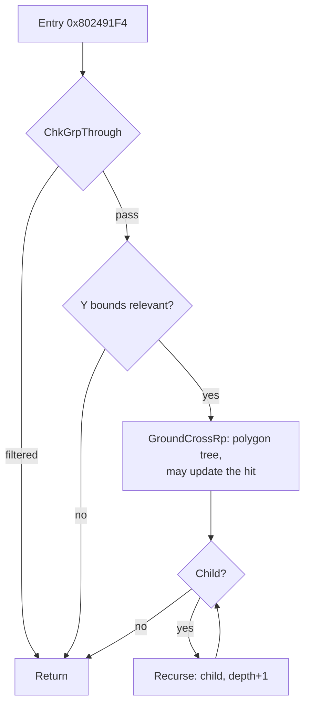

# TECH_PLAN — Ground collision walk, revisited

Status: Planned; M0 next  
[PRD](PRD.md) · [Tracker](PROGRESS.md) · #436's [contract map](https://github.com/irregularthanis/bluewake/blob/docs/groundcross-native-plan/docs/planning/2026-10-21-groundcross_native_reimplementation/GROUND_CROSS_CONTRACT.md)

## What exists

- **#436 (closed, branch `docs/groundcross-native-plan`):**
  - the native early exits for `GroundCrossGrpRp`, in `native_bg.c`;
  - the contract map of the function;
  - a differential test `tests/native_bg_test.c`, which already has a `BENCH_CALLS` argument but loads only Windows DLLs.
- **On the #503 stack:** `native_bg.c` with the leaf natives `ChkSameActorPid` and `ChkGrpThrough`.
- **#541:** the hand-over pattern (return codes that make the chunk hook `goto` a label inside the function), and a `--bench` mode in `native_skin_test.c`. That bench showed a trap: build with the module's `-march`, or the native's `fma` is a slow library call.

## Why #436 lost, in one picture

The native's cost landed on every call. The savings came only on the cheapest 28%.

## The walk, and where a native can hand over

The cost is in `GroundCrossRp` and the recursion. A native can cover them in two ways:
- **Option A, walk only:** the filter, the bounds and the child loop run natively. The native hands over at each `GroundCrossRp` call, where the translation runs the call and returns into the native's loop. This needs re-entry after the call, which is harder.
- **Option B, the whole group:** the native also runs `GroundCrossRp`. When something is not covered, it hands over at the start of the current group (as #541 hands over at the loop head), and the translation finishes the walk.

M0 measures which part holds the cycles before either is chosen.

## M0: the local test (no native code in the game)

### M0-T01: port the bench to Linux

`tests/native_bg_test.c` gets the same module loader as `native_skin_test.c`: `dlopen` on POSIX, `LoadLibrary` on Windows, and `bw_module_select_storage`. It also gets a CMake target like `bluewake_native_skin_test`, built with the module's `-march`.

### M0-T02: census of the walk on Outset

A diagnostic build (compile-time define, like `BLUEWAKE_SKIN_CENSUS`), one Game Mode minute in Outset, records per top-level call:
- groups visited, filtered and rejected by bounds;
- `GroundCrossRp` calls, and the polygon nodes those calls visit;
- recursion depth;
- guest cycles of the whole call, binned by size.

This gives the ceiling (cycles per frame in the walk) and the typical tree shapes for the bench.

### M0-T03: speed test, translated against a prototype

`native_bg_test MODULE --bench` builds synthetic collision groups shaped like the census's typical calls: group table, bounds, polygon trees and the check object. It then times three things on the same module and memory:

| Row | What runs | Why |
|---|---|---|
| Translated | the module's `GroundCrossGrpRp` from its entry | the baseline |
| Prototype | a native walk (bounds, children, `GroundCrossRp`), not yet exact, compared only for the result | the best case; if this is not clearly faster, stop |
| Declined | the native's checks, then a decline, then the translation | the cost added to calls the native refuses, which #436 never timed |

The test repeats each case without resetting memory, as the skinning bench does: the function's only writes are to the check object's hit fields, which the bench restores. Each row is the best of 7 rounds.

**Go/no-go:** go on only if the prototype is ≥ 1.2× faster on the census's typical shapes **and** the declined row is within 2% of the translation. Otherwise record the no-go on #436's line and close this plan.

## Changes (planned)

| File | Change | Milestone |
|---|---|---|
| `tests/native_bg_test.c` | POSIX loader; `--bench` with the three rows; synthetic trees | M0 |
| `runtime/host/CMakeLists.txt` | `bluewake_native_bg_test` target (explicit, never run in public CI), module `-march` | M0 |
| `cmake/composite/native_bg.c` | `BLUEWAKE_BG_CENSUS` counters (diagnostic builds only) | M0 |
| `cmake/composite/native_bg.c`, the hook generator | The exact native walk with a hand-over (M0's chosen option) | M1, only on a go |

## Verification

| Layer | Evidence |
|---|---|
| M0 | Census on the Deck; bench on the workstation, three runs, matched `-march` |
| M1 | Differential test: native plus the translation from each hand-over against the translation alone, every CPU byte and all of MEM1, including short turns |
| M2 | Trained full build; ≥ 6 interleaved Game Mode launches against the control; render_bench checkpoints |

## Implementation order

| Milestone | Depends | Deliverable |
|---|---|---|
| M0 | — | Census + local speed test; go/no-go |
| M1 | M0 go | Exact native walk with hand-over; differential test |
| M2 | M1 | Deck A/B and checkpoints; retain or record no-go |

## Gaps

- The bench's synthetic trees must match the shapes Outset uses; M0-T02 sets them.
- `GroundCrossRp` may stop at an execution boundary (contract map), so a hand-over point inside it may be needed.
- The workstation is not the Deck: the bench screens a native out, and the Deck A/B decides.
