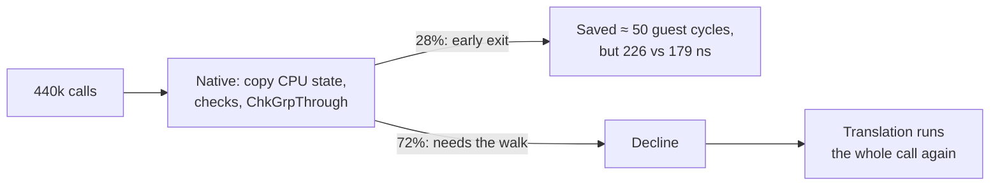
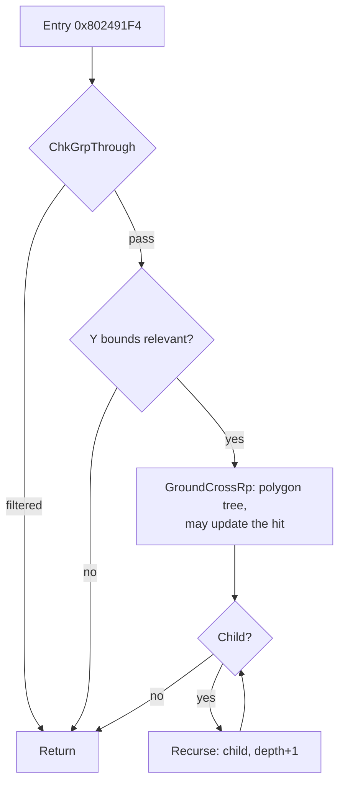

# TECH_PLAN — Ground collision walk, revisited

Status: M0 done (go); M1 designed: an exact, opt-in native walk  
[PRD](PRD.md) · [Tracker](PROGRESS.md) · #436's [contract map](https://github.com/irregularthanis/bluewake/blob/docs/groundcross-native-plan/docs/planning/2026-10-21-groundcross_native_reimplementation/GROUND_CROSS_CONTRACT.md)

## What exists

- **#436 (closed, branch `docs/groundcross-native-plan`):**
  - the native early exits for `GroundCrossGrpRp`, in `native_bg.c`;
  - the contract map of the function;
  - a differential test `tests/native_bg_test.c`, which already has a `BENCH_CALLS` argument but loads only Windows DLLs.
- **On the #503 stack:** `native_bg.c` with the leaf natives `ChkSameActorPid` and `ChkGrpThrough`.
- **#541:** the hand-over pattern (return codes that make the chunk hook `goto` a label inside the function), and a `--bench` mode in `native_skin_test.c`. That bench showed a trap: build with the module's `-march`, or the native's `fma` is a slow library call.

## Why #436 lost, in one picture

The native's cost landed on every call. The savings came only on the cheapest 28%.

## The walk, and where a native can hand over

The cost is in `GroundCrossRp` and the recursion. A native can cover them in two ways:
- **Option A, walk only:** the filter, the bounds and the child loop run natively. The native hands over at each `GroundCrossRp` call, where the translation runs the call and returns into the native's loop. This needs re-entry after the call, which is harder.
- **Option B, the whole group:** the native also runs `GroundCrossRp`. When something is not covered, it hands over at the start of the current group (as #541 hands over at the loop head), and the translation finishes the walk.

M0 measures which part holds the cycles before either is chosen.

## M0: the local test (no native code in the game)

### M0-T01: port the bench to Linux

`tests/native_bg_test.c` gets the same module loader as `native_skin_test.c`: `dlopen` on POSIX, `LoadLibrary` on Windows, and `bw_module_select_storage`. It also gets a CMake target like `bluewake_native_skin_test`, built with the module's `-march`.

### M0-T02: census of the walk on Outset

A diagnostic build (compile-time define, like `BLUEWAKE_SKIN_CENSUS`), one Game Mode minute in Outset, records per top-level call:
- groups visited, filtered and rejected by bounds;
- `GroundCrossRp` calls, and the polygon nodes those calls visit;
- recursion depth;
- guest cycles of the whole call, binned by size.

This gives the ceiling (cycles per frame in the walk) and the typical tree shapes for the bench.

### M0-T03: speed test, translated against a prototype

`native_bg_test MODULE --bench` builds synthetic collision groups shaped like the census's typical calls: group table, bounds, polygon trees and the check object. It then times three things on the same module and memory:

| Row | What runs | Why |
|---|---|---|
| Translated | the module's `GroundCrossGrpRp` from its entry | the baseline |
| Prototype | a native walk (bounds, children, `GroundCrossRp`), not yet exact, compared only for the result | the best case; if this is not clearly faster, stop |
| Declined | the native's checks, then a decline, then the translation | the cost added to calls the native refuses, which #436 never timed |

The test repeats each case without resetting memory, as the skinning bench does: the function's only writes are to the check object's hit fields, which the bench restores. Each row is the best of 7 rounds.

**Go/no-go:** go on only if the prototype is ≥ 1.2× faster on the census's typical shapes **and** the declined row is within 2% of the translation. Otherwise record the no-go on #436's line and close this plan.

## M0 result

| Measurement | Result |
|---|---|
| Census (Deck, Outset) | ≈ 72 ground checks per frame; ≈ 87 group visits and ≈ 10 polygon-tree tests per check; three levels deep |
| Local bench (synthetic census-shaped check, 90 visits) | Translated 70 ns per visit; prototype native 8.6 ns: **8.1×**. A decline with a separate check pass: +3.1% |
| Expected in play | ≈ 6,300 visits × 70 ns ≈ 0.44 ms of a 37 ms frame: **≈ +1%** |

**Go to M1**, with the native opt-in until qualified.

## M1 design: an exact, opt-in native walk

### Where it runs and how it is switched

- **Hook:** at the entry label of `GroundCrossGrpRp` (0x802491F4). It is inserted by a dedicated certify-and-hook script, `scripts/windows/ground_walk.py`, modelled on `native_skin.py`. The script certifies the translated body (0x802491F4–0x80249368) by hash in every chunk variant, and inserts nothing if any variant differs. It does not go through `--native-entries`, which does not build on this tree (#541).
- **Opt-in:** off unless `BLUEWAKE_NATIVE_GROUND_WALK=1`. The module exports a `bluewake_composite_ground_walk_v1(enabled, ready, user)` switch like the skinning native's. The host passes `enabled` only when the variable is exactly `1`, not with the "on unless set to 0" default the other natives use. With it off, the hook costs one predictable branch.
- **Builds:** compiled into normal builds behind the switch, so testers can turn it on without a special build. No change to anyone's default.

### What one native call covers

One call of `GroundCrossGrpRp`: a group and its whole subtree. The census puts the largest subtree at about 17 visits (≈ 1,750 guest cycles), so most calls fit a turn.

| Path in the subtree | v1 |
|---|---|
| Filter (`ChkGrpThrough`, the certified virtual target) | native, through the existing leaf native's logic |
| Bounds rejects | native |
| Child loop and recursion | native |
| A group with a polygon tree (`GroundCrossRp`) | **hand over** to the translation (below) |

### The hand-over at a polygon tree

`GroundCrossRp` can change the ground check's hit and can stop at the end of a turn, so the native does not call it. When the walk reaches a group with a tree, the native stops there and leaves exactly the state the translation has at its call:
- **Registers:** `pc` = 0x80248C38, LR = 0x802492EC, r3/r4/r5 the call's arguments, r27–r31 as the translation holds them at that point.
- **Memory:** one stack frame per open recursion level, with the saved LR and saved r27–r31 the translation would have written, so the translated code returns through those levels by itself.
- **Cycles:** the charges of every block before the call, with the same cycle suffix.

The translation then finishes the call, tree test and remaining walk included. This is #541's hand-over, applied at a call instead of a loop head. Subtrees with no polygon tree, which a first M1 census will count, run natively to the return.

### Exactness

- **Cycles:** each translated block's charge is taken from the generated chunk, as #541 did for skinning, including the inline `_savegpr`/`_restgpr` of the #503 stack and the leaf's own block charges. The native checks the turn's budget and deadline at every block entry the translation checks, and hands over (or declines, at the entry) where the translation would stop.
- **Checks as it walks:** every read is checked as plain stable RAM when it is made. Results stay in locals until the native commits, and the first failed check ends the call:
  - before any work, it declines and changes nothing;
  - after some work, it hands over at the last block boundary it reached, as at a polygon tree.
  This keeps a decline's cost to the part already walked (the M0 bench's separate check pass cost +3.1%).
- **Bounded depth:** the walk stops (declines) past a fixed depth and visit count, so a malformed or cyclic table cannot run away.
- **Tests:** `native_bg_test` gains the walk:
  - random trees, polygon trees at random groups, short turns and deadlines inside the walk;
  - every CPU byte and all of MEM1 compared with the translation alone, through the hook's wrapper as the game calls it (the #541 lesson);
  - the guard test covers the opt-in default and declines in CI.

## Changes (planned)

| File | Change | Milestone |
|---|---|---|
| `tests/native_bg_test.c` | POSIX loader; `--bench` with the three rows; synthetic trees | M0 |
| `runtime/host/CMakeLists.txt` | `bluewake_native_bg_test` target (explicit, never run in public CI), module `-march` | M0 |
| `cmake/composite/native_bg.c` | `BLUEWAKE_BG_CENSUS` counters (diagnostic builds only) | M0 |
| `cmake/composite/native_bg.c`, the hook generator | The exact native walk with a hand-over (M0's chosen option) | M1, only on a go |

## Verification

| Layer | Evidence |
|---|---|
| M0 | Census on the Deck; bench on the workstation, three runs, matched `-march` |
| M1 | Differential test: native plus the translation from each hand-over against the translation alone, every CPU byte and all of MEM1, including short turns |
| M2 | Trained full build; ≥ 6 interleaved Game Mode launches against the control; render_bench checkpoints |

## Implementation order

| Milestone | Depends | Deliverable |
|---|---|---|
| M0 | — | Census + local speed test; go/no-go |
| M1 | M0 go | Exact native walk with hand-over; differential test |
| M2 | M1 | Deck A/B and checkpoints; retain or record no-go |

## Gaps

- The bench's synthetic trees must match the shapes Outset uses; M0-T02 sets them.
- `GroundCrossRp` may stop at an execution boundary (contract map), so a hand-over point inside it may be needed.
- The workstation is not the Deck: the bench screens a native out, and the Deck A/B decides.
