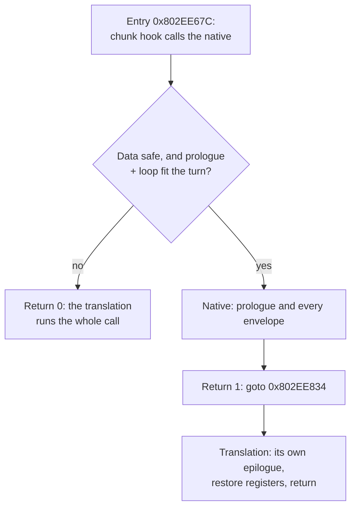

# TECH_PLAN — Native extensions for Outset's character work

Status: Done. M0: the turn budget refuses big models. M2: partial runs built, exact, no measurable gain, dropped; the epilogue hand-over kept for exactness. M1 blocked on porting  
Source: BlueWake `main` at `ee991d312`  
[PRD](PRD.md) · [Tracker](PROGRESS.md)

## What exists

| Native | Source | Switch | Covers |
|---|---|---|---|
| Skinning | [`native_skin.c`](../../../cmake/composite/native_skin.c), `scripts/windows/native_skin.py` | `--native-skin` (on in the Deck builds) | `J3DModel::calcWeightEnvelopeMtx` (0x802EE67C–0x802EE874) |
| Joint matrices | [`native_mtxcalc.c`](../../../cmake/composite/native_mtxcalc.c) | `--native-entries` (off; **does not build**: its generator predates the lean-memory write forms) | `J3DMtxCalcBasic/Softimage/Maya::calcTransform` |
| Rotations, leaves | `native_rot.c`, `native_calc.c`, `native_libm.c`, `native_geom.c`, … | `--native-entries` (off) | `JMAEulerToQuat`, `cM_atan2s`, … |
| Key frames | [`native_anim.c`](../../../cmake/composite/native_anim.c) | `--native-set4` (off; **no hooks**: linked but never called until its entry hashes are recorded for this tree) | `J3DGetKeyFrameInterpolation(S)`, `J3DAnmTransformKey::calcTransform` |

## Why skinning declines: the budget and deadline checks

`bluewake_native_skin` declines, changing nothing, unless the result is certain. Most conditions are about data: plain RAM, finite floats, no overlapping stores. Two are about time:

```c
/* The translation stops at no block (the turn's budget) and prepays every
 * block with no refund (the deadline, further than any block's suffix). */
if (cpu->downcount - (s64)cycles <= -cpu->cycle_budget) goto decline;
if (cpu->cycle_deadline_budget > 0 &&
    (cpu->cycle_deadline_budget < 60 || cpu->cycle_deadline_budget + cpu->downcount < (s64)cycles))
    goto decline;
```

`cycles` = 58 + Σ(23 + 60 × joints per envelope). #530's deadline census showed turns ending at the DSP step 92% of the time, averaging about 8,600 cycles. A model with, say, 40 envelopes and 80 joints needs about 5,800 cycles, which only fits early in a turn. Bigger models almost never fit, so the native covers small models and the translation keeps the expensive ones.

## Approach

| Milestone | Question | Method | Outcome |
|---|---|---|---|
| M0 | Why does skinning decline? | Count declines by reason and model size; one Outset minute in Game Mode | **Done.** All timing declines are the turn budget; calls of 8k+ cycles refused 91–100% |
| M1 | Do the two native sets help? | Full builds with `--native-entries` / `--native-set4`, own training, A/B | **Blocked.** Both need porting first (generator write forms; entry hashes for this tree) |
| M2 | Can big models run natively? | Native runs the envelopes that fit the turn, then hands over to the translation | **Built, exact, dropped:** no measurable gain. The epilogue hand-over is kept for exactness ([what was kept](#what-m2-kept-and-what-it-dropped)) |
| M3 | Is it faster on the Deck? | Game Mode A/B (≥ 6 rounds), checkpoints | **No.** Partial runs +0.05% (3 of 6 rounds), render_bench +0.55%; the hand-over alone level. Checkpoints identical. Earlier gains came from a wrapper bug that skipped work |

## What M2 kept and what it dropped

`calcWeightEnvelopeMtx` has a prologue, a loop over the model's envelopes (each with an inner loop over its joints) and an epilogue.

| | M0 (before) | M2 as built | **Kept (`b9549c9`)** |
|---|---|---|---|
| Prologue | native | native | native |
| Loop | all of it, or decline | all of it, **or the first envelopes that fit the turn (partial runs)** | all of it, or decline |
| Epilogue | native (its own copy) | translation | **translation** |



**Why the epilogue hand-over is kept.** M0 replayed the epilogue and left the cycle suffix at 2, the plain translation's value. On the #503 stack the inline `_restgpr` leaves 0, and when the inline path cannot be taken it falls back to the real routine, which leaves something else again. So no fixed value in the native is right for every build and path, and the M0 native fails the differential test against the #503 module on its first case. Letting the translation run its own epilogue is exact for all of them. No effect of the old mismatch was seen in play: the control's checkpoints matched the hand-over's.

**Why partial runs were dropped.** They let big models, which never fit a turn, run their first envelopes natively, and hand over at the loop head (0x802EE6F0). After a wrapper bug was fixed (below) they were exact in every test, in 220 cases captured on the Deck and in render_bench's checkpoints, but measured **+0.05%** in Game Mode and **+0.55%** in render_bench: noise. The extra joints save only the native-vs-translation difference, about 0.1–0.3% of an Outset frame by the local bench. They were the riskiest code for no measurable return.

**The wrapper bug, and the test lesson.** The hook calls `bluewake_native_skin_try`, which returned `ready && native(cpu)`. That turned the partial code 2 into 1, so the hook jumped to the epilogue with envelopes left. In play, every partial run skipped the rest of the model's matrices. Checkpoints diverged in the first frame after load, and the skipped work showed up as a false +0.8–1.2%. The tests called the native directly and never saw it. The wrapper now passes the native's result through, and the differential test and replay call the native through it, as the hook does.

**Threading, considered and not pursued.** The native's checks (no store overlaps a load, plain RAM, safe floats) would allow envelopes to be split across host threads exactly. With skinning now about 1.5% of the game thread, the ceiling is about +0.5–1% on Outset, against a 13% gap to 30 FPS, and the shared CPU/GPU power budget may take part of it back.

### Tools kept

- `native_skin_test MODULE [CASES]`: the differential test, through the hook's wrapper; short turns, deadlines inside the call.
- `native_skin_test MODULE --bench`: host time, translated against native, at the module's `-march`.
- `native_skin_test MODULE --replay DIR` / `--replay-module DIR`: cases captured in play (`BLUEWAKE_SKIN_DUMP` diagnostic define), through the test's copy of the native or the module's own hook.
- `BLUEWAKE_SKIN_CENSUS`: declines by reason and model size.

### Is the native faster than the translation?

#436 replaced a collision function with a native that turned out slower. To check this one locally, `native_skin_test MODULE --bench` times the translated function against the native plus the translation's epilogue. It uses the same game module, the same synthetic models and the same memory. Results must be built with the module's `-march` (`x86-64-v3`): a baseline build calls a software `fma` and understates the native.

| Envelopes | Joints | Guest cycles | Translated | Native + epilogue | Speedup |
|---:|---:|---:|---:|---:|---:|
| 4 | 8 | 630 | 3.9 µs | 2.9 µs | 1.33–1.40× |
| 12 | 36 | 2,494 | 7.8 µs | 5.8 µs | 1.36× |
| 24 | 96 | 6,370 | 20.3 µs | 15.1 µs | 1.34–1.37× |
| 60 | 180 | 12,238 | 39.6 µs | 28.4 µs | 1.40–1.41× |
| 120 | 360 | 24,418 | 80.4 µs | 56.3 µs | 1.42–1.43× |
| 200 | 800 | 52,658 | 177.9 µs | 125.7 µs | 1.41–1.42× |

Three runs on the workstation, control module `a64af0e` (trained). The gain grows slightly with size, so the big models M2 adds are the best case. Most of the native's time is its exact single-rounding arithmetic (`skin_madds`), which it shares in kind with the translation. The Deck's Zen 2 cores may scale differently, so the Game Mode A/B still decides.

### Other hardware: the hardware-FMA caveat

The native is portable C and exact on every platform. Its speed depends on one operation: the fused multiply-add (`fma`) behind its exact single rounding.

| Module built for | `fma` | Native vs translation | Default |
|---|---|---|---|
| `x86-64-v3` (the Linux and Windows builders' default; Steam Deck; PCs from about 2013–2015 on) | one instruction | 1.33–1.43× faster (measured) | on |
| ARM64 (Android, Apple Silicon) | one instruction | expected faster, not measured | on |
| x86 below `v3` (e.g. a Pentium N5030 without FMA) | a slow library call | 0.84–1.01× (the bench built for baseline x86-64) | **off** |

The native's checks decline for exactness and for the turn's budget, never for speed, so the build decides instead. `native_skin.h` sets `BLUEWAKE_NATIVE_SKIN_HARDWARE_FMA` from `__FMA__`, `__aarch64__` or `__ARM_FEATURE_FMA`. Without hardware FMA, the module keeps the native off and prints why, and the translated path runs, unless `BLUEWAKE_NATIVE_SKIN=1` is set explicitly. On every build, `BLUEWAKE_NATIVE_SKIN=0` turns it off.

## Changes (as landed)

| File | Change | Why |
|---|---|---|
| [`cmake/composite/native_skin.c`](../../../cmake/composite/native_skin.c) | `BLUEWAKE_SKIN_CENSUS`: declines by reason and cycle bins, in the exit report | M0: which model sizes the timing checks refuse |
| `cmake/composite/native_skin.c` | The native runs the prologue and the loop, then hands over at the epilogue; empty models too; the wrapper passes the result through; off without hardware FMA unless `BLUEWAKE_NATIVE_SKIN=1`; `BLUEWAKE_SKIN_DUMP` capture (diagnostic) | M2: exact for every build's epilogue |
| `cmake/composite/native_skin.h` | Result codes documented; `BLUEWAKE_NATIVE_SKIN_HARDWARE_FMA` | M2 |
| `scripts/windows/native_skin.py` | Hook: `switch` on the result, `case 1: goto label_802EE834`; the label required in the certified body | M2 |
| `tests/native_skin_test.c` | Through the wrapper; short turns and deadlines; `--bench`; `--replay` / `--replay-module` | M2 exactness, speed, cases from play |
| `tests/native_skin_source_test.py`, `tests/test_windows_prepared_cache.py` | Fixtures carry the epilogue label; a missing label is rejected | M2 |

## Verification

| Layer | Required evidence |
|---|---|
| M0 counts | Decline reasons sum to all declines; two runs agree |
| Switches | Native tests pass; Game Mode ≥ 6 interleaved launches; checkpoints identical |
| Resumable native | Differential test: every register and byte equal to the translation for every stop point; Game Mode A/B; checkpoints identical |

## Implementation order

| Milestone | Depends | Deliverable |
|---|---|---|
| M0 | — | Skinning decline reasons and sizes in Outset |
| M1 | — (can run beside M0) | `--native-entries` / `--native-set4` measured; retain or record |
| M2 | M0 (timing confirmed) | Resumable skinning native with tests |
| M3 | M2 | Qualified on the Deck; retain or record no-go |

## Gaps

- The resumable stop must match the translation's block boundaries in the envelope loop exactly; the translated loop is generated code (private), so the stop points are derived from it, as `native_skin.py` already certifies the body.
- `--native-entries` and `--native-set4` need `--direct-calls`, `--gather-pipe` and `--native-vec`, all on in the Deck builds.

## References

- [#503](https://github.com/chrissotraidis/bluewake/pull/503): Outset profile, game functions, the `native-skin` counts
- [#530](https://github.com/chrissotraidis/bluewake/pull/530): turn ends at the DSP step; turn length
- [#436](https://github.com/chrissotraidis/bluewake/pull/436): a native that was slower than the translation (fixed checks on small calls)
- [#361](https://github.com/chrissotraidis/bluewake/pull/361), [#366](https://github.com/chrissotraidis/bluewake/pull/366), [#381](https://github.com/chrissotraidis/bluewake/pull/381): the native sets behind their switches
- [Native routines architecture](../../architecture/NativeRoutines.md)
