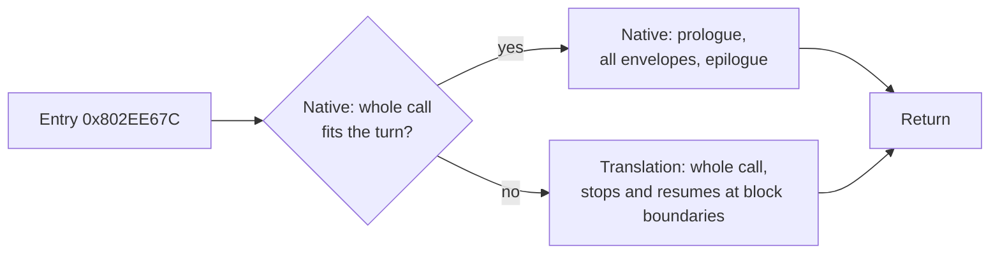
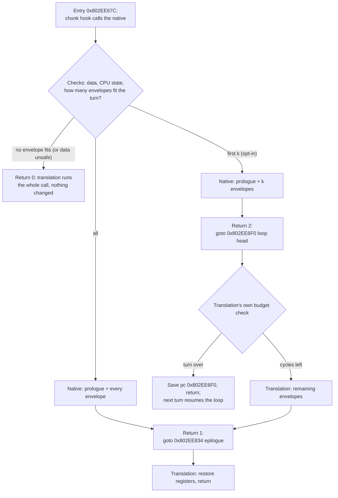

# TECH_PLAN — Native extensions for Outset's character work

Status: M2 exact; with the wrapper fix, partial runs show no measurable gain on the Deck (+0.05%); decision after render_bench; M1 blocked on porting  
Source: BlueWake `main` at `ee991d312`  
[PRD](PRD.md) · [Tracker](PROGRESS.md)

## What exists

| Native | Source | Switch | Covers |
|---|---|---|---|
| Skinning | [`native_skin.c`](../../../cmake/composite/native_skin.c), `scripts/windows/native_skin.py` | `--native-skin` (on in the Deck builds) | `J3DModel::calcWeightEnvelopeMtx` (0x802EE67C–0x802EE874) |
| Joint matrices | [`native_mtxcalc.c`](../../../cmake/composite/native_mtxcalc.c) | `--native-entries` (off; **does not build**: its generator predates the lean-memory write forms) | `J3DMtxCalcBasic/Softimage/Maya::calcTransform` |
| Rotations, leaves | `native_rot.c`, `native_calc.c`, `native_libm.c`, `native_geom.c`, … | `--native-entries` (off) | `JMAEulerToQuat`, `cM_atan2s`, … |
| Key frames | [`native_anim.c`](../../../cmake/composite/native_anim.c) | `--native-set4` (off; **no hooks**: linked but never called until its entry hashes are recorded for this tree) | `J3DGetKeyFrameInterpolation(S)`, `J3DAnmTransformKey::calcTransform` |

## Why skinning declines: the budget and deadline checks

`bluewake_native_skin` declines, changing nothing, unless the result is certain. Most conditions are about data: plain RAM, finite floats, no overlapping stores. Two are about time:

```c
/* The translation stops at no block (the turn's budget) and prepays every
 * block with no refund (the deadline, further than any block's suffix). */
if (cpu->downcount - (s64)cycles <= -cpu->cycle_budget) goto decline;
if (cpu->cycle_deadline_budget > 0 &&
    (cpu->cycle_deadline_budget < 60 || cpu->cycle_deadline_budget + cpu->downcount < (s64)cycles))
    goto decline;
```

`cycles` = 58 + Σ(23 + 60 × joints per envelope). #530's deadline census showed turns ending at the DSP step 92% of the time, averaging about 8,600 cycles. A model with, say, 40 envelopes and 80 joints needs about 5,800 cycles, which only fits early in a turn. Bigger models almost never fit, so the native covers small models and the translation keeps the expensive ones.

## Approach

| Milestone | Question | Method | Outcome |
|---|---|---|---|
| M0 | Why does skinning decline? | Count declines by reason and model size; one Outset minute in Game Mode | **Done.** All timing declines are the turn budget; calls of 8k+ cycles refused 91–100% |
| M1 | Do the two native sets help? | Full builds with `--native-entries` / `--native-set4`, own training, A/B | **Blocked.** Both need porting first (generator write forms; entry hashes for this tree) |
| M2 | Can big models run natively? | Native runs the envelopes that fit the turn, then hands over to the translation | **Done.** Exact in the differential test ([how it works](#how-the-resumable-native-works-m2)) |
| M3 | Is it faster on the Deck? | Game Mode A/B (≥ 6 rounds), checkpoints | **No measurable gain:** partial runs +0.05% (3 of 6 rounds), the hand-over alone level. Earlier gains came from a wrapper bug that skipped work (fixed) |

## How the resumable native works (M2)

`calcWeightEnvelopeMtx` has a prologue, a loop over the model's envelopes (each with an inner loop over its joints) and an epilogue. The translation checks the turn's cycle budget at block entries: the loop head (0x802EE6F0), each joint (0x802EE724) and the loop test (0x802EE824–830). When the budget runs out it saves `pc` and returns, and the next turn resumes there.

Before M2 the native was all-or-nothing: it ran the whole function or declined. Big models never fit a turn, so they always ran translated:



With M2 the native runs only the loop's work and hands the translation the exact state it would have at the loop test. The translation then goes on from there: the epilogue when every envelope is done, or the loop head when only the first *k* fit:



The hand-over is the state after the loop test with r31 = *k*:

| State | Value at the hand-over |
|---|---|
| Loop registers | r31 = *k*, r4 = 48*k*, r8 = envelopes; r29/r30 the weight and index pointers after the joints consumed; r9–r12, r0, r5–r7 as the last joint left them |
| Frame | Stack moved by 112, return address, f27–f31 and r29–r31 saved; r1 = frame; LR = 0x802EE6B8 (the register-save helper's return) |
| FP | f0–f13 and f28–f30 as last computed; f10, f12, f31 the zero pair; f27 the unit pair; FPRF if any FP ran |
| Flags | CR0 = LT (envelopes remain) or EQ, with SO from XER |
| Cycles | downcount less 37 + Σ(23 + 60·joints) for the envelopes run; suffix 1 (the last store block's) |

Details of the hand-over:
- **How many envelopes (*k*):** the longest run whose cycles keep the downcount above the turn's limit and inside the device deadline; with *k* = 0 it declines.
- **Why stopping early is still exact:** the translation does the remaining envelopes itself, with its own budget checks.
- **Why the epilogue stays translated:** builds reshape it (the #503 stack inlines `_restgpr`, which leaves a different cycle suffix), and the translation's own epilogue is right for each.
- **Empty models:** the prologue and set-up run natively, then the hand-over at the epilogue with the set-up's registers (r0 the return address, r11 frame + 32, f28–f30 the caller's). The first M2 build declined them, which cost about 0.5% on the Deck.
- **The wrapper passes the code through:** `bluewake_native_skin_try` returns the native's 0, 1 or 2. A first version returned `ready && native`, which turned 2 into 1 and skipped the rest of the loop in play; the tests now call the native through the wrapper.
- **Opt-in:** partial runs need `BLUEWAKE_NATIVE_SKIN_PARTIAL=1` until M3 qualifies them.

### Is the native faster than the translation?

#436 replaced a collision function with a native that turned out slower. To check this one locally, `native_skin_test MODULE --bench` times the translated function against the native plus the translation's epilogue. It uses the same game module, the same synthetic models and the same memory. Results must be built with the module's `-march` (`x86-64-v3`): a baseline build calls a software `fma` and understates the native.

| Envelopes | Joints | Guest cycles | Translated | Native + epilogue | Speedup |
|---:|---:|---:|---:|---:|---:|
| 4 | 8 | 630 | 3.9 µs | 2.9 µs | 1.33–1.40× |
| 12 | 36 | 2,494 | 7.8 µs | 5.8 µs | 1.36× |
| 24 | 96 | 6,370 | 20.3 µs | 15.1 µs | 1.34–1.37× |
| 60 | 180 | 12,238 | 39.6 µs | 28.4 µs | 1.40–1.41× |
| 120 | 360 | 24,418 | 80.4 µs | 56.3 µs | 1.42–1.43× |
| 200 | 800 | 52,658 | 177.9 µs | 125.7 µs | 1.41–1.42× |

Three runs on the workstation, control module `a64af0e` (trained). The gain grows slightly with size, so the big models M2 adds are the best case. Most of the native's time is its exact single-rounding arithmetic (`skin_madds`), which it shares in kind with the translation. The Deck's Zen 2 cores may scale differently, so the Game Mode A/B still decides.

### Other hardware: the hardware-FMA caveat

The native is portable C and exact on every platform. Its speed depends on one operation: the fused multiply-add (`fma`) behind its exact single rounding.

| Module built for | `fma` | Native vs translation | Default |
|---|---|---|---|
| `x86-64-v3` (the Linux and Windows builders' default; Steam Deck; PCs from about 2013–2015 on) | one instruction | 1.33–1.43× faster (measured) | on |
| ARM64 (Android, Apple Silicon) | one instruction | expected faster, not measured | on |
| x86 below `v3` (e.g. a Pentium N5030 without FMA) | a slow library call | 0.84–1.01× (the bench built for baseline x86-64) | **off** |

The native's checks decline for exactness and for the turn's budget, never for speed, so the build decides instead. `native_skin.h` sets `BLUEWAKE_NATIVE_SKIN_HARDWARE_FMA` from `__FMA__`, `__aarch64__` or `__ARM_FEATURE_FMA`. Without hardware FMA, the module keeps the native off and prints why, and the translated path runs, unless `BLUEWAKE_NATIVE_SKIN=1` is set explicitly. On every build, `BLUEWAKE_NATIVE_SKIN=0` turns it off.

## Changes (planned)

| File | Change | Why |
|---|---|---|
| [`cmake/composite/native_skin.c`](../../../cmake/composite/native_skin.c) | `BLUEWAKE_SKIN_CENSUS`: decline counts by reason (the ten decline sites) and cycle bins for accepted, budget-declined and deadline-declined calls, in the exit report | M0: which model sizes the timing checks refuse |
| `scripts/linux/build.py` (or the local build helper) | Builds with `--native-entries` / `--native-set4` for the A/B | M1; default unchanged unless retained |
| `cmake/composite/native_skin.c` | Hand-over at the loop's test; the first envelopes that fit the turn (opt-in `BLUEWAKE_NATIVE_SKIN_PARTIAL=1`) | M2: big models mostly native |
| `cmake/composite/native_skin.h` | Return codes 1 (epilogue) and 2 (loop head) documented; `BLUEWAKE_NATIVE_SKIN_HARDWARE_FMA` | M2; off where `fma` is a library call |
| `scripts/windows/native_skin.py` | Hook: `switch` on the result, `goto label_802EE834` / `label_802EE6F0`; both labels required in the certified body | M2 |
| `tests/native_skin_test.c` | Short turn budgets; a native run is finished by the translation from the hand-over and compared with the translation alone. `--bench`: host time, translated vs native | M2 exactness and speed |
| `tests/native_skin_source_test.py`, `tests/test_windows_prepared_cache.py` | Fixtures carry the hand-over labels; a missing label is rejected | M2 |

## Verification

| Layer | Required evidence |
|---|---|
| M0 counts | Decline reasons sum to all declines; two runs agree |
| Switches | Native tests pass; Game Mode ≥ 6 interleaved launches; checkpoints identical |
| Resumable native | Differential test: every register and byte equal to the translation for every stop point; Game Mode A/B; checkpoints identical |

## Implementation order

| Milestone | Depends | Deliverable |
|---|---|---|
| M0 | — | Skinning decline reasons and sizes in Outset |
| M1 | — (can run beside M0) | `--native-entries` / `--native-set4` measured; retain or record |
| M2 | M0 (timing confirmed) | Resumable skinning native with tests |
| M3 | M2 | Qualified on the Deck; retain or record no-go |

## Gaps

- The resumable stop must match the translation's block boundaries in the envelope loop exactly; the translated loop is generated code (private), so the stop points are derived from it, as `native_skin.py` already certifies the body.
- `--native-entries` and `--native-set4` need `--direct-calls`, `--gather-pipe` and `--native-vec`, all on in the Deck builds.

## References

- [#503](https://github.com/chrissotraidis/bluewake/pull/503): Outset profile, game functions, the `native-skin` counts
- [#530](https://github.com/chrissotraidis/bluewake/pull/530): turn ends at the DSP step; turn length
- [#436](https://github.com/chrissotraidis/bluewake/pull/436): a native that was slower than the translation (fixed checks on small calls)
- [#361](https://github.com/chrissotraidis/bluewake/pull/361), [#366](https://github.com/chrissotraidis/bluewake/pull/366), [#381](https://github.com/chrissotraidis/bluewake/pull/381): the native sets behind their switches
- [Native routines architecture](../../architecture/NativeRoutines.md)
