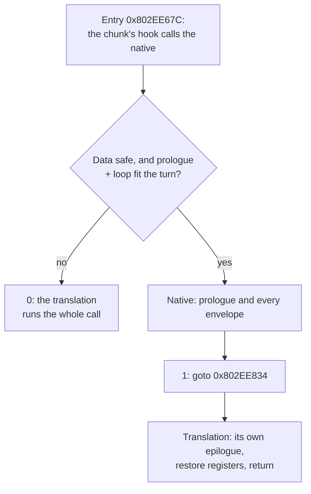

# TECH_PLAN — Native extensions for Outset's character work

Status: Done  
Source: BlueWake `main` at `ee991d312`  
[PRD](PRD.md) · [Tracker and evidence](PROGRESS.md)

## What we tried

`J3DModel::calcWeightEnvelopeMtx` (0x802EE67C–0x802EE874) has a prologue, a loop over the model's envelopes (each with an inner loop over its joints) and an epilogue. The skinning native ([`native_skin.c`](../../../cmake/composite/native_skin.c)) ran all of it or declined. It declines unless the whole call fits the current turn's cycle budget: 58 + 23 per envelope + 60 per joint guest cycles. Turns average about 8,600 cycles, because the DSP steps every 12,600 (#530).

| Step | What | How |
|---|---|---|
| M0 | Why skinning declines | `BLUEWAKE_SKIN_CENSUS`: declines by reason and cycle bin, one Outset launch on the Deck |
| M1 | The other native sets | Full builds with `--native-entries` and `--native-set4` |
| M2 | Big models natively | The native hands over to the translation inside the function: at the epilogue when the loop is done, or at the loop head after the envelopes that fit the turn ("partial runs") |
| M3 | Qualify | Differential test; local bench; Game Mode A/B (≥ 6 rounds); render_bench checkpoints |

## What we found

### M0: the turn budget refuses the big models

28,118 of 28,120 timing declines were the turn budget; the data checks and the deadline never fired. By cost of the call:

| Guest cycles | Accepted | Declined | Declined share |
|---|---:|---:|---:|
| < 1k | 258,829 | 1,660 | 1% |
| 1–2k | 7,827 | 929 | 11% |
| 4–8k | 15,445 | 15,201 | 50% |
| 8–16k | 617 | 5,950 | 91% |
| ≥ 16k | 0 | 4,378 | 100% |

### M1: the other sets need porting

- `--native-entries` fails to build: its generator does not handle a write form (`bw_write32_ato`) the current translation emits.
- `--native-set4` builds but is never called: its hooks wait for entry hashes recorded for this tree.

### The native is faster per call, and the existing one was not exact

- **Speed:** `native_skin_test MODULE --bench` times the translated function against the native plus the translation's epilogue, on the same module and memory. It shows the native 1.3–1.7× faster at 4 to 200 envelopes, across runs.
  - The bench must be built with the module's `-march` (`x86-64-v3`). A baseline build calls a software `fma` and shows no gain.
- **Exactness:** the existing native replayed the epilogue and left the cycle suffix at 2.
  - On the #503 stack the inline `_restgpr` leaves 0.
  - When the inline path cannot be taken, the real routine runs and leaves another value.
  - So the native failed the differential test against the #503 module, and no fixed value in it is right for every build and path. No effect of this was seen in play.

### M2/M3: partial runs work but gain nothing

| Measurement | Result |
|---|---|
| Differential test (short turns, deadlines inside the call) | exact |
| 220 partial runs captured on the Deck, replayed | exact |
| render_bench, 5 scenes | checkpoints identical; +0.55% (noise) |
| Game Mode A/B, 6 rounds | **+0.05%**, ahead in 3 of 6 |
| Joints skinned natively per Outset launch | 1.40 M → 2.73 M |

Doubling the native joints saves only the native-vs-translation difference on them: about 0.1–0.3% of an Outset frame.

### The wrapper bug

The chunk's hook calls `bluewake_native_skin_try`, which returned `ready && native(cpu)`. In C that is 0 or 1, so the partial result 2 ("go on at the loop head") reached the hook as 1 ("go to the epilogue"). In play, every partial run skipped the rest of the model's matrices. Two symptoms followed:
- The checkpoints differed from the first frame after load.
- The skipped work read as a +0.8–1.2% gain.

The tests called the native directly, past the wrapper, so they never saw it. It was found as follows:
1. Checkpoints every retrace put the first difference in the first frame.
2. Captured cases matched through the test's copy of the native but not through the module's hook.
3. Calling the module's native directly matched the test's copy, which left only the wrapper.

## Decision

**Keep the epilogue hand-over; drop partial runs.**

| Part | Before | After |
|---|---|---|
| Prologue | native | native |
| Loop | all of it, or decline | all of it, or decline |
| Epilogue | native, its own copy | **the translation's** |

At the hand-over the native leaves exactly the translation's state after the loop's last test:

| State | Value at 0x802EE834 |
|---|---|
| Loop registers | r31 = r8 = envelopes, r4 = 48 × envelopes; r29/r30 the weight and index pointers after the last joint; r9–r12, r0, r5–r7 as the last joint left them (an empty model: as the set-up left them) |
| Frame | stack moved by 112; return address, f27–f31 and r29–r31 saved; r1 = frame; LR = 0x802EE6B8 |
| FP | f0–f13 and f28–f30 as last computed; f10, f12, f31 the zero pair; f27 the unit pair; FPRF if any FP ran |
| Flags | CR0 = EQ, SO from XER |
| Cycles | downcount less 37 + Σ(23 + 60 × joints); suffix 1, the last store block's (an empty model: the set-up's) |

**Reasons:**
- **The hand-over is the only exact option.** The translation's epilogue is right for every build's transforms and fallback paths. A native copy of it cannot be, and it costs nothing measurable.
- **Partial runs cost too much for what they gave.** They were the most intricate code (budget prediction, a mid-loop hand-over) and already shipped one serious bug. The gain was inside noise, with a ceiling of about 0.1–0.3%.

## Long-term impact

- **Exact across build changes:** a transform that reshapes the epilogue no longer breaks the native.
- **Tools that outlast this PR:**
  - `native_skin_test MODULE [CASES]`: differential test through the hook's wrapper, with short turns and deadlines.
  - `native_skin_test MODULE --bench`: host time, translated against native.
  - `native_skin_test MODULE --replay DIR` and `--replay-module DIR`: cases captured in play (`BLUEWAKE_SKIN_DUMP`), through the test's copy of the native or the module's own hook.
  - `BLUEWAKE_SKIN_CENSUS`: declines by reason and model size.
- **The rule for natives:** census, local bench, Deck A/B, checkpoints; test through the game's own wrapper. [#542](https://github.com/chrissotraidis/bluewake/pull/542) follows it.
- **Threading is not worth it here.** The native's checks (no store overlaps a load; plain RAM; safe floats) would let envelopes run on several host threads exactly. But skinning is now about 1.5% of the game thread, so the ceiling is +0.5–1%, and the Deck's shared CPU/GPU power budget may take part of that back.
- **Other hardware:**

| Module built for | `fma` | Native vs translation | Default |
|---|---|---|---|
| `x86-64-v3` (the builders' default; Steam Deck) | one instruction | 1.3–1.7× faster | on |
| ARM64 (Android, Apple Silicon) | one instruction | expected faster, not measured | on |
| x86 below `v3` | a library call | 0.84–1.01× | **off** (unless `BLUEWAKE_NATIVE_SKIN=1`) |

## Changes

| File | Change |
|---|---|
| [`cmake/composite/native_skin.c`](../../../cmake/composite/native_skin.c) | Hand-over at the epilogue, empty models included; the wrapper passes the result through; off without hardware FMA; `BLUEWAKE_SKIN_CENSUS` and `BLUEWAKE_SKIN_DUMP` (diagnostic builds only) |
| `cmake/composite/native_skin.h` | Result codes; `BLUEWAKE_NATIVE_SKIN_HARDWARE_FMA` |
| `scripts/windows/native_skin.py` | Hook: `case 1: goto label_802EE834`; the label must be in the certified body |
| `tests/native_skin_test.c` | Through the wrapper; short turns and deadlines; `--bench`; `--replay` / `--replay-module` |
| `tests/native_skin_source_test.py`, `tests/test_windows_prepared_cache.py` | Fixtures with the epilogue label; a missing label is rejected |
