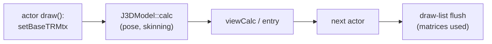

# PRD — Parallel guest execution

Status: Draft (research; M0/M1 audit done, no code)
Source: BlueWake `main` at `ee991d3`; RecompCore `0fe472a`; tww `9cbb155`; profiled build `m437-a-14c558d62d1c` (desktop, 2026-11-03)
Scope: moving provably independent game-thread work onto other host cores, and widening the native paths that work needs; excluded: 60 game updates per second, speculative execution, generic actor scheduling, the GX worker
[Technical plan](TECH_PLAN.md) · [Tracker](PROGRESS.md)

## Problem

The game thread is CPU-bound on one core (≈ 100 % busy) while other cores have room. Every 30 Hz update that misses its 33.3 ms budget is a dropped game frame. The [existing worker pool](../../../cmake/composite/native_work_pool.c) only does fork/join inside one call, and in play it never starts (`[native-math] array … max=8 parallel=0`: arrays stay below its threshold).

The goal is a shorter game-thread critical path per update, not lower total CPU use. More total CPU work is acceptable if more updates land inside the budget.

## Findings

| Finding | Evidence |
| --- | --- |
| **Translated code can't run concurrently as built.** Every chunk binds `#define ctx (&bw_guest_cpu)` (fixed-CPU ABI v4) and ignores its `ctx_param`; fast loads and stores index the linked `BW_GUEST_MEM1` (ABI v5) | Generated chunk headers; [`module_cpu_contract.h`](../../../cmake/composite/module_cpu_contract.h); [`gather_pipe.h`](../../../cmake/composite/gather_pipe.h) |
| Process-global state on the translated path: `bw_direct_depth`/`bw_direct_enabled`, the gather pipe, `g_mem_write_journal`, `g_ppc_guest_aliases_overlap_mem1`, and host interrupt flags read in `bw_direct_call_ready` | [`direct_calls.h`](../../../cmake/composite/direct_calls.h); RecompCore `GXRuntime/src/core/cpu.c` |
| `g_mem_write_journal` fires **after** the store, so it can trace effects but not isolate them | RecompCore `GXRuntime/include/core/cpu.h` |
| Outset, guest-PC sampler, 521,370 samples: J3D **21.9 %**, collision 14.1 %, matrix/vector 11.3 %, audio (`JASystem`) 9.3 %, GX/GD 7.6 %, particles 3.9 %; the top 45 functions cover 43 % | `BLUEWAKE_PC_SAMPLE`, retraces 2700–4200, headless; **taken during a concurrent build, shares indicative only** |
| Top J3D functions: `calcWeightEnvelopeMtx` 2.75 %, `J3DUClipper::clip` 2.7 % (two overloads), `J3DAnmTransformKey::calcTransform` 1.4 %, `J3DModel::calc` 1.2 %, `recursiveCalc` 0.9 % | Same run |
| Native paths decline often: `key-s` 435 k native / 1.43 M declined; `transform-simple` 321 k / 1.02 M; skinning 250 k / 25.7 k, yet 2.75 % of samples sit in the translated skinning body, so the declines are the large models | `[native-*]` counters in the same run |
| **Skinning is already settled by [#541](https://github.com/chrissotraidis/bluewake/pull/541):** the turn budget refuses the big models (8k+ cycle calls decline 91–100 %); partial native runs were exact but within noise (+0.05 % to +0.55 %); skinning is ≈ 1.5 % of the Deck game thread, and threading it is worth ≈ +0.5–1 % | #541 census and Deck A/B |
| **Deck cycle counts are smaller than the sampler's shares.** Translated Maya `calcTransform` 0.59, key-frame 0.46 + 0.44, `JMAEulerToQuat` 0.40 M cycles per frame (each ≈ 0.35–0.8 % of a frame, assuming ≈ 115 M cycles per frame); their natives are in `--native-entries`/`--native-set4`, which are off and need porting | #541 tracker (#503 Outset session) |
| `J3DModel::calc` is called from actor `draw()` in about 286 of ~550 call sites, right before `entry`/`viewCalc`: no overlap window inside the caller | tww `J3DModel.cpp:690`, `m_Do_ext.cpp:531`; heuristic grep |
| `calc` uses the `j3dSys` singleton and static recursion state (`J3DSys::mCurrentMtx`, `mCurrentS`, `mParentS`) and calls arbitrary code: joint callbacks (90 of 476 actor sources), `mCalcCallBack`, deformers | tww `J3DMtxCalc`/`J3DJoint.cpp:42,50` |

## Audio lead (2026-11-03)

| Finding | Evidence |
| --- | --- |
| **`JASystem` is 8.6 % of Outset guest samples**, flat (top function `TChannel::updateMixer` 0.79 %); the game-side `JAI` API is 0.6 %, the DSP/AI library 0.4 % | Same sampler run, strict name classes |
| It runs on its own guest OS thread (`TAudioThread::audioproc`, priority above the game's), woken by the AI DMA callback (≈ every 17.5 ms) and DSP mail; it runs to completion while the game thread is suspended | tww `JASAudioThread.cpp` |
| The game reaches it through `JAI` and ports/command queues under disabled interrupts: designed for preemption at any point | tww `JAudio` |
| **The host DSP is not a lever:** Linux, Windows, Android and iOS default to HLE (`BLUEWAKE_DSP_MODE=hle`), ≈ 1 % of host samples in October profiles | `linux_entry.c`, `win_entry.c`; `profiling/desktop-cost-01` |
| #503's Deck breakdown has no audio line, so the 8.6 % may be inflated by the sampler's bias | #503 M1-T02 |

Options: concurrent translated audio (Track B; structurally the cleanest candidate, but 8.6 % is under the reopen bar); a native async `JASystem` driver (large, bit-exact DSP command output); or serial: port the `--native-entries` `JASChannel` natives (#541 found that set needs porting). Any overlap ends at the game thread's first touch of audio state after the wake, likely within a frame.

**Async audio is opt-in.** Any asynchronous audio path ships behind `BLUEWAKE_ASYNC_AUDIO=1`, off by default on every platform. With the flag unset, audio runs exactly as today (the translated `JASystem` thread, serial), which stays the correctness oracle. The flag only selects the path where the module and host both support it; unsupported cases keep the serial path, as the native-routine switches do.

**Next:** measure the audio thread's share by guest thread (M6-T01). If it is ≥ 8 %, port the `JASChannel` natives and measure the overlap window; if well below, close the multithreading research in favour of #503's serial runtime costs.

## Decisions

- **Track A (asynchronous native jobs) first.** Track B (concurrent translated regions) stays second choice. It needs a second, reentrant code-generation mode (`ctx_param`, `cpu->ram`, no direct calls or gather pipe) plus a real memory snapshot, and gives up the fixed-address speed. Reopen it only if a single region worth ≥ 15–20 % of the game thread has a long window before its first consumer, is too complex to rewrite natively, and traces as self-contained.
- **Widen native coverage before parallelizing.** An async pose job needs a native implementation that accepts the common models anyway, and that alone shortens the thread. An async pose job is all-or-nothing per model: one declining joint keeps the whole model serial, so M4 is gated on M2 covering multi-key transforms (large-model skinning is out of scope after #541).
- 30 game updates per second is fixed. No change to guest cadence.

## Goals

| Goal | Target |
| --- | --- |
| Serial widening (`key-s`, `transform-simple`; start by porting `--native-entries`/`--native-set4`) | ≈ 1–2 % off game-thread time in Outset, identical checkpoints |
| Async pose job (if the window exists) | further ≈ 1–3 % against a 13 % gap to 30 FPS; 0 % if other actors read matrices before the flush |
| Correctness | identical checkpoints and pictures against the serial build; serial path stays the default and the oracle |
| Gate for any async code | the memory-read trace (M3) shows no consumer between submit and flush for eligible models |

Estimates come from one contended profile and source reading. Past native rewrites delivered less than their sample share (`__save_gpr`/`__restore_gpr`, 2026-09-24), so plan on the low end. The ranges were lowered on 2026-11-03 after the Deck cycle counts from #541; the sampler overweights short dispatched functions, so its 21.9 % J3D share overstates what a pose job can move.

**Consequence:** the J3D pose job is at best a few percent. The next multithreading lead is audio (`JASystem`, 9.3 % on the sampler), pending a Deck cycle count.

## Non-goals

60 game updates per second; speculative or transactional execution; generic actor taskification; changing the existing fork/join pool; Track B unless reopened by its criterion.

## Risks

| Risk | Mitigation |
| --- | --- |
| Cross-actor matrix readers (held items, effects on joints, camera) | M3 read trace; exclude models that are read; join on first read |
| `entry()` uses matrices (translucent Z-sort) | Source check in M3 before any job |
| Guest cycle accounting moves | Charge the serial cost at submit; checkpoint comparison |
| Jobs too small (many low-joint models) | Batch per frame; break-even benchmark (M4) |
| Profile skewed by contention | Re-profile on an idle machine first (M0) |
