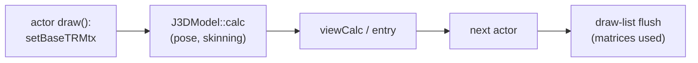

# PRD — Parallel guest execution

Status: Draft (research; M0/M1 audit done, no code)
Source: BlueWake `main` at `ee991d3`; RecompCore `0fe472a`; tww `9cbb155`; profiled build `m437-a-14c558d62d1c` (desktop, 2026-11-03)
Scope: moving provably independent game-thread work onto other host cores, and widening the native paths that work needs; excluded: 60 game updates per second, speculative execution, generic actor scheduling, the GX worker
[Technical plan](TECH_PLAN.md) · [Tracker](PROGRESS.md)

## Problem

The game thread is CPU-bound on one core (≈ 100 % busy) while other cores have room. Every 30 Hz update that misses its 33.3 ms budget is a dropped game frame. The [existing worker pool](../../../cmake/composite/native_work_pool.c) only does fork/join inside one call, and in play it never starts (`[native-math] array … max=8 parallel=0`: arrays stay below its threshold).

The goal is a shorter game-thread critical path per update, not lower total CPU use. More total CPU work is acceptable if more updates land inside the budget.

## Findings

| Finding | Evidence |
| --- | --- |
| **Translated code can't run concurrently as built.** Every chunk binds `#define ctx (&bw_guest_cpu)` (fixed-CPU ABI v4) and ignores its `ctx_param`; fast loads and stores index the linked `BW_GUEST_MEM1` (ABI v5) | Generated chunk headers; [`module_cpu_contract.h`](../../../cmake/composite/module_cpu_contract.h); [`gather_pipe.h`](../../../cmake/composite/gather_pipe.h) |
| Process-global state on the translated path: `bw_direct_depth`/`bw_direct_enabled`, the gather pipe, `g_mem_write_journal`, `g_ppc_guest_aliases_overlap_mem1`, and host interrupt flags read in `bw_direct_call_ready` | [`direct_calls.h`](../../../cmake/composite/direct_calls.h); RecompCore `GXRuntime/src/core/cpu.c` |
| `g_mem_write_journal` fires **after** the store, so it can trace effects but not isolate them | RecompCore `GXRuntime/include/core/cpu.h` |
| Outset, guest-PC sampler, 521,370 samples: J3D **21.9 %**, collision 14.1 %, matrix/vector 11.3 %, audio (`JASystem`) 9.3 %, GX/GD 7.6 %, particles 3.9 %; the top 45 functions cover 43 % | `BLUEWAKE_PC_SAMPLE`, retraces 2700–4200, headless; **taken during a concurrent build, shares indicative only** |
| Top J3D functions: `calcWeightEnvelopeMtx` 2.75 %, `J3DUClipper::clip` 2.7 % (two overloads), `J3DAnmTransformKey::calcTransform` 1.4 %, `J3DModel::calc` 1.2 %, `recursiveCalc` 0.9 % | Same run |
| Native paths decline often: `key-s` 435 k native / 1.43 M declined; `transform-simple` 321 k / 1.02 M; skinning 250 k / 25.7 k, yet 2.75 % of samples sit in the translated skinning body, so the declines are the large models | `[native-*]` counters in the same run |
| `J3DModel::calc` is called from actor `draw()` in about 286 of ~550 call sites, right before `entry`/`viewCalc`: no overlap window inside the caller | tww `J3DModel.cpp:690`, `m_Do_ext.cpp:531`; heuristic grep |
| `calc` uses the `j3dSys` singleton and static recursion state (`J3DSys::mCurrentMtx`, `mCurrentS`, `mParentS`) and calls arbitrary code: joint callbacks (90 of 476 actor sources), `mCalcCallBack`, deformers | tww `J3DMtxCalc`/`J3DJoint.cpp:42,50` |

## Decisions

- **Track A (asynchronous native jobs) first.** Track B (concurrent translated regions) stays second choice. It needs a second, reentrant code-generation mode (`ctx_param`, `cpu->ram`, no direct calls or gather pipe) plus a real memory snapshot, and gives up the fixed-address speed. Reopen it only if a single region worth ≥ 15–20 % of the game thread has a long window before its first consumer, is too complex to rewrite natively, and traces as self-contained.
- **Widen native coverage before parallelizing.** An async pose job needs a native implementation that accepts the common models anyway, and that alone shortens the thread. An async pose job is all-or-nothing per model: one declining joint keeps the whole model serial, so M4 is gated on M2 covering multi-key transforms and large-model skinning.
- 30 game updates per second is fixed. No change to guest cadence.

## Goals

| Goal | Target |
| --- | --- |
| Serial widening (skinning, `key-s`, `transform-simple`) | ≈ 3–5 % off game-thread time in Outset, identical checkpoints |
| Async pose job (if the window exists) | further ≈ 3–8 %; 0 % if other actors read matrices before the flush |
| Correctness | identical checkpoints and pictures against the serial build; serial path stays the default and the oracle |
| Gate for any async code | the memory-read trace (M3) shows no consumer between submit and flush for eligible models |

Estimates come from one contended profile and source reading. Past native rewrites delivered less than their sample share (`__save_gpr`/`__restore_gpr`, 2026-09-24), so plan on the low end.

## Non-goals

60 game updates per second; speculative or transactional execution; generic actor taskification; changing the existing fork/join pool; Track B unless reopened by its criterion.

## Risks

| Risk | Mitigation |
| --- | --- |
| Cross-actor matrix readers (held items, effects on joints, camera) | M3 read trace; exclude models that are read; join on first read |
| `entry()` uses matrices (translucent Z-sort) | Source check in M3 before any job |
| Guest cycle accounting moves | Charge the serial cost at submit; checkpoint comparison |
| Jobs too small (many low-joint models) | Batch per frame; break-even benchmark (M4) |
| Profile skewed by contention | Re-profile on an idle machine first (M0) |
