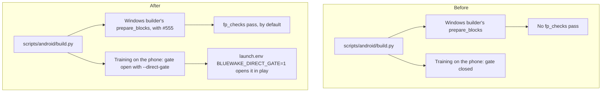

# Technical plan — The direct-call gate and FP checks on Android

[PRD](PRD.md) · [Progress](PROGRESS.md)

## Overview

## What we tried and found

- **The Android builder reuses the Windows one.** `scripts/android/build.py` imports `scripts/windows/build.py` as `wb`. It takes its defaults (`wb.WINDOWS_DEFAULT_OPTIMIZATIONS`), its generated `--<option>` flags and its `prepare_blocks`. With #555 merged in, `fp_checks` is in those defaults, so an Android build already prepares it. Only `--no-fp-checks` was missing.
- **Training is Android's own.** The phone plays the training from `files/launch.env` (`device_training_run`), not from the Windows builder's environment. The gate had to be added there.
- **The fingerprints already follow the options.** `wb.training_fingerprint` and the composite digest record both `fp_checks` and `direct_gate`. Android's module record (`module_request`, from `MODULE_FLAGS`) didn't record the gate, so `direct_gate` is added there. `--app-only` then won't reuse a module trained the other way.
- **How a player opens the gate:** there's no Android menu row for it. `install.py --env BLUEWAKE_DIRECT_GATE=1` writes `files/launch.env`, which [`android_entry.c`](../../../android/src/android_entry.c) reads before the host starts.

### Huge pages on Android

#554's `module_hugepages.h` is guarded by `__linux__`, which Android defines, so it would compile into the Android host, and `launch.env` could set its switch. It would still do nothing today. The APK keeps the module uncompressed inside itself (`android:extractNativeLibs="false"`), `realpath` on that path fails, and the helper returns "not found" before touching anything. If the module were ever extracted to disk, it would copy the code and `MAP_FIXED` it back. Android's SELinux policy may refuse the later `mprotect(PROT_EXEC)` on anonymous memory, and the helper aborts at that point. **Recommendation for #554:** guard it with `defined(__linux__) && !defined(__ANDROID__)`. That isn't changed here, because #554 isn't part of this branch.

## Decision

- fp_checks: on by default, the same as on every other platform. It's exact, and it's a build-time change only.
- The gate: built in, closed unless the player opens it, with `--direct-gate` for a training that matches play with it open. The same as Linux, Windows and Apple.

## Code

| File | Change |
|---|---|
| [`scripts/android/build.py`](../../../scripts/android/build.py) | `--no-fp-checks`; `--direct-gate` (requires direct calls); `direct_gate` in `MODULE_FLAGS`; `BLUEWAKE_DIRECT_GATE=1` in the module's training `launch.env`; `fp_checks` and `direct_gate_training` in the APK's provenance |
| [`tests/test_android_perf_options.py`](../../../tests/test_android_perf_options.py) | Defaults, opt-outs, the module record, the training `launch.env` and the training fingerprint |
| [`.github/workflows/audit.yml`](../../../.github/workflows/audit.yml) | Runs the test |
| [`docs/ANDROID.md`](../../ANDROID.md) | "Speed options from the Linux build" |

## Impact

| Platform | Speed |
|---|---|
| Steam Deck (Linux) | Gate +5.5%, fp_checks +3.05% (measured in #552 and #553) |
| Android | **Not measured yet.** The phone's CPU and the Deck's are different chips, so the Deck's numbers don't carry over |
