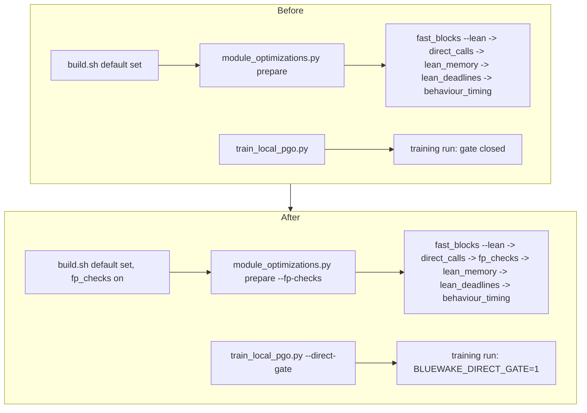

# Technical plan — The #552 gate and #553 fp_checks on the Apple builder

[PRD](PRD.md) · [Tracker](PROGRESS.md)

## Overview

## Code

- [`scripts/builder/module_optimizations.py`](../../../scripts/builder/module_optimizations.py): `steps(..., fp_checks)` puts `scripts/windows/fp_checks.py` right after `direct_calls.py` and before `lean_memory.py`, which is where `scripts/linux/build.py` runs it. Its key is part of `fingerprint()` (`\0fp-checks`), so a cached preparation is never reused across the switch. There is a new `--fp-checks` flag.
- [`scripts/builder/build.sh`](../../../scripts/builder/build.sh):
  - `fp_checks=auto` turns on with the default set. `--no-fp-checks` drops it, and the other options stay as they are.
  - `--fp-checks` names it explicitly. Like every named option, that builds only the named set, and it needs `--lean-blocks`.
  - `--direct-gate` reaches training only.
- [`scripts/builder/profiles/bluewake.sh`](../../../scripts/builder/profiles/bluewake.sh): `profile_train` passes `--direct-gate`.
- [`scripts/builder/train_local_pgo.py`](../../../scripts/builder/train_local_pgo.py): `--direct-gate` sets `BLUEWAKE_DIRECT_GATE` to 1 or 0 in the training environment and adds `\0direct-gate` to the training fingerprint, as Linux's `direct_gate_training` provenance key does.

## The gate on Apple clang, arm64

The gate needs no new code for Apple. `direct_skip.h`, `direct_calls.[ch]` and the main.c handover are plain C11:
- a 4-byte union, guarded by `_Static_assert`;
- no intrinsics, inline assembly or `#ifdef __linux__`;
- a `dlsym` lookup by name, which the Mac host already uses for the other module exports.

The inline test reads `word == 0`, so byte order can't change its answer. It hasn't been compiled for arm64 here (there's no Apple SDK on this machine). The Mac host has no CI build that would compile it either.

## Tests

[`tests/test_mac_optimization_cache.py`](../../../tests/test_mac_optimization_cache.py) (`MacPerfOptionsTest`) runs in `audit.yml` on `macos-latest`. It covers:
- the step order;
- the fingerprint change;
- the training environment;
- the builder's option errors and `--help`.
