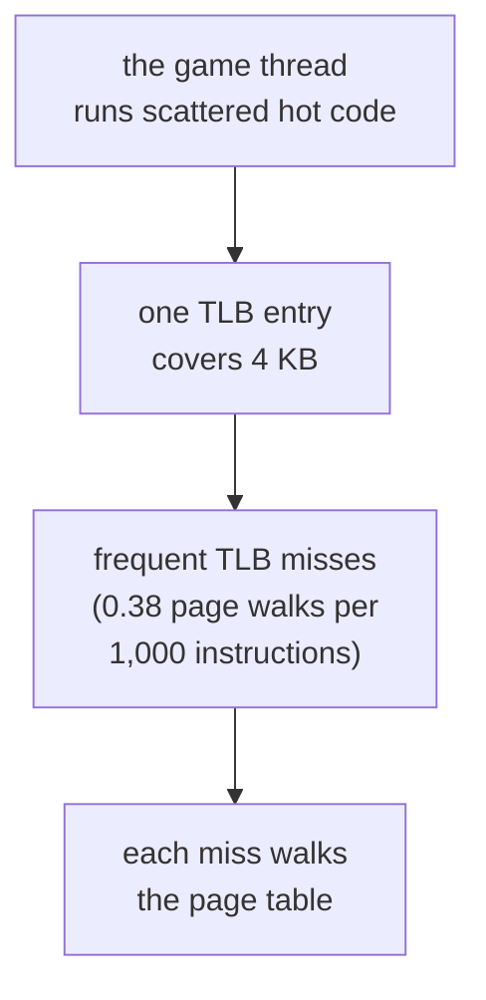
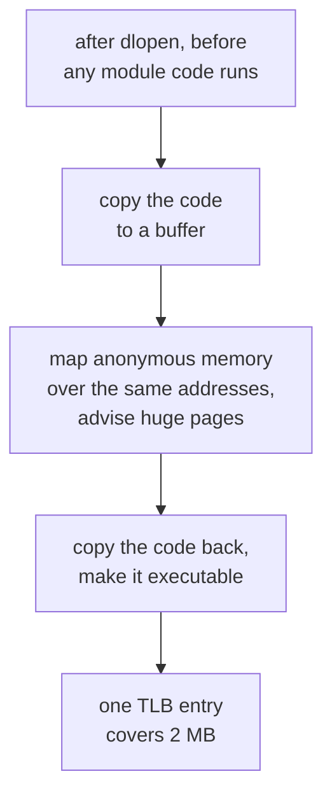
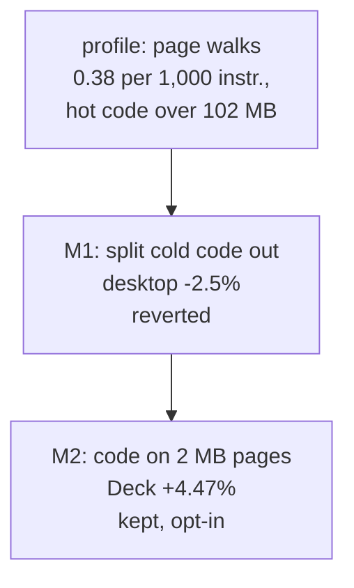

# TECH_PLAN — Code layout of the game module

Status: **Done.** M1 (split functions) no-go, reverted. **M2 (huge pages) kept, opt-in: +4.47% on the Steam Deck**, exact. The switch is Config → Performance → *Game code on large memory pages*, on #531's branch (`06715f0`), off by default.
[Product brief](PRD.md) · [Tracker](PROGRESS.md)

## Overview

The game module (`gGZLE01_recomp.so`) is about 370 MB of compiled translated code. The game thread runs a few tens of megabytes of it, scattered through the rest. The processor keeps a small cache of where code pages live (the instruction TLB); on 4 KB pages it keeps missing, and every miss walks the page table.

This PR leaves the module's code byte for byte as it is, and changes how the host maps it into memory.

## What we tried

The game thread was short of instruction fetch. The translated module is about 370 MB of code, the hot part is scattered through it, and on 4 KB pages the instruction TLB (the processor's cache of where code pages live) keeps missing. We tried two ways to fix it:

1. **M1:** move the code that training never ran out of the hot functions, so the hot code packs together.
2. **M2:** leave the code where it is, but put it on 2 MB pages, so each TLB entry covers 512 times more code.

**Before:** on 4 KB pages.

**After (M2):** on 2 MB pages.

## What we found

- **M1 made it worse:** desktop −2.5% (cycles per frame +2.7%), with page walks up 12.6%. The split follows the *training* profile, and blocks Outset runs that training didn't were moved 140 MB away, so they cost a jump onto another page.
- **M2 worked:** on the Deck, all 372 MB of the module's code went onto 2 MB pages (`[module] huge pages: 372 MB of code copied, 372 MB on huge pages`).
  - **The gain:** **+4.47%** overall, every scene faster (+3.3% to +6.5%), every launch ahead.
  - **Exactness:** the game module was byte-identical in both builds, because the candidate was a host-only rebuild over the control, and the guest checkpoints were identical.
- **The desktop can't show it:** this kernel has no transparent huge pages, so the copy stays on 4 KB pages there. The desktop run checks only that it loads and plays the same.

### How the iterations went

## Decision

**Keep M2, opt-in (the menu switch, or `BLUEWAKE_MODULE_HUGEPAGES=1`); no default for now.**

- **Why keep it:** a consistent +4.5% for a host-only change that doesn't touch the game module.
- **Why opt-in:**
  - **Memory:** about 370 MB more resident memory.
  - **Profiling:** `perf` can't name the module's functions while it's on.
  - **A fatal path:** if the remap ever failed halfway, the host would stop the game rather than run with missing code. That never happened in any run.
- **Why M1 went:** it was slower, and the reason is structural. Training and play don't agree on which blocks are cold.

## Long-term impact

- **Combined with the other work:** on the Deck, huge pages, the direct-call gate (#552) and the FP checks (#553) together are **+15.0%** over the #437 control. That lifts Outset from 27.6 to 30.9 game FPS in render_bench.
- **Where it helps:** the gain needs transparent huge pages (SteamOS has them in `always` mode). Linux desktops without THP get nothing, and other platforms don't run it.
- **Open:** an automated test for the remap (map a test library, remap it, run it, compare its bytes).

## Code

- [`runtime/host/src/module_hugepages.h`](../../../runtime/host/src/module_hugepages.h), Linux only:
  - `bluewake_module_text_find()`: finds the module's executable mapping in `/proc/self/maps`, by the file's real path.
  - `bluewake_module_text_hugepages()`: copies the 2 MB-aligned middle of that mapping to a buffer, maps anonymous memory over the same addresses (`MAP_FIXED`), advises `MADV_HUGEPAGE`, copies the code back and restores read-execute.
  - `bluewake_module_text_huge_kb()`: reads `AnonHugePages` from `/proc/self/smaps`, for the log line.
- [`runtime/host/src/main.c`](../../../runtime/host/src/main.c): right after `dlopen` of the module, and before any of its code runs, calls the remap when `BLUEWAKE_MODULE_HUGEPAGES=1`. It logs `[module] huge pages: N MB of code copied, M MB on huge pages`.
- **The switch:** Config → Performance → *Game code on large memory pages*, a row in `runtime/host/src/settings_table.h` on #531's branch (`06715f0`), off by default. The settings-table test checks it.
- **M1, reverted:** `--split-functions` in `scripts/linux/build.py`; the code is kept in `170e394c4`.

## Impact

| | Result |
|---|---|
| **Steam Deck** | **+4.47%** overall, every scene (+3.3% to +6.5%), every launch ahead |
| Game module | Byte-identical: the candidate was a host-only rebuild over the control |
| Guest checkpoints | Identical |
| Memory | About 370 MB more resident |
| Where it applies | Linux with transparent huge pages (SteamOS: `always`). Elsewhere the switch does nothing |

## Design details

## M1: split the cold blocks, keep the hot sections together (no-go, reverted)

> **Outcome:** desktop −2.5%, and iTLB page walks rose 12.6%. The split follows the training profile, and blocks Outset runs that training didn't are now 140 MB away. The code stays in history as `170e394c4`.

**The change:** `scripts/linux/build.py --split-functions` adds, only to the final module compile that uses the training profile:
- **`-fsplit-machine-functions`:** blocks the profile never saw run move to `.text.split.<function>`, as a `<function>.cold` part.
- **`-Wl,-z,keep-text-section-prefix`:** lld keeps `.text.hot`, `.text.unlikely` and `.text.split` as separate output sections, so the hot parts of every chunk pack together.

**Training is unchanged:** the instrumented compile doesn't get the flags, so the training fingerprint stays the same.

**Checked on one chunk:** the hottest J3D chunk (`func_802ED6E0`), compiled with the build's own command plus the flag:

| | Size |
|---|---:|
| Before | 844 KB in one piece |
| After, hot part | 553 KB |
| After, `func_802ED6E0.cold` | 296 KB |

The inline helpers' copies split the same way.

| File | Change |
|---|---|
| [`scripts/linux/build.py`](../../../scripts/linux/build.py) | `--split-functions` (off by default; needs a training profile); provenance |

**Verification:**
- **Correctness:** guest checkpoints identical to the control, since only placement changes.
- **Speed:** render_bench on the Steam Deck, five save states, at least six interleaved launches each.
- **The mechanism:** the desktop's instruction-TLB and op-cache counters, as a check that the effect is the one intended.

## M2: the module's code on huge pages (host-only, opt-in)

`runtime/host/src/module_hugepages.h`, called right after `dlopen` and before any of the module's code runs, when `BLUEWAKE_MODULE_HUGEPAGES=1`:
1. **Find the mapping:** the module's executable mapping, in `/proc/self/maps` by the file's real path. That avoids the GNU `dl` extensions, which `main.c`'s include order rules out.
2. **Copy it:** its 2 MB-aligned middle, into a temporary anonymous buffer.
3. **Replace it:** map anonymous memory over the same range (`MAP_FIXED`), advise `MADV_HUGEPAGE`, copy the bytes back, and make the range read-execute again.
4. **Report:** `[module] huge pages: N MB of code copied, M MB on huge pages`. The second figure is `AnonHugePages` from `/proc/self/smaps`.

**Exactness:** the same bytes at the same addresses. Relocations are already applied (`RTLD_NOW`), and the code is position-independent.

**Without transparent huge pages** (this desktop's kernel), `madvise` fails, the range stays on 4 KB anonymous pages, and nothing else changes.

**Costs:**
- **Memory:** the copied range is resident anonymous memory, about 400 MB, instead of page cache.
- **Profiling:** `perf` no longer maps those addresses to the module file.

That's one reason it's off by default.

**Testing:** it's host-only, so a host-only rebuild over the control (`build_script --reuse`) gives a candidate with the control's exact module.
