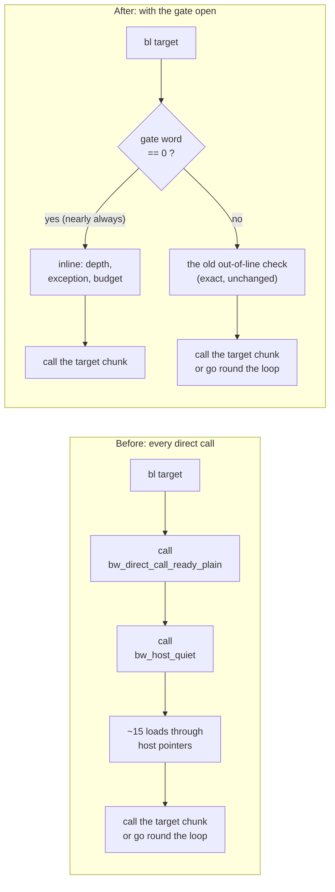
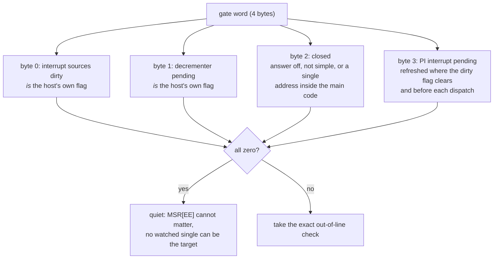
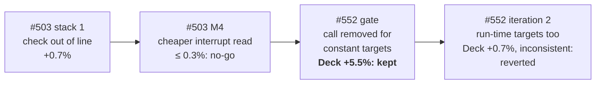

# TECH_PLAN — Direct-call gate

Status: **Done: kept, opt-in.** Steam Deck **+5.5%**, exact. Iteration 2 was a no-go and is reverted. Not proposed as a default (decision 2026-11-04).
[Product brief](PRD.md) · [Tracker](PROGRESS.md) · Stacked on [#503](https://github.com/chrissotraidis/bluewake/pull/503)

## What we tried

Before every direct guest call (a `bl` the builder rewrote to call the target chunk without going round the dispatch loop), translated code asks: *is it safe to skip the loop?* [#503](https://github.com/chrissotraidis/bluewake/pull/503) made that check cheaper, but it was still a call, about a billion times in a long run. We replaced the call with a single word read inline for the common case.

## What we found

- **The check was a large cost:** on the #437 build, the direct-call checks were **8.4%** of all samples. Most of that was the call itself (function entry, pointer loads), not the tests; the module even held 840 copies of each helper, one per chunk.
- **Earlier work had ruled out the obvious fixes:** #503 cut the check's work (+0.7%) and bounded a cheaper interrupt test (≤ 0.3%, no-go); inlining the whole check made the chunks bigger and slower. Every attempt kept the call.
- **The gate removes the call:** direct-call checks fell from 8.4% to 2.1% of samples. Desktop −7.3% cycles per frame; **Steam Deck +5.5%**, every launch ahead, guest checkpoints identical, and 0 unsafe answers in 528 million verified calls.
- **Iteration 2 (the gate for indirect calls too) didn't hold on the Deck:** desktop −1.2% cycles, but Deck +0.7% and not ahead in every launch, twice. Reverted.

### What the gate word stands for

One 32-bit host word. Zero means every host-side condition of the plain check holds, so only the guest-side tests remain inline.

Storing the two flags *in* the word means every one of their ~15 existing writes updates the gate for free; a non-zero word only ever costs the shortcut, never correctness.

### How the iterations went

## Decision

**Keep the gate, opt-in (`BLUEWAKE_DIRECT_GATE=1`); don't propose it as the default for now.**

**The switch:** Config → Performance → *Faster calls inside the game's code*, off by default. The row is on #531's branch ([`06715f0`](https://github.com/chrissotraidis/bluewake/commit/06715f077)).

- **Why keep it:** it's the largest exact gain measured on the game thread this cycle, it's consistent in every launch, and its exactness is checked three ways: a unit test over 1,024 host and CPU states, a verify mode that compares every answer, and identical checkpoints.
- **Why opt-in:** it changes when the module trusts host state, so it should be played more widely before anyone turns it on for players.
- **Why iteration 2 went:** the acceptance rule is "ahead in every launch". Its gain on the Deck was inside the launch-to-launch noise.

## Long-term impact

- **The pattern is reusable:** a host-maintained summary word, read inline, with the exact check as the fallback. Any per-call question whose answer rarely changes can use it.
- **Where the cost went:** direct-call checks are now 2.1% of samples, mostly the full check for indirect calls (1.3%), and that path didn't pay on the Deck.
- **Combined with the other work:** on the Deck, the gate, the FP checks (#553) and the module on huge pages (#554) together are **+15.0%** over the #437 control. That lifts Outset from 27.6 to 30.9 game FPS in render_bench.
- **To make it a default later:** play it more widely; flip the switch's default; and build it with `--direct-gate`, so the training profile follows the gate's path.

## Design details

### Why

Every experiment in [#503](https://github.com/chrissotraidis/bluewake/pull/503) kept the check as a call: the M1-T04 ceiling (70 bytes, +3.1%, mostly from taking interrupts late), stack 1 (+0.7%) and the M4-T01 word (≤ 0.3%). Inlining the *whole* check made the chunks about 11% bigger and slower (v1). What was never tried is a few instructions inline, with the exact check kept out of line.

A profile of the #437 build (Clang 22, this stack with #504 and #531) shows the call is still a large cost:
- **The setup:** desktop PC, Outset headless and unpaced, `perf record`.
- **The share:** the direct-call checks are **8.4% of all samples** (`bw_direct_call_ready_plain`/`_full`, `bw_host_quiet`, `host_can_skip_observation`).
- **Where the samples land:** mostly on the function's entry and its first pointer load. That's the call and fetching it, not the tests.
- **The copies:** the helpers are `static`, so the module holds 840 copies of each, one per chunk.

### Design

One host word, the gate, read inline before a direct call to a constant target in the main executable's code, outside both ranges.

| Byte | Meaning | Set by |
|---|---|---|
| 0 | The interrupt sources are dirty | The host's existing flag: **its storage is this byte**, so every write updates the word |
| 1 | A decrementer exception is pending | The same: the existing flag lives here |
| 2 | Closed: the address-only answer is off or not simple, or a single address lies in the main code | `host_skip_fast_refresh` |
| 3 | PI interrupt pending (`pi_cause & pi_mask`) | `host_direct_gate_pi`, where the dirty flag clears and before each dispatch |

- **Word zero:** every host-side test of the plain check holds, so only the depth, an exception and the budget remain inline. With nothing pending, the guest's MSR[EE] can't matter.
- **Word non-zero:** the call takes today's out-of-line check. That's exact; at worst it's a missed shortcut.
- **The singles:** both are REL raw-image addresses, so a constant target in the main code can't equal them. The host closes the gate if one ever lies there.
- **The PI registers:** they change only while the sources are dirty (#503 M4-T02) or in the main loop between turns (the PE commits). That's why the PI byte is taken before each dispatch.

**Opt-in:** `BLUEWAKE_DIRECT_GATE=1` hands the word over; otherwise the gate stays closed. The builder's `--direct-gate` trains with it open, so a measurement build profiles the path it measures. The default training fingerprint is unchanged.

### Changes

| File | Change |
|---|---|
| [`direct_skip.h`](../../../cmake/composite/direct_skip.h) | `BwHostGate`, the main-code bounds |
| [`direct_calls.h`](../../../cmake/composite/direct_calls.h) | `bw_direct_call_ready_main`: the gate inline, else the plain check; the full check cross-checks the gate under verify |
| [`direct_calls.c`](../../../cmake/composite/direct_calls.c) | The gate pointer (closed unless direct calls and the answer are on and verify is off), the `bluewake_composite_direct_gate` export, the verify counts |
| [`main.c`](../../../runtime/host/src/main.c) | The two flags stored in the word; the closed and PI bytes; the handover behind `BLUEWAKE_DIRECT_GATE=1`; `[direct-gate] verify:` at exit |
| [`build.py`](../../../scripts/linux/build.py) | `--direct-gate` for training; fingerprint and provenance |
| [`direct_calls_test.c`](../../../tests/direct_calls_test.c) | The gate against the full check in 1,024 states; verify catches a stale byte; the conservative side; every path that closes it |

### Verification

| Level | Check |
|---|---|
| Unit | The above, at -O0 and -O2, in Windows and Linux CI |
| Runtime | `BLUEWAKE_DIRECT_SKIP_VERIFY=1` with the gate handed over: zero unsafe gate answers in Outset and a scene change |
| Exactness | render_bench: guest checkpoints identical to the control in all five scenes |
| Performance | Ahead of the control in every interleaved Game Mode launch (at least six); no minimum size |

### Risks

- **Code growth.** About ten instructions at each of about 32,000 call sites. [#503](https://github.com/chrissotraidis/bluewake/pull/503)'s v1 shows growth can cost more than it saves, and only the A/B answers that.
- **A PI writer this design doesn't know about.** The verify counter would show it as unsafe answers, and the checkpoints would drift.

## Implementation order

| Step | Depends | Deliverable |
|---|---|---|
| M0 | #503 | The remaining cost attributed (done) |
| M1 | M0 | The gate, opt-in, with its unit test (done) |
| M2 | M1 | The candidate built on the #437 recipe and trained with the gate open; verify run |
| M3 | M2 | Desktop first read, then the Deck Game Mode A/B and render_bench checkpoints |
| M4 | M3 | Keep opt-in, propose as the default, or no-go |

## References

- [#503 TECH_PLAN](../2026-10-29-outset_cpu_followup/TECH_PLAN.md): stack 1, the M1-T04 ceiling, the M4 interrupt-word specification and its writer table
- [`docs/architecture/GameThread.md`](../../architecture/GameThread.md): the dispatch loop and direct calls
