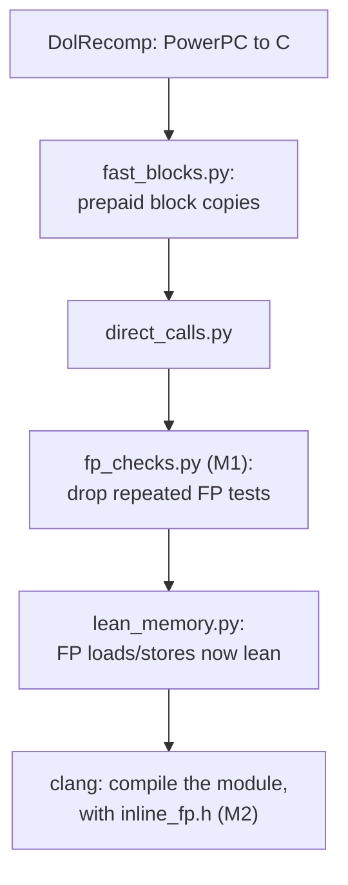
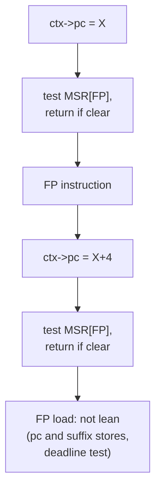
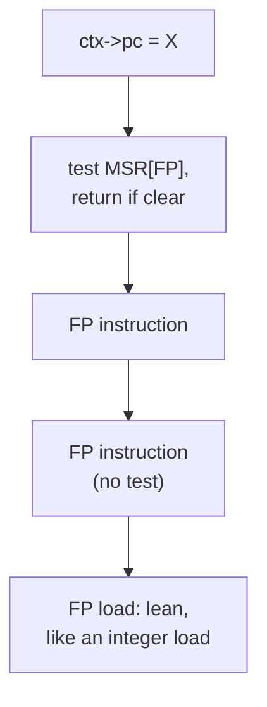
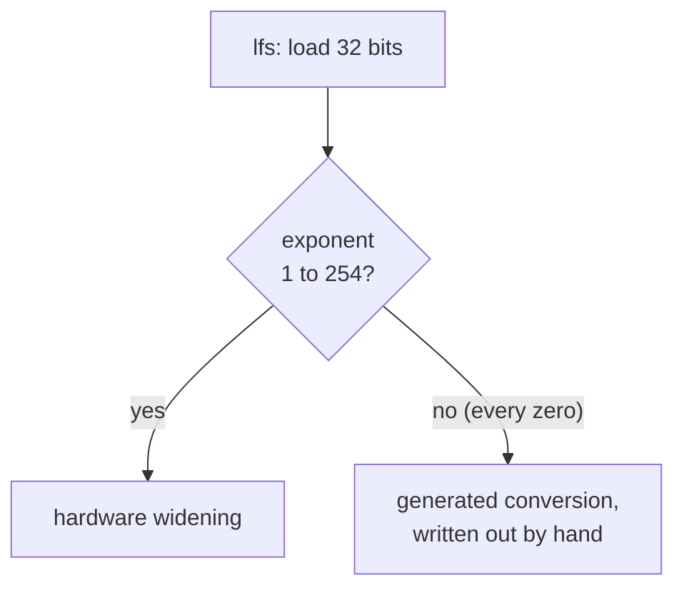
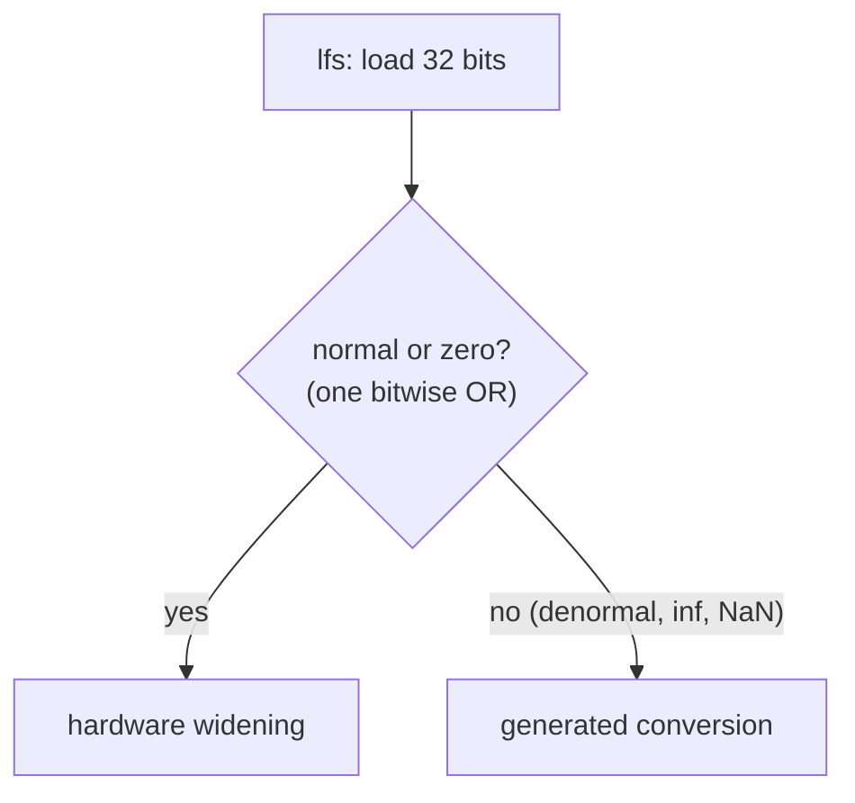

# TECH_PLAN — Floating-point code in the translated game

Status: **Done for now.** **M1 (one FP-available test per stretch)** and **M2 (`lfs` zeros)** are kept and **on by default** in the Linux builder: Steam Deck **+3.05%** and **+1.95%** more. M3 was a no-go and is reverted. M4 and M5 are not started.
[Product brief](PRD.md) · [Tracker](PROGRESS.md)

## Overview

The game is statically recompiled: each PowerPC instruction becomes C, and a builder pipeline then rewrites that C before it's compiled (`scripts/linux/build.py`, the prepare passes in `scripts/windows/`).

Every floating-point instruction pays for exactness: a check that FP is enabled, a `pc` store, exact rounding and flag updates. In the hottest translated code, **FP is 36% of the time** (22.4% arithmetic, 14.0% loads and stores). One `ps_madd` was about 117 x86 instructions.

This PR removes overhead around FP instructions without changing any result.



## M1: one FP-available test per stretch

### What changed

**Before:** every FP instruction in a prepaid block copy tests MSR[FP].



**After:** the first test of each stretch stays, the rest go, and FP loads and stores become lean.



### Why it's exact

- **The test can't go entirely:** the Dolphin OS switches FPU state lazily, so the first FP instruction after a thread switch really traps. That first test stays where it was, with its `pc` store.
- **Inside a prepaid copy, MSR can't change between two tests:**
  - FP operations never take an exception; they only set FPSCR bits.
  - A copy is entered only at its start.
  - Any call that could run guest code ends the stretch.
- **The original blocks keep every test,** because they can be resumed mid-block after another thread has run.

### Code

- [`scripts/windows/fp_checks.py`](../../../scripts/windows/fp_checks.py): the pass.
  - `thin()` keeps the first test per stretch.
  - `safe()` is the explicit list of calls that can't change MSR.
  - `transform()` touches prepaid copies only.
- [`scripts/linux/build.py`](../../../scripts/linux/build.py): runs the pass between `direct-calls` and `lean-memory`.
  - **On by default:** it's in `LINUX_DEFAULT_OPTIMIZATIONS`, with `--no-fp-checks` to opt out.
  - **Recorded** in the prepared-source inputs, the receipt, the training fingerprint and provenance.
- [`tests/test_fp_checks.py`](../../../tests/test_fp_checks.py) (audit job): the rules, the stretch-ending calls, original blocks untouched, repeatable, and end to end that a later `lfs` becomes lean.

### Impact

| | Result |
|---|---|
| Tests removed | 296,188 of 368,745, in 811 chunks |
| FP loads and stores made lean | +177,385 (708,394 lean accesses, against 531,009 before) |
| Desktop, Outset | −3.1% cycles per frame |
| **Steam Deck** | **+3.05%**, every scene, every launch ahead |
| Guest state | Save states byte-identical. The checkpoint's CPU hash differs only in the block-scratch `cycle_observation_suffix` ([#481](https://github.com/chrissotraidis/bluewake/pull/481)) |

## M2: zeros through the hardware's widening in `lfs`

### What changed

**Before:** only normal singles took the fast path, so every `0.0f` went the slow way.



**After:** zeros join the fast path, in one test.



### Why it's exact

- **Zeros:** the hardware widens a zero of either sign to the same double.
- **Denormals stay slow:** the game's non-IEEE mode makes the runtime set the host's **DAZ**, under which the hardware would widen them to zero. That would be wrong in 16,777,214 patterns.
- **NaNs stay slow:** the hardware quiets a signalling NaN.

### Code

- [`cmake/composite/inline_fp.h`](../../../cmake/composite/inline_fp.h), `dolrecomp_f32_from_bits`: the fast-path test.
- [`tests/f32_from_bits_test.c`](../../../tests/f32_from_bits_test.c): all 2³² patterns against the generated path, with DAZ off and on, 0 mismatches. It's run by hand, because it needs a prepared source.

### Impact

- **Steam Deck:** **+1.95%** on top of M1, every launch ahead, checkpoints identical.
- **Desktop:** −1.3% cycles per frame.
- **On:** always, wherever inline FP is on (the default).

## What didn't work

| Step | Result | Why |
|---|---|---|
| M3: `frsp` and `fctiw` inline | Deck −0.36% (desktop +0.6%), reverted (`cea5f9753`) | The inline rounding switch grows the hot code; Zen 2's caches pay for it |
| `psq` quantized specialization | Dropped before building | Its path is only 0.09% of samples |

## Long-term impact

- **Combined with the other work:** on the Deck, M1 and M2 with the direct-call gate ([#552](https://github.com/chrissotraidis/bluewake/pull/552)) and huge pages ([#554](https://github.com/chrissotraidis/bluewake/pull/554)) are **+15.0%** over the #437 control. Outset goes from 27.6 to 30.9 game FPS.
- **What's left in FP:** the per-operation cost is spread thin: finiteness tests, the FPRF classification, the `fma` tie check. M4 (a fallback that doesn't clobber the guest registers) and M5 (lazy FPRF) are the remaining ideas, each estimated under 1%.
- **The lesson from M3:** a desktop gain isn't enough. Code growth can cost more on the Deck than it saves.

## Design details

## M1: one FP-available test per stretch of a prepaid copy

### Why

Every translated FP instruction starts with:

```c
if (!ppc_fp_available_inline(ctx, 0x...u)) return;
```

- **What it costs:** a `pc` store before it, a test of MSR[FP], and an exit edge. The exit stops Clang from keeping state in registers across it.
- **What it blocks:** `lean_memory.py` rewrites an access only when its instruction calls nothing else and never leaves, so the test disqualifies every FP load and store. Each one keeps its `pc` store, its cycle-suffix store and its deadline test.

In the prepared source of the #437 build:

| | Count |
|---|---:|
| Prepaid copies | 464,979 |
| Copies with FP tests | 72,463 (15.6%) |
| FP-available tests in them | 368,745 |
| FP loads and stores in them | 240,490 |
| Of those copies, ones that write MSR, an SPR or the FPSCR | 5 |

### Why the test can't go

The Dolphin OS switches FPU state lazily: `OSSetCurrentContext` clears MSR[FP] for every thread except the FPU's owner, and that thread's first FP instruction traps. So the FP-unavailable path really runs, at thread switches, and a failing test must behave exactly as today.

### Design

`scripts/windows/fp_checks.py` runs on the prepaid copies only, after `fast_blocks.py` and `direct_calls.py` and before `lean_memory.py`:
- **The first test of each stretch stays** at its place, with its `pc` store. A failure is unchanged.
- **Later tests in the stretch are removed.**
- **A stretch ends** at any call that could run guest code or change MSR, or at a label. The next FP instruction then keeps its test, as the first.

### Exactness

Within a prepaid copy, a removed test always passes, because MSR can't change between the stretch's first test and it:
- **The only MSR change in the FP path** is a failing `ppc_fp_available`, and the code returns right after.
- **FP operations never take an exception:** `set_fp_exception` only sets FPSCR bits (`cpu_interpreter_float.c`).
- **Memory accesses don't change MSR:** an exception an MMIO handler raises is taken only after the copy returns.
- **A copy is entered only at its start,** holds no label anything can jump to, and leaves for the original block at any refund. The original blocks keep every test, because they can be resumed mid-block after another thread has run and changed MSR.
- **Every other call ends the stretch:** direct calls, `bw_call_translated`, natives, extracted loops and `rfi`. The list of safe calls is explicit; a prefix match would admit `ppc_fallback_instruction`, which raises a program exception.

### Changes

| File | Change |
|---|---|
| [`scripts/windows/fp_checks.py`](../../../scripts/windows/fp_checks.py) | The pass |
| [`scripts/linux/build.py`](../../../scripts/linux/build.py) | `--fp-checks` (off by default, needs `--prepared-blocks`); the prepared-source inputs, the receipt, the training fingerprint, provenance |
| [`tests/test_fp_checks.py`](../../../tests/test_fp_checks.py) | First test kept and later ones dropped; every stretch-ending call; original blocks untouched; repeatable; unsafe names; end to end, a later `lfs` lean after `lean_memory.py` |
| [`.github/workflows/audit.yml`](../../../.github/workflows/audit.yml) | Runs the test |

### Verification

| Level | Check |
|---|---|
| Unit | `tests/test_fp_checks.py` in the audit job |
| Source | On the #437 prepared source: 296,188 of 368,745 tests removed in 811 chunks; the hottest J3D chunk compiles cleanly with the build's own command |
| Exactness | render_bench, five scenes: guest checkpoints identical to the control |
| Performance | Ahead of the control in every interleaved Game Mode launch (at least six); desktop `perf stat` as a first read |

### Risks

- **A call missing from the safe list** only ends a stretch early, which costs speed, not exactness. A call *wrongly* on the list could skip a needed test. The list is deliberately short: the FP operations, memory accesses and pure conversions.
- **Module size** changes little; the removed lines are small.

## M2: zeros through the hardware's widening in `lfs`

### Why

`dolrecomp_f32_from_bits` (in `inline_fp.h`) widens a single with the hardware only when its exponent is 1–254. Every other single takes the generated conversion, written out by hand. That includes **every zero**, and `0.0f` is among the most common floats the game loads. The test's line is 3.7% of the hottest chunks' time on its own.

### What's exact

**Zero (either sign):** the hardware's widening is the same double, so it can join the fast path.

**Infinities:** also the same double, but rare; they stay on the generated path to keep the test to one OR.

**Denormals:** the game runs in non-IEEE mode, and the runtime then sets the host's **FTZ and DAZ** (`cpu_interpreter_float.c`). Under DAZ the hardware widens a denormal to zero, while the generated path keeps its exact value: 16,777,214 patterns would differ. They stay on the generated path.

**NaNs:** the hardware quiets a signalling one. They stay on the generated path.

The test becomes `(exponent - 1 < 254) | (bits << 1 == 0)`, a bitwise OR, so it's one branch and a zero doesn't mispredict a first test.

### Verification

`tests/f32_from_bits_test.c` compares the fast path with the generated one over all 2³² patterns, now twice: with the default MXCSR and with FTZ and DAZ.
- **Result:** 4,261,412,866 patterns on the fast path, 0 mismatches in both modes.
- **Not in CI:** the test needs a prepared source. It's run by hand (command in its header).

## M3: `frsp` and `fctiw` inline (no-go, reverted)

> **Outcome:** desktop +0.6%, but Steam Deck −0.36% (Hyrule Castle −2.1%), not ahead in its launches. The code is reverted; it stays in history as `cea5f9753`.

### Why

After M1 and M2, a profile of the hot chunks shows the FP compares are already branchless and the rest of the inline FP cost is spread thin. But three FP operations are still out-of-line calls into the interpreter, each with its nested helpers:

| Helper | Share of samples |
|---|---:|
| `ppc_fctiw` (mostly `fctiwz`, in collision code) | 0.67% |
| `ppc_frsp` | 0.55% |
| `ppc_frsqrte` | 0.27% |

### Design

Inline fast paths in `inline_fp.h`, in the interpreter's own terms, defined as `ppc_frsp` and `ppc_fctiw`:
- **`frsp`:** any operand but a NaN. The same `force_single`, the inexact exception (FX, XX, then the VX summary and FEX, as `set_fp_exception` and `ppc_fpscr_updated` do), FI, FR, the FPRF and both halves.
- **`fctiw`:** an operand that isn't a NaN and rounds into the 32-bit range. The same rounding (`trunc`, `ceil`, `floor`, or the interpreter's `round_nearest_even`), the inexact flags and the result word.
- **Anything else** calls the interpreter, from the unmodified state.

`frsqrte` (a table estimate) stays out of line.

### Verification

`tests/inline_fp_test.c` (in CI) compares every operation with the interpreter over the whole CPU state, from random registers and FPSCR (rounding modes, NI, exception enables, with the host's DAZ set to match). It now includes `frsp` and `fctiw`, with integers, ties and the 32-bit edges. **Result:** 2,000,000 iterations of 21 operations match.

## Later steps

M4 and M5 (see the [PRD](PRD.md#steps)) come after M3 is measured.
