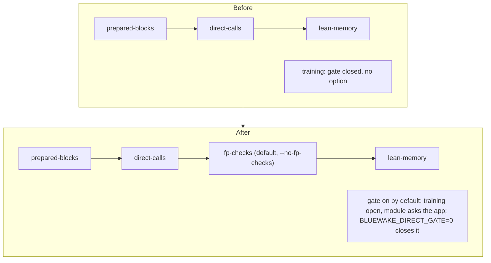

# Technical plan — The direct-call gate and FP checks on Windows

[Product brief](PRD.md) · [Progress](PROGRESS.md)

## Overview

The Windows builder (`scripts/windows/build.py`) already runs the same preparation passes as Linux, in the same order, from the same `scripts/windows/*.py` scripts. This change mirrors the Linux builder's wiring of the two options. Nothing in the generated code or the host changes.

## Code

The changes in [scripts/windows/build.py](../../../scripts/windows/build.py), the same as in the Linux builder:

- **The pass.** `fp-checks` runs after `direct-calls` and before `lean-memory`, so lean memory can make the FP accesses lean.
- **Cache keys.**
  - The pass's script and a `fp_checks` marker go into the composite-inputs digest.
  - `fp_checks` and `direct_gate` go into the training key.
  - `fp_checks` goes into the prepare receipt.
- **Provenance.** `BuilderProvenance.json` gets `fp_checks` and `direct_gate_training`.
- **Options.**
  - `fp_checks` is in `WINDOWS_DEFAULT_OPTIMIZATIONS`, so `--conservative` drops it and `--no-fp-checks` turns it off. It needs `--prepared-blocks`.
  - `direct_gate` is in `WINDOWS_DEFAULT_OPTIMIZATIONS`. `--no-direct-gate` turns it off, `--conservative` drops it, and it needs `direct_calls`. With it on, training runs with the gate open, and `-DBLUEWAKE_DIRECT_GATE_DEFAULT=ON` makes the module export `bluewake_composite_direct_gate_default() = 1`. The app opens the gate when `BLUEWAKE_DIRECT_GATE` is unset; `=0` closes it.

The test is [tests/test_windows_perf_options.py](../../../tests/test_windows_perf_options.py), run by `audit.yml` on Linux. It covers the defaults, the opt-outs, the pass order, the training env and the provenance keys.

## Portability of the gate's host code (static review)

| Piece | Windows (clang, MinGW-style headers) |
|---|---|
| `BwHostGate` (`direct_skip.h`) | It's a union of `uint32_t` and four plain byte fields: `bool`, `bool`, `uint8_t`, `uint8_t`. There are no bit-fields, so layout is fixed. The `_Static_assert` checks that `bool` is 1 byte and the union is 4. |
| Reading the word | `const volatile u32*`, a plain aligned 32-bit load on x86-64. There are no atomics: the host writes and the module reads on the game thread, as on Linux. |
| `__builtin_expect`, `__builtin_constant_p`, `always_inline` | Clang builtins. #503's direct calls already use them on Windows. |
| `bluewake_composite_direct_gate` export | `BW_DIRECT_EXPORT` is `__declspec(dllexport)` under `_WIN32`. The host finds it with `dlsym`, through the same path as the other module exports. |
| `fp_checks.py` | Pure Python over the generated source, with no platform dependence. |

## Risks

- **Unmeasured on Windows.** The Deck and Linux-desktop numbers don't carry over, because a different compiler (clang-cl or MinGW clang), ABI and scheduler change the result.
- fp_checks changes the default Windows module, so a Windows checkpoint check is needed before merge.
