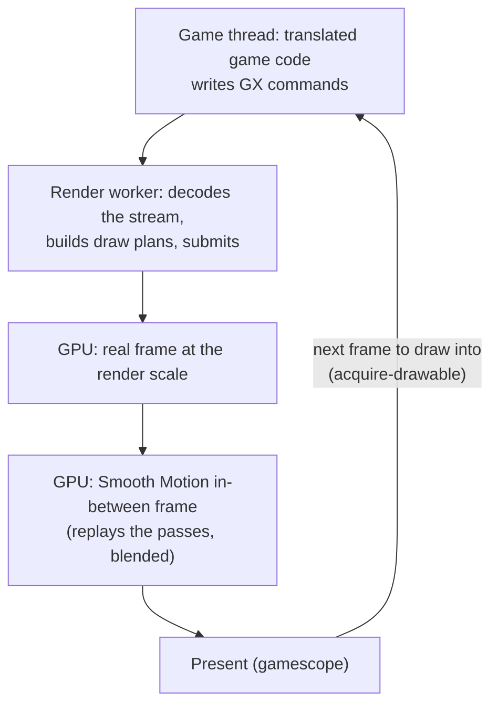

# TECH_PLAN — Why higher render settings drop the Deck below 30 fps

Status: In progress — GPU-bound when paced; next: in-between pass cost (source reading)
Source base: BlueWake `main` at `ee991d3`
[Product brief](PRD.md) · [Tracker](PROGRESS.md)

## How a frame reaches the screen



When the GPU cannot finish both frames in a game frame's time, the game thread waits for a free frame to draw into (`acquire-drawable` in the `[render-slow]` log) and the game drops below 30.

## How it is measured

Paced, as played. render_bench gained `--paced` (measured launches keep the game's own pacing, with Aurora's GPU profiler on) and copies an AppImage shared by several labels once. The settings are the owner's Game Mode settings, each passed with `--set-build`; only render scale and the HD look differ between labels. Two read-only SSH samplers log chip power (slowPPT), GPU clock, GPU busy % and temperature every 0.25–0.5 s, tagged with the running launch's settings.

```sh
S="BLUEWAKE_DIRECT_GATE=1 BLUEWAKE_MODULE_HUGEPAGES=1 DOL_AURORA_EFFICIENT_EFFECTS=1 BLUEWAKE_GATHER_PIPE_BATCH=1
   DOL_AURORA_FORCE_ANISO=4 BLUEWAKE_MODS=betterww BLUEWAKE_ASPECT=16:9 DOL_AURORA_FRAME_INTERP=1
   DOL_AURORA_FRAME_INTERP_STEPS=1 DOL_AURORA_FRAME_INTERP_PACING=0 BLUEWAKE_OPTIONS=<the owner's list>"
scripts/render_bench deck@DECK APP APP APP APP --states test_render/states-play --pairs 2 --warmup 0 --paced \
  $(for L in A B C D; do for kv in $S; do echo --set-build $L:$kv; done; done) \
  --set-build A:DOL_AURORA_RENDER_SCALE=3 --set-build A:BLUEWAKE_HD_LOOK=0 \
  --set-build B:DOL_AURORA_RENDER_SCALE=4 --set-build B:BLUEWAKE_HD_LOOK=0 \
  --set-build C:DOL_AURORA_RENDER_SCALE=3 --set-build C:BLUEWAKE_HD_LOOK=1 \
  --set-build D:DOL_AURORA_RENDER_SCALE=4 --set-build D:BLUEWAKE_HD_LOOK=1 --out render-paced
```

Check in the first launch's log: `gate=on`, the huge-pages line, `[mods] mask=0x3` and no `[state] warning`. Clear `/tmp/appimage_extracted_*` on the Deck before a run.

## Result: the GPU fills

| Setting | FPS | Game thread busy | GPU busy | GPU clock | Power |
|---|---|---|---|---|---|
| 3x | 29.0 | 88 % | 85 % | 553 MHz | 14.6 W |
| 4x | 25.8 | 82 % | 89 % | 913 MHz | 13.7 W |
| 3x + HD | 24.5 | 79 % | 89 % | 938 MHz | 14.2 W |
| 4x + HD | 18.2 | 69 % | 93 % | 1266 MHz | 14.2 W |

Power is not what holds the GPU clock: with the GPU ≥ 95 % busy, its clock is about the same whether the chip draws under 12 W or sits at 15 W (4x + HD: 1358 vs 1374 MHz). The governor picks a clock per load and stays well under 1600 MHz.

## What each part costs (turned off, paced, 4x + HD)

| Turned off | FPS | Change |
|---|---|---|
| — (baseline) | 18.25 | |
| Smooth Motion | 29.96 | +64 % |
| Cloud shadows | 20.91 | +14.5 % |
| Ambient occlusion | 19.62 | +7.5 % |
| Bloom | 18.74 | +2.6 % |
| Far blur | 18.69 | +2.4 % |
| Edge light | 18.62 | +2.0 % |

## Where the GPU time goes (per-pass profiler; superseded for per-pass comparisons)

Aurora's `[gpu-prof]` zones, median per presented frame (ms). Zones nest inside "In-between replay", so they do not add up to a frame; use them to compare passes and settings.

| Pass | 3x | 4x | 3x+HD | 4x+HD |
|---|---|---|---|---|
| In-between replay | 5.3 | 7.8 | 8.3 | 11.9 |
| Staging copies | 5.6 | 7.2 | 6.7 | 9.0 |
| EFB copy 2, real / in-between | 1.1 / 4.2 | 1.3 / 6.2 | 0.8 / 3.5 | 2.2 / 5.0 |
| Cloud shadows, real / in-between | — | — | 0.8 / 3.3 | 2.2 / 4.8 |
| Ambient occlusion, real / in-between | — | — | 0.4 / 1.4 | 1.2 / 2.1 |

## Leads, in order

| # | Lead | Why | First step |
|---|---|---|---|
| L1 | ~~In-between passes cost 2–4x the real frame's~~ | Closed: a profiler artifact (HD zones double-counted; encoder timestamps leak). The in-between frame is ~60 % of the real frame | — |
| L5 | Cloud shadows cost 14.5 % at 4x + HD | ~32 trig calls per pixel at full size, twice a game frame | Opt-in cheaper version in the Performance section; exact shortcuts save only ~1 %, a world-space noise texture baked once a frame saves most of it |
| L2 | Staging copies are 5.6–9 ms | Largest item after the replay | Retest RecompCore #53 paced with these settings |
| L3 | GPU clock governor stays far below 1600 MHz while busy | Tested: locked at 1600 MHz, 4x and 3x + HD gain 1–3 fps and become CPU-bound (chip at 14–15 W); 4x + HD does not gain | Closed as a fix |
| L4 | 4x + HD stalls in present | 255–282 ms a second in present, `acquire-drawable` 30–65 ms, GPU 77 % and game thread 80 % busy at 1600 MHz | Trace swap-chain depth, gamescope latency and Smooth Motion pacing around `acquire-drawable` |
