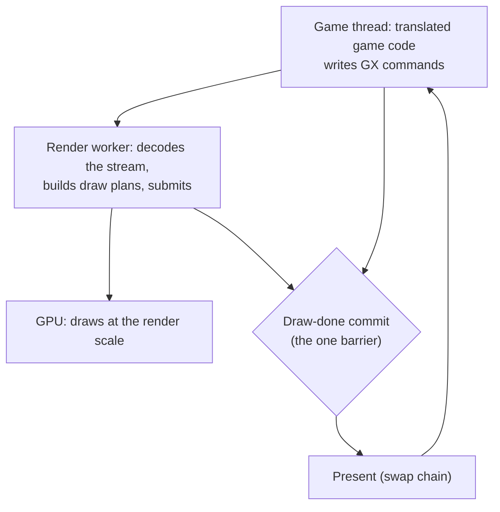
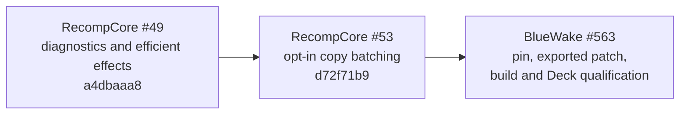

# TECH_PLAN — Why higher render settings slow the game when the GPU has room

Status: In progress — render-scale mechanism confirmed; source work next
Source base: BlueWake `main` at `ee991d3`
[Product brief](PRD.md) · [Tracker](PROGRESS.md)

## How a frame reaches the screen



At the draw-done commit the game thread waits until the render worker has drained everything appended so far ([`main.c`](../../../runtime/host/src/main.c), the `BLUEWAKE_GX_FLUSH_CENSUS` comment). So the game thread can be slowed by its own work, by the render worker's CPU work, by present, by the GPU, or by CPU/GPU power sharing on the Deck APU. Only the first of those shows up as more game-thread instructions in a profile; power sharing instead lowers how many cycles the busy thread gets each second.

## Hypotheses, in order of likelihood

| # | Hypothesis | Grows with the render scale because | Test |
|---|---|---|---|
| H1 | The game thread waits at draw-done for the render worker | EFB copies, resolves and texture copies are larger; the draw plan does more per draw | Flush census: wait per frame at 3x vs 4x |
| H2 | The game thread waits in present | More pixels to hand over, or a swap-chain queue full | Time in present on the game thread; `BLUEWAKE_VSYNC=0` |
| H3 | A synchronous GPU readback | EFB peeks, bounding box, or copy-to-texture read back to the CPU and wait for the GPU | Count and time the readbacks; GPU timestamps around them |
| H4 | The GPU is full on some frames | Busy ms is an average; spikes can still miss the frame | Per-frame GPU busy distribution (p95, max), not only the mean |
| H5 | Memory bandwidth shared by CPU and GPU (the Deck's APU) | Bigger render targets take bandwidth the game thread needs | Game-thread cycles and cache misses per frame at 3x vs 4x with no change in its instructions |
| H6 | CPU/GPU power budget shared by the Deck APU | More GPU work moves power from the CPU and lowers its clock | Effective game-thread clock: cycles/frame × frames/second; then cap the GPU clock and test whether the CPU holds its clock at 4x |

H5 and H6 matter on the Deck in particular. The CPU and GPU share memory and power, so a GPU with idle time can still slow a CPU-bound game. The first profile distinguishes them: more cycles per frame and cache misses point to bandwidth, while the same cycles per frame at fewer frames per second means the CPU is executing those cycles at a lower effective clock. A GPU clock cap then tests the power explanation directly.

## Render-scale result

H6 is confirmed for Outset with Smooth Motion. Uncapped, 4x lowers the game thread's effective clock by 7.0 % and frame rate by 6.3 %. Fixing the GPU at 1100 MHz restores the 4x game-thread clock to 3.34 GHz and reverses the frame-rate result to +6.4 %, with every 4x launch ahead of every 3x launch. Lowering the GPU ceiling would worsen a GPU-time limit; the reversal instead identifies shared APU power and governor behavior. No more render-scale measurements are planned before source work.

## Source findings and first experiment

Source inspection changes the initial staging-copy idea in one important way. Smooth Motion's replay path skips ordinary staging-copy operations and reruns render passes and EFB work, so copy batching does not directly remove duplicated copies from the in-between frame. On a real frame, however, Aurora currently emits completed staging-buffer arenas incrementally as passes are sealed. Texture uploads must remain in operation order because a later upload can overwrite data sampled by an earlier pass.

RecompCore #53, stacked on #49, therefore implements only the safe subset behind `DOL_AURORA_BATCH_STAGING_COPIES=1`:

1. Keep texture staging copies in their existing operation order.
2. Collect completed vertex, uniform, index, and storage-buffer arenas.
3. Encode those copies in a separate command buffer at frame end.
4. Submit the copy buffer before the already-encoded render command buffer.
5. Preserve profiler event order with a deferred timestamp zone.

The default path remains unchanged. If this experiment does not clear the performance gate, the next source target is the work rerun for Smooth Motion's in-between frame, not broader or unsafe copy reordering.

## PR and dependency structure



There is no separate BlueWake PR. #563 owns this plan, the RecompCore pin and exported patch, the matched build, and the final keep/reject decision.

## Implementation surfaces

| Surface | Change |
|---|---|
| RecompCore/Aurora `GXRuntime/graphics/aurora/lib/gfx/common.cpp` | Opt-in batching for non-texture staging buffers |
| RecompCore/Aurora `lib/webgpu/gpu_prof.*` | Deferred timestamp zone so profiling order remains valid |
| `scripts/builder/profiles/bluewake.sh` | Pin the qualified RecompCore stack in #563 |
| `config/dependencies.lock.json` | Record the exact RecompCore revision and evidence |
| `patches/recompcore/` | Export the RecompCore commit required by the repository workflow |

## Implementation order

| Milestone | Depends | Can run with | Deliverable / integration gate |
|---|---|---|---|
| M1 | — | — | Reproducible 3x/4x and Smooth Motion on/off baseline |
| M2 | M1 | — | Shared-power attribution and GPU-cap confirmation |
| M2b | M1 | M2 | Source-level map of staging copies and Smooth Motion replay |
| M3 | M2, M2b | — | Opt-in RecompCore experiment, BlueWake integration, and matched qualification |
| M4 | M3 | — | Evidence-backed keep/reject decision and next target |

Critical path: M1 → M2 → M3 → M4. M2b was inspected alongside attribution work but must be complete before M3 integration. Deck qualification is serial because baseline and candidate must use the same device state and build profile.

## Qualification plan

Build baseline and candidate from the same BlueWake stack and reuse the same build directory/profile so PGO variation does not masquerade as a rendering win. Baseline is RecompCore #49 at `a4dbaaa8`; candidate adds #53 at `d72f71b9` and enables `DOL_AURORA_BATCH_STAGING_COPIES=1`.

Run at least six interleaved baseline/candidate launches on the Deck with the same five save states, 4x render scale, and Smooth Motion enabled. Keep the change only if the candidate is ahead in every launch and all guest checkpoints match. Then compare pictures with Smooth Motion disabled; they must be identical. Restore the Deck's GPU clock range and governor after the run.

## Measurements

All on the Steam Deck with render_bench, five save states, six interleaved launches per setting, the same build.

| Step | Settings compared | What it records | Answers |
|---|---|---|---|
| Q1 | Render scale 3 vs 4 | Game FPS, game thread busy %, GPU busy ms (mean, p95, max) | How big the slowdown is, and whether GPU busy ever reaches the frame budget (H4) |
| Q2 | Same, `--cpu-profile` | Per-thread cycles and instructions per frame; effective game-thread clock from cycles/frame × frames/second; the game thread's and render worker's hottest functions | Whether the game thread's instructions grow (its own work), its cycles grow (H5), or the same cycles run at a lower clock (H6), and what grows on the render worker (H1) |
| Q3 | Same, `BLUEWAKE_GX_FLUSH_CENSUS=1` | Draw-done wait per call, per frame, max | H1 |
| Q4 | Same, timers around present | Time per frame in present | H2 |
| Q5 | Same, readback counters | Number and time of synchronous readbacks | H3 |
| Q6 | HD look on vs off, scale 3 | Q1 to Q3 again | Whether the HD look's slowdown has the same cause |

The diagnostic sequence stops after Q6 because it established the mechanism. Q3 to Q5 and the HD-look comparison are deferred rather than treated as prerequisites for source work.

## How the result is used

| If the cause is | Likely direction (each its own PR) |
|---|---|
| H1: the render worker's CPU work | Make the render worker cheaper, or split its work so the barrier waits less |
| H2: present | Present mode and swap-chain depth |
| H3: readbacks | Asynchronous readback, or caching what is read back |
| H4: GPU spikes | GPU-side work at the larger size |
| H5: shared memory bandwidth | Smaller or fewer intermediate render targets at high scales |
| H6: shared power budget | Reduce GPU work to free power for the CPU; verify with a GPU clock cap |

## Commands

```sh
# Q1/Q2: render scale 3 against 4, same build
scripts/render_bench deck@DECK BUILD BUILD --states test_render/states --pairs 3 --warmup 1 \
  --set-build A:DOL_AURORA_RENDER_SCALE=3 --set-build B:DOL_AURORA_RENDER_SCALE=4 --cpu-profile --out render-scale-3v4

# Q3: add the flush census
  --set-build A:BLUEWAKE_GX_FLUSH_CENSUS=1 --set-build B:BLUEWAKE_GX_FLUSH_CENSUS=1
```

Before each Deck run, clear `/tmp/appimage_extracted_*` on the Deck: the bench unpacks each AppImage into a RAM disk, and a full one has truncated an AppImage before (#524).
