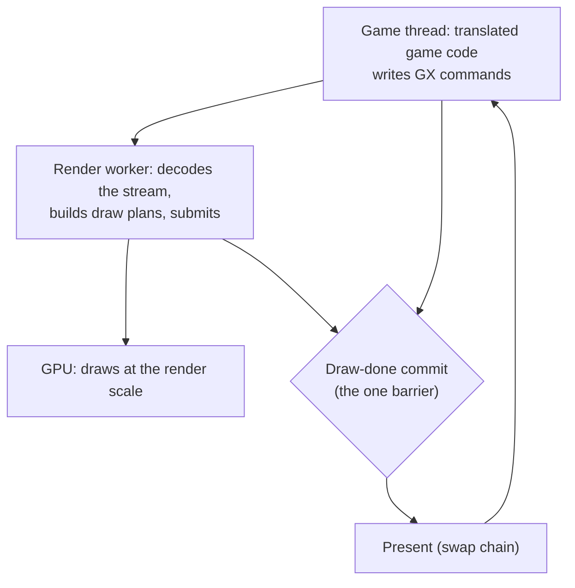

# TECH_PLAN — Why higher render settings slow the game when the GPU has room

Status: In progress — render-scale mechanism confirmed; source work next
Source base: BlueWake `main` at `ee991d3`
[Product brief](PRD.md) · [Tracker](PROGRESS.md)

## How a frame reaches the screen



At the draw-done commit the game thread waits until the render worker has drained everything appended so far ([`main.c`](../../../runtime/host/src/main.c), the `BLUEWAKE_GX_FLUSH_CENSUS` comment). So the game thread can be slowed by its own work, by the render worker's CPU work, by present, by the GPU, or by CPU/GPU power sharing on the Deck APU. Only the first of those shows up as more game-thread instructions in a profile; power sharing instead lowers how many cycles the busy thread gets each second.

## Hypotheses, in order of likelihood

| # | Hypothesis | Grows with the render scale because | Test |
|---|---|---|---|
| H1 | The game thread waits at draw-done for the render worker | EFB copies, resolves and texture copies are larger; the draw plan does more per draw | Flush census: wait per frame at 3x vs 4x |
| H2 | The game thread waits in present | More pixels to hand over, or a swap-chain queue full | Time in present on the game thread; `BLUEWAKE_VSYNC=0` |
| H3 | A synchronous GPU readback | EFB peeks, bounding box, or copy-to-texture read back to the CPU and wait for the GPU | Count and time the readbacks; GPU timestamps around them |
| H4 | The GPU is full on some frames | Busy ms is an average; spikes can still miss the frame | Per-frame GPU busy distribution (p95, max), not only the mean |
| H5 | Memory bandwidth shared by CPU and GPU (the Deck's APU) | Bigger render targets take bandwidth the game thread needs | Game-thread cycles and cache misses per frame at 3x vs 4x with no change in its instructions |
| H6 | CPU/GPU power budget shared by the Deck APU | More GPU work moves power from the CPU and lowers its clock | Effective game-thread clock: cycles/frame × frames/second; then cap the GPU clock and test whether the CPU holds its clock at 4x |

H5 and H6 matter on the Deck in particular. The CPU and GPU share memory and power, so a GPU with idle time can still slow a CPU-bound game. The first profile distinguishes them: more cycles per frame and cache misses point to bandwidth, while the same cycles per frame at fewer frames per second means the CPU is executing those cycles at a lower effective clock. A GPU clock cap then tests the power explanation directly.

## Render-scale result

H6 is confirmed for Outset with Smooth Motion. Uncapped, 4x lowers the game thread's effective clock by 7.0 % and frame rate by 6.3 %. Fixing the GPU at 1100 MHz restores the 4x game-thread clock to 3.34 GHz and reverses the frame-rate result to +6.4 %, with every 4x launch ahead of every 3x launch. Lowering the GPU ceiling would worsen a GPU-time limit; the reversal instead identifies shared APU power and governor behavior. No more render-scale measurements are planned before source work.

## Measurements

All on the Steam Deck with render_bench, five save states, six interleaved launches per setting, the same build.

| Step | Settings compared | What it records | Answers |
|---|---|---|---|
| M1 | Render scale 3 vs 4 | Game FPS, game thread busy %, GPU busy ms (mean, p95, max) | How big the slowdown is, and whether GPU busy ever reaches the frame budget (H4) |
| M2 | Same, `--cpu-profile` | Per-thread cycles and instructions per frame; effective game-thread clock from cycles/frame × frames/second; the game thread's and render worker's hottest functions | Whether the game thread's instructions grow (its own work), its cycles grow (H5), or the same cycles run at a lower clock (H6), and what grows on the render worker (H1) |
| M3 | Same, `BLUEWAKE_GX_FLUSH_CENSUS=1` | Draw-done wait per call, per frame, max | H1 |
| M4 | Same, timers around present | Time per frame in present | H2 |
| M5 | Same, readback counters | Number and time of synchronous readbacks | H3 |
| M6 | HD look on vs off, scale 3 | M1 to M3 again | Whether the HD look's slowdown has the same cause |

M1 to M3 need no code change. M4 and M5 may need small opt-in diagnostics in the host, off by default and kept to a few lines, each a separate commit in this PR.

## How the result is used

| If the cause is | Likely direction (each its own PR) |
|---|---|
| H1: the render worker's CPU work | Make the render worker cheaper, or split its work so the barrier waits less |
| H2: present | Present mode and swap-chain depth |
| H3: readbacks | Asynchronous readback, or caching what is read back |
| H4: GPU spikes | GPU-side work at the larger size |
| H5: shared memory bandwidth | Smaller or fewer intermediate render targets at high scales |
| H6: shared power budget | Reduce GPU work to free power for the CPU; verify with a GPU clock cap |

## Commands

```sh
# M1/M2: render scale 3 against 4, same build
scripts/render_bench deck@DECK BUILD BUILD --states test_render/states --pairs 3 --warmup 1 \
  --set-build A:DOL_AURORA_RENDER_SCALE=3 --set-build B:DOL_AURORA_RENDER_SCALE=4 --cpu-profile --out render-scale-3v4

# M3: add the flush census
  --set-build A:BLUEWAKE_GX_FLUSH_CENSUS=1 --set-build B:BLUEWAKE_GX_FLUSH_CENSUS=1
```

Before each Deck run, clear `/tmp/appimage_extracted_*` on the Deck: the bench unpacks each AppImage into a RAM disk, and a full one has truncated an AppImage before (#524).
