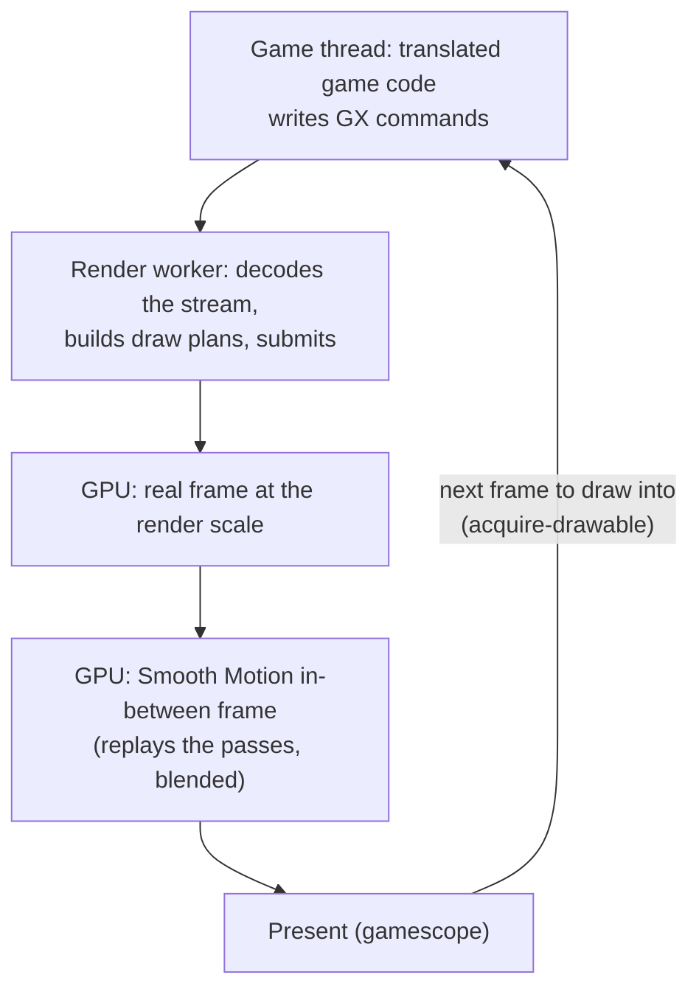
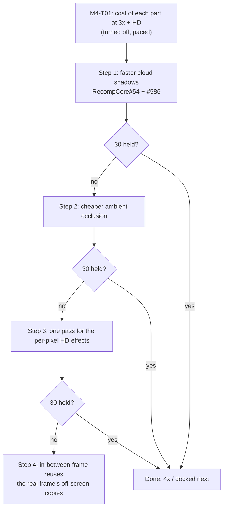

# TECH_PLAN — Why higher render settings drop the Deck below 30 fps

Status: In progress — goal 3x + full HD at 30; step 1 (cloud shadows) building
Source base: BlueWake `main` at `ee991d3`
[Product brief](PRD.md) · [Tracker](PROGRESS.md)

## How a frame reaches the screen



When the GPU cannot finish both frames in a game frame's time, the game thread waits for a free frame to draw into (`acquire-drawable` in the `[render-slow]` log) and the game drops below 30.

## How it is measured

Paced, as played. render_bench gained `--paced` (measured launches keep the game's own pacing, with Aurora's GPU profiler on) and copies an AppImage shared by several labels once. The settings are the owner's Game Mode settings, each passed with `--set-build`; only render scale and the HD look differ between labels. Two read-only SSH samplers log chip power (slowPPT), GPU clock, GPU busy % and temperature every 0.25–0.5 s, tagged with the running launch's settings.

```sh
S="BLUEWAKE_DIRECT_GATE=1 BLUEWAKE_MODULE_HUGEPAGES=1 DOL_AURORA_EFFICIENT_EFFECTS=1 BLUEWAKE_GATHER_PIPE_BATCH=1
   DOL_AURORA_FORCE_ANISO=4 BLUEWAKE_MODS=betterww BLUEWAKE_ASPECT=16:9 DOL_AURORA_FRAME_INTERP=1
   DOL_AURORA_FRAME_INTERP_STEPS=1 DOL_AURORA_FRAME_INTERP_PACING=0 BLUEWAKE_OPTIONS=<the owner's list>"
scripts/render_bench deck@DECK APP APP APP APP --states test_render/states-play --pairs 2 --warmup 0 --paced \
  $(for L in A B C D; do for kv in $S; do echo --set-build $L:$kv; done; done) \
  --set-build A:DOL_AURORA_RENDER_SCALE=3 --set-build A:BLUEWAKE_HD_LOOK=0 \
  --set-build B:DOL_AURORA_RENDER_SCALE=4 --set-build B:BLUEWAKE_HD_LOOK=0 \
  --set-build C:DOL_AURORA_RENDER_SCALE=3 --set-build C:BLUEWAKE_HD_LOOK=1 \
  --set-build D:DOL_AURORA_RENDER_SCALE=4 --set-build D:BLUEWAKE_HD_LOOK=1 --out render-paced
```

Check in the first launch's log: `gate=on`, the huge-pages line, `[mods] mask=0x3` and no `[state] warning`. Clear `/tmp/appimage_extracted_*` on the Deck before a run.

## Result: the GPU fills

| Setting | FPS | Game thread busy | GPU busy | GPU clock | Power |
|---|---|---|---|---|---|
| 3x | 29.0 | 88 % | 85 % | 553 MHz | 14.6 W |
| 4x | 25.8 | 82 % | 89 % | 913 MHz | 13.7 W |
| 3x + HD | 24.5 | 79 % | 89 % | 938 MHz | 14.2 W |
| 4x + HD | 18.2 | 69 % | 93 % | 1266 MHz | 14.2 W |

Power is not what holds the GPU clock: with the GPU ≥ 95 % busy, its clock is about the same whether the chip draws under 12 W or sits at 15 W (4x + HD: 1358 vs 1374 MHz). The governor picks a clock per load and stays well under 1600 MHz.

## What each part costs (turned off, paced, 4x + HD)

| Turned off | FPS | Change |
|---|---|---|
| — (baseline) | 18.25 | |
| Smooth Motion | 29.96 | +64 % |
| Cloud shadows | 20.91 | +14.5 % |
| Ambient occlusion | 19.62 | +7.5 % |
| Bloom | 18.74 | +2.6 % |
| Far blur | 18.69 | +2.4 % |
| Edge light | 18.62 | +2.0 % |

## Where the GPU time goes (per-pass profiler; superseded for per-pass comparisons)

Aurora's `[gpu-prof]` zones, median per presented frame (ms). Zones nest inside "In-between replay", so they do not add up to a frame; use them to compare passes and settings.

| Pass | 3x | 4x | 3x+HD | 4x+HD |
|---|---|---|---|---|
| In-between replay | 5.3 | 7.8 | 8.3 | 11.9 |
| Staging copies | 5.6 | 7.2 | 6.7 | 9.0 |
| EFB copy 2, real / in-between | 1.1 / 4.2 | 1.3 / 6.2 | 0.8 / 3.5 | 2.2 / 5.0 |
| Cloud shadows, real / in-between | — | — | 0.8 / 3.3 | 2.2 / 4.8 |
| Ambient occlusion, real / in-between | — | — | 0.4 / 1.4 | 1.2 / 2.1 |

## Plan: 3x + full HD look at 30

Target 24.4 → 30 fps (+22 %), paced, owner's state, Game Mode build and settings, Smooth Motion one step. Cost of each part at 3x + HD (turned off): cloud shadows 7.9 %, ambient occlusion 6.5 %, far blur 5.2 %, edge light 1.4 %, bloom 1.1 %; Smooth Motion off 29.92.



| Step | Change | Where | Qualification |
|---|---|---|---|
| 1 | Bake the cloud noise once into a 4096² `R32Float` world-space texture; read with exact bilinear weights; re-bake near the edge | `post_fx.cpp` `fs_clouds_baked`, `ensure_cloud_noise` (RecompCore#54); switch "Faster cloud shadows" (#586) | Same build, switch on vs off, 6+ paced launches each, all ahead; pictures within half a step |
| 2 | AO: fewer or cheaper passes (occlusion, two blurs, apply), e.g. a smaller occlusion target or a joint blur | `post_fx.cpp` `encode` AO block | Same; pictures unchanged or within a step |
| 3 | One fragment pass for edge light, torch light and the cloud/AO apply: depth read once, colour written once, 8-bit rounding repeated between steps; and a cheaper far blur (5.2 % at 3x: downsample, two blur rounds, composite) | `post_fx.cpp` `encode`, new combined pipeline; far blur block | Same; merge bit-identical, far blur unchanged or within a step |
| 4 | ~~In-between frame samples the real frame's render-to-texture results~~ Closed: the pass trace at Outset shows only two small off-screen passes (48 flat draws, 1024×768 copies); the scene and its full-size copies must be redrawn | — | — |

Each step is opt-in in Config → Performance first; a step that is not ahead in every launch is reverted and recorded.

## Leads, in order

| # | Lead | Why | First step |
|---|---|---|---|
| L1 | ~~In-between passes cost 2–4x the real frame's~~ | Closed: a profiler artifact (HD zones double-counted; encoder timestamps leak). The in-between frame is ~60 % of the real frame | — |
| L5 | Cloud shadows cost 14.5 % at 4x + HD | ~32 trig calls per pixel at full size, twice a game frame | Opt-in cheaper version in the Performance section; exact shortcuts save only ~1 %, a world-space noise texture baked once a frame saves most of it |
| L2 | Staging copies are 5.6–9 ms | Largest item after the replay | Retest RecompCore #53 paced with these settings |
| L3 | GPU clock governor stays far below 1600 MHz while busy | Tested: locked at 1600 MHz, 4x and 3x + HD gain 1–3 fps and become CPU-bound (chip at 14–15 W); 4x + HD does not gain | Closed as a fix |
| L4 | 4x + HD stalls in present | 255–282 ms a second in present, `acquire-drawable` 30–65 ms, GPU 77 % and game thread 80 % busy at 1600 MHz | Trace swap-chain depth, gamescope latency and Smooth Motion pacing around `acquire-drawable` |

## Other options (not started)

From turning each part off at 4x + HD (Smooth Motion +64 %, cloud shadows +14.5 %, ambient occlusion +7.5 %). The owner's priority is keeping the 60-fps feeling, so the in-between frame should get cheaper, not be skipped.

### Smooth Motion's in-between frame

| Option | What it does | Picture | Effort | Expected |
|---|---|---|---|---|
| S1 Real frames first | Skip the next in-between frame when the GPU is behind, instead of delaying the next real frame | Frames unchanged; fewer in-between frames when the GPU is short | Small (present code) | Holds 30 game fps, but gives up the 60 feeling under load: **set aside** |
| S2 Reuse off-screen copies | The in-between frame samples the real frame's render-to-texture passes (reflections, shadow and blur sources) instead of redrawing them | Very small differences on those textures; opt-in | Medium | Medium; measure the off-screen share first by turning passes off |
| S3 Cheaper depth and copies in the replay | Store-op discard for depth and multisample targets after their last use; skip conversions nothing reads | None | Small–medium | Small |
| S4 Reprojection | Build the in-between frame from the real frame, depth and motion in one full-screen pass instead of a full replay | Approximate at disocclusions; opt-in | Large | Largest: ~1–2 ms instead of ~10 ms; the only option that plausibly keeps 60 at 4x + HD |

### Memory traffic (the GPU-side analogue of the CPU batching)

Aurora already skips redundant pipeline, bind-group and buffer binds and batches draws ([`gxcore_draw.cpp`](../../../ref/recompcore/GXRuntime/graphics/aurora/lib/gfx/gxcore_draw.cpp)). What it does not avoid is whole-image memory traffic; at 4x one image is 2560×2112 (~22 MB colour, ~22 MB depth) on a shared ~88 GB/s bus, and the in-between frame repeats it all.

| Option | Today | Exact-picture alternative |
|---|---|---|
| B1 Fewer pass splits | The EFB pass is cut around soft-effect runs and where the HD effects go in; each cut stores and reloads colour and depth | Merge cuts where possible; load/store only what the next part reads |
| B2 Fuse per-pixel HD effects | Cloud shadows, edge light, torch light and the AO apply are separate full-screen passes, each reading depth and blending into the image | One pass reading depth once and writing colour once, repeating the 8-bit rounding between steps to stay bit-identical |
| B3 Discard depth after last use | Depth is stored to the end of the frame | Store-op discard once nothing reads it |

Measure first: `DOL_AURORA_GPU_PROF=2` lists each pass; count cuts and full-screen passes per frame at 4x + HD.

### Effects

| Option | Note |
|---|---|
| E1 Cloud shadows, exact shortcuts | Early exit when `smoothstep(0.42, 0.6, n)` is decided and skipping the faded-out far sea: ~8 % of octaves, ~1 % fps. Not pursued alone |
| E2 Cloud shadows, baked noise texture | **In progress** (M3-T00, RecompCore#54, #586): 4096² R32Float world-space texture, exact bilinear weights, re-baked only near its edge; error ≤ 0.4 of an 8-bit step (simulated) |
| E3 Ambient occlusion (7.5 %) | Next effect to look at after clouds |
