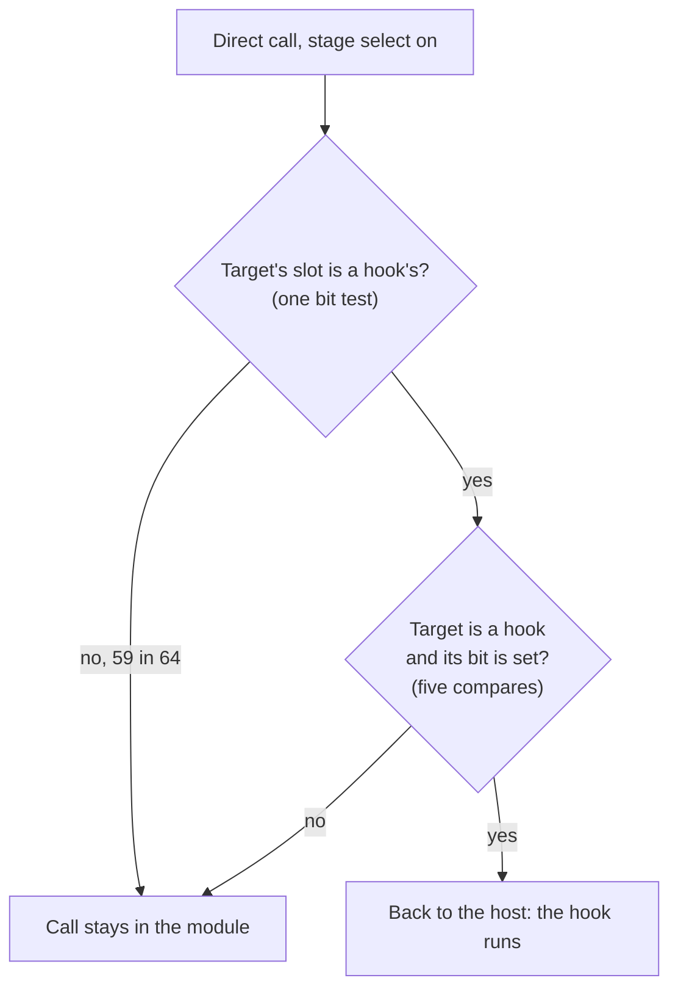

# TECH_PLAN — Stage-select cost: follow-up

Status: Draft; the slot filter is implemented and unit-tested, not measured
[Product brief](PRD.md) · [Tracker](PROGRESS.md)

## The slot filter

With the stage select on, #524's [`bw_direct_call_ready`](../../../cmake/composite/direct_calls.h) compares every direct call's target against the five hooks. The check is out of line, so those compares run on every call. Each hook takes its own slot in a 64-entry table indexed by address bits 2..7 (slots 8, 13, 20, 27, 52; the mirror bit doesn't touch them), so one shift and bit test rules out 59 in 64 targets first.



```c
/* direct_skip.h */
#define BW_SKIP_KNOWN_SLOT(a) (1ull << (((a) >> 2) & 63u))
#define BW_SKIP_KNOWN_SLOTS (BW_SKIP_KNOWN_SLOT(BW_SKIP_KNOWN_CHANGE) | ... )
```

It's exact: the filter only narrows, and a target in a hook's slot still gets the exact compares. `direct_calls_test` checks a neighbour in every hook's slot stays allowed (-O0, -O2).

## Measurements to run

| # | Builds | Stage select | Answers |
|---|---|---|---|
| 1 | this PR, this PR, #524, control | on, off, on, off | Slot filter vs #524 (on); stage select's remaining cost |
| 2 | control source with #524's profile, #524 | both on | #524's gain with the stage select on, same profile |
| 3 | this PR | on | Rendered warp tour; menu, warp, file select, music |

`render_bench` on the Deck: 5 save states, 3 pairs + warm-up, `--cpu-profile` for 1. Clear `/tmp/appimage_extracted_*` on the Deck before each run (a full RAM disk truncated an AppImage once). Builds: `--reuse` over the #524 build folder keeps its optimization profile.

Ready artifacts: this PR's slot filter is the same code as `b7079abce` (`build/artifacts/stage-select-v4/b7079abcefa1`); the control-source-with-#524's-profile build is `ee991d312d97` in the same folder.
